# Lab 02: CIFAR-10 Image Classification with Pre-trained Models

## Phân loại ảnh CIFAR-10 bằng mạng nơ-ron huấn luyện trước

**Tóm tắt.** Bài thực hành khảo sát ResNet18 và DenseNet121 với trọng số ImageNet trên bài toán phân loại 10 lớp CIFAR-10. Dữ liệu được chia thành 45.000 ảnh huấn luyện, 5.000 ảnh validation và 10.000 ảnh test. Hai cách thích nghi được so sánh là chỉ huấn luyện lớp phân loại và fine-tune block cuối. Learning rate và batch size được lựa chọn bằng validation; TensorBoard theo dõi quá trình huấn luyện. Trên tập test, ResNet18 fine-tune đạt Accuracy 81,49% và Macro F1 0,8146; DenseNet121 fine-tune đạt Accuracy 81,53% và Macro F1 0,8151. Kết quả thuộc cấu hình CPU với ảnh đầu vào 64×64, một seed và 2 epoch fine-tune.

**Phạm vi báo cáo:** kết quả thực nghiệm đã chạy trên toàn bộ CIFAR-10 theo split nêu trên. Cấu hình GPU 224×224 được cung cấp trong dự án nhưng chưa được chạy; không có kết quả GPU trong báo cáo này.

## 1. Mục tiêu
Khảo sát ResNet18 và DenseNet121 pre-trained ImageNet, thay classifier thành 10 lớp, so sánh đóng băng backbone và fine-tune block cuối. Điều chỉnh learning rate/batch size, theo dõi bằng TensorBoard, đánh giá và lưu/tải model.

## 2. Dữ liệu và phạm vi thực nghiệm
Toàn bộ split CIFAR-10; ngân sách epoch và độ phân giải được ghi rõ bên dưới.
Profile: `cifar10_cpu_full64`. Train/validation/test thực tế: 45,000/5,000/10,000. Seed: 42.
Split gốc 45.000/5.000 được tạo stratified; test giữ nguồn test chính thức. Khi chạy pilot, mỗi split được lấy tập con stratified riêng. Mỗi lớp có 4.500 train / 500 validation / 1.000 test khi dùng toàn bộ dữ liệu.
Ảnh RGB gốc 32×32 được giữ màu. Đầu vào thực nghiệm là 64×64; normalization dùng mean/std của weights IMAGENET1K_V1. Với 224×224, dùng trọn transforms chính thức; với 64×64, resize trực tiếp để phù hợp ngân sách CPU, không phải preprocessing mặc định của weights. Không augmentation trong thí nghiệm này để tái sử dụng feature đóng băng và giữ tiền xử lý nhất quán.

## 3. Phương pháp
Mỗi mô hình thay classifier bằng Linear 10 đầu ra. Head-only đóng băng backbone và cache feature train/val ở eval mode. Cache tương đương forward backbone cho đầu vào cố định; thời gian trích xuất được ghi riêng.
Tìm learning rate [0.001, 0.01] và batch size [32, 64], 5 epoch/candidate với AdamW, weight_decay=0.0001. Các candidate dùng cùng initial head và shuffle seed. Chọn bằng best validation accuracy; hòa chọn trial sớm nhất.
Fine-tune bắt đầu từ head đã chọn; mở layer4 của ResNet18 hoặc denseblock4+norm5 của DenseNet121. Backbone LR=1e-05, head LR=0.0001, 2 epoch. BatchNorm giữ running statistics; các affine weights trong block được mở vẫn có gradient.
CrossEntropyLoss nhận logits. Checkpoint chọn theo validation. Test không tham gia search hoặc lựa chọn checkpoint; hai điều kiện head/fine-tune được xác định trước và đánh giá sau khi khóa lựa chọn. Mỗi condition được tải vào model instance mới trước đánh giá.

## 4. Kết quả đo được
| Model | Stage | Val acc | Test acc | Macro F1 | Trainable | Train (s) |
|---|---|---:|---:|---:|---:|---:|
| resnet18 | head | 77.16% | 76.09% | 0.7611 | 5,130 | 8.9 |
| resnet18 | finetune | 82.10% | 81.49% | 0.8146 | 8,398,858 | 1084.7 |
| densenet121 | head | 79.24% | 78.21% | 0.7811 | 10,250 | 9.0 |
| densenet121 | finetune | 81.46% | 81.53% | 0.8151 | 2,170,378 | 219.7 |

- resnet18: fine-tune thay đổi test accuracy +5.40 điểm phần trăm và Macro F1 +0.0536 so với head-only.
- densenet121: fine-tune thay đổi test accuracy +3.32 điểm phần trăm và Macro F1 +0.0340 so với head-only.

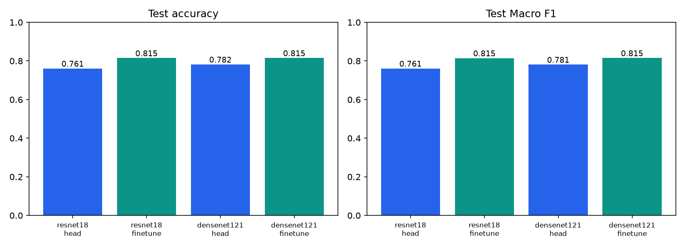

Train (s) chỉ là thời gian fit candidate được chọn hoặc fine-tune, chưa bao gồm feature extraction/search. `training_summary.json` của head_selected ghi riêng thời gian trích xuất và tổng search. Vì fine-tune tiếp tục từ head, chi phí toàn pipeline phải cộng các giai đoạn.

## 5. Phân tích và giới hạn
Kết quả chỉ đại diện cho seed và phạm vi dữ liệu đã ghi. Fine-tune có thêm epoch và được khởi tạo từ head đã học; chênh lệch phản ánh chiến lược hai giai đoạn, chưa cô lập tác động unfreeze ở cùng ngân sách tính toán.
Không mặc định pre-trained hoặc fine-tune phải tốt hơn. Tập nguồn ImageNet khác phân phối ảnh CIFAR-10 độ phân giải thấp. Phóng ảnh không bổ sung thông tin chi tiết mới.
Không so sánh trực tiếp với Lab1 vì FashionMNIST và CIFAR-10 là hai bài toán khác nhau. Cấu hình CPU 64×64 và GPU 224×224 cũng phải được báo cáo riêng; không suy diễn kết quả của cấu hình chưa chạy.

## 6. Bằng chứng và tái lập
`config.json`, `environment.json`, `source_hashes.json`, hai NPZ indices, `console.log`, `status.json` và SHA256 manifest ghi điều kiện chạy. Từng kiến trúc có architecture, parameters, preprocessing, search_results, selection, TensorBoard event và learning curves. Mỗi condition có best.pt, history, classification report, confusion counts, probabilities, ảnh đúng/sai và roundtrip.json.
Lưới ảnh chọn tối đa 8 đúng/8 sai để minh họa; xác suất softmax không bảo đảm dự đoán đúng. Số trong confusion matrix là count, màu chuẩn hóa theo lớp thật.

## 7. Khảo sát lỗi và hình bổ sung

### Dữ liệu RGB và phân bố lớp

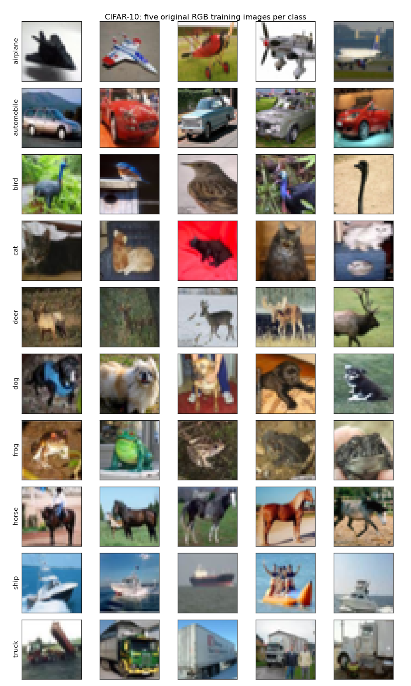

| Class | Train | Validation | Test |
|---|---:|---:|---:|
| airplane | 4500 | 500 | 1000 |
| automobile | 4500 | 500 | 1000 |
| bird | 4500 | 500 | 1000 |
| cat | 4500 | 500 | 1000 |
| deer | 4500 | 500 | 1000 |
| dog | 4500 | 500 | 1000 |
| frog | 4500 | 500 | 1000 |
| horse | 4500 | 500 | 1000 |
| ship | 4500 | 500 | 1000 |
| truck | 4500 | 500 | 1000 |

- resnet18/head_selected: cặp lỗi nhiều nhất dog → cat (147 ảnh trong tập test đã chọn).

**Ba lớp F1 thấp nhất — resnet18/head_selected:**

| Class | Precision | Recall | F1 |
|---|---:|---:|---:|
| cat | 0.6340 | 0.6460 | 0.6399 |
| bird | 0.7283 | 0.6700 | 0.6979 |
| deer | 0.6712 | 0.7410 | 0.7044 |

- resnet18/finetune: cặp lỗi nhiều nhất dog → cat (145 ảnh trong tập test đã chọn).

**Ba lớp F1 thấp nhất — resnet18/finetune:**

| Class | Precision | Recall | F1 |
|---|---:|---:|---:|
| cat | 0.6948 | 0.6990 | 0.6969 |
| dog | 0.7878 | 0.7350 | 0.7605 |
| bird | 0.7578 | 0.7760 | 0.7668 |

### resnet18

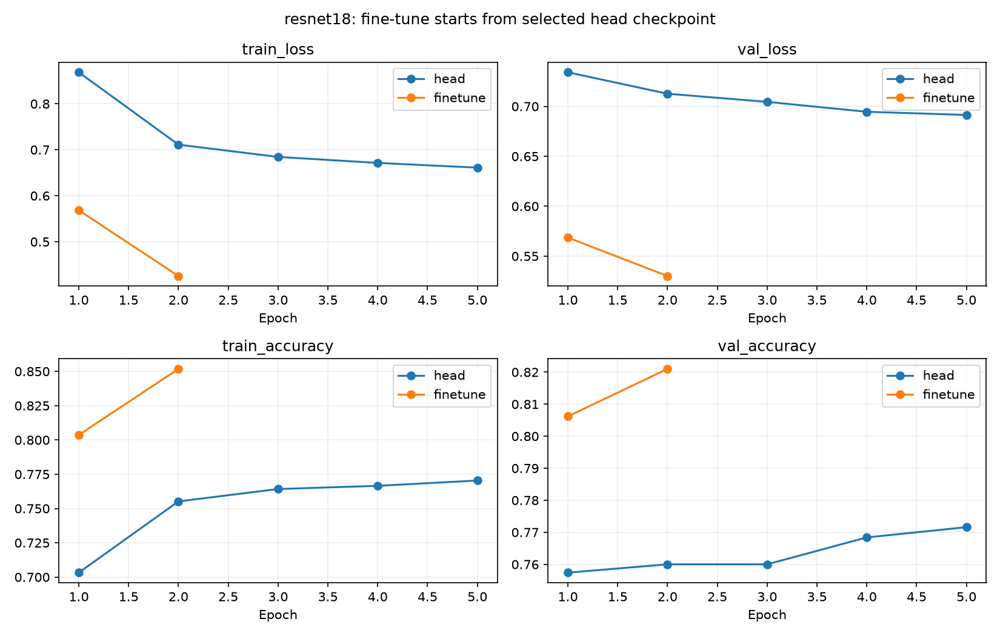

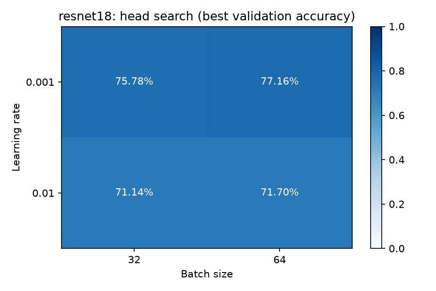

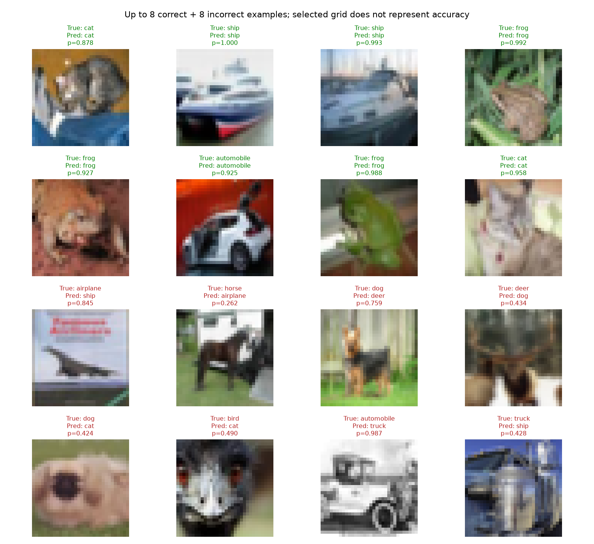

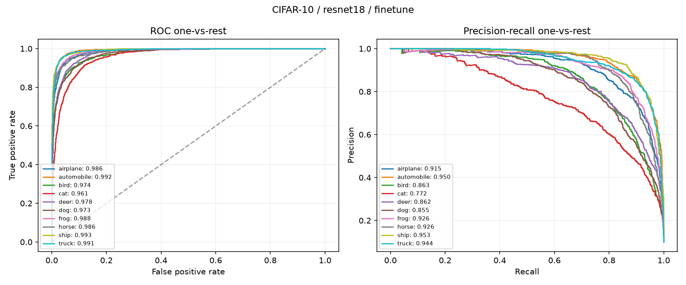

- densenet121/head_selected: cặp lỗi nhiều nhất dog → cat (196 ảnh trong tập test đã chọn).

**Ba lớp F1 thấp nhất — densenet121/head_selected:**

| Class | Precision | Recall | F1 |
|---|---:|---:|---:|
| cat | 0.6210 | 0.7030 | 0.6595 |
| deer | 0.7733 | 0.6720 | 0.7191 |
| dog | 0.8269 | 0.6450 | 0.7247 |

- densenet121/finetune: cặp lỗi nhiều nhất dog → cat (144 ảnh trong tập test đã chọn).

**Ba lớp F1 thấp nhất — densenet121/finetune:**

| Class | Precision | Recall | F1 |
|---|---:|---:|---:|
| cat | 0.6826 | 0.6990 | 0.6907 |
| dog | 0.7847 | 0.7510 | 0.7675 |
| bird | 0.7788 | 0.7570 | 0.7677 |

### densenet121

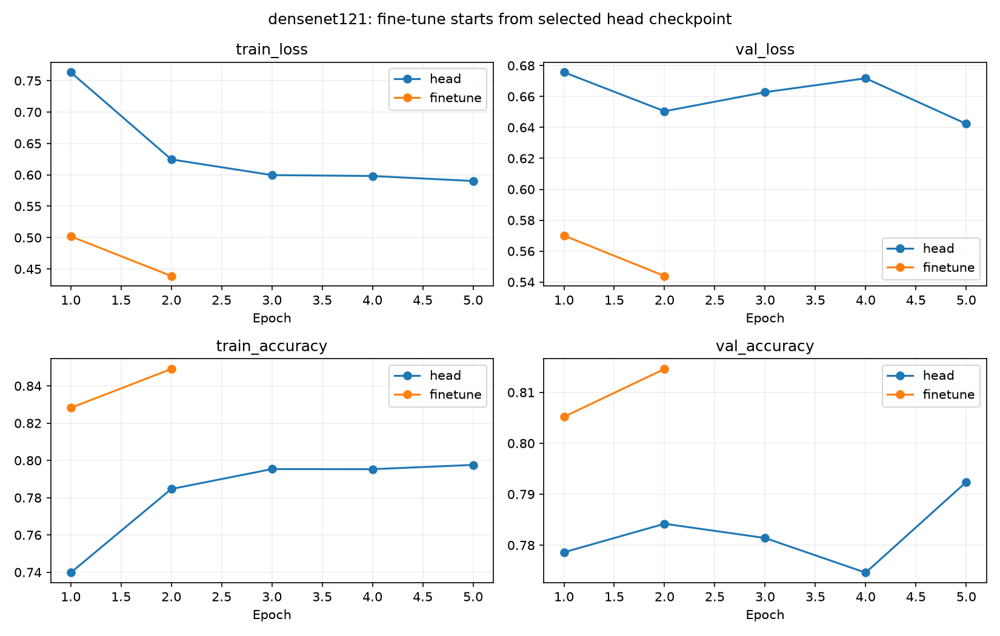

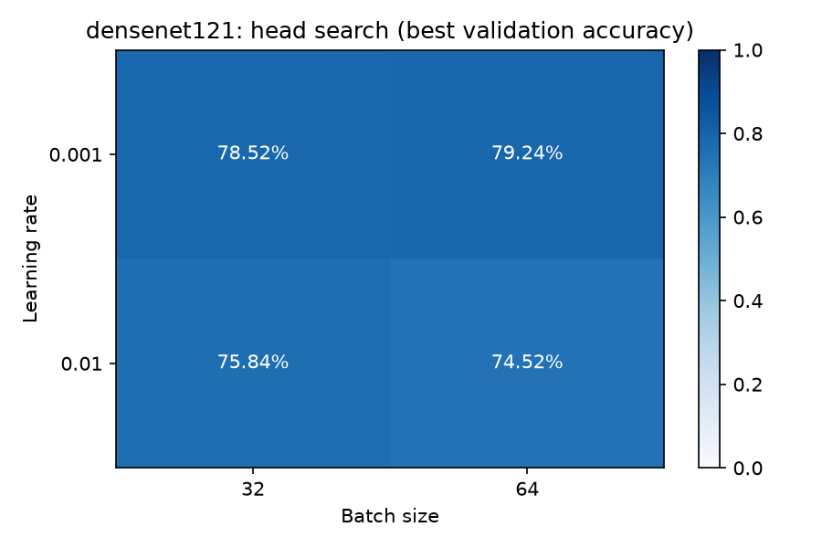

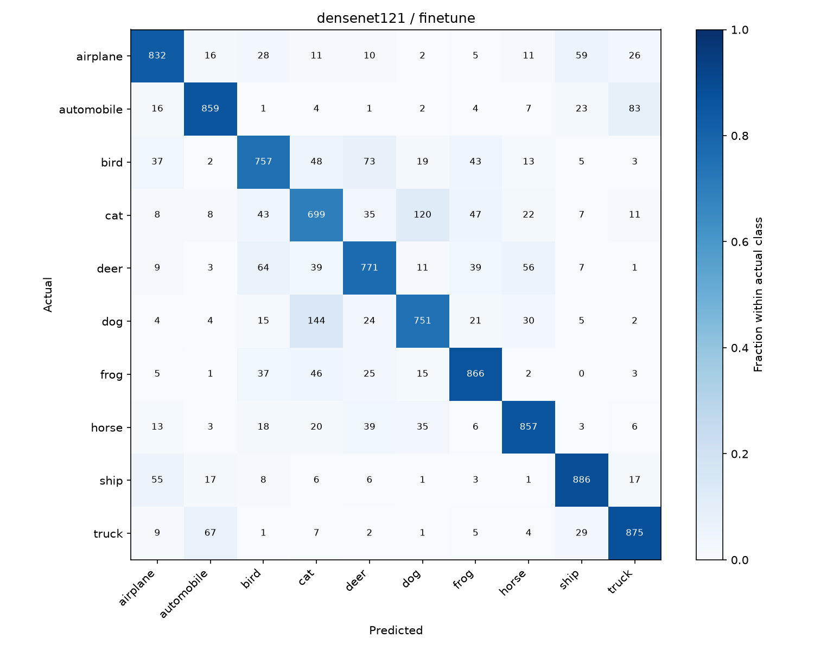

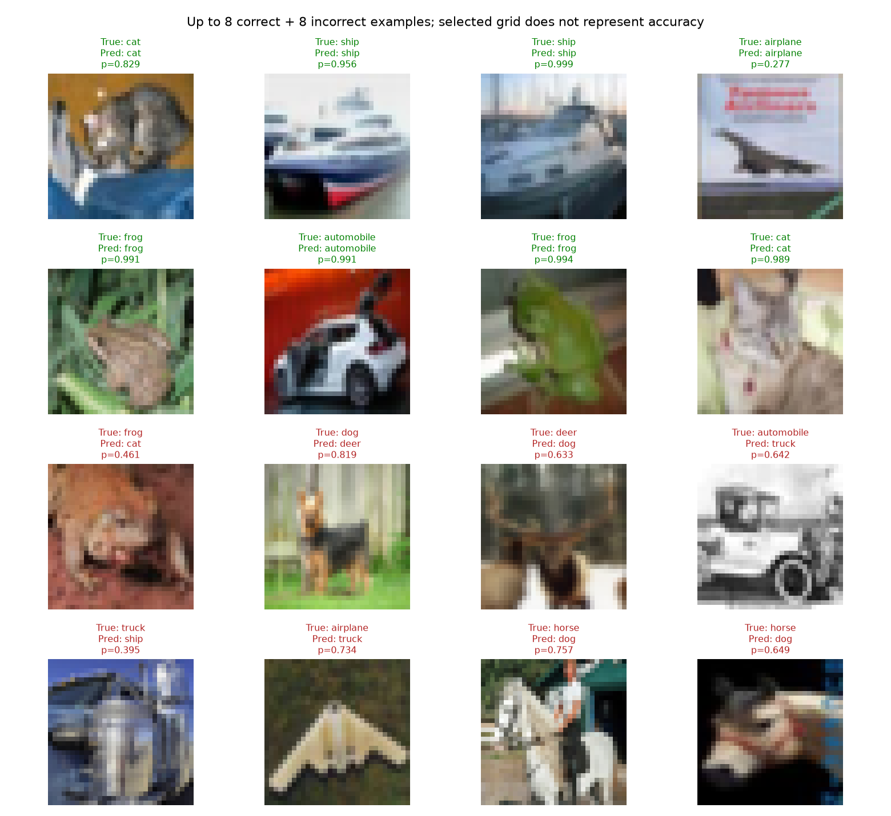

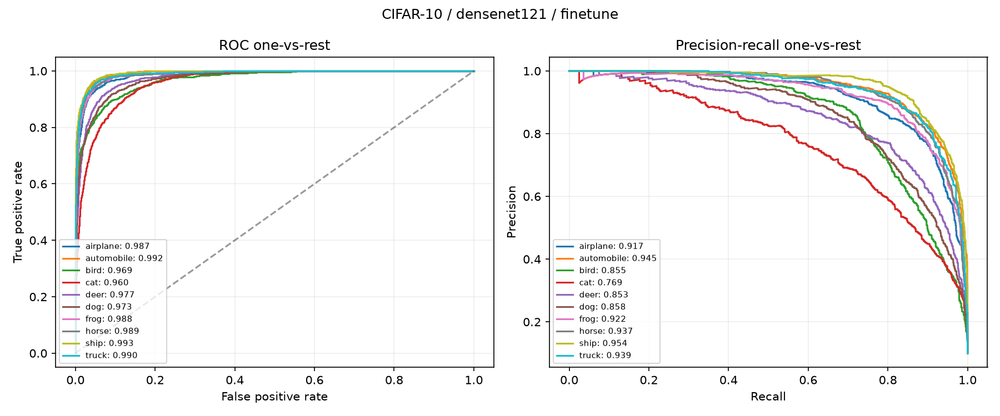

### TensorBoard và chi phí

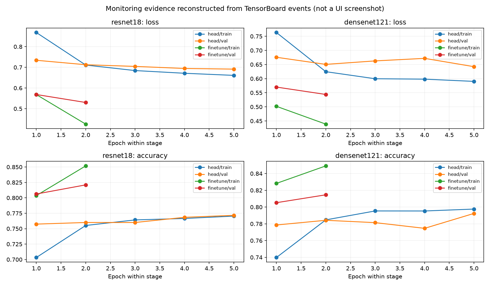

Hình này dựng từ TensorBoard events thật; không phải ảnh chụp giao diện. Mở TensorBoard theo README để xem tương tác.

Điều kiện được đề xuất bằng validation: **resnet18/finetune**, validation accuracy **82.10%**.

Chi phí pipeline gồm feature extraction, toàn bộ head search và fine-tune nếu có; chưa gồm EDA, ghi báo cáo và inference test. Xem cost_comparison.csv.

| Model | Stage | Feature extraction (s) | All head search (s) | Pipeline train (s) | Test (s) |
|---|---|---:|---:|---:|---:|
| resnet18 | head | 281.9 | 47.6 | 329.4 | 64.0 |
| resnet18 | finetune | 281.9 | 47.6 | 1414.1 | 62.8 |
| densenet121 | head | 478.1 | 43.4 | 521.5 | 100.4 |
| densenet121 | finetune | 478.1 | 43.4 | 741.2 | 92.4 |

### Cấu hình head được chọn bằng validation

| Model | LR | Batch | Best epoch | Validation accuracy |
|---|---:|---:|---:|---:|
| resnet18 | 0.001 | 64 | 5 | 77.16% |
| densenet121 | 0.001 | 64 | 5 | 79.24% |

densenet121 fine-tune sử dụng cache đầu ra của prefix đóng băng; đã kiểm chứng tương đương trên 8 ảnh thật, max logit error=0. Test vẫn forward toàn bộ model trên ảnh RGB. Kiểm thử riêng đối chiếu cả logits, gradients và schema checkpoint.

Chi phí giữa các kiến trúc chịu ảnh hưởng của cách thực thi: xem cột execution trong cost_comparison.csv. Trong run này, nếu một model dùng cache prefix còn model khác forward ảnh khi fine-tune, không dùng thời gian thô để kết luận riêng về tốc độ kiến trúc. Cache giữ nguyên bài toán tối ưu và số ảnh/epoch; mã hiện hành hỗ trợ cache prefix cho cả hai model ở profile CPU.

### Diễn giải chỉ số và thiết kế

Accuracy là số ảnh dự đoán đúng chia tổng số ảnh. Macro F1 tính F1 riêng cho từng lớp rồi lấy trung bình không trọng số; vì vậy mỗi lớp đóng góp ngang nhau. Macro Precision/Recall và cross-entropy test được lưu trong metrics.json. ROC-AUC và average precision tính one-vs-rest từng lớp, không phải cùng một đại lượng.

ResNet dùng residual connections để cộng tín hiệu qua các block; DenseNet nối các feature maps từ nhiều lớp trong dense block. Thực nghiệm thay head và giữ cấu trúc backbone gốc, không thiết kế lại CNN từ đầu.

CPU profile chỉ có 2 epoch fine-tune sau head search: kết quả chứng minh pipeline và hành vi ở ngân sách đã chọn, không chứng minh đã hội tụ hoặc đạt chất lượng tối ưu. Chưa chạy nhiều seed, augmentation ablation hay baseline khởi tạo ngẫu nhiên.

## 8. Kiểm chứng bài làm và sản phẩm bàn giao

Các kiểm tra sau đã được thực hiện, với kết quả lưu trong [verification.json](outputs/runs/20261024T075133Z_cifar10_cpu_full64_71863a0e/verification.json):

- 8 kiểm thử đạt, bao gồm split CIFAR-10, giữ màu RGB, tương đương feature cache, kiểm soát gradient, đóng/mở lớp, save/load và tương đương huấn luyện bằng cache prefix.
- Hai notebook được thực thi từ đầu và lưu output, không có cell báo lỗi: 5 code cell trong notebook EDA và 9 code cell trong notebook modeling.
- Accuracy và Macro F1 được tính lại từ xác suất dự đoán đã lưu; nhãn được đối chiếu với dữ liệu test chính thức.
- Tổng confusion matrix khớp số ảnh test; lựa chọn trial được đối chiếu với validation accuracy.
- Bốn điều kiện model/stage đều vượt kiểm tra save/load vào instance mới; CLI inference từ checkpoint cũng chạy thành công.
- Checksum bộ dữ liệu và pretrained weights được xác nhận; manifest ghi SHA256 các artifact. Sau khi chuyển dự án sang `lab2`, 212 artifact của run đã được kiểm tra giữ nguyên checksum.

Các file chính:

| Sản phẩm | Đường dẫn |
|---|---|
| EDA, tiền xử lý và kiến trúc | [Notebook 01](notebooks/01_cifar10_eda_architecture.ipynb) |
| Huấn luyện, TensorBoard và đánh giá | [Notebook modeling](notebooks/lab_02_transfer_learning.ipynb) |
| Bảng kết quả đầy đủ | [comparison.csv](outputs/runs/20261024T075133Z_cifar10_cpu_full64_71863a0e/comparison.csv) |
| Chi phí và cách thực thi | [cost_comparison.csv](outputs/runs/20261024T075133Z_cifar10_cpu_full64_71863a0e/cost_comparison.csv) |
| Cấu hình và môi trường | [config.json](outputs/runs/20261024T075133Z_cifar10_cpu_full64_71863a0e/config.json), [environment.json](outputs/runs/20261024T075133Z_cifar10_cpu_full64_71863a0e/environment.json) |
| Hướng dẫn chạy | [README.md](README.md) |
| Danh mục kết quả | [RESULTS.md](RESULTS.md) |

Các hình trong báo cáo liên kết tới thư mục run đi kèm. Khi sao chép báo cáo để nộp, cần giữ cấu trúc thư mục `outputs/runs/` hoặc xuất sang định dạng nhúng hình.

## 9. Kết luận

Bài thực hành đã thực hiện đầy đủ các bước tải mô hình pretrained, khảo sát kiến trúc, thay classifier, đóng băng lớp, fine-tune, điều chỉnh siêu tham số, theo dõi TensorBoard, đánh giá và lưu/tải mô hình trên CIFAR-10.

Trong ngân sách thí nghiệm này, fine-tune cải thiện test Accuracy của cả hai kiến trúc: ResNet18 tăng 5,40 điểm phần trăm và DenseNet121 tăng 3,32 điểm phần trăm so với head-only tương ứng. Đây là kết quả của chiến lược hai giai đoạn có thêm epoch, chưa phải phép cô lập tác động mở lớp ở cùng tổng ngân sách.

Nếu áp dụng tiêu chí lựa chọn đã định là validation Accuracy, điều kiện được chọn là **ResNet18 fine-tune**, đạt validation Accuracy **82,10%**, test Accuracy **81,49%** và Macro F1 **0,8146**. DenseNet121 fine-tune có test Accuracy **81,53%**, cao hơn 0,04 điểm phần trăm, tương đương 4 ảnh trên 10.000 ảnh test; chênh lệch nhỏ này không đủ để kết luận mô hình tốt hơn một cách ổn định qua các seed và không được dùng để thay đổi lựa chọn bằng validation.

Hướng mở rộng là lặp lại với nhiều seed, chạy cấu hình 224×224 trên GPU, khảo sát augmentation, tăng ngân sách fine-tune và bổ sung baseline khởi tạo ngẫu nhiên. Các thí nghiệm này chưa được thực hiện trong báo cáo hiện tại.

## 10. Tài liệu tham khảo
- [Torchvision models và weights](https://docs.pytorch.org/vision/main/models)
- [PyTorch transfer learning](https://docs.pytorch.org/tutorials/beginner/transfer_learning_tutorial)
- [TensorBoard với PyTorch](https://docs.pytorch.org/tutorials/intermediate/tensorboard_tutorial)

- [CIFAR-10 và CIFAR-100 — nguồn dữ liệu chính thức](https://cave.cs.toronto.edu/kriz/cifar.html)
