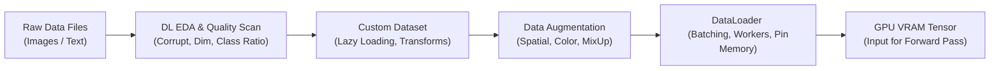

# Hướng Dẫn Chi Tiết: Dữ Liệu & Tăng Cường Dữ Liệu Trong Học Sâu (DL Data & Augmentation Guide)

## Sơ đồ Luồng Dữ Liệu trong Deep Learning (Data Pipeline)

---

# PHẦN 1: KHÁM PHÁ DỮ LIỆU CHUYÊN SÂU (DL-SPECIFIC EDA)

### Bước 1. Quét lỗi và Tính hợp lệ của Dữ liệu (Integrity Scan)
* **What:** Quét toàn bộ thư mục dữ liệu để tìm ra các file ảnh bị lỗi byte, bị cắt ngắn (truncated), hoặc file văn bản bị lỗi mã hóa (Encoding Error).
* **Why:** Chỉ cần một file ảnh bị lỗi lọt vào trong quá trình huấn luyện, `DataLoader` sẽ ném Exception và làm sập toàn bộ quá trình train sau nhiều giờ chạy.
* **How:** Duyệt đệ quy toàn bộ cây thư mục, mở từng file ảnh và gọi cơ chế kiểm tra tính toàn vẹn của thư viện đọc ảnh (ví dụ `PIL.Image.verify()`). Ghi lại danh sách các file lỗi kèm thông báo ngoại lệ, rồi quyết định xóa hoặc sửa thủ công trước khi đưa vào huấn luyện. Không bao giờ để khâu kiểm tra này chạy lẫn trong vòng lặp train.

### Bước 2. Phân tích Kích thước và Tỷ lệ Khung hình (Dimensions & Aspect Ratios)
* **What:** Đo đạc phân phối chiều cao (Height), chiều rộng (Width) và tỷ lệ $Aspect\ Ratio = \frac{Width}{Height}$.
* **Why:**
  * Nếu phần lớn ảnh là chữ nhật dài nhưng ta cưỡng ép Resize về hình vuông $224 \times 224$, vật thể sẽ bị biến dạng (méo mó), làm mất đặc trưng hình học.
  * Giúp đưa ra quyết định: Nên dùng `Resize` đơn thuần hay `Pad to Square` (chèn thêm viền đen/xám để giữ nguyên tỷ lệ trước khi resize).

### Bước 3. Tính toán Thống kê Điểm ảnh (Channel-Wise Mean & Std Calculation)
* **What:** Tính toán giá trị trung bình và độ lệch chuẩn của 3 kênh màu (R, G, B) trên toàn bộ tập huấn luyện:
  $$\mu_c = \frac{1}{N} \sum_{i=1}^N x_{i, c}, \quad \sigma_c = \sqrt{\frac{1}{N} \sum_{i=1}^N (x_{i, c} - \mu_c)^2}$$
* **Why:** Thay vì dùng mặc định giá trị ImageNet (`mean=[0.485, 0.456, 0.406]`, `std=[0.229, 0.224, 0.225]`), việc tính trực tiếp trên tập dữ liệu chuyên biệt (như ảnh y tế X-quang, ảnh vệ tinh, ảnh ban đêm) sẽ giúp mô hình hội tụ tốt hơn đáng kể.
* **How:** Duyệt qua toàn bộ tập train (chỉ tập train, tuyệt đối không dùng tập validation hay test để tránh rò rỉ dữ liệu), cộng dồn tổng và bình phương tổng của từng kênh, sau đó suy ra mean và std. Hai con số này phải được chốt cứng và dùng lại y nguyên cho cả ba tập.

---

# PHẦN 2: THIẾT KẾ DATASET PYTORCH CHUẨN KỸ THUẬT

### Nguyên tắc Vàng: Lazy Loading (Nạp lười biếng)
Tuyệt đối không lưu mảng ảnh thô vào RAM. Trong hàm khởi tạo `__init__()`, chỉ lưu danh sách đường dẫn file (`file_paths`) và nhãn tương ứng (`labels`). Việc đọc file từ ổ đĩa và chuyển thành Tensor chỉ được thực hiện trong hàm `__getitem__()`, tức là tại đúng thời điểm mẫu dữ liệu đó được lấy ra để đưa vào batch.

### Hợp đồng của một Custom Dataset Chuẩn
Một lớp Dataset kế thừa từ `torch.utils.data.Dataset` phải cài đặt đúng ba thành phần sau:

* **`__init__(self, image_paths, labels, transform=None)`:** Chỉ nhận và lưu lại danh sách đường dẫn ảnh, danh sách nhãn số nguyên tương ứng, và bộ biến đổi (transform). Không đọc nội dung ảnh ở bước này.
* **`__len__(self)`:** Trả về tổng số mẫu, chính là độ dài danh sách đường dẫn. `DataLoader` dùng giá trị này để biết phạm vi lấy mẫu.
* **`__getitem__(self, idx)`:** Thực hiện tuần tự ba việc: (1) mở ảnh từ đĩa tại chỉ số `idx` và chuyển về hệ màu RGB; (2) áp dụng `transform` nếu được truyền vào để tiền xử lý và tăng cường dữ liệu; (3) trả về cặp gồm Tensor ảnh và nhãn dưới dạng số nguyên `int64` (`torch.long`) để tương thích với hàm loss phân loại.

Lưu ý: nhãn phải được ép về kiểu `torch.long`, vì `CrossEntropyLoss` yêu cầu nhãn là số nguyên lớp, không phải số thực.

---

# PHẦN 3: CHIẾN LƯỢC TĂNG CƯỜNG DỮ LIỆU (DATA AUGMENTATION)

Augmentation trong Deep Learning được chia làm 3 cấp độ:

### Cấp độ 1: Phép biến đổi Hình học & Màu sắc Cơ bản (Spatial & Color)
* **Sử dụng `torchvision.transforms.v2`:** Đây là API hiện đại, thống nhất giữa ảnh và video, thay cho API `transforms` cũ.
* **Bộ Transform cho tập TRAIN:** Ghép nối các phép biến đổi ngẫu nhiên nhằm đa dạng hóa dữ liệu: cắt và resize ngẫu nhiên về kích thước mục tiêu với tỷ lệ vùng cắt từ 0.8 đến 1.0, lật ngang xác suất 0.5, xoay ngẫu nhiên trong khoảng 15 độ, và điều chỉnh nhẹ độ sáng, độ tương phản, độ bão hòa. Sau đó chuyển sang Tensor float32 trong khoảng [0.0, 1.0] và chuẩn hóa bằng mean/std đã tính ở Phần 1.
* **Bộ Transform cho tập VALIDATION & TEST:** Tuyệt đối KHÔNG ngẫu nhiên hóa. Chỉ resize về kích thước lớn hơn một chút (ví dụ 256) rồi CenterCrop về kích thước mô hình yêu cầu (ví dụ 224), sau đó chuyển Tensor và chuẩn hóa bằng đúng mean/std của tập train. Việc giữ tập đánh giá cố định là điều kiện để so sánh kết quả giữa các lần chạy.

### Cấp độ 2: Tăng cường Nâng cao (MixUp & CutMix)
* **MixUp:** Trộn 2 ảnh với hệ số $\lambda \sim \text{Beta}(\alpha, \alpha)$:
  $$\tilde{x} = \lambda x_i + (1 - \lambda) x_j, \quad \tilde{y} = \lambda y_i + (1 - \lambda) y_j$$
* **CutMix:** Cắt một vùng chữ nhật trên ảnh $A$ và đè lên ảnh $B$, nhãn mục tiêu được pha trộn theo tỷ lệ diện tích của vùng cắt.
* **Why:** Ép mạng nơ-ron không được phụ thuộc vào một vùng đặc trưng duy nhất, tăng khả năng chống chịu nhiễu (Robustness).
* **Cách dùng trong PyTorch:** `torchvision.transforms.v2` cung cấp sẵn hai lớp `CutMix` và `MixUp`. Hai phép này hoạt động ở cấp độ Mini-batch (trộn giữa các mẫu trong cùng một batch) chứ không phải cấp độ từng ảnh đơn lẻ. Vì vậy chúng được ghép vào một bộ chọn ngẫu nhiên (`RandomChoice`) và gọi sau khi batch đã được lấy ra, chứ không nhét vào `Compose` của Dataset. Khi dùng hai phép này, nhãn trở thành phân phối mềm nên hàm loss phải là loại hỗ trợ soft label.

---

# PHẦN 4: CẤU HÌNH DATALOADER TỐI ĐA HÓA THÔNG LƯỢNG (DATALOADER OPTIMIZATION)

Bộ nạp dữ liệu `DataLoader` là cầu nối giữa ổ đĩa và GPU. Cấu hình sai sẽ biến CPU thành "nút thắt cổ chai", khiến GPU phải ngồi chơi xơi nước.

| Tham số | Giá trị khuyến nghị | Mục đích kỹ thuật |
|---|---|---|
| `batch_size` | 16, 32, 64, 128 | Lựa chọn sao cho bộ nhớ VRAM sử dụng đạt khoảng $75 - 85\%$. |
| `shuffle` | `True` (Train), `False` (Val/Test) | Đảm bảo tính ngẫu nhiên của gradient giữa các epoch. |
| `num_workers` | 2 đến 4 (bằng số core CPU thực tế) | Cho phép nạp dữ liệu song song đa tiến trình trên CPU. |
| `pin_memory` | `True` (bắt buộc khi dùng GPU) | Khóa trang bộ nhớ RAM, giúp lệnh `.to('cuda', non_blocking=True)` chuyển dữ liệu sang GPU với băng thông DMA tối đa. |
| `drop_last` | `True` (Train) | Bỏ batch cuối cùng nếu số lượng mẫu lẻ để tránh lỗi `BatchNorm` khi batch size $= 1$. |

**Cách chẩn đoán nút thắt cổ chai:** Nếu GPU utilization thấp trong khi CPU chạy 100%, nút thắt nằm ở khâu nạp dữ liệu. Khi đó tăng `num_workers`, bật `pin_memory`, và cân nhắc dùng `persistent_workers=True` để không phải khởi tạo lại tiến trình worker mỗi epoch.

---

# PHẦN 5: XỬ LÝ MẤT CÂN BẰNG DỮ LIỆU BẰNG SAMPLER

Khi một lớp có 10.000 mẫu và một lớp chỉ có 200 mẫu, thay vì oversampling thủ công làm phình to ổ đĩa, ta sử dụng **`WeightedRandomSampler`** để lấy mẫu có trọng số nghịch đảo với tần suất xuất hiện.

**Quy trình ba bước:**

1. **Đếm số mẫu mỗi lớp** trên tập train (ví dụ bằng `numpy.bincount` trên mảng nhãn).
2. **Tính trọng số nghịch đảo:** trọng số của một lớp tỷ lệ nghịch với số mẫu của lớp đó. Lớp càng hiếm thì mỗi mẫu của nó càng có trọng số lớn.
3. **Gán trọng số cho từng mẫu cụ thể** theo nhãn của mẫu đó, rồi tạo `WeightedRandomSampler` với `num_samples` bằng tổng số mẫu train và `replacement=True` (cho phép lấy lặp lại mẫu thuộc lớp thiểu số).

**Lưu ý quan trọng:** Khi đã truyền `sampler` vào `DataLoader`, bắt buộc đặt `shuffle=False`, vì hai cơ chế này loại trừ lẫn nhau. Ngoài ra, phương pháp này chỉ áp dụng cho tập train; tập validation và test phải giữ nguyên phân phối thật để phản ánh đúng hiệu năng thực tế của mô hình.
