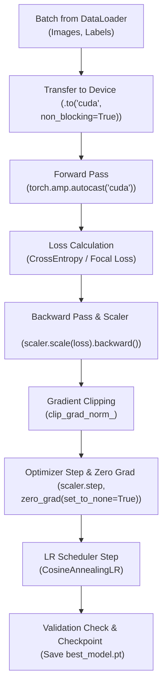

# Hướng Dẫn Chi Tiết: Huấn Luyện & Tối Ưu Hóa Mô Hình Học Sâu (DL Training & Optimization Guide)

## Sơ đồ Vòng Lặp Huấn Luyện (Training Loop Architecture)

---

# PHẦN 1: LỰA CHỌN BACKBONE & TRANSFER LEARNING

### 1. Tiêu chí chọn Backbone (Mô hình tiền huấn luyện)
* **Thư viện khuyến nghị:** Sử dụng thư viện `timm` (PyTorch Image Models) hoặc `torchvision.models` / `transformers`.
* **Bảng lựa chọn thực chiến:**
  * **Thiết bị yếu / GPU nhỏ / CPU:** `mobilenetv3_large_100`, `efficientnet_b0`.
  * **Độ chính xác cao / Cân bằng tốt:** `resnet50`, `convnext_tiny`, `efficientnet_b3`.
  * **SOTA nghiên cứu / Dataset lớn:** `vit_base_patch16_224`, `swin_base_patch4_window7_224`.

### 2. Quy trình Fine-Tuning 2 Giai đoạn chuẩn kỹ thuật
Fine-tuning một backbone tiền huấn luyện không nên mở khóa toàn bộ ngay từ đầu, vì gradient lớn ở những bước đầu sẽ phá hỏng đặc trưng quý giá đã học từ tập dữ liệu lớn. Quy trình chuẩn gồm hai giai đoạn:

* **Giai đoạn 1 — Đóng băng Backbone, chỉ train Classifier Head:** Đặt `requires_grad = False` cho toàn bộ tham số mô hình, sau đó bật lại `requires_grad = True` riêng cho tầng phân loại cuối (Classifier Head). Huấn luyện khoảng 3 đến 5 epoch với learning rate tương đối lớn (khoảng `1e-3`). Mục tiêu là để phần đầu phân loại mới "học nóng" và thích nghi với số lớp mới mà không làm xáo trộn backbone.
* **Giai đoạn 2 — Mở khóa toàn bộ và áp dụng Differential Learning Rate:** Bật lại `requires_grad = True` cho mọi tham số, rồi tạo optimizer với các nhóm tham số có learning rate khác nhau. Nguyên tắc là **backbone học chậm, head học nhanh**: các tầng càng gần đầu vào (đặc trưng tổng quát) dùng learning rate càng nhỏ (ví dụ `1e-5`), các tầng càng gần đầu ra (đặc trưng chuyên biệt) dùng learning rate lớn hơn (ví dụ `1e-4`). Cách phân nhóm này giúp giữ ổn định phần đặc trưng chung trong khi vẫn tinh chỉnh mạnh phần phân loại.

Với `AdamW`, nên đặt `weight_decay = 1e-2` cho toàn bộ nhóm tham số.

---

# PHẦN 2: HÀM MẤT MÁT (LOSS FUNCTIONS) CHUYÊN BIỆT

### 1. Cross-Entropy kết hợp Label Smoothing
* **Why:** Nhãn One-Hot cứng nhắc ($[1, 0, 0]$) ép mạng neural tự tin thái quá, dẫn đến Overfitting.
* **How:** Dùng `nn.CrossEntropyLoss` với tham số `label_smoothing=0.1`. Mục tiêu được làm mềm thành $[0.933, 0.033, 0.033]$, giúp mô hình có khả năng tổng quát hóa tốt hơn. Đây là thay đổi một dòng nhưng thường mang lại cải thiện rõ rệt mà không tốn thêm chi phí tính toán.

### 2. Focal Loss (Vũ khí chống mất cân bằng nhãn trầm trọng)
* **Công thức:**
  $$FL(p_t) = -\alpha_t (1 - p_t)^\gamma \log(p_t)$$
  Với $\gamma$ là tham số tập trung (thường $= 2.0$), làm suy giảm trọng số của các mẫu dễ học ($p_t \to 1$), tập trung gradient vào các ca khó học.
* **Ý tưởng triển khai:** Focal Loss là một lớp kế thừa từ `nn.Module`. Trong hàm `forward`, trước tiên tính Cross-Entropy ở chế độ `reduction='none'` để giữ lại giá trị loss của từng mẫu riêng lẻ (không lấy trung bình ngay). Từ đó suy ra xác suất của nhãn đúng $p_t$ bằng cách lấy `exp` của âm giá trị CE. Nhân thêm hệ số điều tiết $(1 - p_t)^\gamma$ vào từng mẫu để giảm trọng số các mẫu đã dự đoán đúng dễ dàng. Cuối cùng nhân với trọng số lớp $\alpha$ (nếu có, dùng để xử lý mất cân bằng) và lấy trung bình hoặc tổng theo cấu hình `reduction`.

---

# PHẦN 3: OPTIMIZER & LEARNING RATE SCHEDULER

### 1. AdamW (Decoupled Weight Decay)
* Luôn sử dụng **`torch.optim.AdamW`** thay vì `Adam` thông thường, với `weight_decay=1e-2`. Điểm khác biệt cốt lõi là AdamW tách rời việc suy giảm trọng số ra khỏi phép cập nhật gradient (decoupled), nhờ đó regularization hoạt động đúng như thiết kế và mô hình tổng quát hóa ổn định hơn.

### 2. Cosine Annealing với Warmup
* **Why:** Trong những bước đầu tiên, trọng số đang lộn xộn, nếu đặt LR lớn sẽ làm hỏng đặc trưng pre-trained. Warmup giúp tăng dần LR từ 0 lên giá trị tối đa, sau đó Cosine hạ dần êm dịu về 0.
* **Cách cấu hình:** Dùng `OneCycleLR` để có sẵn cả Warmup và Cosine Decay trong một lần gọi. Ba tham số cần chốt là: `max_lr` (đỉnh learning rate, ví dụ `1e-3`), `steps_per_epoch` (bằng số batch của tập train, để scheduler cập nhật theo từng bước chứ không theo epoch), và `pct_start=0.1` (dành 10% số bước đầu tiên cho giai đoạn Warmup). Nếu cần dao động chu kỳ nhiều lần, có thể dùng `CosineAnnealingWarmRestarts`.

---

# PHẦN 4: VÒNG LẶP HUẤN LUYỆN CHUẨN DOANH NGHIỆP (THE CANONICAL TRAINING LOOP)

Một vòng lặp huấn luyện hiện đại cần hội đủ các kỹ thuật: **Automatic Mixed Precision (AMP)**, **Gradient Clipping**, **Zero Grad set to None**, và **Tracking Metrics**. Trình tự thực hiện trong mỗi batch như sau:

1. **Chuyển dữ liệu lên GPU với `non_blocking=True`** để tận dụng đường truyền bất đồng bộ khi `pin_memory` đã bật.
2. **Xóa đạo hàm cũ bằng `optimizer.zero_grad(set_to_none=True)`** thay vì gán về 0. Đặt về `None` giúp giải phóng bộ nhớ và tránh một lượt ghi thừa, tăng tốc nhẹ nhưng đáng kể khi chạy nhiều bước.
3. **Forward Pass trong `torch.amp.autocast`** với `dtype=torch.float16`. Các phép toán được tự động chọn độ chính xác phù hợp, giảm VRAM và tăng tốc trên GPU có Tensor Core.
4. **Scale loss rồi backward:** gọi `scaler.scale(loss).backward()` để phóng đại gradient trước khi lan truyền ngược, tránh hiện tượng gradient underflow khi dùng FP16.
5. **Cắt tỉa đạo hàm chống bùng nổ:** phải gọi `scaler.unscale_(optimizer)` TRƯỚC khi `clip_grad_norm_`, vì gradient hiện đang ở thang phóng đại; nếu clip trên thang đó thì ngưỡng sẽ sai. Ngưỡng khuyến nghị `max_norm=1.0`.
6. **Cập nhật trọng số và điều chỉnh tỷ lệ:** `scaler.step(optimizer)` sau đó `scaler.update()` để tự động điều chỉnh hệ số scale cho bước kế tiếp.
7. **Cập nhật Learning Rate theo từng bước** bằng `scheduler.step()` (đặt sau optimizer step, bên trong vòng lặp batch khi dùng `OneCycleLR`).
8. **Thống kê kết quả:** cộng dồn loss nhân với kích thước batch và đếm số dự đoán đúng để tính loss trung bình và accuracy cho cả epoch.

**Cạm bẫy thường gặp:** quên `unscale_` trước khi clip (bước 5), hoặc gọi `scheduler.step()` theo epoch trong khi scheduler được thiết kế theo bước (bước 7). Cả hai đều khiến kết quả huấn luyện âm thầm sai lệch mà không báo lỗi.

---

# PHẦN 5: ĐÁNH GIÁ, EARLY STOPPING & QUẢN LÝ CHECKPOINT

### Vòng lặp Validation chuẩn xác
* Đặt mô hình ở chế độ `eval()` để vô hiệu hóa Dropout và cố định BatchNorm.
* Bao toàn bộ phần tính toán trong `torch.inference_mode()` — tối ưu hơn `torch.no_grad()` vì tắt hẳn cơ chế autograd và giảm overhead bộ nhớ.
* Vẫn dùng `torch.amp.autocast` cho forward pass để tiết kiệm VRAM, nhưng KHÔNG tính backward và KHÔNG cập nhật tham số.
* Cộng dồn loss và số dự đoán đúng theo cùng cách với tập train, rồi trả về loss trung bình và accuracy của cả epoch.

### Bộ điều khiển Early Stopping & Lưu Checkpoint
Để tránh overfitting và tiết kiệm GPU quota, cần một bộ quản lý checkpoint tự động. Thành phần này hoạt động như sau:

* **Cấu hình:** nhận vào đường dẫn file lưu (`filepath`), số epoch kiên nhẫn (`patience`, ví dụ 5), và chiều đánh giá (`mode` là `min` nếu metric càng nhỏ càng tốt như loss, hoặc `max` nếu càng lớn càng tốt như accuracy).
* **Trạng thái nội bộ:** lưu điểm số tốt nhất (`best_score`) khởi tạo là vô cùng (dương hoặc âm tùy mode) và bộ đếm số lần không cải thiện (`patience_counter`).
* **Hàm `step` (gọi sau mỗi epoch):** so sánh điểm hiện tại với điểm tốt nhất.
  * Nếu có cải thiện: cập nhật `best_score`, reset bộ đếm về 0, và lưu checkpoint đầy đủ gồm số epoch, trạng thái tham số mô hình, điểm tốt nhất, và trạng thái optimizer (để có thể resume chính xác).
  * Nếu không cải thiện: tăng bộ đếm lên 1. Khi bộ đếm đạt ngưỡng `patience`, trả về tín hiệu dừng để vòng lặp huấn luyện ngoài thoát ra sớm.

**Nguyên tắc quan trọng:** chỉ lưu checkpoint khi metric cải thiện (không lưu mỗi epoch để tránh đầy ổ đĩa), và luôn lưu kèm trạng thái optimizer cùng số epoch để lần chạy sau có thể phục hồi đúng tiến độ thay vì train lại từ đầu.
