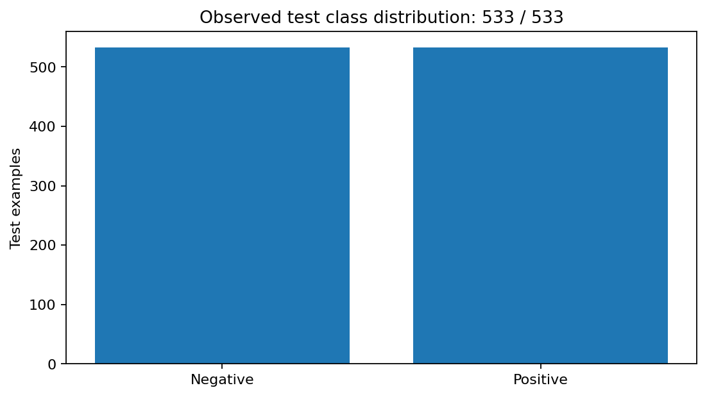
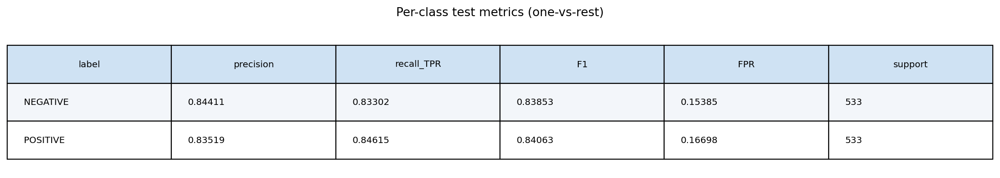
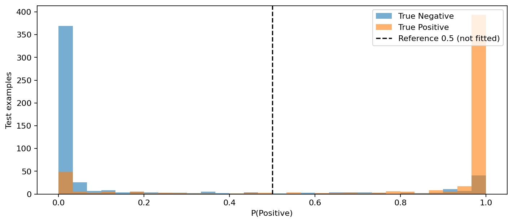
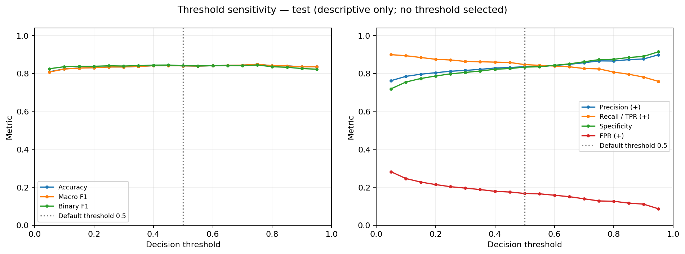
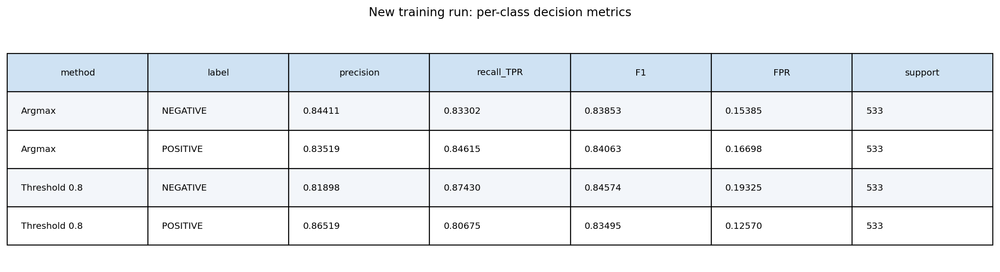
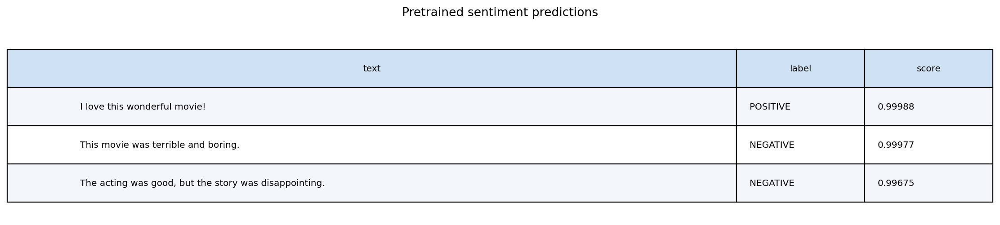
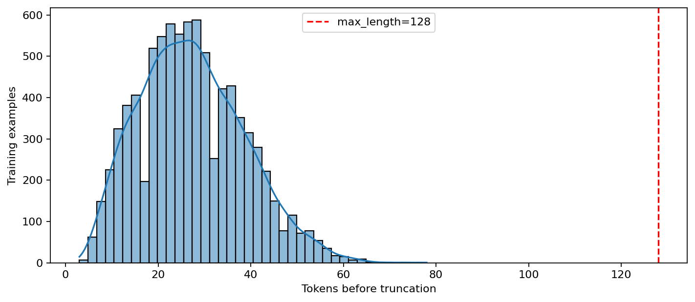

# Lab03 — Kết quả thực nghiệm

| Policy | Accuracy | Precision | Recall | Binary F1 | Macro F1 | Test loss |
|---|---:|---:|---:|---:|---:|---:|
| Argmax | 83.9587% | 83.5185% | 84.6154% | 84.0634% | 83.9580% | 0.544268 |
| Validation threshold 0.8 | 84.0525% | 86.5191% | 80.6754% | 83.4951% | 84.0343% | 0.544268 |

## Nguồn thí nghiệm

- exercise1: `20261026T155744Z_exercise1_65dfe784`
- exercise1_analysis: `20261026T155746Z_exercise1_analysis_205bf966`
- finetuning: `20261026T155822Z_finetuning_2c2f0401`
- analysis: `20261026T160023Z_analysis_163a53b0`
- evaluation: `20261026T160058Z_evaluation_07c24854`
- inference: `20261026T160111Z_inference_7f2b16f0`
- notebook_render: `20261026T160130Z_notebook_render_f8e70da2`

## Hình thực nghiệm

### analysis/calibration_curve.png

### analysis/class_distribution.png

### analysis/metric_comparison.png

### analysis/per_class_metrics.png

### analysis/probability_distribution.png

### analysis/review_length_distribution.png

### analysis/roc_pr_curves.png

### analysis/threshold_test_diagnostic/threshold_curves.png

### analysis/training_threshold_confusion.png

### analysis/training_threshold_metrics.png

### analysis/training_threshold_per_class.png

### evaluation/confusion_matrix.png

### evaluation/metrics_bar.png

### evaluation/sample_predictions.png

### evaluation/test_threshold/confusion_matrix.png

### exercise1_analysis/pipeline_manual_comparison.png

### exercise1_analysis/sentiment_predictions.png

### exercise1_analysis/tokenizer_table.png

### finetuning/confusion_matrix.png

### finetuning/learning_curves.png

### finetuning/metrics_bar.png

### finetuning/sample_predictions.png

### finetuning/test_threshold/confusion_matrix.png

### finetuning/token_length_distribution.png

### finetuning/validation_threshold/threshold_curves.png

### inference/inference.png

