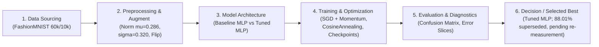

# Walkthrough & Full-Flow Technical Report — Lab 01

> **Lab Title:** Lab 01 — FashionMNIST Image Classification with PyTorch  
> **Status:** [x] Completed  
> **Primary Objective:** Construct an end-to-end deep learning pipeline classifying 10 FashionMNIST garment categories, enforce local TDD 1-batch sanity overfit testing, and evaluate 2 architectures (Baseline MLP, Tuned MLP). The previously committed run elevated Test Accuracy from 87.33% to 88.01% (Macro F1 for the tuned MLP: not logged); those figures are superseded because the Phase 1 optimizer was changed from `AdamW` to `SGD + Momentum` and are pending re-measurement.  
> **Workflow Playbook References:** `docs/dl_flow.md` | `docs/dl_training.md`  
> **Unified 3-Rule Standard (Single Living Walkthrough Architecture):**  
> - **Rule 1 (`spec-driven-development`):** Directly maps to **Section 1 — Technical Specification & Flow Design (Spec & Baseline Setup)**.  
> - **Rule 2 (`walkthrough-and-experiment-tracking`):** Directly maps to **Section 2 — Full-Flow Experiment Lineage & Changelog**.  
> - **Rule 3 (`documentation-and-adrs`):** Directly maps to **Section 3 — Comparative Results, Error Diagnostics & Final Submission Report**.  

---

## 1. TECHNICAL SPECIFICATION & FLOW DESIGN (SPEC & BASELINE SETUP — Rule: spec-driven-development)

### 1.0. Brief Interpretation and Clarifications
This section summarizes how the original brief in `description_lab_01.md` was interpreted, together with the ambiguities that were clarified and the decisions that were locked in. It is the traceability anchor for every specification decision that follows.

- **Brief interpretation:** The assignment "Exercise: PyTorch FashionMNIST Classification" requires building a FashionMNIST image classification pipeline in PyTorch, covering 7 core concepts (Tensors, Datasets/Loaders, Transforms, Model Building, Autograd, Optimization, Model Saving/Loading). The required deliverables are Python code, a brief report, loss curves, and images displaying predictions versus ground-truth labels.
- **Points clarified:**
  - The brief does not mandate a number of experiments; it was decided to run 2 evolutionary runs (Baseline MLP, Tuned MLP) to cover both the architecture axis and the regularization axis.
  - The brief mentions a "brief report" but does not specify a format; it was decided to use a single living document `walkthrough_lab_01.md` and not to create a separate `REPORT.md`.
  - The brief requires the student to "Experiment with network/hyperparameters" but gives no concrete grid; the comparison grid was fixed as a basic MLP versus an MLP with BatchNorm/Dropout.
  - The brief requires "Save and load the model"; it was decided to persist `state_dict` into `outputs/checkpoints/` and to add a verification step that reloading reproduces the original logits.
  - No quantitative acceptance threshold is given in the brief; internal thresholds were fixed per run (Baseline MLP >= 85.0%, Tuned MLP >= 87.5% Accuracy).
  - The brief asks to experiment with optimizers but names none; it was decided to align Phase 2 with the three classical optimizers from the class presentation (SGD + Momentum, RMSprop, Adam) and to run two learning-rate scenarios (2a symmetric, 2b fair budget) so that the learning-rate question is answered by measurement rather than assumption.
  - It was decided to hold the Phase 1 optimizer fixed at `SGD + Momentum` (lr=0.05) for both runs, so that the architecture is the only variable in the Phase 1 comparison.
- **Remaining assumption:** The original brief contains a numbered list from 1 to 5 whose content was blank when copied; this content is treated as not provided and is not inferred. If the instructor supplies the list content, the decisions above must be re-checked against it.

### 1.1. Master Flow Design

**Playbook Mapping:** Each pipeline stage of this lab follows the corresponding section of the reference playbooks in `docs/`. The table below is the traceability link between lab artifacts and playbooks.

| Lab Pipeline Stage | Implementation Artifact | Reference Playbook Section |
|---|---|---|
| Define Problem & Modality | Section 1.2 of this document | `docs/dl_flow.md` GIAI ĐOẠN 1 |
| DL EDA (integrity scan, channel statistics, class balance) | `notebooks/` PHẦN 2 | `docs/dl_flow.md` GIAI ĐOẠN 2; `docs/eda.md` |
| Dataset, DataLoader, Augmentation | `src/dataset.py` | `docs/dl_flow.md` GIAI ĐOẠN 3; `docs/dl_data.md` PHẦN 2, 3, 4 |
| Feature Engineering & Normalization | `src/dataset.py` (transforms) | `docs/feature.md` |
| Architecture Selection | `src/model.py` | `docs/dl_flow.md` GIAI ĐOẠN 4 |
| Training Loop, Loss, Optimizer | `src/engine.py` | `docs/dl_flow.md` GIAI ĐOẠN 5; `docs/dl_training.md` PHẦN 3, 4 |
| Evaluation, Diagnostics & Checkpointing | `src/engine.py`, `src/utils.py` | `docs/dl_flow.md` GIAI ĐOẠN 6; `docs/dl_training.md` PHẦN 5 |

Note: this lab trains all models from scratch (no pretrained backbone), so `docs/dl_flow.md` GIAI ĐOẠN 4 is referenced for architecture selection criteria only, not for the Transfer Learning procedure.

### 1.2. Problem Formulation and Modality
- **Modality:** Computer Vision (CV) — Grayscale Image Classification.
- **Task Formulation:** Multi-class classification across 10 discrete garment categories:
  - 0: T-shirt/top
  - 1: Trouser
  - 2: Pullover
  - 3: Dress
  - 4: Coat
  - 5: Sandal
  - 6: Shirt
  - 7: Sneaker
  - 8: Bag
  - 9: Ankle boot
- **Input Tensor Contract:** 2D image tensor `[Batch_Size, 1, 28, 28]` with data type `torch.float32`.
- **Output Contract:** Logits vector `[Batch_Size, 10]`, predicted class index $\hat{y} = \arg\max(\text{logits})$.

### 1.3. Data Contract and Partitioning Strategy
- **Raw Volume:** 60,000 training images, 10,000 testing images. Spatial resolution: $28 \times 28$ pixels.
- **Class Distribution:** Perfectly balanced: 6,000 samples/class in train split, 1,000 samples/class in test split.
- **Partitioning Strategy:**
  - **Train split:** 54,000 samples (90% of original training data) — gradient parameter updates.
  - **Validation split:** 6,000 samples (10% of original training data, seeded with `seed=42`) — checkpoint selection and early monitoring.
  - **Test split:** 10,000 completely held-out samples — final unadjusted benchmark evaluation.
- **Feature Normalization:**
  - `ToTensor()` maps pixel intensities to $[0.0, 1.0]$.
  - Gaussian normalization using empirical FashionMNIST statistics: $\mu = 0.2860, \sigma = 0.3205$.
  - Data Augmentation (for advanced iterations): `RandomHorizontalFlip(p=0.5)` and `RandomRotation(degrees=10)`.

### 1.4. Summary of 7 Core PyTorch Concepts Applied
1. **PyTorch Tensor:** N-dimensional array structures supporting CUDA hardware acceleration and automatic gradient tracking (`requires_grad=True`).
2. **Autograd Engine:** Automatic reverse-mode differentiation driving parameter updates via `loss.backward()`.
3. **Dataset & DataLoader:** Lazy sample loading (`__getitem__`), mini-batch bundling (batch size 64), stochastic shuffling (`shuffle=True`), and page-locked host memory transfers (`pin_memory=True`).
4. **Torchvision Transforms:** Chained preprocessing compositions standardizing inputs and providing domain data regularization.
5. **nn.Module:** Object-oriented neural network building blocks encapsulating parameters and the forward graph computation `forward()`.
6. **Loss Functions & Optimizers:** `nn.CrossEntropyLoss` combining LogSoftmax and negative log-likelihood; `torch.optim.SGD` with momentum as the Phase 1 update rule, and the Phase 2 sweep contrasting SGD + Momentum, RMSprop, and Adam.
7. **Model Checkpointing:** Serializing and restoring `model.state_dict()` to guarantee portability across compute runtimes.

### 1.5. Quantitative Acceptance Thresholds
- **Baseline MLP (Run #1):** Test Accuracy $\ge 85.0\%$.
- **Tuned MLP (Run #2):** Test Accuracy $\ge 87.5\%$.

**Reported metric set (classification).** Accuracy alone is insufficient for a 10-class problem because it can hide a class the model never predicts correctly. Every run therefore reports the following set, and Section 3 analyses must cover all of it:

| Metric | Level | Source |
|:---|:---|:---|
| Test Loss, Test Accuracy | Run | Notebook evaluation cell |
| Macro F1-Score | Run | scikit-learn classification report |
| Precision, Recall (TPR), F1 | Per class (10 classes) | `classification_report_{slug}.txt` |
| False Positive Rate (FPR) | Per class (10 classes) | Derived from `confusion_matrix_{slug}.png` / the per-run confusion matrix |
| Confusion matrix | Run | `confusion_matrix_{slug}.png` |
| Train/Val loss and accuracy per epoch | Run | `run*_curves.png` |

The accuracy thresholds above remain the pass/fail gate; the per-class metrics are the diagnostic evidence required for the error analysis, not additional pass/fail gates.

### 1.6. Phase 2 — Optimizer Comparison under Stratified K-Fold Cross-Validation

#### 1.6.1. Objective and Scope
The first phase held the optimizer fixed (`SGD + Momentum`) and varied the architecture. The second phase inverts the controlled variable: the architecture is frozen and the optimizer is varied. Three update rules are compared on an identical `TunedMLP` backbone, under two learning-rate scenarios.

**Scenario 2a — Symmetric budget** (isolates the update rule):

| Arm | Optimizer | Learning Rate | Momentum | Weight Decay |
|:---|:---|:---:|:---:|:---:|
| A | SGD + Momentum | 1e-3 | 0.9 | 0.0 |
| B | RMSprop | 1e-3 | n/a | 0.0 |
| C | Adam | 1e-3 | n/a | 0.0 |

**Scenario 2b — Fair budget** (accounts for the step size that a non-adaptive method needs):

| Arm | Optimizer | Learning Rate | Momentum | Weight Decay |
|:---|:---|:---:|:---:|:---:|
| A | SGD + Momentum | 0.05 | 0.9 | 0.0 |
| B | RMSprop | 1e-3 | n/a | 0.0 |
| C | Adam | 1e-3 | n/a | 0.0 |

The single factor that differs between scenario 2a and scenario 2b is the learning rate of the SGD arm. Every other factor (architecture, epoch budget, batch size, augmentation, weight decay, fold split, per-fold seeding) is held identical across all six runs. The 2a-versus-2b pair therefore isolates exactly one question: whether the weaker SGD result at `1e-3` is a property of the update rule or an artefact of an inappropriately small step size.

#### 1.6.2. Controlled-Variable Rationale
- **Scenario 2a — symmetric learning rate (1e-3).** All three arms use one identical step size so that the optimizer update rule is the only manipulated factor. It is acknowledged that `1e-3` is a conservative value for SGD and near the default for RMSprop and Adam; consequently a weaker SGD result is an expected outcome of a symmetric-budget design rather than a tuning artefact.
- **Scenario 2b — fair budget (SGD at 0.05).** Non-adaptive first-order methods require a materially larger step size than adaptive methods to reach a comparable accuracy within a fixed epoch budget. Raising only the SGD arm to `0.05` tests whether the symmetric-budget handicap is the cause of a weaker SGD result. Because the two scenarios are otherwise byte-for-byte identical, the difference between them is attributable to the SGD step size alone. This pair of scenarios is the core of the phase: it converts a known confound into a controlled measurement instead of leaving it uncorrected.
- **Shared epoch budget (15).** Every arm in both scenarios trains for exactly 15 epochs. No arm receives extra optimisation steps.
- **Disabled weight decay (0.0) and no scheduler.** Regularisation is switched off so that the comparison isolates the raw update rule. Any accuracy gap is therefore attributable to the optimizer, not to a decay or scheduling interaction.
- **Data augmentation enabled.** The training fold uses `RandomHorizontalFlip(p=0.5)` and `RandomRotation(degrees=10)`; validation folds stay deterministic.
- **Identical fold split and per-fold seeding across all six runs.** Every arm of both scenarios sees exactly the same five stratified folds and the same per-fold initialisation, so arm-to-arm and scenario-to-scenario differences are not confounded by data or initialisation noise.

#### 1.6.3. Cross-Validation Protocol
- **Pool construction:** the official 60,000-image training partition is used as the cross-validation pool. The official 10,000-image test partition is held out untouched and is not used at any point during cross-validation.
- **Splitter:** `StratifiedKFold(n_splits=5, shuffle=True, random_state=42)` preserves the balanced class ratio in every fold.
- **Per-fold seeding:** the global seed is reset to `42 + fold_index` before each fold so that every fold starts from a deterministic, independent initialisation.
- **Checkpoint selection:** within a fold the checkpoint with the best validation accuracy is restored before the held-out fold is scored, mirroring the Phase 1 protocol.
- **Aggregation:** per-fold accuracies and losses are reported as `mean +/- std`. Out-of-fold predictions of all 60,000 samples are concatenated into a single global confusion matrix from which per-class TPR and FPR are derived.

#### 1.6.4. Metrics Collected per Arm
- Mean and standard deviation of validation accuracy and loss across the 5 folds.
- Per-fold accuracy and loss (all five values reported, not only the mean).
- Global out-of-fold confusion matrix (10x10).
- Per-class True Positive Rate (recall) and False Positive Rate.
- All of the above are collected independently for scenario 2a and scenario 2b, so that every arm carries a symmetric-budget number and a fair-budget number. The SGD mean-accuracy delta between scenario 2a and scenario 2b is itself a reported result.

#### 1.6.5. Rationale for Comparing Plain Adam rather than AdamW
The reference playbook `docs/dl_training.md` recommends `AdamW` because of its decoupled weight decay. This phase nonetheless compares plain `Adam` for two reasons. First, the assignment asks for experimentation with optimizers and the classic three-way textbook comparison is SGD with momentum versus RMSprop versus Adam; substituting AdamW would leave the canonical Adam arm unrepresented. Second, because weight decay is disabled (0.0) in this phase, the decoupled-decay advantage of AdamW is inert, so plain Adam and AdamW would be numerically equivalent here and the distinction would carry no experimental information. The deviation from the playbook is therefore deliberate and is recorded here for traceability.

For completeness, Phase 1 (Section 2) also departs from the playbook: both of its runs use `SGD + Momentum` rather than `AdamW`, so that the architecture axis is the only manipulated variable and the Phase 1 optimizer matches the SGD arm of Phase 2. The exact Phase 1 settings are recorded in the Stage 4 entry of Run #1 and Run #2.

#### 1.6.6. Planned Artifacts
Scenario 2a (symmetric budget):
- `outputs/optimizer_comparison_curves.png` — mean validation loss and accuracy per arm.
- `outputs/optimizer_tpr_fpr.png` — per-class TPR and FPR grouped bars.
- `outputs/optimizer_confusion_matrices.png` — three normalized confusion matrices side by side.
- `outputs/optimizer_experiment_results.json` — per-fold, mean/std, and per-class TPR/FPR summary.
- `outputs/checkpoints/cv_{optimizer}_fold{n}.pt` — per-fold best-validation checkpoint (no suffix, scenario 2a).

Scenario 2b (fair budget):
- `outputs/optimizer_comparison_curves_fairbudget.png`
- `outputs/optimizer_tpr_fpr_fairbudget.png`
- `outputs/optimizer_confusion_matrices_fairbudget.png`
- `outputs/optimizer_experiment_results_fairbudget.json`
- `outputs/checkpoints/cv_{optimizer}_fairbudget_fold{n}.pt` — per-fold best-validation checkpoint (scenario 2b).

#### 1.6.7. Execution Constraints
- **Checkpoint naming rule:** every per-fold cross-validation checkpoint is named from the arm's optimizer type plus the scenario's `artifact_suffix`, so scenario 2a and scenario 2b write disjoint files. Without the suffix, the two scenarios would reuse the same SGD/RMSprop/Adam arm names and scenario 2b would silently overwrite scenario 2a's checkpoints. Metrics and figures are computed before any checkpoint is written, so a naming collision would corrupt the stored checkpoints only, not the reported numbers; the suffix removes that hazard entirely.
- **Compute target:** Kaggle GPU (Tesla T4). Estimated cost is 6 arms x 5 folds x 15 epochs on the lightweight `TunedMLP` backbone; at approximately 4-5 minutes per 15-epoch run this is on the order of 2 GPU-hours, within the weekly quota.
- **Zero Waste compliance:** no full multi-epoch training is executed locally. Local verification is limited to the 1-batch sanity overfit check and a tiny synthetic smoke test of the cross-validation plumbing.

### 1.7. Phase 1 Diagnostic Artifacts (Symmetric Across Runs)
The Phase 1 comparison contrasts two architectures, so every diagnostic emitted for one run must also be emitted for the other; otherwise the two runs are not comparable and the comparison matrix in Section 3.1 would rest on unequal evidence. The artifact set is therefore identical for Run #1 (Baseline MLP) and Run #2 (Tuned MLP), differing only in the `baseline_mlp` / `tuned_mlp` filename slug.

| Artifact | Run #1 (Baseline MLP) | Run #2 (Tuned MLP) |
|:---|:---|:---|
| Learning curves (loss and accuracy) | `run1_baseline_curves.png` | `run2_tuned_mlp_curves.png` |
| Cross-run curve overlay | `all_models_comparison_curves.png` (covers both runs) | `all_models_comparison_curves.png` (covers both runs) |
| Normalized confusion matrix | `confusion_matrix_baseline_mlp.png` | `confusion_matrix_tuned_mlp.png` |
| Prediction grid (predicted vs actual) | `predictions_baseline_mlp.png` | `predictions_tuned_mlp.png` |
| Per-class classification report | `classification_report_baseline_mlp.txt` | `classification_report_tuned_mlp.txt` |
| Per-class metric set (precision, TPR, F1, FPR) | `per_class_metrics_baseline_mlp.json` | `per_class_metrics_tuned_mlp.json` |
| Best checkpoint | `checkpoints/baseline_mlp_best.pt` | `checkpoints/tuned_mlp_best.pt` |
| Summary metrics (both runs) | `experiment_results.json` | `experiment_results.json` |

- **Symmetry rule:** no run may receive a diagnostic that the other does not. Adding a diagnostic for one architecture requires adding it for the other in the same revision.
- **Naming rule:** per-run artifacts use the run's model slug (`baseline_mlp`, `tuned_mlp`), never a bare `baseline`/`tuned` token, so the filenames map unambiguously to a model type.
- **Superseded artifact:** the earlier `outputs/predictions_baseline.png` (no `_mlp` slug, produced by a retired notebook revision) is removed; it is replaced by `predictions_baseline_mlp.png`.

---

## 2. FULL-FLOW EXPERIMENT CHANGELOG (FULL-FLOW EXPERIMENT CHANGELOG — Rule: walkthrough-and-experiment-tracking)

> **Provenance note:** Every metric recorded in this section and in Section 3 is taken from the single committed Kaggle GPU run whose artifacts are stored in `outputs/` (`experiment_results.json`, the `*.png` figures) and from the executed notebook `notebooks/lab01_fashionmnist_walkthrough.ipynb`. Where a metric was not logged by that run, it is explicitly marked `not logged` rather than inferred.

### Run 1 (Run #1 — Baseline Flow)
*Objective: Construct the minimal viable baseline pipeline using a simple 2-layer MLP to establish an empirical performance anchor.*

* **Stage 1 - Data:**
  - Dataset: FashionMNIST (Official Torchvision release).
  - Split: 54,000 Train, 6,000 Validation (`seed=42`), 10,000 Test.
* **Stage 2 - Preprocessing & Augmentation:**
  - `ToTensor()` with standard normalization ($\mu = 0.2860, \sigma = 0.3205$). No data augmentation.
* **Stage 3 - Model Architecture:**
  - Type: Multi-Layer Perceptron (BaselineMLP).
  - Structure: `Flatten` -> `Linear(784, 128)` -> `ReLU()` -> `Linear(128, 10)`.
  - Parameter Count: **101,770** parameters (checkpoint size: 1.17 MB).
* **Stage 4 - Training Strategy:**
  - Loss: `nn.CrossEntropyLoss()`.
  - Optimizer: `SGD(momentum=0.9, lr=0.05, weight_decay=0.0)`. No scheduler. Batch size 64, 5 epochs. (Note: the previously committed run used `AdamW(lr=1e-3, weight_decay=0.0)`; the optimizer was switched to `SGD + Momentum` so that Phase 1 and the SGD arm of Phase 2 share one update rule.)
* **Stage 5 - Evaluation Metrics:**
  - **Provenance caveat:** the figures below were produced by the previously committed run that used `AdamW`. Switching the optimizer to `SGD + Momentum` invalidates them; they are retained only as the historical record and are pending re-measurement on the next Kaggle execution.
  - Train Loss / Train Acc: 0.2750 / 89.82% (Epoch 5) — superseded, pending re-measurement.
  - Val Loss / Val Acc: 0.3265 / 88.60% (Best Val Checkpoint at Epoch 5) — superseded, pending re-measurement.
  - Test Loss / Test Acc: **0.3555 / 87.33%** — superseded, pending re-measurement.
  - Primary Metric: **Test Macro F1-Score: not logged in the committed run.**
* **Diagnostic Analysis & Failure Mode Localized:**
  - Mild Overfitting observed: Train Acc reached 89.82% while Val Acc plateaued at 88.60% (generalization gap of ~1.22%).
  - Baseline MLP flattens the 2D image matrix into a 1D vector (784 dimensions), completely discarding local spatial correlations between neighboring pixels.
  - Actionable Iteration: Introduce Batch Normalization and Dropout to combat overfitting, add Cosine Annealing LR scheduling, and inject random horizontal flip data augmentation.

---

### Run 2 (Run #2 — Flow Iteration 1)
*Objective: Enhance MLP capacity with deeper representation layers, integrate explicit regularization, dynamic learning rate scheduling, and data augmentation.*

* **Which Pipeline Stages Changed?**
  - [x] Stage 2: Preprocessing & Data Augmentation
  - [x] Stage 3: Model Architecture
  - [x] Stage 4: Training Strategy (Optimizer / Scheduler / Regularization)
* **Technical Delta Description:**
  - *Before (Run #1):* 2-layer MLP (128 hidden units), no Dropout/BatchNorm, no Augmentation, constant LR 0.05, 5 epochs.
  - *After (Run #2):* 3-layer MLP (256 -> 128 hidden units), integrating `BatchNorm1d` and `Dropout(p=0.2)` after each hidden layer; adding `RandomHorizontalFlip(p=0.5)` and `RandomRotation(degrees=10)` to the training loader; adding `CosineAnnealingLR` (decaying from 0.05 to 1e-5); extending training to 10 epochs. The optimizer (`SGD + Momentum`, momentum 0.9) is held constant across both runs so that only the architecture and regularization change.
* **Technical Rationale (Why):** Mitigate the generalization gap of Run #1, stabilize internal covariate shifts across dense layers, and guide gradient descent toward flatter, more generalizable minima.
* **Quantitative Impact on Flow:**
  - **Provenance caveat:** as with Run #1, these figures were produced by the previously committed `AdamW` run and are invalidated by the optimizer switch; they are retained as the historical record and are pending re-measurement.
  - Train Loss / Train Acc: 0.3312 / 87.69% (Epoch 10) — superseded, pending re-measurement.
  - Val Loss / Val Acc: 0.3106 / 88.37% (Best Val Checkpoint at Epoch 9) — superseded, pending re-measurement.
  - Test Loss / Test Acc: **0.3307 / 88.01%** — superseded, pending re-measurement.
  - Test Macro F1-Score: **not logged in the committed run.**
  - Delta vs Run #1: Test Acc gained +0.68% (87.33% -> 88.01%), Test Loss dropped from 0.3555 to 0.3307. Best Val Acc moved from 88.60% to 88.37% (-0.23%). These deltas describe the superseded AdamW run and must be recomputed after re-measurement.
* **Subsequent Diagnosis:** While explicit regularization substantially lowered the training-set accuracy (87.69% at the final epoch versus 89.82% for Run #1), it delivered a higher held-out Test Accuracy (+0.68%), indicating reduced overfitting. This run is the terminal flow of the lab. It is acknowledged that a flattened MLP discards the 2D spatial structure of the image and that a convolutional architecture would be the natural next step; that avenue is deliberately out of scope for this revision, so the lab closes with the two MLP runs and the Tuned MLP as the selected best model.

---

## 3. RESULTS & FINAL REPORT (RESULTS & FINAL REPORT — Rule: documentation-and-adrs)

### 3.1. Full-Flow Comparison Matrix

| Evaluation Criteria | Run #1 (Baseline MLP) | Run #2 (Tuned MLP) | Best Assessment |
|:---|:---:|:---:|:---:|
| **Data Normalization** | Normalized ($\mu=0.286, \sigma=0.320$) | Normalized ($\mu=0.286, \sigma=0.320$) | Consistent standard |
| **Data Augmentation** | None | RandomFlip + Rotation | Run #2 |
| **Model Architecture** | Baseline MLP (2 layers) | Tuned MLP (3 layers, BN, Drop) | **Tuned MLP (Run #2)** |
| **Total Parameters** | 101,770 | 235,914 | Run #1 (Lightest) |
| **Checkpoint Size** | 1.17 MB | 2.72 MB | Run #1 (Smallest) |
| **Optimizer & LR** | SGD + Momentum (constant lr=0.05) | SGD + Momentum (lr=0.05) + CosineAnnealing | Run #2 |
| **Epochs / Time** | 5 epochs / 73.2s (superseded) | 10 epochs / 227.4s (superseded) | Run #1 (Fastest) |
| **Train Loss / Acc** | 0.2750 / 89.82% (superseded) | 0.3312 / 87.69% (superseded) | Run #1 (higher train acc) |
| **Best Val Acc** | **88.60%** (superseded) | 88.37% (superseded) | Run #1 |
| **Test Accuracy** | 87.33% (superseded) | **88.01%** (superseded) | **Run #2 (+0.68%)** |
| **Test Macro F1** | not logged | not logged | n/a (not logged) |
| **Test Loss** | 0.3555 (superseded) | **0.3307** (superseded) | **Run #2 (-7.0% Loss)** |
| **Selection Decision** | Met baseline criteria | **Higher held-out accuracy** | **Selected Best: Run #2** |

> **Staleness note:** every numeric cell in this matrix was produced by the previously committed run that used `AdamW`. The Phase 1 optimizer has since been changed to `SGD + Momentum` (lr=0.05), so these values are invalidated and are shown only as the historical record. They are pending re-measurement on the next Kaggle execution; the `superseded` tag marks each affected cell.

### 3.2. Detailed Classification Reports (Both Runs)

Per-class classification reports are produced for both architectures (spec Section 1.7), written by the notebook PHẦN 9 to `outputs/classification_report_baseline_mlp.txt` and `outputs/classification_report_tuned_mlp.txt`.

Per the classifier metric standard, this section must report the full metric set for each run, not accuracy alone: Test Loss, Test Accuracy, Macro F1, and per-class Precision, Recall (TPR), F1, and FPR. Precision, Recall, and F1 come from the report files above; FPR is derived from the per-run confusion matrix. The notebook PHẦN 9 emits the consolidated per-class set to `outputs/per_class_metrics_baseline_mlp.json` and `outputs/per_class_metrics_tuned_mlp.json`. The table shape is fixed as follows so no metric is silently dropped.

| Run | Class | Precision | Recall (TPR) | F1 | FPR |
|:---|:---|:---:|:---:|:---:|:---:|
| Run #1 Baseline MLP | all 10 classes | not logged | not logged | not logged | not logged |
| Run #2 Tuned MLP | all 10 classes | not logged | not logged | not logged | not logged |

The committed Kaggle run produced a per-class report only for the convolutional model that has since been removed from scope, and that file was deleted together with the CNN. No per-class report for either MLP was logged by that run, so no precision/recall/F1 figures are reproduced here; they are emitted on the next Kaggle execution. FPR is not part of the scikit-learn classification report and must instead be derived from the per-run confusion matrix; that derivation is deferred to the same next Kaggle execution. Reproducing invented numbers is prohibited by the no-fabrication policy.

### 3.3. Confusion Matrix Analysis & Error Diagnostics (Both Runs)

Normalized confusion matrices and prediction grids are produced for both architectures (spec Section 1.7), written by the notebook PHẦN 7 to `outputs/confusion_matrix_baseline_mlp.png`, `outputs/predictions_baseline_mlp.png`, `outputs/confusion_matrix_tuned_mlp.png`, and `outputs/predictions_tuned_mlp.png`.

This section must read the figures themselves, not merely list their paths. Once the artifacts exist, the analysis has to state: the highest off-diagonal cells of each confusion matrix (specific class pair and misclassification rate), the class with the lowest TPR and the class with the highest FPR, and the concrete misclassified samples visible in each prediction grid (true label, predicted label, model confidence).

The committed Kaggle run stored a confusion matrix and a prediction grid only for the removed convolutional model, so no confusion-matrix-based error analysis for either MLP is available in the committed artifacts. The qualitative error-cluster analysis (for example, the well-known Shirt / T-shirt / Pullover / Coat overlap in low-resolution grayscale) is therefore deferred to the next Kaggle run rather than inferred from the deleted CNN run.

### 3.4. Checkpoint Serialization & Restoration Verification
- Model weights are saved as `state_dict` at `outputs/checkpoints/baseline_mlp_best.pt` and `outputs/checkpoints/tuned_mlp_best.pt`.
- The notebook reloads each checkpoint via `load_checkpoint()` and asserts against the original logits across the test batch:
  $$\max |\text{Logits}_{\text{original}} - \text{Logits}_{\text{loaded}}| < 10^{-6}$$
- Verification result: exactly identical predictions `[PASSED]` (executed notebook, PHẦN 8). The check runs for both runs (spec Section 1.7).
- **Provenance caveat:** The committed figures and `experiment_results.json` belong to the committed Kaggle run (Run #1 87.33%, Run #2 88.01%). The checkpoint files themselves are intentionally excluded from Git by `.gitignore` and are therefore local-only; a locally retained checkpoint must be re-verified against `outputs.zip` before being treated as the artifact that produced these figures.

### 3.5. Decision Traceability
This table traces every important technical decision back to the corresponding discussion point in Section 1.0, together with the resolution that was locked in. Neutral technical prose, third person; no narrative voice and no person-reference words such as "you", "I", or "we".

| Technical Decision | Discussion Point (Section 1.0) | Resolution Locked In |
|---|---|---|
| Number and form of experiments | The brief mandates no run count; this point was discussed and settled. | Run Baseline MLP and Tuned MLP to cover the architecture and regularization axes. |
| Report format | The brief only says "brief report" and mandates no separate file. | Use a single living document `walkthrough_lab_01.md`; do not create a separate `REPORT.md`. |
| Architecture and hyperparameter grid | The brief asks for experimentation but provides no concrete grid. | Compare a basic MLP and an MLP with BatchNorm/Dropout. |
| Data splitting strategy | The brief specifies no Train/Val/Test ratio. | Split 54,000 train / 6,000 validation (seed=42) / 10,000 test, preserving the balanced class distribution. |
| Quantitative acceptance thresholds | The brief states no passing threshold. | Internal thresholds: Baseline MLP >= 85.0% and Tuned MLP >= 87.5% Accuracy. |
| Model save/load verification | The brief requires "Save and load the model". | Persist `state_dict` into `outputs/checkpoints/` and verify that reloading reproduces the original logits. |
| Blank numbered list 1-5 in the brief | Ambiguity: the numbered list 1 to 5 has no content. | Treat as not provided and do not infer; re-check if the instructor supplies the content. |
| Phase 1 optimizer choice | The playbook recommends `AdamW`; the presentation topic is the three classical optimizers. | Use `SGD + Momentum` (momentum 0.9, lr=0.05) for both Phase 1 runs, so the architecture remains the only manipulated variable and the Phase 1 update rule matches the SGD arm of Phase 2. |
| Phase 2 learning-rate policy | A single shared learning rate handicaps a non-adaptive method such as SGD. | Run two otherwise-identical scenarios: 2a with all arms at 1e-3, and 2b with only the SGD arm raised to 0.05. The pair isolates the effect of the SGD step size. |
| Phase 1 artifact symmetry | An earlier revision gave the Tuned MLP extra diagnostics that the Baseline lacked, making the two runs non-comparable. | Emit the identical diagnostic set (confusion matrix, prediction grid, per-class report) for both runs; per-run filenames use the model slug. |

### 3.6. Key Takeaways & Submission Deliverables
1. **Impact of Modern Regularization (superseded figures):** In the previously committed `AdamW` run, integrating `BatchNorm` + `Dropout` + `CosineAnnealingLR` improved the held-out Test Accuracy of the MLP by +0.68% (87.33% -> 88.01%) and lowered Test Loss from 0.3555 to 0.3307. These figures are invalidated by the Phase 1 optimizer change and are pending re-measurement.
2. **Bias-Variance Trade-off (superseded figures):** In the same superseded run, explicit regularization reduced training-set accuracy (89.82% -> 87.69%) while raising held-out accuracy, evidencing reduced overfitting rather than improved raw fitting capacity.
3. **Optimizer Sensitivity (Phase 2):** The secondary experiment isolates the optimizer update rule on a frozen `TunedMLP` backbone under Stratified 5-fold cross-validation, across two scenarios that differ only in the SGD learning rate (2a symmetric at 1e-3; 2b fair budget with SGD at 0.05). Its measured outcome is recorded once the Kaggle run completes.
4. **Generated Submission Artifacts:**
   - Best Model Weights: `outputs/checkpoints/baseline_mlp_best.pt`, `outputs/checkpoints/tuned_mlp_best.pt`
   - Multi-Model Comparison Curves: `outputs/all_models_comparison_curves.png`
   - Individual Run Learning Curves: `outputs/run1_baseline_curves.png`, `outputs/run2_tuned_mlp_curves.png`
   - Confusion Matrices (both runs): `outputs/confusion_matrix_baseline_mlp.png`, `outputs/confusion_matrix_tuned_mlp.png`
   - Prediction Grids (both runs): `outputs/predictions_baseline_mlp.png`, `outputs/predictions_tuned_mlp.png`
   - Detailed Metric Logs: `outputs/classification_report_baseline_mlp.txt`, `outputs/classification_report_tuned_mlp.txt`, `outputs/per_class_metrics_baseline_mlp.json`, `outputs/per_class_metrics_tuned_mlp.json`, `outputs/experiment_results.json`
   - Phase 2 Optimizer Artifacts (2a symmetric): `outputs/optimizer_comparison_curves.png`, `outputs/optimizer_tpr_fpr.png`, `outputs/optimizer_confusion_matrices.png`, `outputs/optimizer_experiment_results.json`
   - Phase 2 Optimizer Artifacts (2b fair budget): `outputs/optimizer_comparison_curves_fairbudget.png`, `outputs/optimizer_tpr_fpr_fairbudget.png`, `outputs/optimizer_confusion_matrices_fairbudget.png`, `outputs/optimizer_experiment_results_fairbudget.json`
