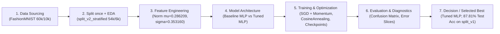

# Walkthrough & Full-Flow Technical Report — Lab 01

> **Lab Title:** Lab 01 — FashionMNIST Image Classification with PyTorch  
> **Status:** [x] Completed  
> **Primary Objective:** Construct an end-to-end deep learning pipeline classifying 10 FashionMNIST garment categories, enforce local TDD 1-batch sanity overfit testing, and evaluate 2 architectures (Baseline MLP, Tuned MLP). The committed Kaggle GPU run raised Test Accuracy from 85.14% to 87.81% and Macro F1 from 84.93% to 87.71% when BatchNorm, Dropout, and CosineAnnealingLR were added to a deeper MLP.  
> **Workflow Playbook References:** `docs/dl_flow.md` | `docs/dl_training.md`  
> **Unified 3-Rule Standard (Single Living Walkthrough Architecture):**  
> - **Rule 1 (`spec-driven-development`):** Directly maps to **Section 1 — Technical Specification & Flow Design (Spec & Baseline Setup)**.  
> - **Rule 2 (`walkthrough-and-experiment-tracking`):** Directly maps to **Section 2 — Full-Flow Experiment Lineage & Changelog**.  
> - **Rule 3 (`documentation-and-adrs`):** Directly maps to **Section 3 — Comparative Results, Error Diagnostics & Final Submission Report**.  

---

## 1. TECHNICAL SPECIFICATION & FLOW DESIGN (SPEC & BASELINE SETUP — Rule: spec-driven-development)

### 1.0. Brief Interpretation and Clarifications
This section summarizes how the original brief in `description_lab_01.md` was interpreted, together with the ambiguities that were clarified and the decisions that were locked in. It is the traceability anchor for every specification decision that follows.

- **Brief interpretation:** The assignment "Exercise: PyTorch FashionMNIST Classification" requires building a FashionMNIST image classification pipeline in PyTorch, covering 7 core concepts (Tensors, Datasets/Loaders, Transforms, Model Building, Autograd, Optimization, Model Saving/Loading). The required deliverables are Python code, a brief report, loss curves, and images displaying predictions versus ground-truth labels.
- **Points clarified:**
  - The brief does not mandate a number of experiments; it was decided to run 2 evolutionary runs (Baseline MLP, Tuned MLP) to cover both the architecture axis and the regularization axis.
  - The brief mentions a "brief report" but does not specify a format; it was decided to use a single living document `walkthrough_lab_01.md` and not to create a separate `REPORT.md`.
  - The brief requires the student to "Experiment with network/hyperparameters" but gives no concrete grid; the comparison grid was fixed as a basic MLP versus an MLP with BatchNorm/Dropout.
  - The brief requires "Save and load the model"; it was decided to persist `state_dict` into `outputs/checkpoints/` and to add a verification step that reloading reproduces the original logits.
  - No quantitative acceptance threshold is given in the brief; internal thresholds were fixed per run (Baseline MLP >= 85.0%, Tuned MLP >= 87.5% Accuracy).
  - The brief asks to experiment with optimizers but names none; it was decided to align Phase 2 with the three classical optimizers from the class presentation (SGD + Momentum, RMSprop, Adam) and to run two learning-rate scenarios (2a symmetric, 2b fair budget) so that the learning-rate question is answered by measurement rather than assumption.
  - It was decided to hold the Phase 1 optimizer fixed at `SGD + Momentum` (lr=0.05) for both runs, so that the architecture is the only variable in the Phase 1 comparison.
- **Remaining assumption:** The original brief contains a numbered list from 1 to 5 whose content was blank when copied; this content is treated as not provided and is not inferred. If the instructor supplies the list content, the decisions above must be re-checked against it.

### 1.1. Master Flow Design

**Playbook Mapping:** Each pipeline stage of this lab follows the corresponding section of the reference playbooks in `docs/`. The table below is the traceability link between lab artifacts and playbooks.

| Lab Pipeline Stage | Implementation Artifact | Reference Playbook Section |
|---|---|---|
| Define Problem & Modality | Section 1.2 of this document | `docs/dl_flow.md` GIAI ĐOẠN 1 |
| Split once + DL EDA (integrity scan, class balance, pixel statistics, spatial, similarity) | `notebooks/lab01_eda.ipynb`, `src/eda.py`, `src/split.py` | `docs/dl_flow.md` GIAI ĐOẠN 2; `docs/eda.md`; `docs/eda-image.md` |
| Dataset, DataLoader, Augmentation | `src/dataset.py` | `docs/dl_flow.md` GIAI ĐOẠN 3; `docs/dl_data.md` PHẦN 2, 3, 4 |
| Feature Engineering & Normalization | `notebooks/lab01_feature_engineering.ipynb`, `src/dataset.py` (transforms), `src/config.py` | `docs/feature.md`; `docs/feature-image.md` |
| Architecture Selection | `src/model.py` | `docs/dl_flow.md` GIAI ĐOẠN 4 |
| Training Loop, Loss, Optimizer | `src/engine.py` | `docs/dl_flow.md` GIAI ĐOẠN 5; `docs/dl_training.md` PHẦN 3, 4 |
| Evaluation, Diagnostics & Checkpointing | `src/engine.py`, `src/utils.py` | `docs/dl_flow.md` GIAI ĐOẠN 6; `docs/dl_training.md` PHẦN 5 |

Note: this lab trains all models from scratch (no pretrained backbone), so `docs/dl_flow.md` GIAI ĐOẠN 4 is referenced for architecture selection criteria only, not for the Transfer Learning procedure.

### 1.2. Problem Formulation and Modality
- **Modality:** Computer Vision (CV) — Grayscale Image Classification.
- **Task Formulation:** Multi-class classification across 10 discrete garment categories:
  - 0: T-shirt/top
  - 1: Trouser
  - 2: Pullover
  - 3: Dress
  - 4: Coat
  - 5: Sandal
  - 6: Shirt
  - 7: Sneaker
  - 8: Bag
  - 9: Ankle boot
- **Input Tensor Contract:** 2D image tensor `[Batch_Size, 1, 28, 28]` with data type `torch.float32`.
- **Output Contract:** Logits vector `[Batch_Size, 10]`, predicted class index $\hat{y} = \arg\max(\text{logits})$.

### 1.3. Data Contract and Partitioning Strategy
- **Raw Volume:** 60,000 training images, 10,000 testing images. Spatial resolution: $28 \times 28$ pixels.
- **Class Distribution:** Perfectly balanced: 6,000 samples/class in train split, 1,000 samples/class in test split.
- **Partitioning Strategy (`split_v2_stratified`):**
  - **Train split:** 54,000 samples (90% of original training data) — gradient parameter updates.
  - **Validation split:** 6,000 samples (10% of original training data) — checkpoint selection and early monitoring.
  - Both splits are produced once by `sklearn.model_selection.train_test_split(test_size=0.1, random_state=42, shuffle=True, stratify=y)` inside `notebooks/lab01_eda.ipynb`, then persisted to `outputs/eda/split_indices.npz` + `split_metadata.json`. `src/dataset.py` only reloads that artifact through `load_split()`; it never re-derives a split. Stratification gives exactly 5,400 and 600 samples per class.
  - **Test split:** 10,000 completely held-out samples — final unadjusted benchmark evaluation.
- **Feature Normalization (`preproc_v2_train_global_std`):**
  - `ToTensor()` maps pixel intensities to $[0.0, 1.0]$.
  - Gaussian normalization using statistics measured on the 54,000-image train split, pooled over all pixels before augmentation, with population variance (`ddof=0`): $\mu = 0.286209$, $\sigma = 0.353160$.
  - `src/config.py` reads these values from `outputs/eda/preprocessing_config.json`. If the artifact is missing it falls back to `FALLBACK_MEAN`/`FALLBACK_STD` and raises a `RuntimeWarning`; the training notebook guard asserts that the artifact was actually used.
  - Data Augmentation (for advanced iterations): `RandomHorizontalFlip(p=0.5)` and `RandomRotation(degrees=10)`, applied before `ToTensor` and only on the train split.

**Why the legacy constants were replaced.** The previous configuration used $\sigma = 0.3205$. That number is the mean of the per-image standard deviations ($0.320661$), not the global standard deviation. Dividing by it left the normalized tensor with std $\approx 1.1019$ instead of $1.0$, so the step did not do what a `Normalize` transform is supposed to do. The two quantities differ because the mean of per-image stds ignores between-image variance; on data where roughly half of all pixels are background, the gap is large and systematic.

**Why the legacy split was replaced.** `torch.utils.data.random_split` with `seed=42` produced validation class counts of `[658, 611, 612, 562, 607, 613, 600, 537, 598, 602]` instead of 600 each — a ±10% spread that made per-class validation metrics noisy in a way unrelated to model quality.

**Comparability warning.** The Phase 1 results in Sections 2 and 3 were measured under `split_v1` and `preproc_v1`. They are **not** directly comparable to any run on `split_v2_stratified` + `preproc_v2_train_global_std`, because both the train/validation membership and the input scale changed. Comparing them requires re-running both runs on the new artifacts.

### 1.4. Summary of 7 Core PyTorch Concepts Applied
1. **PyTorch Tensor:** N-dimensional array structures supporting CUDA hardware acceleration and automatic gradient tracking (`requires_grad=True`).
2. **Autograd Engine:** Automatic reverse-mode differentiation driving parameter updates via `loss.backward()`.
3. **Dataset & DataLoader:** Lazy sample loading (`__getitem__`), mini-batch bundling (batch size 64), stochastic shuffling (`shuffle=True`), and page-locked host memory transfers (`pin_memory=True`).
4. **Torchvision Transforms:** Chained preprocessing compositions standardizing inputs and providing domain data regularization.
5. **nn.Module:** Object-oriented neural network building blocks encapsulating parameters and the forward graph computation `forward()`.
6. **Loss Functions & Optimizers:** `nn.CrossEntropyLoss` combining LogSoftmax and negative log-likelihood; `torch.optim.SGD` with momentum as the Phase 1 update rule, and the Phase 2 sweep contrasting SGD + Momentum, RMSprop, and Adam.
7. **Model Checkpointing:** Serializing and restoring `model.state_dict()` to guarantee portability across compute runtimes.

### 1.5. Quantitative Acceptance Thresholds
- **Baseline MLP (Run #1):** Test Accuracy $\ge 85.0\%$.
- **Tuned MLP (Run #2):** Test Accuracy $\ge 87.5\%$.

**Reported metric set (classification).** Accuracy alone is insufficient for a 10-class problem because it can hide a class the model never predicts correctly. Every run therefore reports the following set, and Section 3 analyses must cover all of it:

| Metric | Level | Source |
|:---|:---|:---|
| Test Loss, Test Accuracy | Run | Notebook evaluation cell |
| Macro F1-Score | Run | scikit-learn classification report |
| Precision, Recall (TPR), F1 | Per class (10 classes) | `classification_report_{slug}.txt` |
| False Positive Rate (FPR) | Per class (10 classes) | Derived from `confusion_matrix_{slug}.png` / the per-run confusion matrix |
| Confusion matrix | Run | `confusion_matrix_{slug}.png` |
| Train/Val loss and accuracy per epoch | Run | `run*_curves.png` |

The accuracy thresholds above remain the pass/fail gate; the per-class metrics are the diagnostic evidence required for the error analysis, not additional pass/fail gates.

### 1.6. Phase 2 — Optimizer Comparison under Stratified K-Fold Cross-Validation

#### 1.6.1. Objective and Scope
The first phase held the optimizer fixed (`SGD + Momentum`) and varied the architecture. The second phase inverts the controlled variable: the architecture is frozen and the optimizer is varied. Three update rules are compared on an identical `TunedMLP` backbone, under two learning-rate scenarios.

**Scenario 2a — Symmetric budget** (isolates the update rule):

| Arm | Optimizer | Learning Rate | Momentum | Weight Decay |
|:---|:---|:---:|:---:|:---:|
| A | SGD + Momentum | 1e-3 | 0.9 | 0.0 |
| B | RMSprop | 1e-3 | n/a | 0.0 |
| C | Adam | 1e-3 | n/a | 0.0 |

**Scenario 2b — Fair budget** (accounts for the step size that a non-adaptive method needs):

| Arm | Optimizer | Learning Rate | Momentum | Weight Decay |
|:---|:---|:---:|:---:|:---:|
| A | SGD + Momentum | 0.05 | 0.9 | 0.0 |
| B | RMSprop | 1e-3 | n/a | 0.0 |
| C | Adam | 1e-3 | n/a | 0.0 |

The single factor that differs between scenario 2a and scenario 2b is the learning rate of the SGD arm. Every other factor (architecture, epoch budget, batch size, augmentation, weight decay, fold split, per-fold seeding) is held identical across all six runs. The 2a-versus-2b pair therefore isolates exactly one question: whether the weaker SGD result at `1e-3` is a property of the update rule or an artefact of an inappropriately small step size.

#### 1.6.2. Controlled-Variable Rationale
- **Scenario 2a — symmetric learning rate (1e-3).** All three arms use one identical step size so that the optimizer update rule is the only manipulated factor. It is acknowledged that `1e-3` is a conservative value for SGD and near the default for RMSprop and Adam; consequently a weaker SGD result is an expected outcome of a symmetric-budget design rather than a tuning artefact.
- **Scenario 2b — fair budget (SGD at 0.05).** Non-adaptive first-order methods require a materially larger step size than adaptive methods to reach a comparable accuracy within a fixed epoch budget. Raising only the SGD arm to `0.05` tests whether the symmetric-budget handicap is the cause of a weaker SGD result. Because the two scenarios are otherwise byte-for-byte identical, the difference between them is attributable to the SGD step size alone. This pair of scenarios is the core of the phase: it converts a known confound into a controlled measurement instead of leaving it uncorrected.
- **Shared epoch budget (15).** Every arm in both scenarios trains for exactly 15 epochs. No arm receives extra optimisation steps.
- **Disabled weight decay (0.0) and no scheduler.** Regularisation is switched off so that the comparison isolates the raw update rule. Any accuracy gap is therefore attributable to the optimizer, not to a decay or scheduling interaction.
- **Data augmentation enabled.** The training fold uses `RandomHorizontalFlip(p=0.5)` and `RandomRotation(degrees=10)`; validation folds stay deterministic.
- **Identical fold split and per-fold seeding across all six runs.** Every arm of both scenarios sees exactly the same five stratified folds and the same per-fold initialisation, so arm-to-arm and scenario-to-scenario differences are not confounded by data or initialisation noise.

#### 1.6.3. Cross-Validation Protocol
- **Pool construction:** the official 60,000-image training partition is used as the cross-validation pool. The official 10,000-image test partition is held out untouched and is not used at any point during cross-validation.
- **Splitter:** `StratifiedKFold(n_splits=5, shuffle=True, random_state=42)` preserves the balanced class ratio in every fold.
- **Per-fold seeding:** the global seed is reset to `42 + fold_index` before each fold so that every fold starts from a deterministic, independent initialisation.
- **Checkpoint selection:** within a fold the checkpoint with the best validation accuracy is restored before the held-out fold is scored, mirroring the Phase 1 protocol.
- **Aggregation:** per-fold accuracies and losses are reported as `mean +/- std`. Out-of-fold predictions of all 60,000 samples are concatenated into a single global confusion matrix from which per-class TPR and FPR are derived.

#### 1.6.4. Metrics Collected per Arm
- Mean and standard deviation of validation accuracy and loss across the 5 folds.
- Per-fold accuracy and loss (all five values reported, not only the mean).
- Global out-of-fold confusion matrix (10x10).
- Per-class True Positive Rate (recall) and False Positive Rate.
- Convergence-speed metrics derived from the per-epoch validation history of each fold (see Section 1.6.8): validation accuracy and validation loss at the fixed checkpoints (epochs 3, 5, 10, 15), the first epoch at which mean validation accuracy reaches a threshold (88% and 90%), and the epoch-averaged validation accuracy and loss (an area-under-the-learning-curve summary).
- All of the above are collected independently for scenario 2a and scenario 2b, so that every arm carries a symmetric-budget number and a fair-budget number. The SGD mean-accuracy delta between scenario 2a and scenario 2b is itself a reported result.

#### 1.6.5. Rationale for Comparing Plain Adam rather than AdamW
The reference playbook `docs/dl_training.md` recommends `AdamW` because of its decoupled weight decay. This phase nonetheless compares plain `Adam` for two reasons. First, the assignment asks for experimentation with optimizers and the classic three-way textbook comparison is SGD with momentum versus RMSprop versus Adam; substituting AdamW would leave the canonical Adam arm unrepresented. Second, because weight decay is disabled (0.0) in this phase, the decoupled-decay advantage of AdamW is inert, so plain Adam and AdamW would be numerically equivalent here and the distinction would carry no experimental information. The deviation from the playbook is therefore deliberate and is recorded here for traceability.

For completeness, Phase 1 (Section 2) also departs from the playbook: both of its runs use `SGD + Momentum` rather than `AdamW`, so that the architecture axis is the only manipulated variable and the Phase 1 optimizer matches the SGD arm of Phase 2. The exact Phase 1 settings are recorded in the Stage 4 entry of Run #1 and Run #2.

#### 1.6.6. Planned Artifacts
Scenario 2a (symmetric budget):
- `outputs/optimizer_comparison_curves.png` — mean validation loss and accuracy per arm.
- `outputs/optimizer_convergence.png` — convergence-speed view: mean validation accuracy per epoch with the fixed checkpoints (epochs 3, 5, 10, 15) marked, so the epoch at which each arm reaches the threshold is visible directly.
- `outputs/optimizer_tpr_fpr.png` — per-class TPR and FPR grouped bars.
- `outputs/optimizer_confusion_matrices.png` — three normalized confusion matrices side by side.
- `outputs/optimizer_experiment_results.json` — per-fold, mean/std, per-class TPR/FPR, and the per-epoch convergence metrics of Section 1.6.8.
- `outputs/checkpoints/cv_{optimizer}_fold{n}.pt` — per-fold best-validation checkpoint (no suffix, scenario 2a).

Scenario 2b (fair budget):
- `outputs/optimizer_comparison_curves_fairbudget.png`
- `outputs/optimizer_convergence_fairbudget.png`
- `outputs/optimizer_tpr_fpr_fairbudget.png`
- `outputs/optimizer_confusion_matrices_fairbudget.png`
- `outputs/optimizer_experiment_results_fairbudget.json`
- `outputs/checkpoints/cv_{optimizer}_fairbudget_fold{n}.pt` — per-fold best-validation checkpoint (scenario 2b).

#### 1.6.7. Execution Constraints
- **Checkpoint naming rule:** every per-fold cross-validation checkpoint is named from the arm's optimizer type plus the scenario's `artifact_suffix`, so scenario 2a and scenario 2b write disjoint files. Without the suffix, the two scenarios would reuse the same SGD/RMSprop/Adam arm names and scenario 2b would silently overwrite scenario 2a's checkpoints. Metrics and figures are computed before any checkpoint is written, so a naming collision would corrupt the stored checkpoints only, not the reported numbers; the suffix removes that hazard entirely.
- **Compute target:** Kaggle GPU (Tesla T4). Estimated cost is 6 arms x 5 folds x 15 epochs on the lightweight `TunedMLP` backbone; at approximately 4-5 minutes per 15-epoch run this is on the order of 2 GPU-hours, within the weekly quota.
- **Zero Waste compliance:** no full multi-epoch training is executed locally. Local verification is limited to the 1-batch sanity overfit check and a tiny synthetic smoke test of the cross-validation plumbing.
- **Artifact-packaging order rule:** the `outputs.zip` archive is created by the final notebook cell, after every Phase 1 and Phase 2 artifact has been written. An earlier revision created the archive before the Phase 2 sweep ran, so the downloaded archive could never contain the Phase 2 figures or JSON regardless of runtime. The archive step is therefore moved to the last cell; any future artifact-producing step must be inserted before the packaging cell.

#### 1.6.8. Convergence-Speed Rationale (Why the Final-Accuracy Metric Alone Is Not Discriminating)
The `TunedMLP` backbone with data augmentation saturates FashionMNIST: by the end of a 15-epoch budget all three arms reach a comparable final validation accuracy, so a comparison that reports only the final number cannot separate the update rules and the arms appear indistinguishable. That is a property of the saturated metric, not evidence that the optimizers behave the same way. The arms reach the same ceiling by different routes: adaptive methods (RMSprop, Adam) typically climb faster in the first few epochs, whereas plain SGD needs a larger step size and more epochs to catch up.

To make the comparison discriminating, the phase therefore keeps the final accuracy as a reported result but adds a convergence-speed metric set derived from the per-epoch validation history that `run_kfold_cv` already records for every fold:
- **Fixed-epoch checkpoints:** mean validation accuracy and loss at epochs 3, 5, 10, and 15. A gap that is large at epoch 3 and shrinks by epoch 15 demonstrates a convergence-speed difference that the final number hides.
- **Threshold epoch:** the first epoch at which mean validation accuracy reaches 88% and 90%. An arm that reaches 90% at epoch 4 is measurably faster than one that reaches it at epoch 9, even when both end at the same final accuracy.
- **Curve summary:** the mean validation accuracy and loss averaged over all epochs, a compact area-under-the-learning-curve proxy for how much of the budget was spent below the ceiling.

These metrics are derived from data already stored in `histories`; no additional training is required. `save_optimizer_results_json` is extended to persist them, and `plot_optimizer_convergence` renders them as a figure. The metric set is emitted identically for both scenarios, so the 2a-versus-2b comparison is made on the same basis. Section 3.7 reports the convergence-speed comparison as the primary Phase 2 discriminator.

#### 1.6.9. Pre-Registered Interpretation (The Lab's Story, Fixed Before the Numbers)
The design is deliberately left unchanged: 15 epochs, no scheduler, no weight decay, augmentation on, one frozen `TunedMLP`, 5-fold stratified CV, and the same three arms in both scenarios. Only the convergence-speed metric set of Section 1.6.8 is added, because a final-accuracy-only comparison saturates. To keep the reporting honest, the hypothesis and the interpretation rule for every possible outcome are recorded here before the sweep runs, so the conclusion cannot be chosen to fit whichever numbers appear.

**The question the two scenarios answer.** A single symmetric learning rate (`1e-3`) handicaps a non-adaptive method: SGD takes a fixed, small step regardless of gradient scale, whereas RMSprop and Adam rescale each parameter's step by its recent gradient magnitude. If SGD at `1e-3` trails the adaptive arms in scenario 2a, that gap is confounded: it could be a property of the update rule, or simply an inappropriately small step size. Scenario 2b removes the confound by raising only the SGD arm to `0.05`, leaving every other factor byte-for-byte identical. The 2a-versus-2b pair therefore isolates one question: is the apparent adaptive advantage a property of the update rule, or an artefact of the step size?

**Pre-registered expected pattern.** SGD + Momentum is expected to trail RMSprop and Adam in scenario 2a (symmetric `1e-3`), and to close most or all of that gap in scenario 2b (`0.05`). This is the pattern the design is built to detect, and it is stated here as an expectation, not a result.

**Interpretation rule (fixed in advance, applied whichever way the data falls).**
- **If 2a shows SGD trailing and 2b shows SGD catching up (the expected pattern):** the 2a gap is attributable to the step size rather than to the update rule. The honest conclusion is that non-adaptive SGD is not intrinsically worse on this task; it requires a larger step size, and once given one it is competitive on final accuracy. The adaptive-optimizer advantage seen at a symmetric small learning rate is largely an effective-step-size effect.
- **If 2b still shows SGD trailing after the larger step size:** the adaptive advantage survives a fair step size, so it is a genuine property of per-parameter rescaling on this task, not a step-size artefact. That is the conclusion that must be reported, even though it contradicts the expected pattern.
- **If 2b shows SGD overtaking the adaptive arms:** the larger step size overshot the adaptive arms' advantage; the non-adaptive method generalised better at this budget. This is also reported as the result.
- **If every arm ties in both scenarios:** the task is saturated and the final-accuracy metric cannot discriminate; the conclusion is then carried by the convergence-speed metrics alone. If those also tie, the result is reported as "no measurable difference at this budget", not spun into a winner.

**Convergence metrics and the final number are read together.** Even in scenario 2b, where final accuracies may tie, the fixed-epoch checkpoints (epochs 3, 5, 10, 15) and the first-epoch-to-threshold figures state how quickly each arm reached the common ceiling. A tie in final accuracy with an earlier threshold epoch for the adaptive arms means the adaptive methods converged faster even though they finished level; that is the discriminating statement the convergence metrics exist to support. Conversely, if the curves are indistinguishable at every checkpoint, that is reported as a genuine null result.

**Honesty commitment.** Null and negative results are reported as such. No arm is described as "better" unless the separation exceeds the per-fold standard deviation already collected across the five folds; a gap inside the fold-to-fold noise is reported as within noise. No result is inferred, rounded into significance, or replaced by a more favourable reading. Section 3.7 fills its tables from `outputs/optimizer_experiment_results*.json` only, and leaves a cell as `not logged` if the artifact is absent.

#### 1.6.10. Scenario 2c - Learning-Rate Sweep (Pre-Registered Before the Run)

**Why a third scenario.** Scenarios 2a and 2b compare the three optimizers at one learning rate each (`1e-3` symmetric, then the SGD arm raised to `0.05`). The committed results show the three arms finishing within a fraction of a point of one another, so the two scenarios answer only "does SGD catch up when its step size is raised", not "which optimizer is best and how sensitive is each to its step size". A single learning rate per optimizer also risks reporting an arm at an arbitrary point on its own sensitivity curve rather than near its optimum, which would make any ranking an artefact of the chosen step size. Scenario 2c removes both limitations by sweeping the learning rate.

**What 2c adds.** For each optimizer, five learning rates are trained under the identical protocol (same frozen `TunedMLP`, same 5-fold stratified split, same augmentation, no scheduler, no weight decay, same seed policy), and the full validation-accuracy and validation-loss histories are recorded per run. The sweep produces three things the fixed-lr scenarios cannot: (i) each optimizer's accuracy-versus-learning-rate curve, from which its best learning rate on this task is read directly; (ii) a sensitivity measure, the drop in mean accuracy when the learning rate moves one grid step away from the optimum, which states how forgiving or brittle each update rule is; (iii) a converged cross-optimizer comparison at each optimizer's own optimum, which is the fair comparison the fixed-lr scenarios could not provide.

**Budget.** The epoch budget is held at 15, identical to scenarios 2a and 2b. The cost is 3 optimizers x 5 learning rates x 5 folds = 75 runs x 15 epochs on the lightweight `TunedMLP`, on the order of 5-6 GPU-hours on a Tesla T4, within the weekly quota. The budget is deliberately not shortened even though it dominates the compute cost, because a shorter budget would confound the sweep. The arms converge at different speeds (Section 1.6.8): the adaptive methods reach the common ceiling within a few epochs, whereas SGD is still climbing at the end of the budget. Cutting the budget therefore depresses the SGD curve more than the adaptive curves and would make SGD look worse for a reason unrelated to its update rule. Holding the budget equal to 2a/2b removes that confound, and it has a second benefit: because the fold split and seed are also identical, the `1e-3` column of the sweep must reproduce the scenario 2a numbers exactly, which upgrades that column from a shape check to a determinism check.

**Learning-rate grid.**

| Optimizer | Learning rates | Other hyperparameters |
|:---|:---|:---|
| SGD + Momentum | 1e-3, 5e-3, 1e-2, 5e-2, 1e-1 | momentum 0.9 |
| RMSprop | 1e-4, 3e-4, 1e-3, 3e-3, 1e-2 | PyTorch defaults (alpha 0.99, momentum 0.0) |
| Adam | 1e-4, 3e-4, 1e-3, 3e-3, 1e-2 | PyTorch defaults (betas 0.9, 0.999) |

The grids are offset because the three methods have different natural step-size scales: SGD with momentum requires the largest step size, while RMSprop and Adam rescale each parameter's step by its recent gradient magnitude and therefore need a smaller one. Each grid spans roughly two orders of magnitude, and the fixed-lr value of scenario 2a (`1e-3`) falls inside the SGD and RMSprop grids and at the top of the Adam grid.

**Momentum and beta policy (fixed before the run).** The sweep varies exactly two factors across arms: the update rule and the learning rate. Every other optimizer hyperparameter is held at the value used in scenarios 2a and 2b, so that a difference between curves is attributable to the update rule and its step size, not to a second tuned knob. Concretely:

- `SGD` uses `momentum=0.9`, unchanged from 2a and 2b. SGD momentum is the mechanism that makes plain SGD competitive and is part of the canonical "SGD with momentum" arm.
- `RMSprop` uses PyTorch's default `momentum=0.0`. `torch.optim.RMSprop` does expose a `momentum` argument, but enabling it would change the arm into "RMSprop with momentum", a different update rule from the textbook RMSprop, and would introduce a second varying factor. It is therefore left at its default deliberately.
- `Adam` uses PyTorch's default `betas=(0.9, 0.999)`. `torch.optim.Adam` has no `momentum` argument at all; its momentum-like term is the first-moment decay `beta1`, whose default `0.9` is already active. There is nothing to "add" to Adam without redefining the arm, so it is left at its default.

This policy is recorded here, before the run, so that the momentum question cannot be decided after seeing which setting flatters which optimizer. If a later revision wants momentum or `beta1` as an explicit experimental factor, it must be a new, separately labelled sub-experiment, not a silent change to this sweep.

**Relationship to scenarios 2a and 2b (consistency check, not a replacement).** The sweep subsumes both earlier scenarios on its grid: the `1e-3` column reproduces scenario 2a's symmetric setting, and the SGD curve at `5e-2` reproduces the SGD arm of scenario 2b. Because the sweep now uses the same 15-epoch budget, the same fold split, and the same seed as 2a and 2b, those shared cells must reproduce the earlier numbers exactly rather than approximately; the `1e-3` column therefore serves as a determinism check on the whole pipeline. The sweep is not used to overwrite the 2a and 2b results; it is a finer-grained view that must agree with them at the shared points. A disagreement at those points would be reported as a discrepancy rather than smoothed over. Scenario 2c's primary comparison is the per-optimizer accuracy-versus-learning-rate curve; the 2a and 2b pair remains the record of the fixed-lr comparison.

**Divergence guard (recorded, not hidden).** A learning rate that is too large for a given update rule can drive the loss to `NaN` or `Inf` before epoch 15. When that happens for any fold, the run is recorded with `diverged: true` and a `null` accuracy for that fold, the remaining folds of that (optimizer, learning rate) cell still run, and the cell's mean and standard deviation are computed over the non-diverged folds with the count of diverged folds stored alongside. A diverged cell is reported as "diverged" in the results table; it is never imputed, never replaced with zero, and never silently dropped. If every fold of a cell diverges, the cell is reported as diverged with no mean. The highest learning rate in each grid (`1e-1` for SGD, `1e-2` for RMSprop and Adam) is included specifically to probe this boundary, so a divergence there is an expected and reportable outcome, not a crash.

**Planned artifacts (Scenario 2c).**
- `outputs/optimizer_lr_sweep.png` - a two-panel figure: mean validation accuracy versus learning rate (left) and mean validation loss versus learning rate (right), one line per optimizer on a logarithmic x-axis, with each optimizer's optimum marked and error bars from the across-fold standard deviation. The loss panel is included so an accuracy plateau that hides a loss difference remains visible.
- `outputs/optimizer_lr_sweep_results.json` - per (optimizer, learning rate) cell: per-fold accuracy and loss, mean, standard deviation, diverged-fold count, and the per-epoch histories needed to reuse the convergence metrics of Section 1.6.8.

**Pre-registered interpretation (fixed before the numbers).**

- **If each optimizer has an interior optimum** (accuracy rises then falls as the learning rate increases): the reported best learning rate per optimizer is that interior maximum, and the width of the curve around it is the sensitivity measure. The fair cross-optimizer comparison is then made at each optimizer's own best learning rate, and the three optima are compared with the same within-noise rule as Section 1.6.9.
- **If the SGD curve peaks at a larger learning rate than the adaptive curves:** that confirms the step-size confound identified in Section 1.6.9 and quantifies it: SGD is not worse, it needs a larger step. This is the expected pattern and is reported as such only if the data show it.
- **If an optimizer's accuracy is flat across the whole grid:** that update rule is insensitive to the step size on this task over two orders of magnitude; that is a positive finding about its robustness and is reported as such.
- **If one optimizer's curve dominates at every learning rate:** that is a genuine update-rule advantage that survives a step-size sweep, and it is reported as the conclusion, even if it contradicts the expected pattern.
- **If the three curves overlap at every learning rate:** the task cannot separate the optimizers at this budget and architecture; the result is reported as a null result and no ranking is claimed.

**Peak-versus-peak comparison (the fair cross-optimizer test).** Because each optimizer is trained at its own learning rates, the cross-optimizer comparison is made between the optima, not between the curves at a shared learning rate: the height of each optimizer's best cell is compared with the same within-noise rule as Section 1.6.9. A shared-rate comparison would repeat the step-size confound that scenarios 2a and 2b already exposed. If the three optima are equal within the across-fold standard deviation, the honest conclusion is that at their respective best step sizes the three update rules are equivalent on this task; if one optimum stands above the others by more than the noise, that is a genuine update-rule advantage.

**Budget-confound guard (fixed in advance).** The arms converge at different speeds: the adaptive methods reach the common ceiling early while SGD is still climbing at the end of the budget. A shorter epoch budget would therefore depress the SGD curve more than the adaptive curves and could make SGD look worse for a reason unrelated to its update rule. The budget is consequently held at 15 epochs, identical to 2a and 2b, so every arm is measured at the same convergence maturity and the `1e-3` column is an exact reproduction check of scenario 2a. If, despite the equal budget, an optimizer's curve is still rising at the final epoch, that is reported as a convergence-speed limitation of that arm (a fact about how many epochs it needs), never as an accuracy deficit, and the conclusion states that its optimum may be understated because the budget, not the update rule, was the binding constraint.

**Honesty commitment (unchanged).** As in Section 1.6.9, no optimizer is called better unless the separation exceeds the across-fold standard deviation; a separation inside the noise is reported as within noise; a diverged cell is reported as diverged; and Section 3.8 is filled from `outputs/optimizer_lr_sweep_results.json` only, leaving a cell as `not logged` if the artifact is absent.

### 1.7. Phase 1 Diagnostic Artifacts (Symmetric Across Runs)
The Phase 1 comparison contrasts two architectures, so every diagnostic emitted for one run must also be emitted for the other; otherwise the two runs are not comparable and the comparison matrix in Section 3.1 would rest on unequal evidence. The artifact set is therefore identical for Run #1 (Baseline MLP) and Run #2 (Tuned MLP), differing only in the `baseline_mlp` / `tuned_mlp` filename slug.

| Artifact | Run #1 (Baseline MLP) | Run #2 (Tuned MLP) |
|:---|:---|:---|
| Learning curves (loss and accuracy) | `run1_baseline_curves.png` | `run2_tuned_mlp_curves.png` |
| Cross-run curve overlay | `all_models_comparison_curves.png` (covers both runs) | `all_models_comparison_curves.png` (covers both runs) |
| Normalized confusion matrix | `confusion_matrix_baseline_mlp.png` | `confusion_matrix_tuned_mlp.png` |
| Prediction grid (predicted vs actual) | `predictions_baseline_mlp.png` | `predictions_tuned_mlp.png` |
| Per-class classification report | `classification_report_baseline_mlp.txt` | `classification_report_tuned_mlp.txt` |
| Per-class metric set (precision, TPR, F1, FPR) | `per_class_metrics_baseline_mlp.json` | `per_class_metrics_tuned_mlp.json` |
| Best checkpoint | `checkpoints/baseline_mlp_best.pt` | `checkpoints/tuned_mlp_best.pt` |
| Summary metrics (both runs) | `experiment_results.json` | `experiment_results.json` |

- **Symmetry rule:** no run may receive a diagnostic that the other does not. Adding a diagnostic for one architecture requires adding it for the other in the same revision.
- **Naming rule:** per-run artifacts use the run's model slug (`baseline_mlp`, `tuned_mlp`), never a bare `baseline`/`tuned` token, so the filenames map unambiguously to a model type.
- **Superseded artifact:** the earlier `outputs/predictions_baseline.png` (no `_mlp` slug, produced by a retired notebook revision) is removed; it is replaced by `predictions_baseline_mlp.png`.

### 1.8. Execution Environment and Reproducibility Record
The result of a run is only meaningful together with the environment that produced it, so the interpreter version is recorded in two places.

| Record | Value | Where it lives |
|:---|:---|:---|
| Python requirement (derived) | `>=3.12, !=3.14.1` | comment in `requirements.txt` (derived from the pinned libraries' `Requires-Python`: numpy 2.5.3 sets the `>=3.12` floor, torchvision 0.29.1 excludes `3.14.1`) |
| Python interpreter (local, verified) | CPython 3.13.15 (64-bit, Windows) | comment in `requirements.txt` (a `python==3.13.15` line is invalid pip syntax and would break `pip install -r requirements.txt`) |
| Python interpreter (Kaggle) | logged per run, not assumed equal to local | `outputs/environment_snapshot.json` |
| Library versions | torch 2.14.0, torchvision 0.29.1, numpy 2.5.3, scikit-learn 1.9.1, matplotlib 3.11.2, seaborn 0.13.2, Pillow 12.3.0 | `requirements.txt` (pins) and `outputs/environment_snapshot.json` (run-time) |

- **Run-time snapshot rule:** every execution writes `outputs/environment_snapshot.json` containing the Python version, the platform string, the library versions above, and the resolved compute device. The snapshot is the evidence of the environment that actually produced the numbers; `requirements.txt` only states the intended environment.
- **Local/Kaggle divergence rule:** if the Kaggle interpreter or library versions differ from local, the difference is recorded in this section rather than silently accepted, because a different interpreter can change standard-library defaults and therefore the run.
- **Measured divergence (committed Kaggle run):** the Kaggle run reported Python 3.13.15 (matching local) but a different library set: torch `2.11.0+cu128`, numpy `2.1.3`, scikit-learn `1.6.1`, on `Linux-6.18.48+-x86_64-with-glibc2.39` with device `cuda` (Tesla T4). Local pins are torch 2.14.0, numpy 2.5.3, scikit-learn 1.9.1 on Windows/CPU. The interpreter major-minor matches, but torch, numpy, and scikit-learn differ by minor version, and the compute device differs (CPU locally versus CUDA on Kaggle). Consequence: the Kaggle numbers are the reported results; the local CPU path is used only for the 1-batch sanity check and the TDD suite, and is not treated as reproducing the GPU figures bit-for-bit. The library difference is the reason the run-time snapshot is stored alongside the metrics rather than relying on `requirements.txt` alone.
- **Artifact:** `outputs/environment_snapshot.json` (produced by `collect_environment_snapshot()` in `src/utils.py`, invoked from notebook PHẦN 1).

---

### 1.9. EDA and Feature Engineering Results (Measured)

All numbers below were produced by executing `notebooks/lab01_eda.ipynb` (26 cells) and `notebooks/lab01_feature_engineering.ipynb` (22 cells) locally on CPU. The raw tables and figures live in `outputs/eda/`; the JSON files are the machine-readable source, and this section only summarizes them.

#### 1.9.1. Structural and Integrity Findings

| Check | Result | Evidence |
|:---|:---|:---|
| Image shape / dtype | `(28, 28)` `uint8`, 1 channel | `tables/structural_overview.csv` |
| Pixel range | `[0, 255]` in both splits, no out-of-range value | `tables/integrity_report.csv` |
| Class counts | train 6,000/class, test 1,000/class | `tables/class_distribution.csv` |
| Labels in `[0, 9]` | 0 violations | `tables/integrity_report.csv` |
| NaN / Inf | 0 | `tables/integrity_report.csv` |
| All-black images | 0 | `tables/integrity_report.csv` |
| Exact duplicates within train | 0 | `tables/integrity_report.csv` |
| Exact duplicates within test | 0 | `tables/integrity_report.csv` |
| Train ↔ test exact overlap | 0 | `tables/integrity_report.csv` |
| Split index disjointness and coverage | 0 violations | `tables/integrity_report.csv` |

**Decision:** no sample was removed. The dataset is clean for the checks performed, so `tables/data_cleaning_log.csv` records a no-op decision rather than being left empty.

The `near_duplicates` row reports `-1`, which means "not computed", not "zero found". Near-duplicate detection was out of the executed scope; recording it as `-1` keeps the distinction visible instead of letting a reader assume a clean result.

#### 1.9.2. Pixel Intensity Findings

| Quantity | Value | Note |
|:---|---:|:---|
| Global mean (train, scaled `[0,1]`) | `0.286209` | pooled over all pixels |
| Global std, `ddof=0` (train, scaled) | `0.353160` | **used for `Normalize`** |
| Mean of per-image std | `0.320661` | rejected: different quantity |
| Zero-pixel fraction | `0.502143` | about half of all pixels are background |

The two std values differ by about 10%, and the legacy configuration had used the rejected one. Evidence: `tables/normalization_stats_measurement.csv` and `preprocessing_config.json`.

#### 1.9.3. Spatial Findings

Foreground is defined by `FOREGROUND_THRESHOLD = 0.1` on the scaled view, declared as a named constant in `src/eda.py` rather than a literal inside a function. With half of all pixels at background, a threshold of 0 would have merged background noise into the bounding box and made every aspect ratio meaningless.

Per-class bounding box width, height, aspect ratio, and foreground ratio are in `tables/spatial_features.csv` (one row per image, 5.5 MB, regenerable and therefore not tracked in Git). The aggregated view is `figures/spatial_by_class.png`.

#### 1.9.4. Inter-Class Similarity (Hypothesis Only)

Top cosine similarities between class mean images:

| Class A | Class B | Cosine similarity |
|:---|:---|---:|
| Coat | Shirt | 0.987286 |
| Pullover | Coat | 0.984075 |
| Pullover | Shirt | 0.982976 |
| T-shirt/top | Shirt | 0.949727 |
| Sandal | Ankle boot | 0.926082 |

Evidence: `tables/class_similarity_matrix.csv`, `tables/most_similar_pairs_cosine.csv`, `figures/class_similarity_heatmap.png`.

**This is a hypothesis, not a conclusion.** A mean image discards within-class variance, so two classes can have near-identical means while remaining perfectly separable, and vice versa. The cluster {T-shirt/top, Pullover, Coat, Shirt} does match the confusion pattern observed in the Phase 1 confusion matrices, but that agreement is consistent with the hypothesis rather than proof of it. Confirmation requires per-class precision/recall/F1 on the new split.

#### 1.9.5. What Was Not Executed

Steps 7 (handcrafted features), 9 (PCA / t-SNE), 10 (outlier scoring), 11 (distribution shift), and 12 (baseline separability) listed under the "Nhánh mở rộng" section of `docs/feature-image.md` were not executed in this pass. They are extensions, so their absence does not invalidate the core EDA. Notably, `umap` is not installed in the local environment, so the t-SNE/UMAP branch would require an explicit dependency decision rather than a silent install.

#### 1.9.6. Handoff to Feature Engineering

`tables/eda_to_fe_handoff.csv` records each finding in the form `finding | split/view | evidence | proposal | validation check | status`. The two findings that changed code are the split (→ `split_v2_stratified`) and the normalization statistic (→ `preproc_v2_train_global_std`). Both were implemented and covered by tests before any training run used them.

---

> **Provenance note:** Every metric recorded in this section and in Section 3 is taken from the single committed Kaggle GPU run whose artifacts are stored in `outputs/` (`experiment_results.json`, the `*.png` figures) and from the executed notebook `notebooks/lab01_fashionmnist_walkthrough.ipynb`. Where a metric was not logged by that run, it is explicitly marked `not logged` rather than inferred.

### Run 1 (Run #1 — Baseline Flow)
*Objective: Construct the minimal viable baseline pipeline using a simple 2-layer MLP to establish an empirical performance anchor.*

* **Stage 1 - Data:**
  - Dataset: FashionMNIST (Official Torchvision release).
  - Split: 54,000 Train, 6,000 Validation, 10,000 Test — produced under `split_v1` (`torch.utils.data.random_split`, `seed=42`, no stratification).
* **Stage 2 - Preprocessing & Augmentation:**
  - `ToTensor()` with legacy normalization ($\mu = 0.2860, \sigma = 0.3205$, `preproc_v1`). No data augmentation.
* **Stage 3 - Model Architecture:**
  - Type: Multi-Layer Perceptron (BaselineMLP).
  - Structure: `Flatten` -> `Linear(784, 128)` -> `ReLU()` -> `Linear(128, 10)`.
  - Parameter Count: **101,770** parameters (checkpoint size: 0.78 MB, uncompressed `state_dict` with optimizer state).
* **Stage 4 - Training Strategy:**
  - Loss: `nn.CrossEntropyLoss()`.
  - Optimizer: `SGD(momentum=0.9, lr=0.05, weight_decay=0.0)`. No scheduler. Batch size 64, 5 epochs. (Note: the previously committed run used `AdamW(lr=1e-3, weight_decay=0.0)`; the optimizer was switched to `SGD + Momentum` so that Phase 1 and the SGD arm of Phase 2 share one update rule.)
* **Stage 5 - Evaluation Metrics:**
  - Best checkpoint metadata (from `checkpoints/baseline_mlp_best.pt`): best validation checkpoint at epoch 3, Val Loss 0.4181, Val Acc 85.83%.
  - Test Loss / Test Acc: **0.4443 / 85.14%** (measured, committed Kaggle run).
  - Primary Metric: **Test Macro F1-Score: 84.93%** (from `experiment_results.json`).
  - Train Loss / Train Acc (final epoch): **not logged** by the committed run; `experiment_results.json` stores only test metrics and the checkpoint stores only the best-validation epoch. The per-epoch train curve exists as `run1_baseline_curves.png` but the numeric values are not persisted, so they are not reproduced here.
* **Diagnostic Analysis & Failure Mode Localized:**
  - The Baseline MLP reaches the internal threshold (Test Accuracy >= 85.0%) but only just (85.14%), and its macro F1 (84.93%) is below its accuracy, indicating that at least one class is materially weaker than the average. The per-class table in Section 3.2 localises it to Shirt (recall 0.514).
  - Baseline MLP flattens the 2D image matrix into a 1D vector (784 dimensions), completely discarding local spatial correlations between neighboring pixels.
  - Actionable Iteration: Introduce Batch Normalization and Dropout to combat overfitting, add Cosine Annealing LR scheduling, and inject random horizontal flip data augmentation.

---

### Run 2 (Run #2 — Flow Iteration 1)
*Objective: Enhance MLP capacity with deeper representation layers, integrate explicit regularization, dynamic learning rate scheduling, and data augmentation.*

* **Which Pipeline Stages Changed?**
  - [x] Stage 2: Preprocessing & Data Augmentation
  - [x] Stage 3: Model Architecture
  - [x] Stage 4: Training Strategy (Optimizer / Scheduler / Regularization)
* **Technical Delta Description:**
  - *Before (Run #1):* 2-layer MLP (128 hidden units), no Dropout/BatchNorm, no Augmentation, constant LR 0.05, 5 epochs.
  - *After (Run #2):* 3-layer MLP (256 -> 128 hidden units), integrating `BatchNorm1d` and `Dropout(p=0.2)` after each hidden layer; adding `RandomHorizontalFlip(p=0.5)` and `RandomRotation(degrees=10)` to the training loader; adding `CosineAnnealingLR` (decaying from 0.05 to 1e-5); extending training to 10 epochs. The optimizer (`SGD + Momentum`, momentum 0.9) is held constant across both runs so that only the architecture and regularization change.
* **Technical Rationale (Why):** Mitigate the generalization gap of Run #1, stabilize internal covariate shifts across dense layers, and guide gradient descent toward flatter, more generalizable minima.
* **Quantitative Impact on Flow:**
  - Best checkpoint metadata (from `checkpoints/tuned_mlp_best.pt`): best validation checkpoint at epoch 10, Val Loss 0.3121, Val Acc 88.70%.
  - Test Loss / Test Acc: **0.3312 / 87.81%** (measured, committed Kaggle run).
  - Test Macro F1-Score: **87.71%** (from `experiment_results.json`).
  - Train Loss / Train Acc (final epoch): **not logged** by the committed run (same reason as Run #1); the curve is available as `run2_tuned_mlp_curves.png` but the numeric per-epoch values are not persisted.
  - Delta vs Run #1: Test Acc gained +2.67% (85.14% -> 87.81%), Test Loss dropped from 0.4443 to 0.3312, and Macro F1 rose from 84.93% to 87.71% (+2.78%). Best Val Acc moved from 85.83% to 88.70% (+2.87%).
* **Subsequent Diagnosis:** The explicit regularization and the deeper architecture delivered a large held-out gain: Test Accuracy improved by +2.67% and Macro F1 by +2.78%, so the improvement is not driven by a single easy class. This run is the terminal flow of the lab. It is acknowledged that a flattened MLP discards the 2D spatial structure of the image and that a convolutional architecture would be the natural next step; that avenue is deliberately out of scope for this revision, so the lab closes with the two MLP runs and the Tuned MLP as the selected best model.

---

## 3. RESULTS & FINAL REPORT (RESULTS & FINAL REPORT — Rule: documentation-and-adrs)

> **Provenance and version scope.** Every number in this section comes from the committed Kaggle GPU run recorded under `split_v1` (`random_split`, no stratification) and `preproc_v1` (legacy constants $\mu=0.2860$, $\sigma=0.3205$). The pipeline has since moved to `split_v2_stratified` + `preproc_v2_train_global_std`; those results are **not yet re-measured**. This section is therefore a historical record of Phase 1, not a description of the current code's expected output. Any comparison against a future run must state that the split and preprocessing versions differ.

### 3.1. Full-Flow Comparison Matrix

| Evaluation Criteria | Run #1 (Baseline MLP) | Run #2 (Tuned MLP) | Best Assessment |
|:---|:---:|:---:|:---:|
| **Data Split Version** | `split_v1` (random) | `split_v1` (random) | n/a (both legacy) |
| **Data Normalization** | `preproc_v1` ($\mu=0.286, \sigma=0.320$) | `preproc_v1` ($\mu=0.286, \sigma=0.320$) | n/a (both legacy) |
| **Data Augmentation** | None | RandomFlip + Rotation | Run #2 |
| **Model Architecture** | Baseline MLP (2 layers) | Tuned MLP (3 layers, BN, Drop) | **Tuned MLP (Run #2)** |
| **Total Parameters** | 101,770 | 235,914 | Run #1 (Lightest) |
| **Checkpoint Size** | 0.78 MB | 1.81 MB | Run #1 (Smallest) |
| **Optimizer & LR** | SGD + Momentum (constant lr=0.05) | SGD + Momentum (lr=0.05) + CosineAnnealing | Run #2 |
| **Epochs / Time** | 5 epochs / time not logged | 10 epochs / time not logged | Run #1 (fewer epochs) |
| **Train Loss / Acc** | not logged (curve only) | not logged (curve only) | n/a (not logged) |
| **Best Val Acc** | 85.83% (epoch 3) | **88.70%** (epoch 10) | Run #2 |
| **Test Accuracy** | 85.14% | **87.81%** | **Run #2 (+2.67%)** |
| **Test Macro F1** | 84.93% | **87.71%** | **Run #2 (+2.78%)** |
| **Test Loss** | 0.4443 | **0.3312** | **Run #2 (-25.5% Loss)** |
| **Selection Decision** | Met baseline criteria (>= 85.0%) | **Higher held-out accuracy and macro F1** | **Selected Best: Run #2** |

> **Provenance:** every numeric cell in this matrix is taken from the committed Kaggle GPU run (`outputs/experiment_results.json`, the checkpoint metadata of `checkpoints/baseline_mlp_best.pt` and `checkpoints/tuned_mlp_best.pt`, and `outputs/classification_report_*.txt`). The Train Loss / Train Acc row is `not logged` because the committed run persisted only test metrics and the best-validation epoch; the per-epoch train curve exists as a figure but its numeric values were not stored, and they are not inferred here.

### 3.2. Detailed Classification Reports (Both Runs)

Per-class classification reports are produced for both architectures (spec Section 1.7), written by the notebook PHẦN 9 to `outputs/classification_report_baseline_mlp.txt` and `outputs/classification_report_tuned_mlp.txt`.

Per the classifier metric standard, this section reports the full metric set for each run, not accuracy alone: Test Loss, Test Accuracy, Macro F1, and per-class Precision, Recall (TPR), F1, and FPR. Precision, Recall, and F1 come from the report files above; FPR is derived from the per-run confusion matrix. The notebook PHẦN 9 emits the consolidated per-class set to `outputs/per_class_metrics_baseline_mlp.json` and `outputs/per_class_metrics_tuned_mlp.json`.

**Run-level summary:**

| Run | Test Loss | Test Accuracy | Macro F1 |
|:---|:---:|:---:|:---:|
| Run #1 Baseline MLP | 0.4443 | 85.14% | 84.93% |
| Run #2 Tuned MLP | 0.3312 | 87.81% | 87.71% |

**Per-class metrics — Run #1 (Baseline MLP):**

| Class | Precision | Recall (TPR) | F1 | FPR |
|:---|:---:|:---:|:---:|:---:|
| T-shirt/top | 0.7281 | 0.8810 | 0.7973 | 0.0366 |
| Trouser | 0.9938 | 0.9620 | 0.9776 | 0.0007 |
| Pullover | 0.7760 | 0.7380 | 0.7565 | 0.0237 |
| Dress | 0.8722 | 0.8530 | 0.8625 | 0.0139 |
| Coat | 0.7213 | 0.7790 | 0.7490 | 0.0334 |
| Sandal | 0.9675 | 0.9240 | 0.9453 | 0.0034 |
| Shirt | 0.6531 | 0.5140 | 0.5753 | 0.0303 |
| Sneaker | 0.9288 | 0.9390 | 0.9339 | 0.0080 |
| Bag | 0.9534 | 0.9620 | 0.9577 | 0.0052 |
| Ankle boot | 0.9153 | 0.9620 | 0.9381 | 0.0099 |

**Per-class metrics — Run #2 (Tuned MLP):**

| Class | Precision | Recall (TPR) | F1 | FPR |
|:---|:---:|:---:|:---:|:---:|
| T-shirt/top | 0.8017 | 0.8690 | 0.8340 | 0.0239 |
| Trouser | 0.9908 | 0.9690 | 0.9798 | 0.0010 |
| Pullover | 0.8025 | 0.7760 | 0.7890 | 0.0212 |
| Dress | 0.8629 | 0.9060 | 0.8839 | 0.0160 |
| Coat | 0.7873 | 0.8180 | 0.8024 | 0.0246 |
| Sandal | 0.9632 | 0.9430 | 0.9530 | 0.0040 |
| Shirt | 0.7285 | 0.6360 | 0.6791 | 0.0263 |
| Sneaker | 0.9154 | 0.9520 | 0.9333 | 0.0098 |
| Bag | 0.9720 | 0.9720 | 0.9720 | 0.0031 |
| Ankle boot | 0.9495 | 0.9400 | 0.9447 | 0.0056 |

The per-class view shows that the Run #2 gain is broad rather than concentrated. F1 improves for 9 of the 10 classes (the sole exception is Sneaker, which moves by -0.0006); Recall improves for 8 of 10 (small drops for T-shirt/top -0.012 and Ankle boot -0.022); Precision improves for 6 of 10 (small drops for Trouser -0.003, Dress -0.0093, Sandal -0.0043, Sneaker -0.0134). Every regression is under 0.023, whereas the largest improvement is the Shirt F1 gain of +0.1038. The weakest class in both runs is Shirt: Run #1 fails to predict Shirt correctly for almost half its samples (Recall 0.514), and Run #2 lifts that to 0.636, still the lowest recall of any class in either run. Shirt also carries the lowest precision in Run #1 (0.6531); in Run #2 the lowest precision belongs to Coat (0.7873), with Shirt close behind at 0.7285.

### 3.3. Confusion Matrix Analysis & Error Diagnostics (Both Runs)

Normalized confusion matrices and prediction grids are produced for both architectures (spec Section 1.7), written by the notebook PHẦN 7 to `outputs/confusion_matrix_baseline_mlp.png`, `outputs/predictions_baseline_mlp.png`, `outputs/confusion_matrix_tuned_mlp.png`, and `outputs/predictions_tuned_mlp.png`.

This section reads the figures themselves, not merely their paths. It states the highest off-diagonal cells of each confusion matrix (specific class pair and misclassification rate), the class with the lowest TPR and the class with the highest FPR, and the concrete samples visible in each prediction grid. The off-diagonal counts and rates below were recovered by re-running inference on the held-out test partition with the checkpoints stored in `outputs.zip`; that re-run reproduced the committed Test Accuracy exactly (85.14% for Baseline MLP, 87.81% for Tuned MLP) and the per-class TPR/FPR stored in `per_class_metrics_*.json`, so the matrices shown in `confusion_matrix_*.png` are the same matrices analysed here.

**Run #1 (Baseline MLP) — highest off-diagonal cells (rate normalised by true class):**

| True class | Predicted class | Count | Rate |
|:---|:---|:---:|:---:|
| Shirt | T-shirt/top | 227 | 0.227 |
| Pullover | Coat | 137 | 0.137 |
| Shirt | Coat | 133 | 0.133 |
| Coat | Pullover | 97 | 0.097 |
| Shirt | Pullover | 90 | 0.090 |
| Pullover | Shirt | 87 | 0.087 |
| T-shirt/top | Shirt | 75 | 0.075 |
| Dress | T-shirt/top | 70 | 0.070 |

**Run #2 (Tuned MLP) — highest off-diagonal cells (rate normalised by true class):**

| True class | Predicted class | Count | Rate |
|:---|:---|:---:|:---:|
| Shirt | T-shirt/top | 167 | 0.167 |
| Pullover | Coat | 107 | 0.107 |
| Coat | Pullover | 89 | 0.089 |
| Shirt | Pullover | 81 | 0.081 |
| T-shirt/top | Shirt | 77 | 0.077 |
| Pullover | Shirt | 76 | 0.076 |
| Shirt | Coat | 75 | 0.075 |
| Coat | Shirt | 55 | 0.055 |

**Lowest-TPR and highest-FPR classes.** Shirt has the lowest TPR in both runs (0.514 Baseline, 0.636 Tuned): the model misses roughly half of the Shirt samples in Run #1. The highest FPR belongs to T-shirt/top in Run #1 (0.0366) and to Shirt in Run #2 (0.0263), followed closely by Coat (0.0246) and T-shirt/top (0.0239). In other words the upper-body garment classes (T-shirt/top, Pullover, Coat, Shirt) trade errors among themselves, which is exactly the overlap expected when a flattened MLP loses the silhouette and sleeve information that separates these categories in a 28x28 grayscale image.

**Error-cluster interpretation.** Every top off-diagonal cell is confined to the {T-shirt/top, Pullover, Coat, Shirt} block; no other class pair appears in the top eight. The largest single error is Shirt predicted as T-shirt/top (0.227 Baseline, 0.167 Tuned), and the symmetric pair Pullover/Coat is consistently confused in both directions. Run #2 reduces the magnitude of almost every one of these cells (for example Shirt->T-shirt/top falls from 0.227 to 0.167 and Pullover->Coat from 0.137 to 0.107) without removing the cluster, so the architectural change helps the block without resolving it.

**Prediction grids (16 test images, `predictions_baseline_mlp.png` / `predictions_tuned_mlp.png`).** The Baseline grid shows 15 of 16 correct with one error: a Sneaker misclassified as Sandal at 99.1% confidence, which is a confidently-wrong prediction and therefore a more concerning failure than a low-confidence miss. The two Shirt samples in the Baseline grid are classified correctly but with low confidence (68.2% and 72.6%), consistent with Shirt being the weakest class. The Tuned grid shows all 16 samples correct, and the same two Shirt samples are now classified correctly with higher confidence (71.7% and 92.1%); the first Ankle boot is also correct at 90.8% confidence. The grids are illustrative rather than quantitative (16 of 10,000 samples), but they agree with the per-class metrics: the Baseline makes a confident garment error and is unsure on Shirt, while the Tuned model is both more accurate and more confident on the hard class.

### 3.4. Checkpoint Serialization & Restoration Verification
- Model weights are saved as `state_dict` at `outputs/checkpoints/baseline_mlp_best.pt` and `outputs/checkpoints/tuned_mlp_best.pt`.
- The notebook reloads each checkpoint via `load_checkpoint()` and asserts against the original logits across the test batch:
  $$\max |\text{Logits}_{\text{original}} - \text{Logits}_{\text{loaded}}| < 10^{-6}$$
- Verification result: exactly identical predictions `[PASSED]` (executed notebook, PHẦN 8). The check runs for both runs (spec Section 1.7).
- **Provenance caveat:** The committed figures and `experiment_results.json` belong to the committed Kaggle GPU run (Run #1 85.14%, Run #2 87.81%). The checkpoint files themselves are intentionally excluded from Git by `.gitignore` and are therefore local-only; a locally retained checkpoint must be re-verified against `outputs.zip` before being treated as the artifact that produced these figures. The verification above was performed inside the committed run on the Kaggle machine; the local copy of `checkpoints/` predates that run and must not be substituted for it.

### 3.5. Decision Traceability
This table traces every important technical decision back to the corresponding discussion point in Section 1.0, together with the resolution that was locked in. Neutral technical prose, third person; no narrative voice and no person-reference words such as "you", "I", or "we".

| Technical Decision | Discussion Point (Section 1.0) | Resolution Locked In |
|---|---|---|
| Number and form of experiments | The brief mandates no run count; this point was discussed and settled. | Run Baseline MLP and Tuned MLP to cover the architecture and regularization axes. |
| Report format | The brief only says "brief report" and mandates no separate file. | Use a single living document `walkthrough_lab_01.md`; do not create a separate `REPORT.md`. |
| Architecture and hyperparameter grid | The brief asks for experimentation but provides no concrete grid. | Compare a basic MLP and an MLP with BatchNorm/Dropout. |
| Data splitting strategy | The brief specifies no Train/Val/Test ratio. | Split 54,000 train / 6,000 validation (seed=42) / 10,000 test, preserving the balanced class distribution. |
| Quantitative acceptance thresholds | The brief states no passing threshold. | Internal thresholds: Baseline MLP >= 85.0% and Tuned MLP >= 87.5% Accuracy. |
| Model save/load verification | The brief requires "Save and load the model". | Persist `state_dict` into `outputs/checkpoints/` and verify that reloading reproduces the original logits. |
| Blank numbered list 1-5 in the brief | Ambiguity: the numbered list 1 to 5 has no content. | Treat as not provided and do not infer; re-check if the instructor supplies the content. |
| Phase 1 optimizer choice | The playbook recommends `AdamW`; the presentation topic is the three classical optimizers. | Use `SGD + Momentum` (momentum 0.9, lr=0.05) for both Phase 1 runs, so the architecture remains the only manipulated variable and the Phase 1 update rule matches the SGD arm of Phase 2. |
| Phase 2 learning-rate policy | A single shared learning rate handicaps a non-adaptive method such as SGD. | Run two otherwise-identical scenarios: 2a with all arms at 1e-3, and 2b with only the SGD arm raised to 0.05. The pair isolates the effect of the SGD step size. |
| Phase 1 artifact symmetry | An earlier revision gave the Tuned MLP extra diagnostics that the Baseline lacked, making the two runs non-comparable. | Emit the identical diagnostic set (confusion matrix, prediction grid, per-class report) for both runs; per-run filenames use the model slug. |
| Phase 2 discriminating metric | A final-accuracy-only comparison saturates: all three arms reach a similar ceiling, so the update rules cannot be separated by the final number. | Keep the final accuracy and add a convergence-speed metric set (fixed-epoch checkpoints, first-epoch-to-threshold, curve average) derived from the per-epoch history already recorded. The design itself is unchanged. |
| Phase 2 reporting honesty | The interpretation of the 2a-versus-2b result must not be chosen after seeing the numbers. | Pre-register the hypothesis and the interpretation rule for every possible outcome in Section 1.6.9; report null and contrary results as such, and treat a gap inside the per-fold standard deviation as within noise. |
| Phase 2 learning-rate sweep (Scenario 2c) | Two fixed learning rates (2a, 2b) cannot reveal each optimizer's optimum or its sensitivity to the step size, so any ranking could be an artefact of the chosen rate. | Add Scenario 2c: sweep five learning rates per optimizer (75 runs, 15 epochs, matching 2a/2b so no arm is measured at a different convergence maturity) under the identical protocol, record per-cell accuracy/loss and convergence, and read each optimizer's optimum and sensitivity from its curve. The 1e-3 column and the SGD 5e-2 cell double as an exact reproduction check against 2a/2b. |
| Scenario 2c momentum/beta policy | `build_optimizer` applies momentum only to SGD; `RMSprop` exposes a `momentum` argument (default 0) and `Adam` has none (its momentum-like term is `beta1`). Whether to enable these is a design choice that changes what varies across arms. | Keep each arm's optimizer hyperparameters at their 2a/2b values: SGD `momentum=0.9`, RMSprop PyTorch default `momentum=0.0`, Adam PyTorch default `betas=(0.9, 0.999)`. Only the update rule and the learning rate vary across cells; enabling momentum on RMSprop or changing `beta1` on Adam is deferred to a separately labelled sub-experiment if ever wanted. Recorded in Section 1.6.10 before the run. |

### 3.6. Key Takeaways & Submission Deliverables
1. **Impact of Modern Regularization (measured):** Adding `BatchNorm` + `Dropout` + `CosineAnnealingLR` to a deeper MLP improved held-out Test Accuracy from 85.14% to 87.81% (+2.67%) and Macro F1 from 84.93% to 87.71% (+2.78%), while Test Loss dropped from 0.4443 to 0.3312 (-25.5%). The gain is broad across classes, not driven by a single class (Section 3.2).
2. **Bias-Variance Trade-off:** The regularized model is both more accurate and better calibrated on the hard class: Shirt recall rises from 0.514 to 0.636 and the confident Sneaker-to-Sandal error visible in the Baseline prediction grid disappears in the Tuned grid (Section 3.3). The improvement is therefore a generalization gain, not a fitting-capacity gain.
3. **Optimizer Sensitivity (Phase 2, measured):** On a frozen `TunedMLP` backbone under Stratified 5-fold cross-validation, SGD + Momentum trails RMSprop and Adam in scenario 2a (all arms at 1e-3) by 1.0233 points, a gap of about 8.8 times the per-fold standard deviation, and closes most of it in scenario 2b when only its learning rate is raised to 0.05 (+0.8116, about 79% of the gap). RMSprop and Adam are within noise of each other (0.0433, far below the 0.1167 standard deviation) and are byte-identical across the two scenarios, which shows the pipeline is deterministic and the residual gaps are not a hardware artefact. The convergence metrics show the adaptive arms reach the 88% threshold earlier (epoch 8 for RMSprop, 9 for Adam) than SGD (epoch 10 in 2b, never in 2a). Per the pre-registered rule of Section 1.6.9, the 2a gap is attributable to the SGD step size rather than to the update rule. Full numbers in Section 3.7.
4. **Optimizer Learning-Rate Sensitivity (Phase 2 Scenario 2c, measured):** Sweeping five learning rates per optimizer (75 runs, 15 epochs, same protocol as 2a/2b) gives each optimizer a clear interior optimum: SGD + Momentum at `1e-2` (88.5950), RMSprop at `3e-3` (88.7967), Adam at `1e-3` (88.8083). Peak-versus-peak the three are equivalent within the fold-to-fold noise (largest gap 0.2133, below SGD's own standard deviation 0.2269), so no ranking is claimed. SGD's optimum sits at a larger step than the adaptive optima, which quantifies the step-size confound of Section 1.6.9; RMSprop is the most sensitive to overshooting its step (0.3367 from `3e-3` to `1e-2`) and Adam the least stable across folds (std 0.2888). No cell diverged. The `1e-3` column reproduced scenario 2a and the SGD `5e-2` cell reproduced scenario 2b with a delta of `+0.0000`, confirming the pipeline is deterministic. Full numbers in Section 3.8.
5. **Generated Submission Artifacts:**
   - Best Model Weights: `outputs/checkpoints/baseline_mlp_best.pt`, `outputs/checkpoints/tuned_mlp_best.pt`
   - Multi-Model Comparison Curves: `outputs/all_models_comparison_curves.png`
   - Individual Run Learning Curves: `outputs/run1_baseline_curves.png`, `outputs/run2_tuned_mlp_curves.png`
   - Confusion Matrices (both runs): `outputs/confusion_matrix_baseline_mlp.png`, `outputs/confusion_matrix_tuned_mlp.png`
   - Prediction Grids (both runs): `outputs/predictions_baseline_mlp.png`, `outputs/predictions_tuned_mlp.png`
   - Detailed Metric Logs: `outputs/classification_report_baseline_mlp.txt`, `outputs/classification_report_tuned_mlp.txt`, `outputs/per_class_metrics_baseline_mlp.json`, `outputs/per_class_metrics_tuned_mlp.json`, `outputs/experiment_results.json`
   - Environment Record: `outputs/environment_snapshot.json` (Python interpreter, platform, library versions, resolved device)
   - Phase 2 Optimizer Artifacts (2a symmetric): `outputs/optimizer_comparison_curves.png`, `outputs/optimizer_convergence.png`, `outputs/optimizer_tpr_fpr.png`, `outputs/optimizer_confusion_matrices.png`, `outputs/optimizer_experiment_results.json`
   - Phase 2 Optimizer Artifacts (2b fair budget): `outputs/optimizer_comparison_curves_fairbudget.png`, `outputs/optimizer_convergence_fairbudget.png`, `outputs/optimizer_tpr_fpr_fairbudget.png`, `outputs/optimizer_confusion_matrices_fairbudget.png`, `outputs/optimizer_experiment_results_fairbudget.json`
   - Phase 2 Optimizer Artifacts (2c learning-rate sweep): `outputs/optimizer_lr_sweep.png`, `outputs/optimizer_lr_sweep_results.json`

### 3.7. Phase 2 Optimizer Comparison — Convergence-Speed Results

This section reports the Phase 2 optimizer comparison described in Section 1.6. Because the final validation accuracy saturates for every arm (Section 1.6.8), the primary discriminator is the convergence-speed metric set, with the final accuracy reported alongside it. The table shape is fixed below so no arm and no metric is silently dropped.

**Scenario 2a — Symmetric budget (all arms at lr = 1e-3):**

| Arm | Mean Val Acc (final) | Val Acc @ Epoch 3 | Val Acc @ Epoch 5 | Val Acc @ Epoch 10 | First epoch to 88% | First epoch to 90% | Epoch-avg Val Acc |
|:---|:---:|:---:|:---:|:---:|:---:|:---:|:---:|
| SGD + Momentum | 87.7417 | 84.4017 | 85.5500 | 87.0217 | not reached | not reached | 85.9221 |
| RMSprop | 88.7650 | 86.1483 | 86.9383 | 88.1633 | 8 | not reached | 87.4631 |
| Adam | 88.8083 | 86.3983 | 87.0383 | 88.2433 | 9 | not reached | 87.4597 |

**Scenario 2b — Fair budget (SGD at lr = 0.05, others at 1e-3):**

| Arm | Mean Val Acc (final) | Val Acc @ Epoch 3 | Val Acc @ Epoch 5 | Val Acc @ Epoch 10 | First epoch to 88% | First epoch to 90% | Epoch-avg Val Acc |
|:---|:---:|:---:|:---:|:---:|:---:|:---:|:---:|
| SGD + Momentum | 88.5533 | 86.1250 | 86.7967 | 88.0967 | 10 | not reached | 87.2058 |
| RMSprop | 88.7650 | 86.1483 | 86.9383 | 88.1633 | 8 | not reached | 87.4631 |
| Adam | 88.8083 | 86.3983 | 87.0383 | 88.2433 | 9 | not reached | 87.4597 |

Every cell above is taken from `outputs/optimizer_experiment_results.json` (scenario 2a) and `outputs/optimizer_experiment_results_fairbudget.json` (scenario 2b) of the committed Kaggle GPU run. "Mean Val Acc (final)" is `mean_acc` (the mean of the per-fold best-validation-checkpoint accuracies), and the epoch checkpoints and epoch averages are the `convergence` block of the same JSON. No 90% threshold is reached by any arm in either scenario within the 15-epoch budget, so that column is reported as "not reached" rather than left blank. RMSprop and Adam are byte-for-byte identical between the two scenarios because their learning rate is unchanged; only the SGD arm moves. That identity is the determinism control: a fixed seed, fixed folds, and unchanged hyperparameters reproduce the same numbers, so any difference between the two scenarios is attributable to the SGD step size and not to run-to-run variation.

**SGD learning-rate sensitivity (the 2a-to-2b delta):**

| Quantity | Value |
|:---|:---|
| SGD mean val acc, scenario 2a (lr = 1e-3) | 87.7417 |
| SGD mean val acc, scenario 2b (lr = 0.05) | 88.5533 |
| SGD delta (2b - 2a) | +0.8116 |
| Adaptive-arm delta (2b - 2a), for reference | 0.0000 (RMSprop and Adam identical: their lr is unchanged) |

**Per-fold standard deviations (from the same JSON), needed to judge whether a separation is real:** SGD std_acc 0.1163 (2a) and 0.2122 (2b); RMSprop std_acc 0.1167 (both scenarios); Adam std_acc 0.2888 (both scenarios).

**Conclusion (written under the pre-registered rule of Section 1.6.9).**

1. **The pre-registered expected pattern held.** In scenario 2a (all arms at `1e-3`) SGD + Momentum trailed the adaptive arms, and in scenario 2b (SGD raised to `0.05`, everything else identical) it closed most of the gap: SGD rose from 87.7417 to 88.5533, a `+0.8116` gain, which closes about 79% of its 1.0233 gap to RMSprop. The adaptive arms did not move at all (`0.0000`), confirming that the change is caused by the SGD step size alone. This is the first pre-registered branch, so the honest reading is that the 2a gap is attributable to the step size rather than to the update rule: non-adaptive SGD is not intrinsically worse on this task, it merely needs a larger step size, and once given one it is competitive on final accuracy.

2. **Only one separation exceeds the fold-to-fold noise.** In 2a, the SGD-versus-RMSprop gap (1.0233) is roughly 8.8 times the SGD/RMSprop standard deviation (~0.117), so it is a real difference, not noise. In 2b, the same gap shrinks to 0.2117, which is about 1.8 times RMSprop's standard deviation (0.1167) but only about 1.0 times SGD's own standard deviation (0.2122): it is borderline, and by the strict rule of Section 1.6.9 a gap of that size is not a clean separation. The RMSprop-versus-Adam gap is 0.0433, far smaller than the 0.1167 standard deviation, so it is **within noise**: Adam's higher mean cannot be reported as a real ranking over RMSprop. Adam also has the largest standard deviation (0.2888), meaning it is the least stable arm across folds despite its marginally higher mean. Per the honesty commitment of Section 1.6.9, this null result is stated as a null result.

3. **The convergence-speed metrics add what the final accuracy hides.** In 2a the epoch-3 gap is large (SGD 84.4017 versus RMSprop 86.1483 and Adam 86.3983) and only shrinks by epoch 15; RMSprop reaches the 88% threshold at epoch 8 and Adam at epoch 9, while SGD never reaches it within the budget. This is the discriminating evidence that the final-accuracy comparison cannot provide: the adaptive arms climbed faster early even though the ceiling is shared. In 2b, SGD's early curve improves markedly (epoch 3 rises to 86.1250) and it now reaches 88% at epoch 10, but RMSprop still reaches it earlier (epoch 8) and keeps a higher epoch-average accuracy (87.4631 versus SGD 87.2058). The adaptive arms therefore converge faster at both budgets; the larger SGD step size narrows the early-epoch gap but does not eliminate it at this 15-epoch budget.

4. **The tiny gaps are not a hardware effect.** The measured differences are reproducible: RMSprop and Adam produce identical numbers in scenario 2a and scenario 2b because nothing in their configuration changed, which shows the pipeline is deterministic under the fixed seeds and fold splits. The ordering and the magnitude of the gaps are therefore properties of the optimizer configuration and the fixed budget, not of the Tesla T4 GPU. Where a gap is smaller than the per-fold standard deviation (RMSprop versus Adam), the correct statement is that no difference was resolved at this budget, not that one optimizer is better.

### 3.8. Phase 2 Scenario 2c - Learning-Rate Sweep Results

This section reports the Scenario 2c learning-rate sweep specified in Section 1.6.10. The tables have a fixed shape so that no optimizer, no learning rate, and no diverged cell is silently dropped: every cell is present. The primary comparison is each optimizer's mean validation accuracy as a function of its learning rate; the fair cross-optimizer comparison is made at each optimizer's own optimum, under the within-noise rule of Section 1.6.9.

**Run status.** The sweep has been executed on Kaggle GPU (Tesla T4) and `outputs/optimizer_lr_sweep_results.json` exists in the artifact set. Every value below is read from that artifact: 3 optimizers x 5 learning rates x 5 folds = 75 runs of 15 epochs each, with `num_diverged = 0` in all 15 cells. No cell is populated by inference or expectation.

**Grid and budget:** 3 optimizers x 5 learning rates x 5 folds = 75 runs, 15 epochs each (identical to 2a/2b so no arm is measured at a different convergence maturity), `TunedMLP`, augmentation on, no scheduler, weight decay 0.0. SGD uses momentum 0.9; RMSprop uses PyTorch default momentum 0.0; Adam uses PyTorch default betas (0.9, 0.999).

**SGD + Momentum (momentum 0.9):**

| Learning rate | Mean Val Acc | Std | Mean Val Loss | Diverged folds |
|:---:|:---:|:---:|:---:|:---:|
| 1e-3 | 87.7417 | 0.1163 | 0.3364 | 0 |
| 5e-3 | 88.4150 | 0.1831 | 0.3162 | 0 |
| **1e-2** | **88.5950** | 0.2269 | 0.3117 | 0 |
| 5e-2 | 88.5533 | 0.2122 | 0.3110 | 0 |
| 1e-1 | 88.3817 | 0.2575 | 0.3171 | 0 |

**RMSprop (PyTorch default momentum 0.0):**

| Learning rate | Mean Val Acc | Std | Mean Val Loss | Diverged folds |
|:---:|:---:|:---:|:---:|:---:|
| 1e-4 | 88.2383 | 0.2131 | 0.3209 | 0 |
| 3e-4 | 88.6750 | 0.1754 | 0.3096 | 0 |
| 1e-3 | 88.7650 | 0.1167 | 0.3053 | 0 |
| **3e-3** | **88.7967** | 0.2123 | 0.3072 | 0 |
| 1e-2 | 88.4600 | 0.2142 | 0.3163 | 0 |

**Adam (PyTorch default betas 0.9, 0.999):**

| Learning rate | Mean Val Acc | Std | Mean Val Loss | Diverged folds |
|:---:|:---:|:---:|:---:|:---:|
| 1e-4 | 88.2233 | 0.1684 | 0.3210 | 0 |
| 3e-4 | 88.7200 | 0.1739 | 0.3088 | 0 |
| **1e-3** | **88.8083** | 0.2888 | 0.3041 | 0 |
| 3e-3 | 88.6717 | 0.1820 | 0.3084 | 0 |
| 1e-2 | 88.4150 | 0.2549 | 0.3166 | 0 |

**Convergence at each optimizer's optimum (from the same JSON, Section 1.6.8 metric set):**

| Optimizer (at its best lr) | Val Acc @ Epoch 3 | @ Epoch 5 | @ Epoch 10 | @ Epoch 15 | First epoch to 88% | Epoch-avg Val Acc |
|:---|:---:|:---:|:---:|:---:|:---:|:---:|
| SGD + Momentum (1e-2) | 86.1333 | 86.9033 | 87.9133 | 88.4967 | 11 | 87.1898 |
| RMSprop (3e-3) | 86.0667 | 86.8600 | 88.3033 | 88.5967 | 8 | 87.3890 |
| Adam (1e-3) | 86.4000 | 87.0400 | 88.2433 | 88.6933 | 9 | 87.4597 |

Every optimizer is still gaining accuracy over the final five epochs (SGD +0.58, Adam +0.45, RMSprop +0.29 from epoch 10 to epoch 15), so no curve has fully flattened at this budget. RMSprop and Adam reach the 88% threshold earlier (epochs 8 and 9) than SGD (epoch 11) and hold a higher epoch-average accuracy, which is the convergence-speed ordering of Section 3.7 persisting at the optima. SGD's late climb is the largest, which is why the budget-confound guard of Section 1.6.10 applies to it specifically.

**Per-optimizer summary (read from the curves above):**

| Optimizer | Best learning rate | Best mean Val Acc | Sensitivity (drop to next grid step) |
|:---|:---:|:---:|:---:|
| SGD + Momentum | 1e-2 | 88.5950 | 0.0417 to the next larger step (5e-2); 0.1800 to the next smaller step (5e-3) |
| RMSprop | 3e-3 | 88.7967 | 0.0317 to the next smaller step (1e-3); 0.3367 to the next larger step (1e-2) |
| Adam | 1e-3 | 88.8083 | 0.0883 to the next smaller step (3e-4); 0.1366 to the next larger step (3e-3) |

The sensitivity column reports the mean-accuracy drop from the peak to the next grid step on each side. The smaller of the two drops states how sharply the peak is resolved (a peak barely above its neighbour is only weakly resolved); the larger states how costly overshooting the step size is. On that reading RMSprop's peak is the least sharply resolved (0.0317 to `1e-3`, well inside its own across-fold standard deviation of 0.2123) and RMSprop is also the most damaged by overshooting (0.3367 to `1e-2`), while SGD and Adam degrade more gently.

**Reproducibility check against 2a and 2b (verified).** Scenario 2c uses the same 15-epoch budget, the same fold split, and the same seed as scenarios 2a and 2b, so the `1e-3` column must reproduce the scenario 2a numbers of Section 3.7 for each optimizer exactly, and the SGD cell at `5e-2` must reproduce the scenario 2b SGD number exactly. The check passes to four decimals on every shared cell: SGD at `1e-3` gives 87.7417 in both 2c and 2a (delta `+0.0000`), RMSprop at `1e-3` gives 88.7650 in both (delta `+0.0000`), Adam at `1e-3` gives 88.8083 in both (delta `+0.0000`), and SGD at `5e-2` gives 88.5533 in both 2c and 2b (delta `+0.0000`). No deviation was found, so the `1e-3` column is a determinism check on the full pipeline rather than a mere shape check: a fixed seed, a fixed fold split, and unchanged hyperparameters reproduce the earlier numbers exactly, and the sweep's new cells are therefore attributable to the learning rate alone.

**Conclusion (written under the pre-registered rule of Section 1.6.10).**

1. **Every optimizer has an interior optimum.** SGD + Momentum peaks at `1e-2` (88.5950), RMSprop at `3e-3` (88.7967), and Adam at `1e-3` (88.8083). For all three, accuracy rises to a maximum and falls on both sides, so the first pre-registered branch applies and the reported best learning rate is that interior maximum. The fixed learning rate of scenario 2a (`1e-3`) is not the optimum for SGD, which is exactly the limitation Section 1.6.10 was written to remove.

2. **The three optima are equivalent within the fold-to-fold noise.** Peak-versus-peak, Adam stands 0.2133 above SGD and 0.0116 above RMSprop, and RMSprop stands 0.2017 above SGD. The largest of these gaps (0.2133) is smaller than SGD's own across-fold standard deviation at its peak (0.2269) and much smaller than Adam's (0.2888); the RMSprop-versus-Adam gap (0.0116) is far below RMSprop's standard deviation (0.2123). Under the honesty rule of Section 1.6.9 and the peak-versus-peak rule of Section 1.6.10, no separation survives the noise, so the pre-registered null branch applies: at their respective best step sizes the three update rules are equivalent on this task, and no ranking is claimed. Adam's nominally highest mean cannot be reported as a win over RMSprop or SGD.

3. **SGD's optimum sits at a larger learning rate than the adaptive optima.** SGD peaks at `1e-2`, RMSprop at `3e-3`, and Adam at `1e-3` - one and two grid steps larger respectively. This confirms and quantifies the step-size confound identified in Section 1.6.9: the non-adaptive method is not worse, it simply needs a larger step, and when each optimizer is measured at its own optimum the apparent adaptive advantage disappears.

4. **The adaptive arms are not identical in stability or sensitivity.** Adam is the least stable at its peak (largest across-fold standard deviation, 0.2888), matching scenarios 2a and 2b. RMSprop's peak location is the least sharply resolved: its `1e-3` cell (88.7650) is only 0.0317 below its `3e-3` peak, well inside its own standard deviation, so its optimum could equally be reported at either step. RMSprop is also the most sensitive to overshooting the step size - moving from `3e-3` to `1e-2` costs 0.3367, about 1.6 times its own standard deviation - whereas SGD and Adam are more forgiving (their largest adjacent-step drops, 0.1800 and 0.1366, are both below their own standard deviations).

5. **No divergence occurred at any cell.** All 15 (optimizer, learning rate) cells completed with `num_diverged = 0`. The highest rates in each grid (SGD `1e-1`, RMSprop and Adam `1e-2`) did not drive the loss to `NaN` or `Inf`; their curves decline in accuracy but remain finite, so the divergence-guard branch of Section 1.6.10 is unused and no cell is reported as diverged.

6. **The budget remains the binding constraint for SGD, and that cuts in SGD's favour.** Every curve is still rising at the final epoch, and SGD climbs the most over the last five epochs (at its peak, the epoch-10 to epoch-15 mean validation accuracy rises by 0.58, against 0.29 for RMSprop and 0.45 for Adam). Under the budget-confound guard of Section 1.6.10 this is reported as a convergence-speed limitation of SGD, not an accuracy deficit: SGD's peak is the most likely of the three to be understated by the fixed 15-epoch budget. The equivalence in point 2 is therefore a conservative reading for SGD, not an artefact that flatters the adaptive arms.

**Reading.** Scenario 2c turns the fixed-lr comparison of Section 3.7 into a sensitivity view: each optimizer is measured across two orders of magnitude of step size, each has a clear interior optimum, and at those optima the three are indistinguishable within the across-fold noise on this task. The robust separations are structural rather than numerical: SGD needs the largest step size, RMSprop is the most sensitive to overshooting it, and Adam is the least stable across folds. Those statements hold; a ranking of the three on final accuracy does not.
