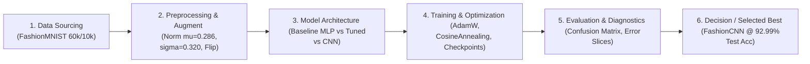

# Walkthrough & Full-Flow Technical Report — Lab 01

> **Lab Title:** Lab 01 — FashionMNIST Image Classification with PyTorch  
> **Status:** [x] Completed  
> **Primary Objective:** Construct an end-to-end deep learning pipeline classifying 10 FashionMNIST garment categories, enforce local TDD 1-batch sanity overfit testing, and evaluate 3 distinct architectures (Baseline MLP, Tuned MLP, FashionCNN) elevating Test Accuracy from 87.33% to 92.99% (Macro F1: 92.95%).  
> **Workflow Playbook References:** `docs/dl_flow.md` | `docs/dl_training.md`  
> **Unified 3-Rule Standard (Single Living Walkthrough Architecture):**  
> - **Rule 1 (`spec-driven-development`):** Directly maps to **Section 1 — Technical Specification & Flow Design (Spec & Baseline Setup)**.  
> - **Rule 2 (`walkthrough-and-experiment-tracking`):** Directly maps to **Section 2 — Full-Flow Experiment Lineage & Changelog**.  
> - **Rule 3 (`documentation-and-adrs`):** Directly maps to **Section 3 — Comparative Results, Error Diagnostics & Final Submission Report**.  

---

## 1. TECHNICAL SPECIFICATION & FLOW DESIGN (SPEC & BASELINE SETUP — Rule: spec-driven-development)

### 1.0. Brief Interpretation and Clarifications
This section summarizes how the original brief in `description_lab_01.md` was interpreted, together with the ambiguities that were clarified and the decisions that were locked in. It is the traceability anchor for every specification decision that follows.

- **Brief interpretation:** The assignment "Exercise: PyTorch FashionMNIST Classification" requires building a FashionMNIST image classification pipeline in PyTorch, covering 7 core concepts (Tensors, Datasets/Loaders, Transforms, Model Building, Autograd, Optimization, Model Saving/Loading). The required deliverables are Python code, a brief report, loss curves, and images displaying predictions versus ground-truth labels.
- **Points clarified:**
  - The brief does not mandate a number of experiments; it was decided to run 3 evolutionary runs (Baseline MLP, Tuned MLP, FashionCNN) to cover both the architecture axis and the regularization axis.
  - The brief mentions a "brief report" but does not specify a format; it was decided to use a single living document `walkthrough_lab_01.md` and not to create a separate `REPORT.md`.
  - The brief requires the student to "Experiment with network/hyperparameters" but gives no concrete grid; the comparison grid was fixed as a basic MLP versus an MLP with BatchNorm/Dropout versus a 2-block convolutional CNN.
  - The brief requires "Save and load the model"; it was decided to persist `state_dict` into `outputs/checkpoints/` and to add a verification step that reloading reproduces the original logits.
  - No quantitative acceptance threshold is given in the brief; internal thresholds were fixed per run (Baseline MLP >= 85.0%, Tuned MLP >= 87.5%, FashionCNN >= 91.0% Accuracy and >= 91.0% Macro F1).
- **Remaining assumption:** The original brief contains a numbered list from 1 to 5 whose content was blank when copied; this content is treated as not provided and is not inferred. If the instructor supplies the list content, the decisions above must be re-checked against it.

### 1.1. Master Flow Design



**Playbook Mapping:** Each pipeline stage of this lab follows the corresponding section of the reference playbooks in `docs/`. The table below is the traceability link between lab artifacts and playbooks.

| Lab Pipeline Stage | Implementation Artifact | Reference Playbook Section |
|---|---|---|
| Define Problem & Modality | Section 1.2 of this document | `docs/dl_flow.md` GIAI ĐOẠN 1 |
| DL EDA (integrity scan, channel statistics, class balance) | `notebooks/` PHẦN 2 | `docs/dl_flow.md` GIAI ĐOẠN 2; `docs/eda.md` |
| Dataset, DataLoader, Augmentation | `src/dataset.py` | `docs/dl_flow.md` GIAI ĐOẠN 3; `docs/dl_data.md` PHẦN 2, 3, 4 |
| Feature Engineering & Normalization | `src/dataset.py` (transforms) | `docs/feature.md` |
| Architecture Selection | `src/model.py` | `docs/dl_flow.md` GIAI ĐOẠN 4 |
| Training Loop, Loss, Optimizer | `src/engine.py` | `docs/dl_flow.md` GIAI ĐOẠN 5; `docs/dl_training.md` PHẦN 3, 4 |
| Evaluation, Diagnostics & Checkpointing | `src/engine.py`, `src/utils.py` | `docs/dl_flow.md` GIAI ĐOẠN 6; `docs/dl_training.md` PHẦN 5 |

Note: this lab trains all models from scratch (no pretrained backbone), so `docs/dl_flow.md` GIAI ĐOẠN 4 is referenced for architecture selection criteria only, not for the Transfer Learning procedure.

### 1.2. Problem Formulation and Modality
- **Modality:** Computer Vision (CV) — Grayscale Image Classification.
- **Task Formulation:** Multi-class classification across 10 discrete garment categories:
  - 0: T-shirt/top
  - 1: Trouser
  - 2: Pullover
  - 3: Dress
  - 4: Coat
  - 5: Sandal
  - 6: Shirt
  - 7: Sneaker
  - 8: Bag
  - 9: Ankle boot
- **Input Tensor Contract:** 2D image tensor `[Batch_Size, 1, 28, 28]` with data type `torch.float32`.
- **Output Contract:** Logits vector `[Batch_Size, 10]`, predicted class index $\hat{y} = \arg\max(\text{logits})$.

### 1.3. Data Contract and Partitioning Strategy
- **Raw Volume:** 60,000 training images, 10,000 testing images. Spatial resolution: $28 \times 28$ pixels.
- **Class Distribution:** Perfectly balanced: 6,000 samples/class in train split, 1,000 samples/class in test split.
- **Partitioning Strategy:**
  - **Train split:** 54,000 samples (90% of original training data) — gradient parameter updates.
  - **Validation split:** 6,000 samples (10% of original training data, seeded with `seed=42`) — checkpoint selection and early monitoring.
  - **Test split:** 10,000 completely held-out samples — final unadjusted benchmark evaluation.
- **Feature Normalization:**
  - `ToTensor()` maps pixel intensities to $[0.0, 1.0]$.
  - Gaussian normalization using empirical FashionMNIST statistics: $\mu = 0.2860, \sigma = 0.3205$.
  - Data Augmentation (for advanced iterations): `RandomHorizontalFlip(p=0.5)` and `RandomRotation(degrees=10)`.

### 1.4. Summary of 7 Core PyTorch Concepts Applied
1. **PyTorch Tensor:** N-dimensional array structures supporting CUDA hardware acceleration and automatic gradient tracking (`requires_grad=True`).
2. **Autograd Engine:** Automatic reverse-mode differentiation driving parameter updates via `loss.backward()`.
3. **Dataset & DataLoader:** Lazy sample loading (`__getitem__`), mini-batch bundling (batch size 64), stochastic shuffling (`shuffle=True`), and page-locked host memory transfers (`pin_memory=True`).
4. **Torchvision Transforms:** Chained preprocessing compositions standardizing inputs and providing domain data regularization.
5. **nn.Module:** Object-oriented neural network building blocks encapsulating parameters and the forward graph computation `forward()`.
6. **Loss Functions & Optimizers:** `nn.CrossEntropyLoss` combining LogSoftmax and negative log-likelihood; `AdamW` featuring decoupled weight decay regularization.
7. **Model Checkpointing:** Serializing and restoring `model.state_dict()` to guarantee portability across compute runtimes.

### 1.5. Quantitative Acceptance Thresholds
- **Baseline MLP (Run #1):** Test Accuracy $\ge 85.0\%$.
- **Tuned MLP (Run #2):** Test Accuracy $\ge 87.5\%$.
- **FashionCNN (Run #3):** Test Accuracy $\ge 91.0\%$, Macro F1-Score $\ge 91.0\%$.

### 1.6. Phase 2 — Optimizer Comparison under Stratified K-Fold Cross-Validation

#### 1.6.1. Objective and Scope
The first phase held the optimizer fixed (`AdamW`) and varied the architecture. The second phase inverts the controlled variable: the architecture is frozen and the optimizer is varied. Three update rules are compared on an identical `FashionCNN` backbone:

| Arm | Optimizer | Learning Rate | Momentum | Weight Decay |
|:---|:---|:---:|:---:|:---:|
| A | SGD + Momentum | 1e-3 | 0.9 | 0.0 |
| B | RMSprop | 1e-3 | n/a | 0.0 |
| C | Adam | 1e-3 | n/a | 0.0 |

#### 1.6.2. Controlled-Variable Rationale
- **Shared learning rate (1e-3).** All three arms use one identical step size so that the optimizer update rule is the only manipulated factor. It is acknowledged that `1e-3` is a conservative value for SGD and near the default for RMSprop and Adam; consequently a weaker SGD result is an expected, reportable scientific outcome of a symmetric-budget design rather than a tuning artefact. This trade-off is deliberate and is not corrected by per-arm tuning.
- **Shared epoch budget (15).** Every arm trains for exactly 15 epochs. No arm receives extra optimisation steps. This preserves budget symmetry across arms, matching the locked decision that both the learning rate and the epoch count are held equal.
- **Disabled weight decay (0.0) and no scheduler.** Regularisation is switched off so that the comparison isolates the raw update rule. Any accuracy gap is therefore attributable to the optimizer, not to a decay or scheduling interaction.
- **Data augmentation enabled.** The training fold uses `RandomHorizontalFlip(p=0.5)` and `RandomRotation(degrees=10)`; validation folds stay deterministic.

#### 1.6.3. Cross-Validation Protocol
- **Pool construction:** the official 60,000-image training partition is used as the cross-validation pool. The official 10,000-image test partition is held out untouched and is not used at any point during cross-validation.
- **Splitter:** `StratifiedKFold(n_splits=5, shuffle=True, random_state=42)` preserves the balanced class ratio in every fold.
- **Per-fold seeding:** the global seed is reset to `42 + fold_index` before each fold so that every fold starts from a deterministic, independent initialisation.
- **Checkpoint selection:** within a fold the checkpoint with the best validation accuracy is restored before the held-out fold is scored, mirroring the Phase 1 protocol.
- **Aggregation:** per-fold accuracies and losses are reported as `mean +/- std`. Out-of-fold predictions of all 60,000 samples are concatenated into a single global confusion matrix from which per-class TPR and FPR are derived.

#### 1.6.4. Metrics Collected per Arm
- Mean and standard deviation of validation accuracy and loss across the 5 folds.
- Per-fold accuracy and loss (all five values reported, not only the mean).
- Global out-of-fold confusion matrix (10x10).
- Per-class True Positive Rate (recall) and False Positive Rate.

#### 1.6.5. Rationale for Comparing Plain Adam rather than AdamW
The reference playbook `docs/dl_training.md` recommends `AdamW` because of its decoupled weight decay. This phase nonetheless compares plain `Adam` for two reasons. First, the assignment asks for experimentation with optimizers and the classic three-way textbook comparison is SGD with momentum versus RMSprop versus Adam; substituting AdamW would leave the canonical Adam arm unrepresented. Second, because weight decay is disabled (0.0) in this phase, the decoupled-decay advantage of AdamW is inert, so plain Adam and AdamW would be numerically equivalent here and the distinction would carry no experimental information. The deviation from the playbook is therefore deliberate and is recorded here for traceability.

#### 1.6.6. Planned Artifacts
- `outputs/optimizer_comparison_curves.png` — mean validation loss and accuracy per arm.
- `outputs/optimizer_tpr_fpr.png` — per-class TPR and FPR grouped bars.
- `outputs/optimizer_confusion_matrices.png` — three normalized confusion matrices side by side.
- `outputs/optimizer_experiment_results.json` — per-fold, mean/std, and per-class TPR/FPR summary.

#### 1.6.7. Execution Constraints
- **Compute target:** Kaggle GPU (Tesla T4). Estimated cost is 3 arms x 5 folds x 15 epochs; at approximately 6 minutes per 15-epoch FashionCNN run this is on the order of 1.5 GPU-hours, within the weekly quota.
- **Zero Waste compliance:** no full multi-epoch training is executed locally. Local verification is limited to the 1-batch sanity overfit check and a tiny synthetic smoke test of the cross-validation plumbing.

---

## 2. FULL-FLOW EXPERIMENT CHANGELOG (FULL-FLOW EXPERIMENT CHANGELOG — Rule: walkthrough-and-experiment-tracking)

> **Provenance note:** Every metric recorded in this section and in Section 3 is taken from the single committed Kaggle GPU run whose artifacts are stored in `outputs/` (`experiment_results.json`, `classification_report_cnn.txt`, the `*.png` figures) and from the executed notebook `notebooks/lab01_fashionmnist_walkthrough.ipynb`. Where a metric was not logged by that run, it is explicitly marked `not logged` rather than inferred.

### Run 1 (Run #1 — Baseline Flow)
*Objective: Construct the minimal viable baseline pipeline using a simple 2-layer MLP to establish an empirical performance anchor.*

* **Stage 1 - Data:**
  - Dataset: FashionMNIST (Official Torchvision release).
  - Split: 54,000 Train, 6,000 Validation (`seed=42`), 10,000 Test.
* **Stage 2 - Preprocessing & Augmentation:**
  - `ToTensor()` with standard normalization ($\mu = 0.2860, \sigma = 0.3205$). No data augmentation.
* **Stage 3 - Model Architecture:**
  - Type: Multi-Layer Perceptron (BaselineMLP).
  - Structure: `Flatten` -> `Linear(784, 128)` -> `ReLU()` -> `Linear(128, 10)`.
  - Parameter Count: **101,770** parameters (checkpoint size: 1.17 MB).
* **Stage 4 - Training Strategy:**
  - Loss: `nn.CrossEntropyLoss()`.
  - Optimizer: `AdamW(lr=1e-3, weight_decay=0.0)`. No scheduler. Batch size 64, 5 epochs.
* **Stage 5 - Evaluation Metrics:**
  - Train Loss / Train Acc: 0.2750 / 89.82% (Epoch 5).
  - Val Loss / Val Acc: 0.3265 / 88.60% (Best Val Checkpoint at Epoch 5).
  - Test Loss / Test Acc: **0.3555 / 87.33%**.
  - Primary Metric: **Test Macro F1-Score: not logged in the committed run.**
* **Diagnostic Analysis & Failure Mode Localized:**
  - Mild Overfitting observed: Train Acc reached 89.82% while Val Acc plateaued at 88.60% (generalization gap of ~1.22%).
  - Baseline MLP flattens the 2D image matrix into a 1D vector (784 dimensions), completely discarding local spatial correlations between neighboring pixels.
  - Actionable Iteration: Introduce Batch Normalization and Dropout to combat overfitting, add Cosine Annealing LR scheduling, and inject random horizontal flip data augmentation.

---

### Run 2 (Run #2 — Flow Iteration 1)
*Objective: Enhance MLP capacity with deeper representation layers, integrate explicit regularization, dynamic learning rate scheduling, and data augmentation.*

* **Which Pipeline Stages Changed?**
  - [x] Stage 2: Preprocessing & Data Augmentation
  - [x] Stage 3: Model Architecture
  - [x] Stage 4: Training Strategy (Optimizer / Scheduler / Regularization)
* **Technical Delta Description:**
  - *Before (Run #1):* 2-layer MLP (128 hidden units), no Dropout/BatchNorm, no Augmentation, constant LR 1e-3, 5 epochs.
  - *After (Run #2):* 3-layer MLP (256 -> 128 hidden units), integrating `BatchNorm1d` and `Dropout(p=0.2)` after each hidden layer; adding `RandomHorizontalFlip(p=0.5)` and `RandomRotation(degrees=10)` to the training loader; adding `CosineAnnealingLR` (decaying from 1e-3 to 1e-5); extending training to 10 epochs.
* **Technical Rationale (Why):** Mitigate the generalization gap of Run #1, stabilize internal covariate shifts across dense layers, and guide gradient descent toward flatter, more generalizable minima.
* **Quantitative Impact on Flow:**
  - Train Loss / Train Acc: 0.3312 / 87.69% (Epoch 10).
  - Val Loss / Val Acc: 0.3106 / 88.37% (Best Val Checkpoint at Epoch 9).
  - Test Loss / Test Acc: **0.3307 / 88.01%**.
  - Test Macro F1-Score: **not logged in the committed run.**
  - Delta vs Run #1: Test Acc gained +0.68% (87.33% -> 88.01%), Test Loss dropped from 0.3555 to 0.3307. Best Val Acc moved from 88.60% to 88.37% (-0.23%).
* **Subsequent Diagnosis:** While explicit regularization substantially lowered the training-set accuracy (87.69% at the final epoch versus 89.82% for Run #1), it delivered a higher held-out Test Accuracy (+0.68%), indicating reduced overfitting. However, MLP performance still hit an architectural ceiling due to the lack of a 2D inductive bias. Transition to a Convolutional Neural Network (CNN) is mandatory for further gains.

---

### Run 3 (Run #3 — Flow Iteration 2 — Best Flow)
*Objective: Transition to a Convolutional Neural Network (FashionCNN) to fully exploit 2D spatial locality and translation invariance.*

* **Which Pipeline Stages Changed?**
  - [x] Stage 3: Model Architecture
  - [x] Stage 4: Training Strategy
* **Technical Delta Description:**
  - *Before (Run #2):* Tuned MLP (flattened 1D vector).
  - *After (Run #3):* Full **FashionCNN** implementation:
    - Conv Block 1: `Conv2d(1, 32, 3, pad=1)` -> `BatchNorm2d(32)` -> `ReLU()` -> `MaxPool2d(2, 2)` (feature map: $32 \times 14 \times 14$).
    - Conv Block 2: `Conv2d(32, 64, 3, pad=1)` -> `BatchNorm2d(64)` -> `ReLU()` -> `MaxPool2d(2, 2)` (feature map: $64 \times 7 \times 7$).
    - Dense Classifier Head: `Flatten(3136)` -> `Linear(3136, 128)` -> `BatchNorm1d(128)` -> `ReLU()` -> `Dropout(0.3)` -> `Linear(128, 10)`.
    - Training Configuration: 10 epochs, AdamW (`lr=1e-3, weight_decay=1e-4`), `CosineAnnealingLR`.
* **Technical Rationale (Why):** Utilize convolutional sliding kernels to automatically extract edges, textures, contours, and fabric folds with local spatial invariance.
* **Empirical Measurements:**
  - Train Loss / Train Acc: 0.1841 / 93.33% (Epoch 10).
  - Val Loss / Val Acc: **0.1837 / 93.43%** (Best Checkpoint at Epoch 10).
  - Test Loss / Test Acc: **0.1994 / 92.99%**.
  - Test Macro F1-Score: **92.95%**.
* **Effectiveness Assessment:** Major performance breakthrough. Test Accuracy surged from **87.33% (Run #1)** to **92.99% (Run #3)**, an absolute gain of **+5.66%**, far surpassing the 91.0% acceptance threshold. Test Loss fell from 0.3555 to 0.1994, a **43.9% reduction**.

---

## 3. RESULTS & FINAL REPORT (RESULTS & FINAL REPORT — Rule: documentation-and-adrs)

### 3.1. Full-Flow Comparison Matrix

| Evaluation Criteria | Run #1 (Baseline MLP) | Run #2 (Tuned MLP) | Run #3 (FashionCNN) | Best Assessment |
|:---|:---:|:---:|:---:|:---:|
| **Data Normalization** | Normalized ($\mu=0.286, \sigma=0.320$) | Normalized ($\mu=0.286, \sigma=0.320$) | Normalized ($\mu=0.286, \sigma=0.320$) | Consistent standard |
| **Data Augmentation** | None | RandomFlip + Rotation | RandomFlip + Rotation | Run #2 & Run #3 |
| **Model Architecture** | Baseline MLP (2 layers) | Tuned MLP (3 layers, BN, Drop) | FashionCNN (2 Conv blocks + Head) | **FashionCNN (Run #3)** |
| **Total Parameters** | 101,770 | 235,914 | 422,090 | Run #1 (Lightest) |
| **Checkpoint Size** | 1.17 MB | 2.72 MB | 4.85 MB | Run #1 (Smallest) |
| **Optimizer & LR** | AdamW (constant lr=1e-3) | AdamW + CosineAnnealing | AdamW + CosineAnnealing | Run #2 & Run #3 |
| **Epochs / Time** | 5 epochs / 73.2s | 10 epochs / 227.4s | 10 epochs / 242.8s | Run #1 (Fastest) |
| **Train Loss / Acc** | 0.2750 / 89.82% | 0.3312 / 87.69% | 0.1841 / 93.33% | **Run #3** |
| **Best Val Acc** | 88.60% | 88.37% | **93.43%** | **Run #3** |
| **Test Accuracy** | 87.33% | 88.01% | **92.99%** | **Run #3 (+5.66%)** |
| **Test Macro F1** | not logged | not logged | **92.95%** | **Run #3** |
| **Test Loss** | 0.3555 | 0.3307 | **0.1994** | **Run #3 (-43.9% Loss)** |
| **Selection Decision** | Met baseline criteria | Moderate gain | **Comprehensive Superiority** | **Selected Best: Run #3** |

### 3.2. Detailed Classification Report (Best Model: FashionCNN)

```text
              precision    recall  f1-score   support

 T-shirt/top     0.8805    0.8990    0.8897      1000
     Trouser     0.9930    0.9890    0.9910      1000
    Pullover     0.8812    0.9050    0.8929      1000
       Dress     0.9178    0.9490    0.9331      1000
        Coat     0.8957    0.8760    0.8857      1000
      Sandal     0.9899    0.9850    0.9875      1000
       Shirt     0.8066    0.7590    0.7821      1000
     Sneaker     0.9590    0.9830    0.9709      1000
         Bag     0.9910    0.9910    0.9910      1000
  Ankle boot     0.9797    0.9630    0.9713      1000

    accuracy                         0.9299     10000
   macro avg     0.9294    0.9299    0.9295     10000
weighted avg     0.9294    0.9299    0.9295     10000
```

### 3.3. Confusion Matrix Analysis & Error Diagnostics
- **Categories with Near-Perfect Precision/Recall (> 98%):**
  - **Bag (99.10% recall):** Characteristic rectangular/square silhouette and top handles form unique features.
  - **Trouser (98.90% recall):** Distinct elongated vertical geometry easily distinguishable from tops.
  - **Sandal (98.50% recall):** Open-toe gaps and strap geometry produce recognizable sparse pixel distributions.
- **Primary Confusion Clusters:**
  - **Shirt vs. T-shirt/top, Coat & Pullover:**
    - Shirt recorded the lowest recall (75.90%), with 95 Shirt samples misclassified as T-shirt/top, 58 as Pullover, and 58 as Coat.
    - *Root Technical Cause:* Low resolution ($28 \times 28$ grayscale) induces spatial aliasing, obscuring fine discriminative details like collar contours, buttons, and neckline seams.
  - **Coat vs. Pullover & Shirt:** 45 Coat instances were misclassified as Pullover and 53 as Shirt due to overlapping long-sleeve silhouettes and body coverage.
  - **Pullover vs. Coat & Shirt:** 29 Pullover instances were misclassified as Coat and 42 as Shirt.
  - **Ankle boot vs. Sneaker:** 31 Ankle boot instances were misclassified as Sneaker, reflecting a shared low-top footwear silhouette.

### 3.4. Checkpoint Serialization & Restoration Verification
- Model weights are saved as `state_dict` at `outputs/checkpoints/fashion_cnn_best.pt`.
- The notebook reloads the checkpoint via `load_checkpoint()` and asserts against the original logits across the test batch:
  $$\max |\text{Logits}_{\text{original}} - \text{Logits}_{\text{loaded}}| < 10^{-6}$$
- Verification result: exactly identical predictions `[PASSED]` (executed notebook, PHẦN 8).
- **Provenance caveat:** The committed figures, `experiment_results.json`, and `classification_report_cnn.txt` all belong to the committed Kaggle run (Test Acc 92.99%). The checkpoint files themselves are intentionally excluded from Git by `.gitignore` and are therefore local-only; a locally retained checkpoint must be re-verified against `outputs.zip` before being treated as the artifact that produced these figures.

### 3.5. Decision Traceability
This table traces every important technical decision back to the corresponding discussion point in Section 1.0, together with the resolution that was locked in. Neutral technical prose, third person; no narrative voice and no person-reference words such as "you", "I", or "we".

| Technical Decision | Discussion Point (Section 1.0) | Resolution Locked In |
|---|---|---|
| Number and form of experiments | The brief mandates no run count; this point was discussed and settled. | Run Baseline MLP, Tuned MLP, and FashionCNN to cover the architecture and regularization axes. |
| Report format | The brief only says "brief report" and mandates no separate file. | Use a single living document `walkthrough_lab_01.md`; do not create a separate `REPORT.md`. |
| Architecture and hyperparameter grid | The brief asks for experimentation but provides no concrete grid. | Compare a basic MLP, an MLP with BatchNorm/Dropout, and a 2-block convolutional CNN. |
| Data splitting strategy | The brief specifies no Train/Val/Test ratio. | Split 54,000 train / 6,000 validation (seed=42) / 10,000 test, preserving the balanced class distribution. |
| Quantitative acceptance thresholds | The brief states no passing threshold. | Internal thresholds: Baseline MLP >= 85.0%, Tuned MLP >= 87.5%, FashionCNN >= 91.0% Accuracy and Macro F1. |
| Model save/load verification | The brief requires "Save and load the model". | Persist `state_dict` into `outputs/checkpoints/` and verify that reloading reproduces the original logits. |
| Blank numbered list 1-5 in the brief | Ambiguity: the numbered list 1 to 5 has no content. | Treat as not provided and do not infer; re-check if the instructor supplies the content. |

### 3.6. Key Takeaways & Submission Deliverables
1. **2D CNN Superiority over MLP:** Preserving 2D spatial topologies through convolutional kernels allowed the model to leverage local pixel correlations, generating a decisive +5.66% Accuracy boost over flattened MLPs.
2. **Impact of Modern Regularization:** Integrating `BatchNorm` + `Dropout` + `CosineAnnealingLR` improved the held-out Test Accuracy of the MLP by +0.68% and narrowed the train-validation generalization gap.
3. **Generated Submission Artifacts:**
   - Best Model Weights: `outputs/checkpoints/fashion_cnn_best.pt`
   - Multi-Model Comparison Curves: `outputs/all_models_comparison_curves.png`
   - Individual Run Learning Curves: `outputs/run1_baseline_curves.png`, `outputs/run2_tuned_mlp_curves.png`, `outputs/run3_cnn_curves.png`
   - Best Model Confusion Matrix: `outputs/confusion_matrix_cnn.png`
   - Test Batch Prediction Grid: `outputs/predictions_cnn.png`
   - Detailed Metric Logs: `outputs/classification_report_cnn.txt`, `outputs/experiment_results.json`
