# Lab 02 — Transfer Learning trên CIFAR10

## 1. Mục tiêu
Khảo sát ResNet18 và DenseNet121 pre-trained ImageNet, thay classifier thành 10 lớp, so sánh đóng băng backbone và fine-tune một/hai block cuối. Điều chỉnh learning rate/batch size, theo dõi bằng TensorBoard, đánh giá và lưu/tải model.

## 2. Dữ liệu và phạm vi thực nghiệm
Toàn bộ split CIFAR-10; ngân sách epoch và độ phân giải được ghi rõ bên dưới.
Profile: `cifar10_macintel_cpu_control64`. Train/validation/test thực tế: 45,000/5,000/10,000. Seed: 42.
Split gốc 45.000/5.000 được tạo stratified; test giữ nguồn test chính thức. Khi chạy pilot, mỗi split được lấy tập con stratified riêng. Mỗi lớp có 4.500 train / 500 validation / 1.000 test khi dùng toàn bộ dữ liệu.
Ảnh RGB gốc 32×32 được giữ màu. Đầu vào thực nghiệm là 64×64; normalization dùng mean/std của weights IMAGENET1K_V1. Với 224×224, dùng trọn transforms chính thức; với 64×64, resize trực tiếp để phù hợp ngân sách CPU, không phải preprocessing mặc định của weights. Không augmentation trong thí nghiệm này để tái sử dụng feature đóng băng và giữ tiền xử lý nhất quán.

## 3. Phương pháp
Mỗi mô hình thay classifier bằng Linear 10 đầu ra. Head-only đóng băng backbone và cache feature train/val ở eval mode. Cache tương đương forward backbone cho đầu vào cố định; thời gian trích xuất được ghi riêng.
Tìm learning rate [0.001, 0.01] và batch size [64, 128], 10 epoch/candidate với adamw, weight_decay=0.0001. Các candidate dùng cùng initial head và shuffle seed. Policy chọn candidate: {'accuracy_tolerance': 0, 'loss_tolerance': 0}; accuracy band → validation loss band → fit time. Checkpoint trong mỗi trial chọn accuracy cao nhất, hòa chọn loss thấp hơn rồi epoch sớm hơn.
Fine-tune: mọi candidate khởi tạo lại từ cùng selected head; cấu hình optimizer/LR/depth/scheduler được chọn chỉ bằng validation. Ngân sách tối đa 10 epoch; stopping policy=fixed epoch budget. Số epoch thực chạy và stop_reason nằm trong training_summary.json; không suy ra hội tụ từ ngân sách. Trong mỗi trial, BatchNorm running statistics giữ cố định. Mở hai block DenseNet gồm denseblock3+transition3+denseblock4+norm5. Cache prefix chỉ hỗ trợ last block; cấu hình tuned tắt cache cho cả hai kiến trúc.
- resnet18: adamw; depth=last_block; backbone_lr=1e-05; head_lr=0.0001; scheduler=none
- densenet121: adamw; depth=last_block; backbone_lr=1e-05; head_lr=0.0001; scheduler=none
Toàn bộ fine-search: `finetune_search_results.csv`; xem `cost_comparison.csv` để phân biệt chi phí toàn search và selected recipe.

CrossEntropyLoss nhận logits. Checkpoint chọn theo validation. Test không tham gia search hoặc lựa chọn checkpoint; hai điều kiện head/fine-tune được xác định trước và đánh giá sau khi khóa lựa chọn. Mỗi condition được tải vào model instance mới trước đánh giá.

## 4. Kết quả đo được
| Model | Stage | Val acc | Test acc | Macro F1 | Trainable | Train (s) |
|---|---|---:|---:|---:|---:|---:|
| resnet18 | head | 77.18% | 75.93% | 0.7581 | 5,130 | 10.2 |
| resnet18 | finetune | 84.20% | 83.59% | 0.8349 | 8,398,858 | 2200.2 |
| densenet121 | head | 79.38% | 79.04% | 0.7907 | 10,250 | 15.2 |
| densenet121 | finetune | 83.00% | 82.99% | 0.8301 | 2,170,378 | 1037.9 |

- resnet18: fine-tune thay đổi test accuracy +7.66 điểm phần trăm và Macro F1 +0.0768 so với head-only.
- densenet121: fine-tune thay đổi test accuracy +3.95 điểm phần trăm và Macro F1 +0.0394 so với head-only.

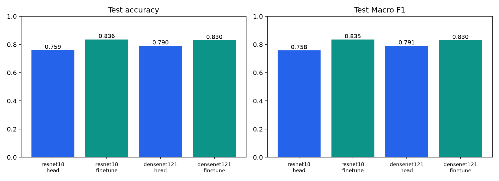

Train (s) chỉ là thời gian fit candidate được chọn hoặc fine-tune, chưa bao gồm feature extraction/search. `training_summary.json` của head_selected ghi riêng thời gian trích xuất và tổng search. Vì fine-tune tiếp tục từ head, chi phí toàn pipeline phải cộng các giai đoạn.

## 5. Phân tích và giới hạn
Kết quả chỉ đại diện cho seed và phạm vi dữ liệu đã ghi. Fine-tune có thêm epoch và được khởi tạo từ head đã học; chênh lệch phản ánh chiến lược hai giai đoạn, chưa cô lập tác động unfreeze ở cùng ngân sách tính toán.
Không mặc định pre-trained hoặc fine-tune phải tốt hơn. Tập nguồn ImageNet khác phân phối ảnh CIFAR-10 độ phân giải thấp. Phóng ảnh không bổ sung thông tin chi tiết mới.
Không so sánh trực tiếp với Lab1 vì FashionMNIST và CIFAR-10 là hai bài toán khác nhau. Cấu hình CPU 64×64 và GPU 224×224 cũng phải được báo cáo riêng; không suy diễn kết quả của cấu hình chưa chạy.

## 6. Bằng chứng và tái lập
`config.json`, `environment.json`, `source_hashes.json`, hai NPZ indices, `console.log`, `status.json` và SHA256 manifest ghi điều kiện chạy. Từng kiến trúc có architecture, parameters, preprocessing, search_results, selection, TensorBoard event và learning curves. Mỗi condition có best.pt, history, classification report, confusion counts, probabilities, ảnh đúng/sai và roundtrip.json.
Lưới ảnh chọn tối đa 8 đúng/8 sai để minh họa; xác suất softmax không bảo đảm dự đoán đúng. Số trong confusion matrix là count, màu chuẩn hóa theo lớp thật.

## 7. Tài liệu tham khảo
- [Torchvision models và weights](https://docs.pytorch.org/vision/main/models)
- [PyTorch transfer learning](https://docs.pytorch.org/tutorials/beginner/transfer_learning_tutorial)
- [TensorBoard với PyTorch](https://docs.pytorch.org/tutorials/intermediate/tensorboard_tutorial)

## 8. Khảo sát lỗi và hình bổ sung

### Dữ liệu RGB và phân bố lớp

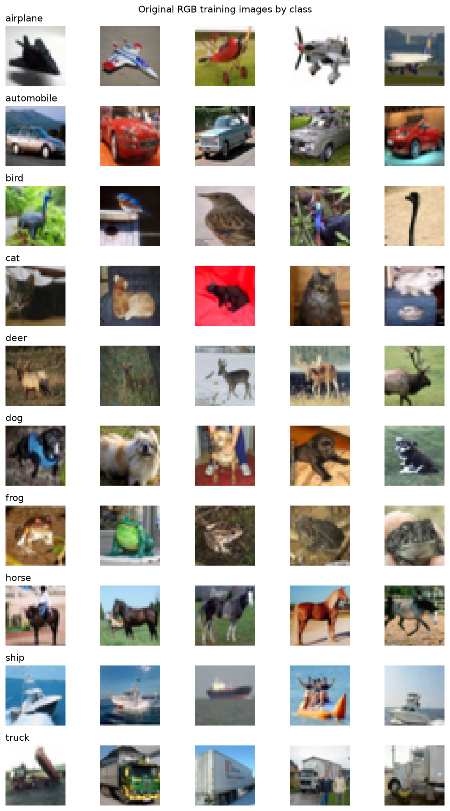

| Class | Train | Validation | Test |
|---|---:|---:|---:|
| airplane | 4500 | 500 | 1000 |
| automobile | 4500 | 500 | 1000 |
| bird | 4500 | 500 | 1000 |
| cat | 4500 | 500 | 1000 |
| deer | 4500 | 500 | 1000 |
| dog | 4500 | 500 | 1000 |
| frog | 4500 | 500 | 1000 |
| horse | 4500 | 500 | 1000 |
| ship | 4500 | 500 | 1000 |
| truck | 4500 | 500 | 1000 |

- resnet18/head_selected: cặp lỗi nhiều nhất cat → dog (140 ảnh trong tập test đã chọn).

**Ba lớp F1 thấp nhất — resnet18/head_selected:**

| Class | Precision | Recall | F1 |
|---|---:|---:|---:|
| cat | 0.6421 | 0.6260 | 0.6339 |
| bird | 0.7197 | 0.6650 | 0.6913 |
| deer | 0.7395 | 0.6700 | 0.7030 |

- resnet18/finetune: cặp lỗi nhiều nhất cat → dog (169 ảnh trong tập test đã chọn).

**Ba lớp F1 thấp nhất — resnet18/finetune:**

| Class | Precision | Recall | F1 |
|---|---:|---:|---:|
| cat | 0.7557 | 0.6310 | 0.6877 |
| dog | 0.7533 | 0.8060 | 0.7787 |
| bird | 0.7856 | 0.8060 | 0.7957 |

### resnet18

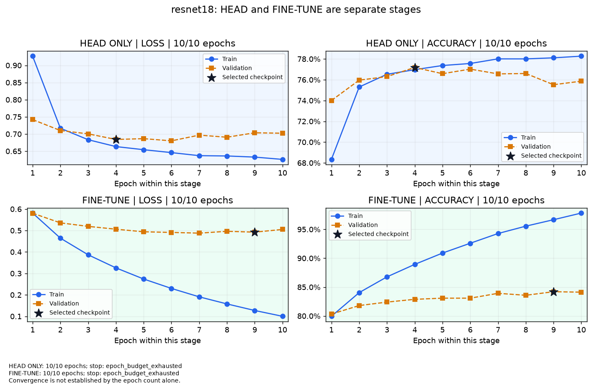

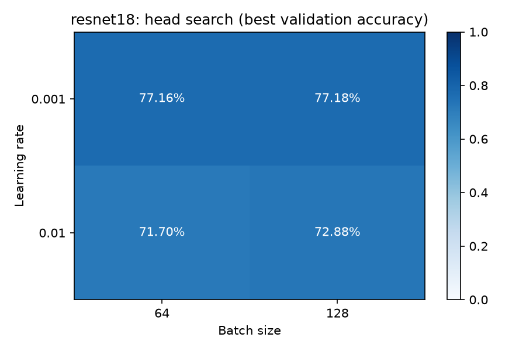

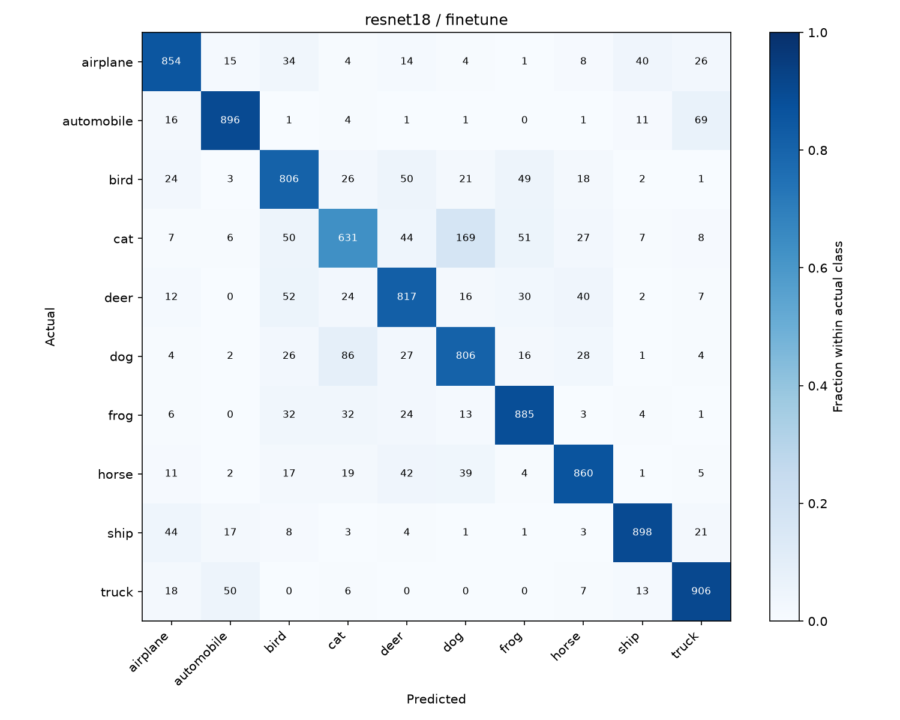

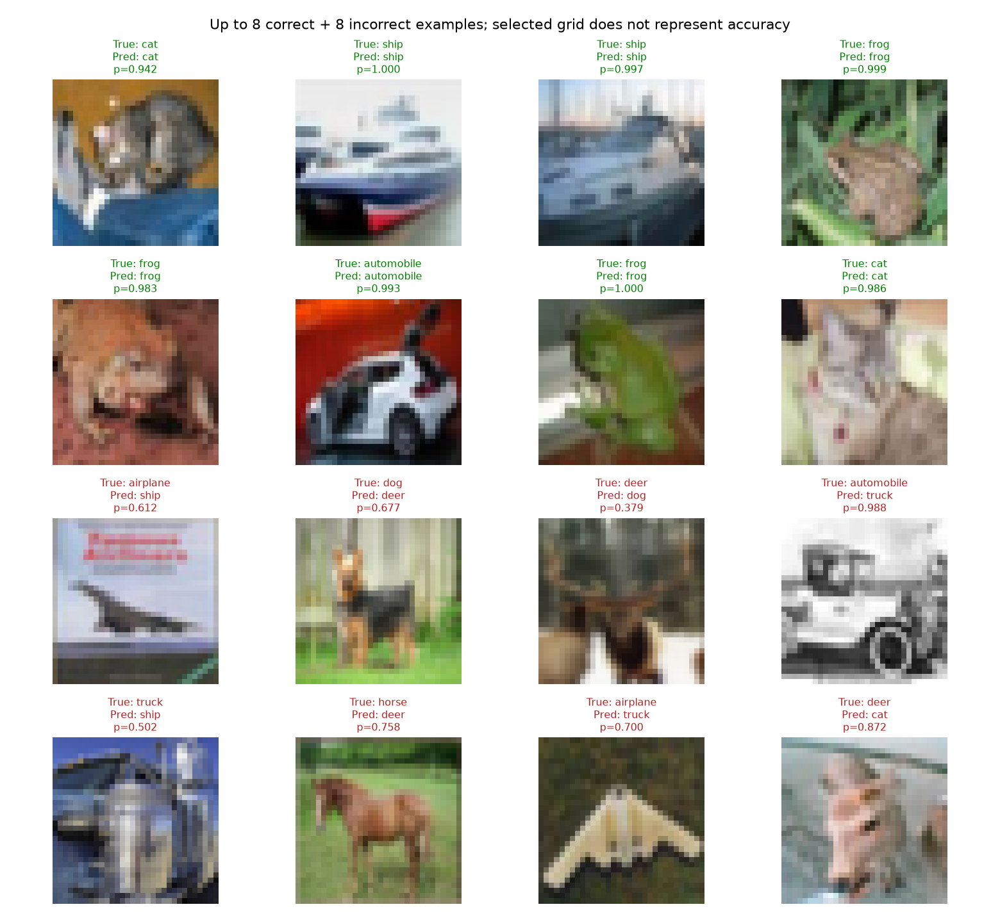

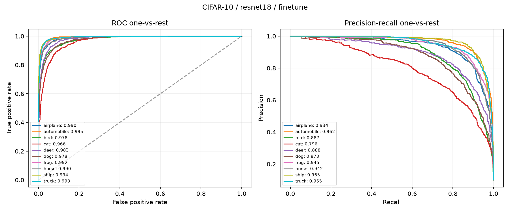

- densenet121/head_selected: cặp lỗi nhiều nhất dog → cat (146 ảnh trong tập test đã chọn).

**Ba lớp F1 thấp nhất — densenet121/head_selected:**

| Class | Precision | Recall | F1 |
|---|---:|---:|---:|
| cat | 0.6683 | 0.6810 | 0.6746 |
| deer | 0.7183 | 0.7470 | 0.7324 |
| bird | 0.7513 | 0.7280 | 0.7395 |

- densenet121/finetune: cặp lỗi nhiều nhất dog → cat (146 ảnh trong tập test đã chọn).

**Ba lớp F1 thấp nhất — densenet121/finetune:**

| Class | Precision | Recall | F1 |
|---|---:|---:|---:|
| cat | 0.6928 | 0.7150 | 0.7037 |
| dog | 0.7933 | 0.7560 | 0.7742 |
| bird | 0.8008 | 0.7880 | 0.7944 |

### densenet121

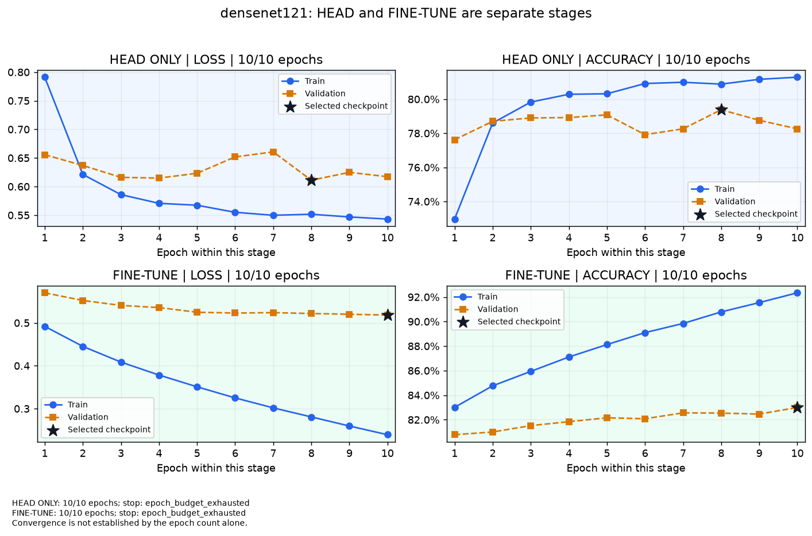

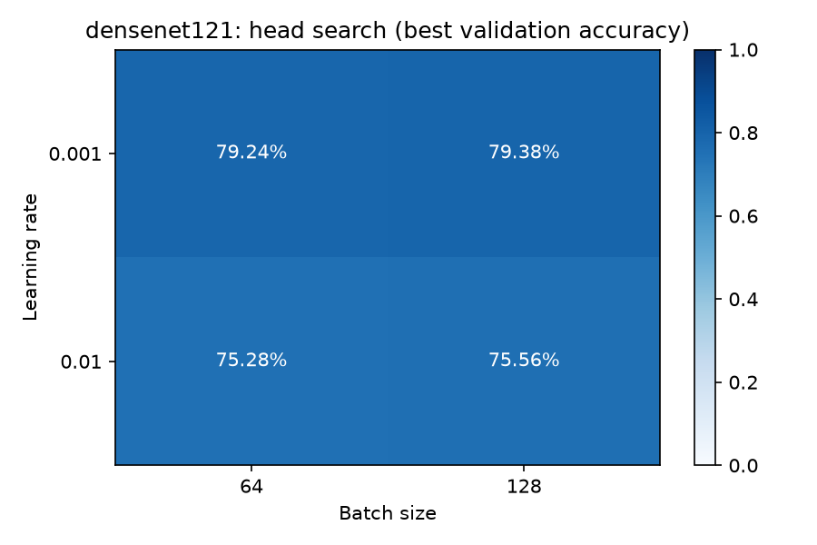

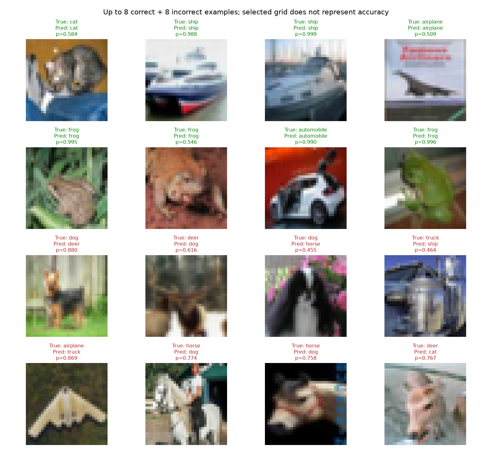

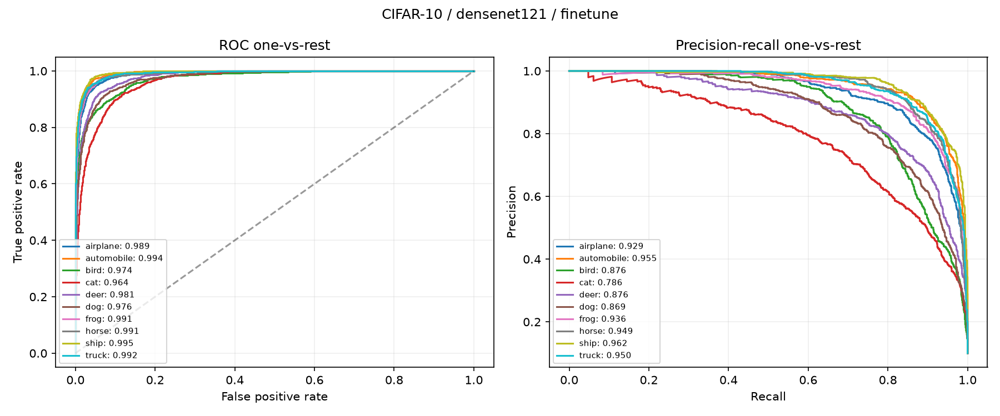

### TensorBoard và chi phí

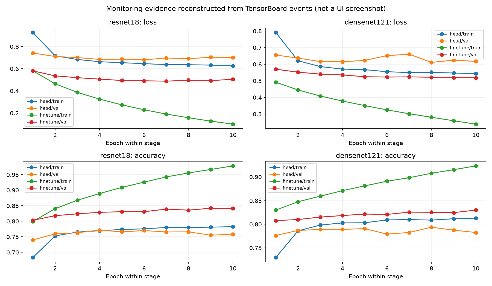

Hình này dựng từ TensorBoard events thật; không phải ảnh chụp giao diện. Mở TensorBoard theo README để xem tương tác.

Điều kiện được đề xuất bằng validation: **resnet18/finetune**, validation accuracy **84.20%**.

Chi phí pipeline gồm feature extraction, toàn bộ head search và toàn bộ fine-tune search nếu có; chưa gồm EDA, ghi báo cáo và inference test. Xem cost_comparison.csv.

| Model | Stage | Feature extraction (s) | All head search (s) | Pipeline search train (s) | Test (s) |
|---|---|---:|---:|---:|---:|
| resnet18 | head | 222.3 | 46.0 | 268.3 | 35.9 |
| resnet18 | finetune | 222.3 | 46.0 | 2468.5 | 36.0 |
| densenet121 | head | 601.5 | 64.4 | 665.9 | 91.7 |
| densenet121 | finetune | 601.5 | 64.4 | 1703.8 | 93.5 |

### Cấu hình head được chọn bằng validation

| Model | LR | Batch | Best epoch | Validation accuracy |
|---|---:|---:|---:|---:|
| resnet18 | 0.001 | 128 | 4 | 77.18% |
| densenet121 | 0.001 | 128 | 8 | 79.38% |

resnet18 fine-tune sử dụng cache đầu ra của prefix đóng băng; đã kiểm chứng tương đương trên 8 ảnh thật, max logit error=0. Test vẫn forward toàn bộ model trên ảnh RGB. Kiểm thử riêng đối chiếu cả logits, gradients và schema checkpoint.

densenet121 fine-tune sử dụng cache đầu ra của prefix đóng băng; đã kiểm chứng tương đương trên 8 ảnh thật, max logit error=0. Test vẫn forward toàn bộ model trên ảnh RGB. Kiểm thử riêng đối chiếu cả logits, gradients và schema checkpoint.

Chi phí giữa các kiến trúc chịu ảnh hưởng của cách thực thi: xem cột execution trong cost_comparison.csv. Trong run này, nếu một model dùng cache prefix còn model khác forward ảnh khi fine-tune, không dùng thời gian thô để kết luận riêng về tốc độ kiến trúc. Cache giữ nguyên bài toán tối ưu và số ảnh/epoch; mã hiện hành hỗ trợ cache prefix cho cả hai model ở profile CPU.

### Diễn giải chỉ số và thiết kế

Accuracy là số ảnh dự đoán đúng chia tổng số ảnh. Macro F1 tính F1 riêng cho từng lớp rồi lấy trung bình không trọng số; vì vậy mỗi lớp đóng góp ngang nhau. Macro Precision/Recall và cross-entropy test được lưu trong metrics.json. ROC-AUC và average precision tính one-vs-rest từng lớp, không phải cùng một đại lượng.

ResNet dùng residual connections để cộng tín hiệu qua các block; DenseNet nối các feature maps từ nhiều lớp trong dense block. Thực nghiệm thay head và giữ cấu trúc backbone gốc, không thiết kế lại CNN từ đầu.

Profile cifar10_macintel_cpu_control64: ngân sách tối đa 10 epoch fine-tune, ảnh 64x64, seed 42. Kết quả chỉ đại diện cấu hình và ngân sách này; một seed chưa chứng minh ưu thế thống kê.