# BÁO CÁO LAB 02 — TRANSFER LEARNING TRÊN CIFAR-10

**Chủ đề:** EDA, preprocessing, pretrained backbone, head-only, fine-tuning và đánh giá chất lượng/chi phí.

**Phạm vi:** ResNet18, DenseNet121; chọn checkpoint bằng validation; test; benchmark CUDA một ảnh với model đã nạp sẵn.

**Quy ước bằng chứng:** H = `20261024T075133Z_cifar10_cpu_full64_71863a0e` (CPU lịch sử); S = `20261030T052121Z_cifar10_scheduled64_b895bfc1` (scheduled CPU macOS); B = benchmark một ảnh Kaggle T4 dùng checkpoint S. Không ghép metric giữa run. Nhật ký sửa code/kiểm thử nằm ngoài báo cáo.

**Bản nguồn để dàn trang:** cấu trúc theo walkthrough Lab01, có ngắt trang gợi ý. Chưa render PDF, chưa xác nhận số trang cuối.

## Tóm tắt

Lab phân loại 10 lớp CIFAR-10 RGB, train-pool 50.000 chia 45.000 train/5.000 validation, test 10.000 giữ riêng. Backbone ImageNet được thay classifier, train head rồi mở một phần backbone; EDA và feature thủ công phục vụ mô tả dữ liệu.

Trong S, ResNet18/DenseNet121 fine-tune đạt test accuracy 84,14%/91,80%, chênh 7,66 điểm phần trăm; validation khuyến nghị DenseNet. H được trình bày riêng vì ngân sách, augmentation, scheduler/cache khác; không quy chênh lệch cho một yếu tố.

B đo từ đọc PNG đến JSON sau khi model nạp sẵn: median ResNet 3,761 ms/ảnh, DenseNet 15,329 ms/ảnh. Lặp một ảnh sau warm-up trên T4 không thay thế đánh giá toàn test hoặc xác lập phần cứng tối thiểu.

## Mục lục

- [1.1. Diễn giải đề bài và câu hỏi nghiên cứu](#11-diễn-giải-đề-bài-và-câu-hỏi-nghiên-cứu)
- [1.2. Bài toán, dữ liệu và hợp đồng tensor](#12-bài-toán-dữ-liệu-và-hợp-đồng-tensor)
- [1.3. Kiến trúc phần mềm và luồng dữ liệu](#13-kiến-trúc-phần-mềm-và-luồng-dữ-liệu)
- [1.4. Cơ sở ResNet18, DenseNet121 và transfer learning](#14-cơ-sở-resnet18-densenet121-và-transfer-learning)
- [1.5. Chia tập và tránh rò rỉ thông tin](#15-chia-tập-và-tránh-rò-rỉ-thông-tin)
- [2.1. EDA và kiểm tra tính toàn vẹn](#21-eda-và-kiểm-tra-tính-toàn-vẹn)
- [2.2. Phân bố lớp, pixel và ảnh mẫu](#22-phân-bố-lớp-pixel-và-ảnh-mẫu)
- [2.3. Preprocessing và augmentation](#23-preprocessing-và-augmentation)
- [2.4. Thay classifier, freeze và fine-tune](#24-thay-classifier-freeze-và-fine-tune)
- [2.5. Feature cache và điều kiện so sánh](#25-feature-cache-và-điều-kiện-so-sánh)
- [2.6. Loss, optimizer, scheduler và ngân sách epoch](#26-loss-optimizer-scheduler-và-ngân-sách-epoch)
- [2.7. Sanity overfit, checkpoint và môi trường](#27-sanity-overfit-checkpoint-và-môi-trường)
- [2.8. Thiết kế search và chọn model bằng validation](#28-thiết-kế-search-và-chọn-model-bằng-validation)
- [2.9. Metric đa lớp, ROC và Precision–Recall](#29-metric-đa-lớp-roc-và-precisionrecall)
- [2.10. Cách đo thời gian, RAM và VRAM](#210-cách-đo-thời-gian-ram-và-vram)
- [3.1. So sánh tổng thể các cấu hình đã chạy](#31-so-sánh-tổng-thể-các-cấu-hình-đã-chạy)
- [3.2. Đường học và lựa chọn checkpoint](#32-đường-học-và-lựa-chọn-checkpoint)
- [3.3. Metric theo lớp và confusion matrix](#33-metric-theo-lớp-và-confusion-matrix)
- [3.4. ROC và Precision–Recall](#34-roc-và-precisionrecall)
- [3.5. Ảnh dự đoán đúng/sai và phân tích lỗi](#35-ảnh-dự-đoán-đúngsai-và-phân-tích-lỗi)
- [3.6. Kết quả search trong từng điều kiện thực nghiệm](#36-kết-quả-search-trong-từng-điều-kiện-thực-nghiệm)
- [3.7. Chi phí huấn luyện và đánh giá](#37-chi-phí-huấn-luyện-và-đánh-giá)
- [3.8. Save/load và bằng chứng inference](#38-saveload-và-bằng-chứng-inference)
- [3.9. Benchmark một ảnh khi model đã nạp sẵn](#39-benchmark-một-ảnh-khi-model-đã-nạp-sẵn)
- [3.10. Kết luận, giới hạn và hướng phát triển](#310-kết-luận-giới-hạn-và-hướng-phát-triển)

## 1. ĐẶC TẢ, CƠ SỞ VÀ THIẾT KẾ

<div style="break-before: page; page-break-before: always;"></div>

### 1.1. Diễn giải đề bài và câu hỏi nghiên cứu

Theo [đề bài](description_lab_02.md), cần khảo sát nhiều pretrained architectures, thay classifier, freeze/fine-tune, dùng transforms/DataLoader, train/evaluate, điều chỉnh LR/batch và TensorBoard. CIFAR-10 là dataset được chọn trong triển khai, không phải ràng buộc riêng trong ảnh đề.

Ba câu hỏi nghiên cứu: head-only so với fine-tune thay đổi chất lượng thế nào; ResNet18 và DenseNet121 đánh đổi chất lượng/chi phí ra sao; một ảnh mất bao lâu và dùng bao nhiêu RAM/VRAM khi model đã nạp sẵn? Head-only là baseline trên backbone pretrained. Chưa có baseline train-from-scratch nên chưa cô lập lợi ích pretraining.

Chọn cấu hình bằng validation; test chỉ dùng sau khi khóa checkpoint. Không đặt acceptance threshold hậu nghiệm. Tuning nhiều optimizer/depth và lặp seed là hướng kiểm chứng; có code không đồng nghĩa có kết quả.

<div style="break-before: page; page-break-before: always;"></div>

### 1.2. Bài toán, dữ liệu và hợp đồng tensor

Phân loại đa lớp đơn nhãn. Ảnh thô uint8 [32,32,3], pixel 0–255; sau transform là float32 [B,3,H,W]. Nhãn nguyên 0–9; đầu ra [B,10] logits. CrossEntropyLoss nhận logits; argmax chọn lớp, softmax phục vụ xác suất/ROC/PR.

Thứ tự lớp: airplane, automobile, bird, cat, deer, dog, frog, horse, ship, truck. Run H/S dùng H=W=64; cấu hình 224×224 là điều kiện khác.

| Tập | Số ảnh | Mỗi lớp | Vai trò |
|---|---:|---:|---|
| Train | 45.000 | 4.500 | Cập nhật gradient |
| Validation | 5.000 | 500 | Chọn cấu hình, checkpoint và dừng |
| Test | 10.000 | 1.000 | Đánh giá sau lựa chọn |

Không gọi train-pool 50.000 là tập train cập nhật gradient 45.000.

<div style="break-before: page; page-break-before: always;"></div>

### 1.3. Kiến trúc phần mềm và luồng dữ liệu

[README](README.md) hướng dẫn sử dụng; [EDA](notebooks/01_lab02_eda.ipynb) khảo sát dữ liệu; [modeling](notebooks/02_lab02_modeling.ipynb) đọc artifact; [benchmark](notebooks/03_lab02_single_image_benchmark.ipynb) thực thi inference CUDA riêng.

```text
src/
├── datasets/     # Dữ liệu, EDA, split, transforms và loader
├── models/       # Backbone, classifier, freeze và feature extraction
├── training/     # Fit, search, feature cache và điều phối
├── inference.py  # Nạp model và dự đoán một ảnh
└── utils/        # Artifact, metric, hình và benchmark
```

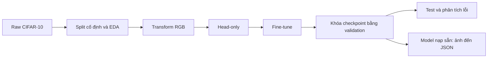

Source hiện hành phục vụ lần chạy tiếp theo; source_snapshot/manifest từng run mô tả code tạo ra bằng chứng đó. Không suy ra run cũ dùng mọi thay đổi mới.

<div style="break-before: page; page-break-before: always;"></div>

### 1.4. Cơ sở ResNet18, DenseNet121 và transfer learning

ResNet18 cộng nhánh residual; DenseNet121 nối feature từ layer trước để tái sử dụng biểu diễn. Cả hai dùng ImageNet weights IMAGENET1K_V1 trong [models.py](src/models/models.py). Chi phí thực thi phải đo, không suy ra chỉ từ số tham số.

Classifier ResNet nhận 512 feature, DenseNet nhận 1.024 feature; Linear mới trả 10 logits. Dropout 0,2 đứng trước Linear trong S, chỉ hoạt động khi train.

| Model | Tổng tham số S | Head trainable | Fine-tune trainable | Fine/tổng |
|---|---:|---:|---:|---:|
| ResNet18 | 11.181.642 | 5.130 | 4.725.770 | 42,26% |
| DenseNet121 | 6.964.106 | 10.250 | 2.921.034 | 41,94% |

Tỷ lệ học gần nhau không có nghĩa năng lực biểu diễn/compute giống nhau. Mở phần cuối giúp thích nghi bài toán đích nhưng tăng chi phí và nguy cơ overfit.

<div style="break-before: page; page-break-before: always;"></div>

### 1.5. Chia tập và tránh rò rỉ thông tin

Split phân tầng dùng seed 42, lưu [metadata](outputs/eda/split_metadata.json) và [preprocessing config](outputs/eda/preprocessing_config.json). Split EDA được tái dựng theo thuật toán đã mô tả; không coi đây là bản indices gốc còn thiếu của H. Hash đối chiếu split H: dcfe29a6b8c5f308b77679d3ca6f33156aa8e76db22c9b4c74a93251afc686c8.

Thống kê màu/feature chỉ dùng train. Normalization ImageNet cố định không fit từ test; augmentation chỉ train. Integrity audit có thể đọc held-out để phát hiện lỗi/trùng, không dùng test để tối ưu recipe. Exact duplicate audit không chứng nhận không có near-duplicate hoặc mọi dạng leakage.

## 2. PHƯƠNG PHÁP VÀ QUY TRÌNH THỰC NGHIỆM

<div style="break-before: page; page-break-before: always;"></div>

### 2.1. EDA và kiểm tra tính toàn vẹn

[eda.py](src/datasets/eda.py) xác thực MD5 sáu batch chính thức trước khi deserialize, đổi layout NCHW lưu trong file thành NHWC. Audit kiểm shape/dtype, nhãn 0–9, pixel hữu hạn, ảnh hằng, trùng byte trong và giữa partition.

[Integrity report](outputs/eda/integrity_report.csv) trên 60.000 ảnh ghi 0 nhãn ngoài miền, 0 pixel không hữu hạn, 0 ảnh hằng và 0 bản ghi trùng byte. Near-duplicate và chất lượng nhãn rộng hơn chưa hoàn tất. Ảnh tự nhiên không có segmentation mask nên foreground ratio/bounding box là not applicable; pixel đen không mặc định là nền.

<div style="break-before: page; page-break-before: always;"></div>

### 2.2. Phân bố lớp, pixel và ảnh mẫu

Lớp cân bằng như bảng 1.2; [class distribution](outputs/eda/class_distribution.csv), [ảnh mẫu](outputs/eda/sample_images.png) và [ảnh trung bình lớp](outputs/eda/class_mean_images.png) là bằng chứng dữ liệu.

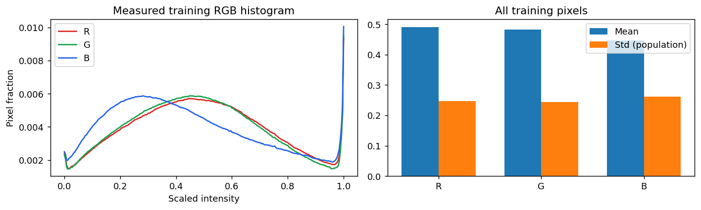

Trên 45.000 train sau chia 255, mean RGB=(0,491137;0,482111;0,446449), std population=(0,246869;0,243430;0,261603). Histogram R/G có vùng mật độ lớn quanh cường độ trung bình; B có mean thấp hơn/std cao hơn. Đỉnh ở pixel 255 không tự chứng minh lỗi dữ liệu.

Feature mô tả gồm brightness, contrast, zero fraction, edge density và mean R/G/B. Gray=mean RGB; brightness=mean(gray), contrast=std(gray); edge density là tỷ lệ độ lớn sai phân >0,1 trên miền sai phân chung. Zero fraction đếm kênh bằng 0, không phải nền.

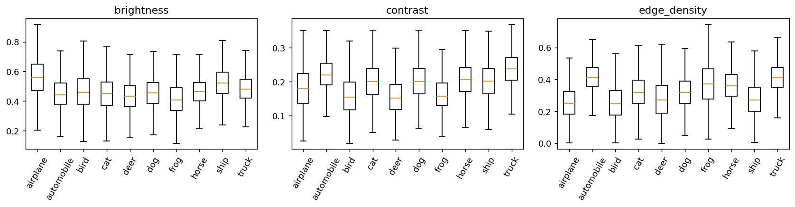

Airplane/ship có median brightness cao hơn frog; truck có median contrast cao. Automobile/truck có median edge density gần nhau và cao hơn một số lớp động vật. Phân bố chồng lấn lớn; đây là mô tả, chưa kiểm định nguyên nhân phân lớp. Feature chỉ phục vụ EDA, không nối vào tensor CNN.

<div style="break-before: page; page-break-before: always;"></div>

### 2.3. Preprocessing và augmentation

Ở 64×64: Resize antialias → ToTensor/chia 255 → Normalize với mean ImageNet (0,485;0,456;0,406), std (0,229;0,224;0,225). Thống kê này khác mean/std CIFAR-10 vừa đo. Ở 224×224, source dùng transform weights enum; không xem hai transform là cùng điều kiện.

H không augmentation. S chỉ augmentation fine-tune train: RandomCrop 32/padding reflect 4, horizontal flip p=0,5, rồi transform chung. Validation/test không augmentation. [data.py](src/datasets/data.py) chặn augmentation ở split khác train. Inference lấy image size từ checkpoint.

<div style="break-before: page; page-break-before: always;"></div>

### 2.4. Thay classifier, freeze và fine-tune

Head-only khóa backbone, chỉ học classifier; fine-tune mở tập layer định trước với LR backbone nhỏ hơn head. requires_grad điều khiển gradient; BatchNorm running statistics giữ cố định ở eval, kể cả BN trong block mở. Affine parameters của BN vẫn có thể học nếu thuộc phần mở.

H mở layer4+fc của ResNet; denseblock4+norm5+classifier của DenseNet. S mở layer4.1+fc của ResNet; DenseNet mở denseblock3 layer11–12,18–24, transition3, denseblock4 layer1–4,13–16, norm5 và classifier. scheduled_tail kiểm tra phần tham số học không quá 50%; không mô tả thành mở toàn bộ hai block cuối.

Freeze giảm gradient/optimizer state, không tự loại forward của prefix; cần ghi execution policy cùng metric.

<div style="break-before: page; page-break-before: always;"></div>

### 2.5. Feature cache và điều kiện so sánh

Pooled feature cache tính backbone một lần để train head. Prefix cache lưu activation trước phần fine-tune, chỉ hợp lệ khi transform/prefix cố định và không mở layer trong prefix. [feature_cache.py](src/training/feature_cache.py) sở hữu cache/loader; checkpoint giữ schema full model.

H dùng cached frozen prefix cho DenseNet fine-tune, full-image forward cho ResNet nên train time không xếp hạng kiến trúc. S tắt prefix cache fine-tune cả hai và dùng augmentation train; head vẫn pooled cache, trước dropout nên mask dropout không bị cố định. Không tái dùng cache trái điều kiện augmentation/unfreeze.

<div style="break-before: page; page-break-before: always;"></div>

### 2.6. Loss, optimizer, scheduler và ngân sách epoch

CrossEntropyLoss nhận logits. Train: zero gradient → forward → loss → backward → optimizer step. Validation eval/inference không cập nhật weights. Scheduler step sau optimizer/epoch.

| Điều kiện | Head | Fine-tune | Chính sách |
|---|---|---|---|
| H | AdamW LR {0,001;0,01} × batch {32;64}, 5 epoch/trial | Backbone LR 1e-5, head LR 1e-4, 2 epoch | Không scheduler/augmentation; cache khác nhau |
| S | AdamW LR 0,001, batch 128, 12 epoch | Backbone LR 1e-4, head LR 1e-3, tối đa 20 epoch | Cosine ratio 1,0→0,1; dropout 0,2; augmentation fine train |

Weight decay 1e-4. S early stopping theo validation loss: min 10 epoch, patience 7, min_delta=1e-4. Checkpoint theo accuracy không nhất thiết ở minimum loss. [scheduled.json](config/scheduled.json) là recipe đã thực thi trong S; số epoch thực chạy ở 3.2, không thay bằng ngân sách dự kiến.

<div style="break-before: page; page-break-before: always;"></div>

### 2.7. Sanity overfit, checkpoint và môi trường

Sanity overfit một batch kiểm tra model/loss/gradient trước chạy dài; không dùng batch accuracy làm test accuracy. Seed Python/NumPy/Torch, split seed và môi trường được ghi theo run. Nhật ký kiểm thử phần mềm nằm ngoài báo cáo.

| Điều kiện | Thiết bị và phiên bản được ghi |
|---|---|
| H | Windows CPU; CPython 3.13.3; torch 2.14.1+cpu; torchvision 0.29.1+cpu |
| S | macOS 13.5.2 Intel CPU; Python 3.12.7; torch 2.2.2; torchvision 0.17.2; 4 threads |
| B | Tesla T4; Python 3.13.16; torch 2.11.0+cu130; torchvision 0.26.0+cu130 |

best.pt phục vụ inference; last.pt lưu optimizer/scheduler/RNG/history để resume tại epoch hoàn tất. Resume trial không tự hoàn thành selection/test toàn suite. Checkpoint cũ thiếu schema không tự có bảo đảm resume mới. S ghi resumed=false; B chỉ nạp checkpoint.

<div style="break-before: page; page-break-before: always;"></div>

### 2.8. Thiết kế search và chọn model bằng validation

H khảo sát LR×batch rồi fine-tune head chọn bằng validation; S có một recipe/model nên không phải grid search. Checkpoint mỗi trial chọn validation accuracy lớn nhất; hòa chọn loss nhỏ hơn rồi epoch sớm hơn.

**Thiết kế tuned mở rộng, chưa có benchmark đầy đủ:** [tuned.json](config/tuned.json) là cấu hình chạy bằng `scripts/run.py`. Chưa có kết quả benchmark tuning đầy đủ.

| Thành phần | Triển khai | Kiểm soát |
|---|---|---|
| Head search | AdamW LR {1e-4,1e-3,1e-2} × batch {64,128}, 10 epoch/trial | Cùng initial classifier và shuffle seed |
| Fine control | AdamW, backbone 1e-5, head 1e-4, last block, LR cố định | Min 10 / max 30 epoch; patience 7 theo val loss |
| Fine grid | AdamW LR {3e-6,1e-5,3e-5}; SGD momentum 0,9 LR {1e-4,3e-4,1e-3}; head=10× | LR riêng theo optimizer; cùng giới hạn min 10 / max 30 và stopping policy |
| Unfreeze | Last block hoặc last two blocks; tổng 12 tổ hợp optimizer/LR/depth + 1 control | Reset toàn bộ state_dict, kể cả BN buffers, về cùng selected head |
| ResNet hai block | layer3 + layer4 + fc | layer1/layer2 vẫn frozen |
| DenseNet hai block | denseblock3 + transition3 + denseblock4 + norm5 + classifier | Không bỏ sót transition3; block1/block2 frozen |
| Scheduler | CosineAnnealingLR, T_max=30; control LR cố định | Step sau optimizer/epoch, log LR thực dùng trước khi step |
| Cache | Tắt prefix cache ở tuned cho cả hai kiến trúc | Raise lỗi trước load weights nếu mở hai block mà cache vẫn bật |
| Seed | Khởi tạo/shuffle 42, rồi 43/44; split_seed cố định 42 | Thay training seed không đổi train/validation/test |

Checkpoint mỗi trial chọn validation accuracy lớn nhất; hòa chọn validation loss nhỏ hơn rồi epoch sớm hơn. Chọn candidate theo ba bước: giữ accuracy trong 0,001 của mức cao nhất; giữ loss trong 0,005 của mức thấp nhất trong nhóm đó; chọn fit time thấp nhất. Tolerances là đơn vị tuyệt đối; 0,001 accuracy = 0,1 điểm phần trăm. Không dùng test accuracy/loss để chọn. Policy mới không hồi tố thay đổi checkpoint/kết quả lịch sử.

Khuyến nghị giữa hai kiến trúc dùng cùng validation bands và **selected recipe training cost** chỉ khi execution policy giống nhau. Nếu policy khác nhau như run cũ, bỏ time tie-break và chọn theo validation accuracy/loss. Chất lượng gần nhau ở một seed chưa chứng minh tương đương thống kê; cần lặp seed và kiểm tra độ ổn định trước kết luận.

AdamW weight decay tách khỏi gradient còn SGD dùng L2 theo optimizer; cùng hệ số không làm hai regularization hoàn toàn tương đương. Kết quả so sánh phản ánh từng recipe hoàn chỉnh. Mở thêm block có thể tăng khả năng thích nghi nhưng cũng có thể tăng overfit, thời gian và VRAM; chưa khẳng định cải thiện khi chưa đo validation.

Kết quả H/S đặt ở 3.6. Grid thiết kế/dry-run không phải trial đã chạy.

<div style="break-before: page; page-break-before: always;"></div>

### 2.9. Metric đa lớp, ROC và Precision–Recall

Accuracy=số đúng/N; macro metric lấy trung bình 10 lớp. One-vs-rest: precision=TP/(TP+FP), recall/TPR=TP/(TP+FN), FPR=FP/(FP+TN). FPR không bằng 1−precision. Confusion giữ counts và màu chuẩn hóa theo hàng; test có 1.000 ảnh/lớp.

ROC quét score qua nhiều ngưỡng: X=FPR/Y=TPR; PR: X=recall/Y=precision. Legend PR là Average Precision (AP), không phải F1 hay diện tích hình thang mặc định. Macro AUC/AP là trung bình số đo theo lớp, không suy ra đường macro từ các số tổng. Argmax 10 lớp không tương đương ngưỡng 0,5 mỗi lớp.

<div style="break-before: page; page-break-before: always;"></div>

### 2.10. Cách đo thời gian, RAM và VRAM

- `train_pass_seconds` và `validation_seconds` đo riêng, đồng bộ CUDA trước/sau; train pass gồm loader, truyền dữ liệu và tính toán.
- `train_seconds` là fit wall time, gồm train/validation và phần log/checkpoint trong vòng fit; không phải GPU compute thuần. History có LR từng nhóm, throughput; summary có peak CUDA allocated memory.
- `pipeline_training_seconds` = extraction + toàn bộ head search + toàn bộ fine search. Không cộng lại selected head/fine lần thứ hai.
- `selected_recipe_training_seconds` = extraction + selected head fit + selected fine fit; dùng để cân nhắc recipe khi chất lượng tương đương trong các bands.
- `model_selection_wall_seconds` còn tính startup model/weights, preview, tạo loader và đóng gói search. Không dùng số này như pure training compute. Test pass đo riêng và vẫn forward toàn bộ model.

Benchmark B bắt đầu sau load model/checkpoint; batch 1, FP32, eval/inference_mode, TF32 tắt. Total đo độc lập đọc/giải mã PNG → preprocessing → CPU/GPU transfer → forward → softmax/kết quả về CPU → chuỗi JSON; loại in terminal/ghi báo cáo. CUDA đồng bộ ở biên đo.

Ghi request đầu riêng; warm-up 20, total 100 lượt. Stage diagnostics 20 lượt riêng có sync từng bước; không cộng stage suy ra total. Bộ nhớ dùng 20 lượt khác để sampler không nhiễu latency chính: RSS lấy mẫu 1 ms; reset CUDA peaks trước memory pass. Cùng ảnh có OS cache. RSS gồm process/model/thư viện; allocated/reserved là allocator, không phải toàn CUDA context hoặc cấu hình tối thiểu.

## 3. KẾT QUẢ, THẢO LUẬN VÀ KẾT LUẬN

<div style="break-before: page; page-break-before: always;"></div>

### 3.1. So sánh tổng thể các cấu hình đã chạy

**Run S, scheduled CPU đã hoàn tất.** Nguồn [comparison](outputs/runs/20261030T052121Z_cifar10_scheduled64_b895bfc1/comparison.csv), [config](outputs/runs/20261030T052121Z_cifar10_scheduled64_b895bfc1/config.json), [status](outputs/runs/20261030T052121Z_cifar10_scheduled64_b895bfc1/status.json). Test 10.000 ảnh; macro metric là fraction 0–1.

| Model | Stage | Test loss | Accuracy (%) | Macro F1 | Macro precision | Macro recall | Best val accuracy (%) |
|---|---|---|---|---|---|---|---|
| resnet18 | head | 0.696569 | 76.35 | 0.763008 | 0.763644 | 0.763500 | 76.94 |
| resnet18 | finetune | 0.484747 | 84.14 | 0.840593 | 0.841238 | 0.841400 | 84.70 |
| densenet121 | head | 0.604426 | 78.79 | 0.787870 | 0.791085 | 0.787900 | 79.78 |
| densenet121 | finetune | 0.301038 | 91.80 | 0.917978 | 0.918393 | 0.918000 | 91.86 |

Fine-tune so với head tăng accuracy ResNet +7,79, DenseNet +13,01 điểm phần trăm; Macro F1 tăng 0,077585/0,130107. Có thêm ngân sách, augmentation và mở backbone nên chưa cô lập tác động từng yếu tố.

DenseNet fine-tune hơn ResNet 7,66 điểm phần trăm accuracy, Macro F1 0,077384 và loss thấp hơn 0,183709. [Validation recommendation](outputs/runs/20261030T052121Z_cifar10_scheduled64_b895bfc1/validation_recommendation.json) chọn DenseNet: val accuracy 91,86% so với 84,70%. Một seed chưa xác lập ưu thế phổ quát.

**Run H, giữ riêng để truy vết:** bảng dưới dùng fraction, không phải recipe S.

Run lịch sử `20261024T075133Z_cifar10_cpu_full64_71863a0e` (ký hiệu H). Tất cả hàng dùng cùng CIFAR-10/split, RGB 64×64, không augmentation, ImageNet normalization.

| model | stage | loss | accuracy | macro_f1 | macro_precision | macro_recall | best_val_accuracy |
|---|---|---|---|---|---|---|---|
| resnet18 | head | 0.706896 | 0.7609 | 0.761075 | 0.763462 | 0.7609 | 0.7716 |
| resnet18 | finetune | 0.547387 | 0.8149 | 0.814634 | 0.815284 | 0.8149 | 0.821 |
| densenet121 | head | 0.660355 | 0.7821 | 0.781146 | 0.786055 | 0.7821 | 0.7924 |
| densenet121 | finetune | 0.547715 | 0.8153 | 0.815109 | 0.815191 | 0.8153 | 0.8146 |

Trong H, DenseNet test chỉ hơn 0,04 điểm phần trăm nhưng validation thấp hơn ResNet (81,46%/82,10%); lựa chọn lịch sử là ResNet. Registry hiện tại chọn S, không dùng khuyến nghị H để mô tả S. H→S đổi nhiều yếu tố, chưa thể quy chênh lệch cho riêng cosine/dropout/unfreeze. Chênh lệch DenseNet−ResNet trong H là loss +0,0003283 và Macro F1 +0,0004746.

<div style="break-before: page; page-break-before: always;"></div>

### 3.2. Đường học và lựa chọn checkpoint

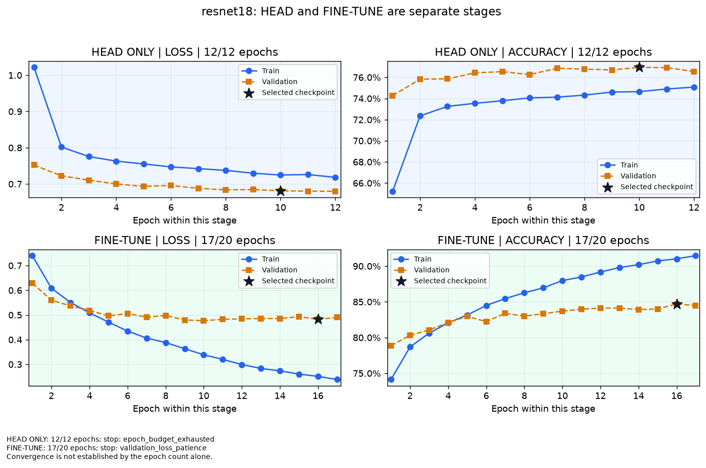

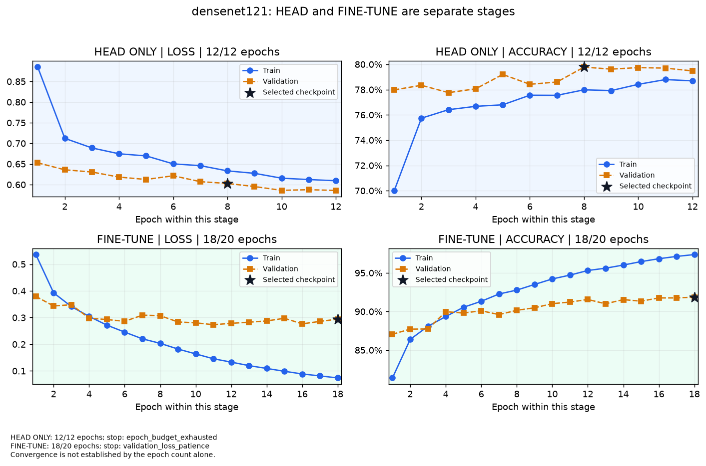

Head cả hai chạy 12/12 epoch. Fine-tune ResNet chạy 17/20, DenseNet 18/20, dừng validation_loss_patience. [ResNet summary](outputs/runs/20261030T052121Z_cifar10_scheduled64_b895bfc1/resnet18/finetune/training_summary.json) ghi best epoch 16; [DenseNet summary](outputs/runs/20261030T052121Z_cifar10_scheduled64_b895bfc1/densenet121/finetune/training_summary.json) ghi 18. Epoch bắt đầu lại trong mỗi stage.

ResNet train loss 0,7402→0,2383, val loss 0,6282→0,4904; minimum val loss 0,47695. DenseNet train loss 0,5361→0,07381, val loss 0,37935→0,29413; minimum 0,27328. Hình cho thấy train tiếp tục cải thiện, validation chững/dao động; minimum loss khác checkpoint có accuracy tốt nhất.

Cuối fine-tune, train−val accuracy gap khoảng 6,98/5,51 điểm phần trăm. Cần theo dõi tổng quát hóa; early stopping không tự chứng minh hội tụ tối ưu. Dropout/augmentation khiến điều kiện train khác val, cần thận trọng khi đọc gap.

H chỉ fine-tune 2 epoch: val loss ResNet 0,5686→0,5301, DenseNet 0,5701→0,5439; không dùng epoch S để diễn giải H.

<div style="break-before: page; page-break-before: always;"></div>

### 3.3. Metric theo lớp và confusion matrix

**Run S**, fraction 0–1. Nguồn [class metrics](outputs/review/20261030T052121Z_cifar10_scheduled64_b895bfc1/class_metrics.csv), đối chiếu confusion counts từng stage.

| Model | Stage | Lớp | Precision | Recall/TPR | F1 | FPR |
|---|---|---|---|---|---|---|
| resnet18 | head | airplane | 0.7824 | 0.7910 | 0.7867 | 0.0244 |
| resnet18 | head | automobile | 0.8189 | 0.8500 | 0.8342 | 0.0209 |
| resnet18 | head | bird | 0.7184 | 0.6530 | 0.6841 | 0.0284 |
| resnet18 | head | cat | 0.6425 | 0.6200 | 0.6310 | 0.0383 |
| resnet18 | head | deer | 0.6780 | 0.7180 | 0.6974 | 0.0379 |
| resnet18 | head | dog | 0.7303 | 0.7500 | 0.7400 | 0.0308 |
| resnet18 | head | frog | 0.7640 | 0.8320 | 0.7966 | 0.0286 |
| resnet18 | head | horse | 0.8250 | 0.7590 | 0.7906 | 0.0179 |
| resnet18 | head | ship | 0.8501 | 0.8450 | 0.8475 | 0.0166 |
| resnet18 | head | truck | 0.8269 | 0.8170 | 0.8219 | 0.0190 |
| resnet18 | finetune | airplane | 0.8698 | 0.8350 | 0.8520 | 0.0139 |
| resnet18 | finetune | automobile | 0.8903 | 0.9090 | 0.8996 | 0.0124 |
| resnet18 | finetune | bird | 0.8271 | 0.7940 | 0.8102 | 0.0184 |
| resnet18 | finetune | cat | 0.7359 | 0.7190 | 0.7274 | 0.0287 |
| resnet18 | finetune | deer | 0.8454 | 0.7490 | 0.7943 | 0.0152 |
| resnet18 | finetune | dog | 0.7934 | 0.7910 | 0.7922 | 0.0229 |
| resnet18 | finetune | frog | 0.8123 | 0.9090 | 0.8580 | 0.0233 |
| resnet18 | finetune | horse | 0.8716 | 0.8760 | 0.8738 | 0.0143 |
| resnet18 | finetune | ship | 0.9048 | 0.9220 | 0.9133 | 0.0108 |
| resnet18 | finetune | truck | 0.8617 | 0.9100 | 0.8852 | 0.0162 |
| densenet121 | head | airplane | 0.7990 | 0.8110 | 0.8050 | 0.0227 |
| densenet121 | head | automobile | 0.8874 | 0.7960 | 0.8392 | 0.0112 |
| densenet121 | head | bird | 0.7945 | 0.6880 | 0.7374 | 0.0198 |
| densenet121 | head | cat | 0.6336 | 0.7210 | 0.6745 | 0.0463 |
| densenet121 | head | deer | 0.7338 | 0.7360 | 0.7349 | 0.0297 |
| densenet121 | head | dog | 0.7902 | 0.6930 | 0.7384 | 0.0204 |
| densenet121 | head | frog | 0.8008 | 0.8360 | 0.8180 | 0.0231 |
| densenet121 | head | horse | 0.8214 | 0.8460 | 0.8335 | 0.0204 |
| densenet121 | head | ship | 0.8655 | 0.8620 | 0.8637 | 0.0149 |
| densenet121 | head | truck | 0.7848 | 0.8900 | 0.8341 | 0.0271 |
| densenet121 | finetune | airplane | 0.9338 | 0.9310 | 0.9324 | 0.0073 |
| densenet121 | finetune | automobile | 0.9491 | 0.9500 | 0.9495 | 0.0057 |
| densenet121 | finetune | bird | 0.9117 | 0.8980 | 0.9048 | 0.0097 |
| densenet121 | finetune | cat | 0.8599 | 0.8160 | 0.8374 | 0.0148 |
| densenet121 | finetune | deer | 0.9040 | 0.9130 | 0.9085 | 0.0108 |
| densenet121 | finetune | dog | 0.8343 | 0.8910 | 0.8617 | 0.0197 |
| densenet121 | finetune | frog | 0.9383 | 0.9580 | 0.9480 | 0.0070 |
| densenet121 | finetune | horse | 0.9567 | 0.9270 | 0.9416 | 0.0047 |
| densenet121 | finetune | ship | 0.9404 | 0.9630 | 0.9516 | 0.0068 |
| densenet121 | finetune | truck | 0.9559 | 0.9330 | 0.9443 | 0.0048 |

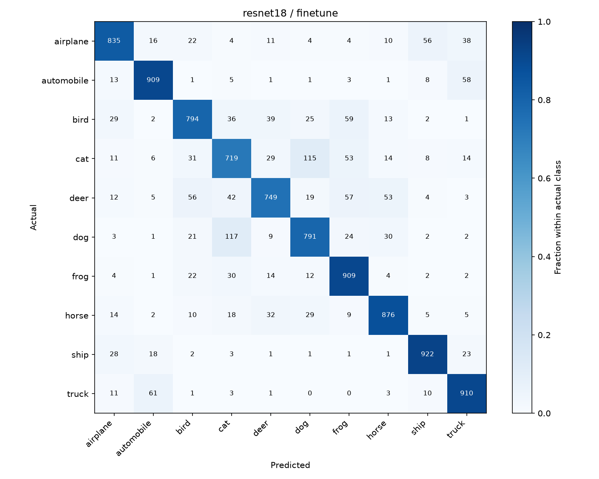

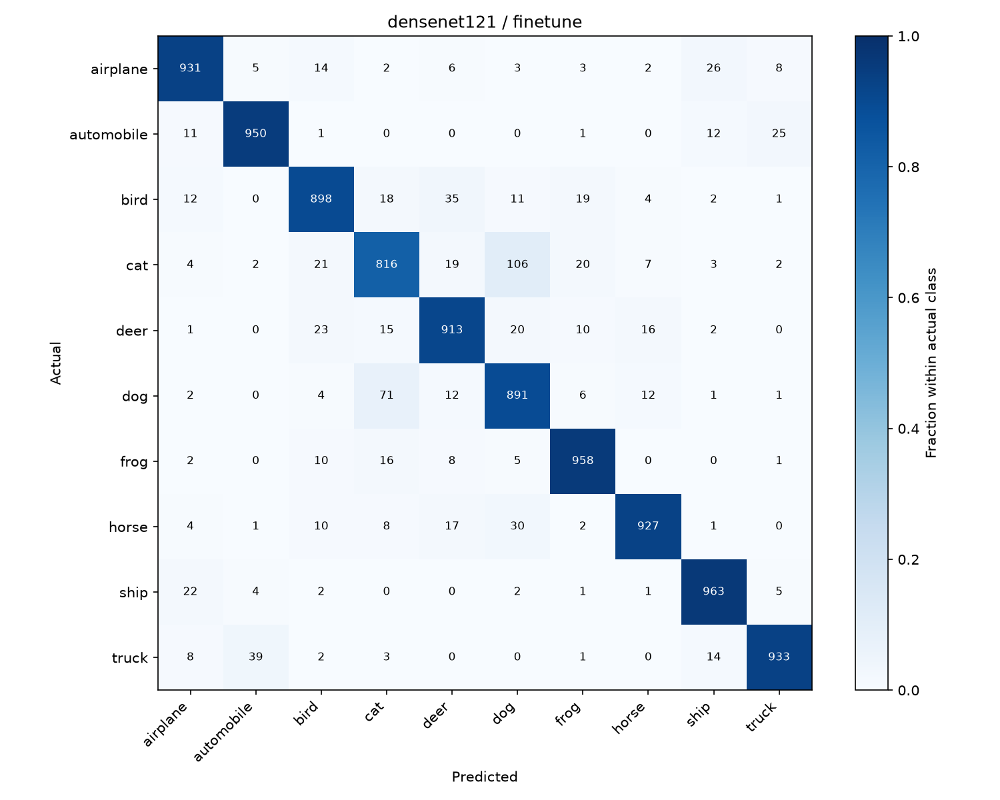

Đọc theo hàng: ResNet dog→cat 117/1.000=11,7%, cat→dog 115/1.000=11,5%; cat recall thấp nhất 71,9%. DenseNet cat→dog 106/1.000=10,6%, dog→cat 71/1.000=7,1%; cat recall thấp nhất 81,6%. FPR cao nhất là cat ở ResNet (2,87%), dog ở DenseNet (1,97%); không mặc định hai metric yếu nhất thuộc cùng lớp.

Ship recall cao nhất cả hai (92,2%/96,3%). Nhầm cat/dog vẫn nổi bật; ảnh nhỏ và tương đồng hình dáng là giả thuyết, chưa kiểm định nguyên nhân. H có ResNet dog→cat 14,5%, DenseNet 14,4%; không thay counts S bằng số lịch sử.

**Run H — metric theo lớp để truy vết, fraction 0–1:**

Bộ metric theo lớp (FPR = FP/(FP+TN), one-vs-rest) tính lại từ confusion counts:

| model | stage | class | precision | recall_tpr | f1 | fpr |
|---|---|---|---|---|---|---|
| resnet18 | head | airplane | 0.7113 | 0.818 | 0.7609 | 0.0369 |
| resnet18 | head | automobile | 0.8149 | 0.854 | 0.834 | 0.0216 |
| resnet18 | head | bird | 0.7283 | 0.67 | 0.6979 | 0.0278 |
| resnet18 | head | cat | 0.634 | 0.646 | 0.6399 | 0.0414 |
| resnet18 | head | deer | 0.6712 | 0.741 | 0.7044 | 0.0403 |
| resnet18 | head | dog | 0.7736 | 0.687 | 0.7278 | 0.0223 |
| resnet18 | head | frog | 0.812 | 0.786 | 0.7988 | 0.0202 |
| resnet18 | head | horse | 0.7904 | 0.792 | 0.7912 | 0.0233 |
| resnet18 | head | ship | 0.8562 | 0.822 | 0.8388 | 0.0153 |
| resnet18 | head | truck | 0.8427 | 0.793 | 0.8171 | 0.0164 |
| resnet18 | finetune | airplane | 0.7992 | 0.84 | 0.8191 | 0.0234 |
| resnet18 | finetune | automobile | 0.8833 | 0.863 | 0.873 | 0.0127 |
| resnet18 | finetune | bird | 0.7578 | 0.776 | 0.7668 | 0.0276 |
| resnet18 | finetune | cat | 0.6948 | 0.699 | 0.6969 | 0.0341 |
| resnet18 | finetune | deer | 0.7977 | 0.765 | 0.781 | 0.0216 |
| resnet18 | finetune | dog | 0.7878 | 0.735 | 0.7605 | 0.022 |
| resnet18 | finetune | frog | 0.8319 | 0.871 | 0.851 | 0.0196 |
| resnet18 | finetune | horse | 0.8815 | 0.826 | 0.8529 | 0.0123 |
| resnet18 | finetune | ship | 0.8431 | 0.908 | 0.8743 | 0.0188 |
| resnet18 | finetune | truck | 0.8756 | 0.866 | 0.8708 | 0.0137 |
| densenet121 | head | airplane | 0.7853 | 0.823 | 0.8037 | 0.025 |
| densenet121 | head | automobile | 0.8451 | 0.851 | 0.848 | 0.0173 |
| densenet121 | head | bird | 0.7697 | 0.695 | 0.7304 | 0.0231 |
| densenet121 | head | cat | 0.621 | 0.703 | 0.6595 | 0.0477 |
| densenet121 | head | deer | 0.7733 | 0.672 | 0.7191 | 0.0219 |
| densenet121 | head | dog | 0.8269 | 0.645 | 0.7247 | 0.015 |
| densenet121 | head | frog | 0.7904 | 0.852 | 0.82 | 0.0251 |
| densenet121 | head | horse | 0.7419 | 0.891 | 0.8096 | 0.0344 |
| densenet121 | head | ship | 0.8317 | 0.875 | 0.8528 | 0.0197 |
| densenet121 | head | truck | 0.8753 | 0.814 | 0.8435 | 0.0129 |
| densenet121 | finetune | airplane | 0.8421 | 0.832 | 0.837 | 0.0173 |
| densenet121 | finetune | automobile | 0.8765 | 0.859 | 0.8677 | 0.0134 |
| densenet121 | finetune | bird | 0.7788 | 0.757 | 0.7677 | 0.0239 |
| densenet121 | finetune | cat | 0.6826 | 0.699 | 0.6907 | 0.0361 |
| densenet121 | finetune | deer | 0.7819 | 0.771 | 0.7764 | 0.0239 |
| densenet121 | finetune | dog | 0.7847 | 0.751 | 0.7675 | 0.0229 |
| densenet121 | finetune | frog | 0.8335 | 0.866 | 0.8494 | 0.0192 |
| densenet121 | finetune | horse | 0.8544 | 0.857 | 0.8557 | 0.0162 |
| densenet121 | finetune | ship | 0.8652 | 0.886 | 0.8755 | 0.0153 |
| densenet121 | finetune | truck | 0.852 | 0.875 | 0.8633 | 0.0169 |

<div style="break-before: page; page-break-before: always;"></div>

### 3.4. ROC và Precision–Recall

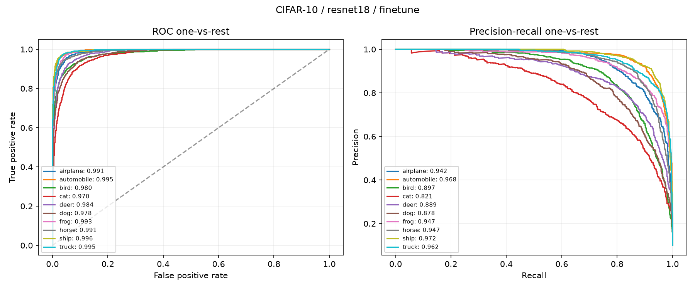

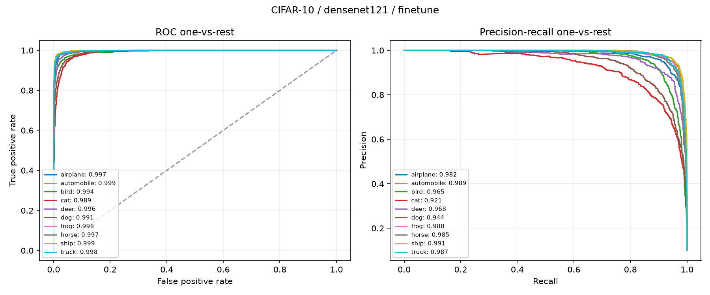

| Model | Macro ROC AUC OvR | Macro AP OvR |
|---|---|---|
| resnet18 | 0.987149 | 0.922339 |
| densenet121 | 0.995809 | 0.971887 |

Nguồn [ResNet scores](outputs/runs/20261030T052121Z_cifar10_scheduled64_b895bfc1/resnet18/finetune/roc_pr_metrics.csv), [DenseNet scores](outputs/runs/20261030T052121Z_cifar10_scheduled64_b895bfc1/densenet121/finetune/roc_pr_metrics.csv). Đường cat thấp hơn ship/automobile ở cả ROC/PR. Cat AP 0,82105/0,92079, ship AP 0,97183/0,99086. AUC/AP cao không bảo đảm mọi argmax đúng hoặc xác suất đã calibration.

<div style="break-before: page; page-break-before: always;"></div>

### 3.5. Ảnh dự đoán đúng/sai và phân tích lỗi

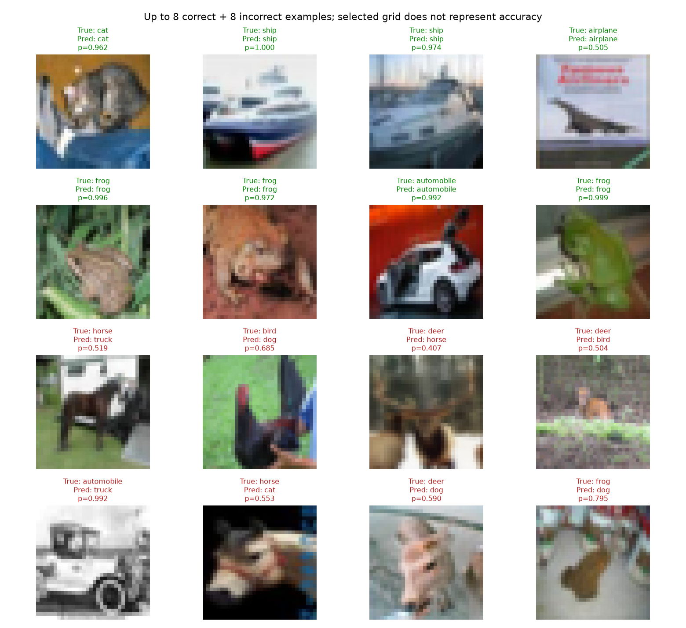

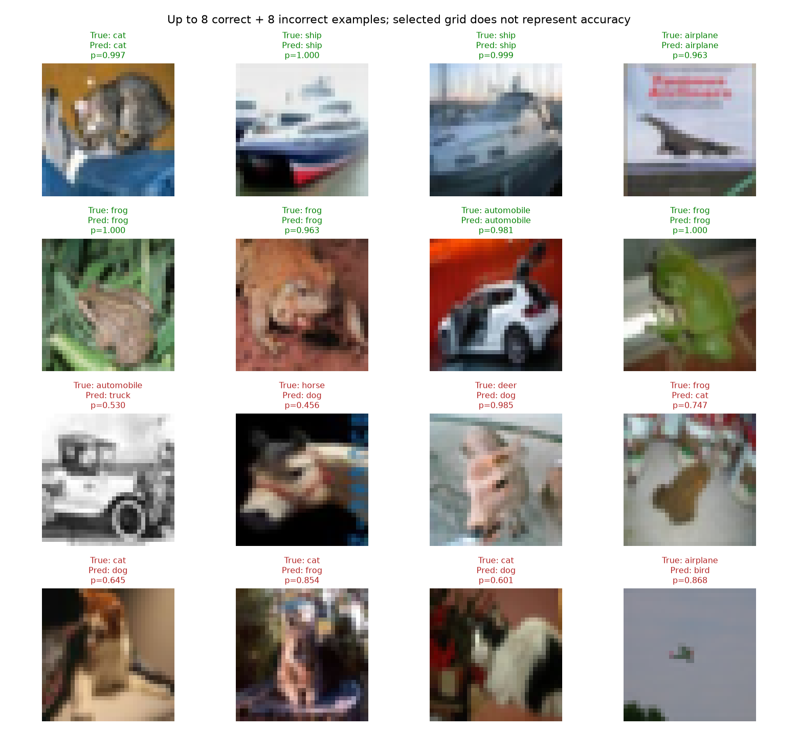

Đọc hình và [CSV ResNet](outputs/runs/20261030T052121Z_cifar10_scheduled64_b895bfc1/resnet18/finetune/prediction_examples.csv): index 37 automobile→truck p=0,9917, index 59 frog→dog p=0,7946. [CSV DenseNet](outputs/runs/20261030T052121Z_cifar10_scheduled64_b895bfc1/densenet121/finetune/prediction_examples.csv): index 58 deer→dog p=0,9851; index 68 cat→frog p=0,8545; index 97 airplane→bird p=0,8678. Confidence cao vẫn có thể sai.

Lưới chọn tối đa 8 đúng+8 sai, không đại diện tỷ lệ lỗi/lát cắt phổ biến nhất. Counts toàn test ở 3.3 mới hỗ trợ kết luận cặp nhầm chính. Chưa có thống kê lỗi theo độ sáng/kích thước vật thể nên không quy lỗi cho nền/ánh sáng.

H có ví dụ dog→deer p=0,819, horse→dog p=0,757; không gắn các mẫu đó vào S.

<div style="break-before: page; page-break-before: always;"></div>

### 3.6. Kết quả search trong từng điều kiện thực nghiệm

H chọn LR 0,001/batch 64 cho cả hai. LR 0,01 kém hơn trong grid này, chưa chứng minh tối ưu ngoài grid. Fine-tune tăng test accuracy ResNet +5,40/DenseNet +3,32 điểm phần trăm; thêm ngân sách nên chưa phải ablation ngang epoch.

S dùng một recipe định trước, không grid search. Accuracy 91,80% không phải best trial của nhiều optimizer. Tuned ở 2.8 chưa có benchmark đầy đủ để so AdamW/SGD hoặc last-block/last-two-blocks.

Calibration CPU riêng trên 640 train/160 val, một epoch, không dùng test: ResNet full-image fine epoch batch64/128 là 7,646/5,810 s; DenseNet batch128 là 10,010 s. Phép đo nhỏ chỉ phục vụ dự toán, không thay chi phí full S hay khẳng định batch128 luôn nhanh hơn. Đoạn nối LR trên hình không phải kết quả tại LR trung gian.

<div style="break-before: page; page-break-before: always;"></div>

### 3.7. Chi phí huấn luyện và đánh giá

**Run S, CPU**, nguồn [cost comparison](outputs/runs/20261030T052121Z_cifar10_scheduled64_b895bfc1/cost_comparison.csv), công thức tại 2.10.

| Model | Stage | Execution | Pipeline training (s) | Test 10.000 ảnh (s) |
|---|---|---|---|---|
| resnet18 | head | pooled_feature_cache | 360.69 | 45.20 |
| resnet18 | finetune | full_image_forward | 6901.23 | 41.85 |
| densenet121 | head | pooled_feature_cache | 648.81 | 207.69 |
| densenet121 | finetune | full_image_forward | 20972.13 | 141.52 |

Fine pipeline DenseNet dài hơn khoảng 3,04 lần ResNet trong S; cùng full-image forward nhưng actual epochs/compute khác. Head pooled cache không phải tốc độ end-to-end ảnh. Pipeline khoảng 115,02/349,54 phút; không suy ra thời gian T4 từ CPU.

**Run H, CPU với cache khác nhau:**

| model | stage | execution | pipeline_training_seconds | test_seconds |
|---|---|---|---|---|
| resnet18 | head | pooled_feature_cache | 329.45 | 64.0 |
| resnet18 | finetune | full_image_forward | 1414.15 | 62.76 |
| densenet121 | head | pooled_feature_cache | 521.51 | 100.4 |
| densenet121 | finetune | cached_frozen_prefix | 741.18 | 92.39 |

Khuyến nghị lịch sử H chọn ResNet theo validation (82,10% so với 81,46%); lựa chọn của run S được trình bày tại 3.1. Không đảo lựa chọn H vì test DenseNet nhỉnh hơn.

Pipeline train ghi nhận: ResNet 1414,15 s; DenseNet 741,18 s (ít hơn khoảng 47,59%). Đây là thời gian thực tế gồm extraction+all head trials+fine-tune, **không phải kết luận kiến trúc DenseNet nhanh hơn**: DenseNet dùng cached frozen prefix, ResNet full_image_forward, số tham số học cũng khác. Test chạy toàn mạng: ResNet 62,76 s, DenseNet 92,39 s; test time bao gồm loader/chuyển thiết bị/forward, chưa phải latency per-image chuẩn hóa. Cần T0 cùng policy/hardware trước khi xếp hạng hiệu quả.

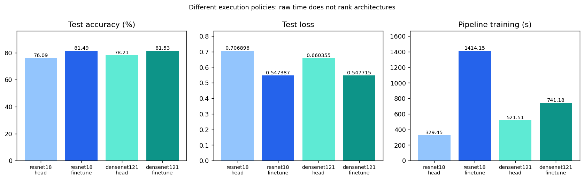

GPU training peak S là null vì CPU; không lấy VRAM inference B để điền cho training.

<div style="break-before: page; page-break-before: always;"></div>

### 3.8. Save/load và bằng chứng inference

[Verification S](outputs/runs/20261030T052121Z_cifar10_scheduled64_b895bfc1/verification.json) ghi metric recomputation/confusion totals/validation selection passed, 4 roundtrip. [ResNet](outputs/runs/20261030T052121Z_cifar10_scheduled64_b895bfc1/resnet18/finetune/roundtrip.json)/[DenseNet](outputs/runs/20261030T052121Z_cifar10_scheduled64_b895bfc1/densenet121/finetune/roundtrip.json) ghi 8 mẫu, max_probability_error=0, passed=true trên môi trường S. Phạm vi chỉ 8 mẫu, không phải full-test sau load.

[inference.py](src/inference.py) tách load_model khỏi predict_image; sau load model eval, đọc image size từ checkpoint, trả model/predicted/probability/actual/probabilities. [infer.py](scripts/infer.py) là CLI dùng chung. B nạp checkpoint S trên CUDA, cả hai dự đoán cat từ PNG test index0.

H cũng có 4 roundtrip passed trên 8 mẫu. Nhận xét thiếu file nặng trong checkout lịch sử không mô tả chung mọi run hiện tại. Chưa chạy lại toàn test sau load trên T4 trong benchmark một ảnh.

<div style="break-before: page; page-break-before: always;"></div>

### 3.9. Benchmark một ảnh khi model đã nạp sẵn

Đã thực thi ngày 03/11/2026 (giờ Việt Nam) trên Kaggle Tesla T4, CUDA 13.0, PyTorch 2.11.0+cu130, torchvision 0.26.0+cu130, Python 3.13.16. Mỗi model chạy trong process riêng trên một GPU, batch 1, FP32, eval/inference_mode, TF32 tắt, 4 CPU threads. Checkpoint fine-tune thuộc run `20261030T052121Z_cifar10_scheduled64_b895bfc1`; đây là đo inference GPU của checkpoint có sẵn, không phải huấn luyện lại.

Đầu vào là cùng PNG CIFAR-10 test index 0, nhãn cat, ảnh gốc 32×32, preprocessing resize 64×64 theo checkpoint. Đầu ra gồm nhãn dự đoán, xác suất và phân phối 10 lớp; cả hai model dự đoán cat. Tổng thời gian đo từ đọc/giải mã PNG đến chuỗi JSON: preprocessing → chuyển CPU/GPU → forward → softmax/kết quả về CPU → serialization. Không tính nạp model/checkpoint hay ghi báo cáo. Sau 20 warm-up, đo độc lập 100 request; từng bước và bộ nhớ được đo trong các lượt riêng.

| Model | Mean (ms/ảnh) | Median (ms/ảnh) | P95 (ms/ảnh) | RSS peak (MiB) | VRAM allocated peak (MiB) | VRAM reserved peak (MiB) |
|---|---:|---:|---:|---:|---:|---:|
| ResNet18 | 4,306 | 3,761 | 5,135 | 1284,934 | 56,535 | 66 |
| DenseNet121 | 15,555 | 15,329 | 16,157 | 1309,516 | 42,848 | 48 |

Request đầu sau khi nạp model được ghi riêng: ResNet18 6175,540 ms, DenseNet121 477,552 ms; không đưa vào thống kê warmed. Đây là một mẫu đầu mỗi process, chịu ảnh hưởng khởi tạo thư viện và cache dùng chung; không dùng để xếp hạng tốc độ khởi động kiến trúc.

RSS ngay sau nạp model lần lượt 940,711/986,801 MiB. Trong lượt đo bộ nhớ đã warm-up, RSS peak tăng 0,070/0,074 MiB so với baseline ngay trước lượt đó; CUDA allocated peak tăng 4,703/6,734 MiB. RSS gồm thư viện, model và bộ nhớ process, lấy mẫu mỗi 1 ms nên có thể bỏ lỡ đỉnh ngắn. Allocated/reserved là số liệu allocator PyTorch, không gồm toàn bộ CUDA context/VRAM của process. Các số này mô tả tài nguyên quan sát được, không xác lập RAM/VRAM tối thiểu để triển khai.

Giới hạn: chỉ lặp một ảnh, có OS cache, một phiên GPU và không đánh giá biến thiên giữa nhiều phiên hoặc toàn tập test. Không suy ra throughput theo batch hay accuracy từ phép đo này. [Bằng chứng](outputs/published/single_image_benchmark/20261102T184034Z_kaggle/provenance.json) lưu nguồn checkpoint, SHA256 gói thực thi và ID hai benchmark; mỗi thư mục model có 100 mẫu latency, stage samples, environment, prediction và manifest đã đối chiếu. [Notebook Kaggle đã lưu](https://www.kaggle.com/code/thuongfeai/lab02-single-image-benchmark) là version 1; bản notebook local đã thu hồi đủ 4 code cell có execution count và output, không có output lỗi.


Kết quả được tích hợp tại mục 8 của [notebook Modeling](notebooks/02_lab02_modeling.ipynb), đọc artifact đã kiểm checksum và khớp nguồn training run. [Notebook thực thi T4 gốc](notebooks/03_lab02_single_image_benchmark.ipynb) được giữ làm bằng chứng. Nguồn đo là [benchmark_inference.py](scripts/benchmark_inference.py); protocol ở 2.10. Bằng chứng xuất riêng trong outputs/published giữ provenance gói thực thi.

<div style="break-before: page; page-break-before: always;"></div>

### 3.10. Kết luận, giới hạn và hướng phát triển

Trong S, DenseNet đạt chất lượng cao hơn ResNet và được chọn bằng validation. Đổi lại, train/test CPU và median inference T4 dài hơn trong các phép đo tương ứng. Thiết bị/phạm vi timing được báo cáo riêng; không dùng CPU training để suy latency GPU.

H có test gần nhau nhưng cache khác nhau nên train time chưa đủ chọn kiến trúc. H/S đổi nhiều yếu tố, chưa cô lập scheduler/augmentation/dropout/unfreeze. Một seed, thiếu calibration xác suất và thiếu nhiều phiên benchmark là giới hạn.

| Quyết định | Câu hỏi ở 1.1 | Bằng chứng/giới hạn |
|---|---|---|
| Chọn bằng validation | So chất lượng | H chọn ResNet, S chọn DenseNet; không đảo theo test |
| Ghi cache/ngân sách | Chất lượng và chi phí | 2.5/3.7; không xem mọi train time tương đương |
| Tách load khỏi request | Thời gian một ảnh | 2.10/3.9; first/warmed tách riêng |
| Feature thủ công chỉ EDA | Hợp đồng CNN | 2.2/2.3; không nối vào input |

Hướng phát triển: nhiều seed/cùng execution policy; ablation từng yếu tố; kiểm tra lỗi theo lát cắt định trước; benchmark nhiều ảnh/phiên và toàn bộ VRAM process khi lập cấu hình triển khai. Tuned vẫn là thiết kế chờ benchmark.

**Nguồn bằng chứng:** [comparison H](outputs/runs/20261024T075133Z_cifar10_cpu_full64_71863a0e/comparison.csv), [comparison S](outputs/runs/20261030T052121Z_cifar10_scheduled64_b895bfc1/comparison.csv), [provenance B](outputs/published/single_image_benchmark/20261102T184034Z_kaggle/provenance.json). Run/log/checkpoint thô lưu local, Git ignore; link outputs/runs cần bộ artifact tương ứng. B đã xuất riêng, không chứa weights.

**Tài liệu nền tảng:** [dl_flow](../../docs/dl_flow.md), [dl_data](../../docs/dl_data.md), [dl_training](../../docs/dl_training.md), [eda](../../docs/eda.md), [eda-image](../../docs/eda-image.md), [feature](../../docs/feature.md), [feature-image](../../docs/feature-image.md).

- [Torchvision ResNet18](https://docs.pytorch.org/vision/stable/models/generated/torchvision.models.resnet18.html) và [DenseNet121](https://docs.pytorch.org/vision/stable/models/generated/torchvision.models.densenet121.html): weights và preprocessing.
- [PyTorch optim](https://docs.pytorch.org/docs/stable/optim.html): AdamW, SGD và LR scheduler; cấu hình đề xuất không phải kết quả đo.
- [Transfer learning tutorial](https://docs.pytorch.org/tutorials/beginner/transfer_learning_tutorial.html): freeze/fine-tuning.
