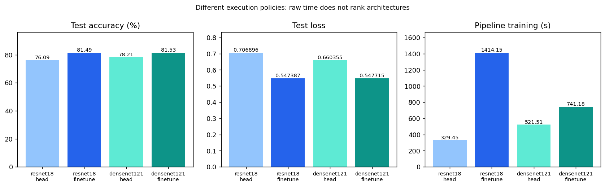
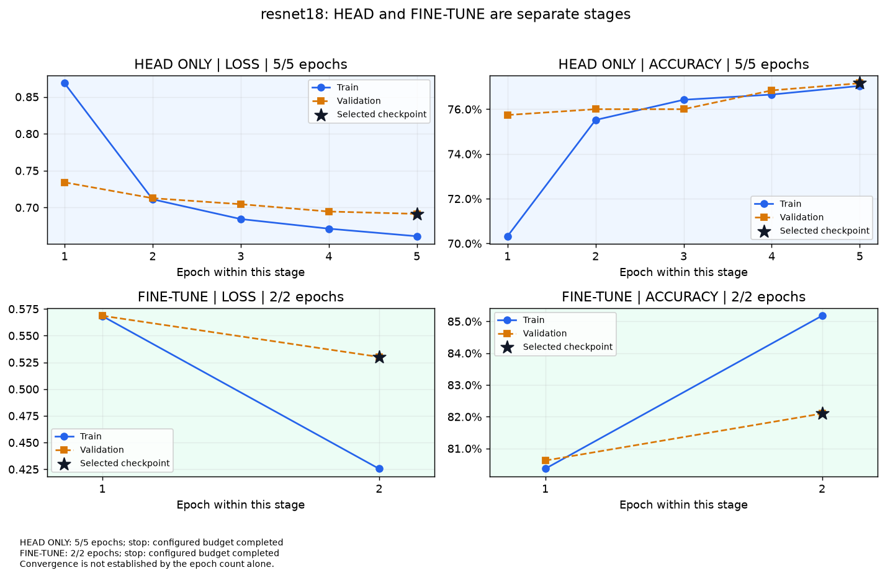
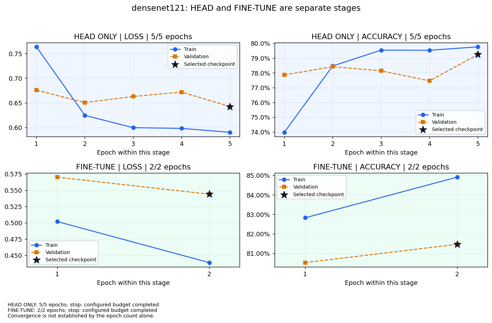

# Walkthrough & Full-Flow Technical Report — Lab 02

> **Lab Title:** Lab 02 — Transfer learning trên CIFAR-10
> **Status:** Kết quả lịch sử đã có; chỉnh trình bày local; tuning đã triển khai và kiểm thử; benchmark tuning đầy đủ chưa chạy.
> **Primary Objective:** So sánh chất lượng và chi phí của hai pretrained architectures, với bằng chứng không trộn giữa profile.
> **Workflow Playbook References:** [dl_flow](../../docs/dl_flow.md) | [dl_data](../../docs/dl_data.md) | [dl_training](../../docs/dl_training.md) | [eda](../../docs/eda.md) | [eda-image](../../docs/eda-image.md) | [feature](../../docs/feature.md) | [feature-image](../../docs/feature-image.md)

Dựa trên [walkthrough_template](../../.agents/templates/walkthrough_template.md). Rule 1: [spec-driven-development](../../.agents/skills/spec-driven-development/SKILL.md); Rule 2: [walkthrough-and-experiment-tracking](../../.agents/skills/walkthrough-and-experiment-tracking/SKILL.md); Rule 3: [documentation-and-adrs](../../.agents/skills/documentation-and-adrs/SKILL.md).

Điểm vào: [README](README.md) → [EDA](notebooks/01_lab02_eda.ipynb) → [Modeling](notebooks/02_lab02_modeling.ipynb) → tài liệu này. Các báo cáo trong run là artifact lịch sử; nội dung kỹ thuật hiện hành chỉ sửa tại đây.

## 1. TECHNICAL SPECIFICATION & FLOW DESIGN

### 1.0. Brief Interpretation and Clarifications

Theo [đề đang lưu](description_lab_02.md), cần nhiều pretrained architectures, thay classifier, freeze/fine-tune, train/evaluate, điều chỉnh LR/batch và TensorBoard. CIFAR-10 RGB là dataset đã chốt. File đề hiện tại ghi riêng nội dung ảnh và phạm vi triển khai; đã đối chiếu ảnh đề slide trang 23 trong lượt rà soát này; CIFAR-10 là lựa chọn của source, không phải ràng buộc trong ảnh.

- Hai notebook tách trách nhiệm: EDA chỉ data raw → preprocess → feature engineering; modeling chứa kiến trúc/train/evaluation. Không in source code hoặc toàn bộ model vào notebook.
- Chất lượng gần nhau cần so thêm thời gian, số tham số được học và điều kiện cache. Không chọn model chỉ từ chênh lệch test 0,04 điểm phần trăm.
- Tuning LR/optimizer/mở thêm block là giả thuyết cần kiểm chứng; chưa có run mới. Không ghi chúng thành kết quả đã đạt.
- Dọn file theo phương án đã chốt: gom logic đóng gói, giữ CLI có chức năng; các snapshot nguồn có hash giữ nguyên.

### 1.0.1. Đối chiếu ảnh đề và tên artifact

| Yêu cầu trong ảnh | Bằng chứng trong source hiện hành | Kết luận |
|---|---|---|
| Nhiều pretrained architectures | `models.SPECS`: ResNet18 và DenseNet121, ImageNet weights enum | Đáp ứng về code; không bắt buộc VGG |
| Khảo sát cấu trúc/layer/parameter | `architecture.txt`, `parameters.csv`, biểu đồ số tham số; full structure thu gọn trong modeling | Đáp ứng; không in dài mặc định |
| Thay classifier, freeze/fine-tune | `build_model`, `configure_trainable`, BN statistics cố định | Đáp ứng; test gradient/frozen weights |
| transforms + DataLoader | `data.image_transform`, `IndexedImages`, `image_loader` | Đáp ứng; RGB và normalization có test |
| Loss, optimizer, loop | `experiment.pass_epoch/fit`: CrossEntropy + AdamW/SGD momentum | Đáp ứng về triển khai |
| Điều chỉnh LR/batch | 2 LR × 2 batch mỗi kiến trúc, `search_results.csv` | Có kết quả đã lưu; chọn bằng validation |
| TensorBoard | SummaryWriter scalars/LR/histogram/graph; hình dựng từ event scalars đã lưu | Có code và artifact lịch sử; thiếu event files trong checkout để xác minh live mới |
| Evaluate test | 4 condition, confusion counts và metric tính lại khớp | Đáp ứng ở mức bằng chứng đã lưu |
| EDA tách modeling (yêu cầu người dùng) | `src/eda.py`, notebook 01 chỉ dùng outputs/eda; notebook 02 đọc kết quả model | Đã tách cả import và nguồn artifact |
| Naming/template (quy định repo) | `description_lab_02.md`, `walkthrough_lab_02.md`, `README.md`, 01/02 notebook | Đúng tên template; không tạo Lab02_CIFAR10.md/REPORT.md thứ hai |

Kết luận: code bao phủ các yêu cầu trong ảnh. Không chứng nhận tái lập toàn bộ training chỉ từ CSV/PNG: checkpoint, test predictions NPZ và event files của run cũ không có trong checkout. GPU 224×224 và tuning mở rộng vẫn chưa chạy. Run CPU lịch sử đã có trước lượt sửa và không tuân thủ Zero Waste hiện hành; lượt này chỉ đo EDA, kiểm thử và thực thi view.

### 1.1. Master Flow Design

```mermaid
flowchart LR
  A[Raw CIFAR-10 RGB] --> B[Fixed stratified split]
  B --> C[EDA: class counts and RGB features]
  C --> D[Resize / scale / normalize]
  D --> E[Head LR x batch search on validation]
  E --> F[Fine-tune selected head]
  F --> G[Lock checkpoint using validation]
  G --> H[Test metrics and time]
  H --> I[Visual comparison and error analysis]
```

### 1.2. Problem Formulation and Modality

Computer Vision; 10-class single-label classification. Raw `[H,W,C]=[32,32,3]` RGB; đầu vào float32 `[B,3,H,W]`, H=W=64 trong run CPU, 224 trong cấu hình GPU. Đầu ra logits `[B,10]`; CrossEntropy nhận logits, softmax dùng khi đánh giá.

### 1.3. Data Contract and Partitioning Strategy

50.000 train chính thức → 45.000 train + 5.000 validation stratified, seed 42. Test 10.000 chính thức giữ riêng. Mỗi lớp 4.500/500/1.000 ảnh. RGB mean/std mô tả được tính trên train; normalization cố định theo ImageNet. Không augmentation trong run đã có để cache đầu vào nhất quán. Resize 64×64 không phải transform 224×224 chính thức.

Bổ sung ngày 26/10/2026: đo lại raw CIFAR-10 từ 6 batch đã kiểm MD5 chính thức, lưu riêng tại `outputs/eda/`. Split 45.000/5.000/10.000 tái dựng theo thuật toán seed 42 có SHA256 `dcfe29a6b8c5f308b77679d3ca6f33156aa8e76db22c9b4c74a93251afc686c8`, khớp `data_sha256` trong config head của run cũ. Mean/std RGB khớp trong sai số <1e-12. Không sửa source snapshot, manifest hay metric của run cũ.

Kiểm tra 60.000 ảnh: 0 nhãn ngoài miền, 0 pixel không hữu hạn, 0 ảnh hằng, 0 bản ghi trùng byte trong/chéo train-val-test. Đây là kiểm tra trùng chính xác, không phát hiện near-duplicate. Các batch có dtype uint8, shape 32×32×3, min/max 0/255. Không có mask phân đoạn nên foreground ratio/bounding box ghi **not applicable**, không coi pixel đen là nền.

Histogram RGB, ảnh trung bình theo lớp, mean/variance heatmap, boxplot brightness/contrast/edge density, correlation giữa feature và giữa ảnh trung bình lớp đều chỉ đo trên train. Foreground không được suy diễn. Đọc hình: airplane/ship có median brightness cao hơn frog; truck có median contrast và edge density cao. Heatmap mean sáng hơn ở mép trên, variance thấp hơn quanh trung tâm. Đây là mô tả train, không phải kết luận nguyên nhân phân lớp. Handcrafted features chỉ phục vụ chẩn đoán; tensor vẫn RGB CHW, không nối thêm feature vào đầu vào. Mean/std train là thống kê mô tả; normalization vẫn theo ImageNet của weights.

### 1.4. Baseline Model and Target Metrics

Baseline so sánh trong lab: head-only trên backbone pretrained. Chưa có baseline train-from-scratch; do đó chưa định lượng riêng lợi ích pretraining. Primary metric: validation accuracy để chọn cấu hình. Báo cáo test loss, accuracy, Macro F1, macro precision/recall, precision/recall(TPR)/F1/FPR theo lớp. Không có acceptance threshold được chốt trước run lịch sử; không đặt lại ngưỡng hậu nghiệm.

Đề xuất cho tuning mới: chạy seed 42/43/44, chọn theo validation accuracy; nếu chênh dưới 0,1 điểm phần trăm thì xét validation loss rồi thời gian pipeline cùng chính sách thực thi. Đây là tiêu chí đề xuất, chưa áp dụng vào run cũ.

### 1.5. Loss Function and Optimization Design

Run lịch sử: CrossEntropy, AdamW weight_decay=1e-4; head LR={1e-3,1e-2} × batch={32,64}, 5 epoch/trial. Fine-tune backbone LR=1e-5, head LR=1e-4, 2 epoch. Chưa có scheduler/optimizer ablation.

Triển khai mới ngày 26/10/2026: [tuned.json](config/tuned.json) chạy trực tiếp bằng `scripts/run.py`; thiết kế đã hợp nhất trong mục này. Chưa có kết quả benchmark tuning đầy đủ.

| Thành phần | Triển khai | Kiểm soát |
|---|---|---|
| Head search | AdamW LR {1e-4,1e-3,1e-2} × batch {64,128}, 10 epoch/trial | Cùng initial classifier và shuffle seed |
| Fine control | AdamW, backbone 1e-5, head 1e-4, last block, LR cố định | Min 10 / max 30 epoch; patience 7 theo val loss |
| Fine grid | AdamW LR {3e-6,1e-5,3e-5}; SGD momentum 0,9 LR {1e-4,3e-4,1e-3}; head=10× | LR riêng theo optimizer; cùng giới hạn min 10 / max 30 và stopping policy |
| Unfreeze | Last block hoặc last two blocks; tổng 12 tổ hợp optimizer/LR/depth + 1 control | Reset toàn bộ state_dict, kể cả BN buffers, về cùng selected head |
| ResNet hai block | layer3 + layer4 + fc | layer1/layer2 vẫn frozen |
| DenseNet hai block | denseblock3 + transition3 + denseblock4 + norm5 + classifier | Không bỏ sót transition3; block1/block2 frozen |
| Scheduler | CosineAnnealingLR, T_max=30; control LR cố định | Step sau optimizer/epoch, log LR thực dùng trước khi step |
| Cache | Tắt prefix cache ở tuned cho cả hai kiến trúc | Raise lỗi trước load weights nếu mở hai block mà cache vẫn bật |
| Seed | Khởi tạo/shuffle 42, rồi 43/44; split_seed cố định 42 | Thay training seed không đổi train/validation/test |

Checkpoint mỗi trial chọn validation accuracy lớn nhất; hòa chọn validation loss nhỏ hơn rồi epoch sớm hơn. Chọn candidate theo ba bước: giữ accuracy trong 0,001 của mức cao nhất; giữ loss trong 0,005 của mức thấp nhất trong nhóm đó; chọn fit time thấp nhất. Tolerances là đơn vị tuyệt đối; 0,001 accuracy = 0,1 điểm phần trăm. Không dùng test accuracy/loss để chọn. Policy mới không hồi tố thay đổi checkpoint/kết quả lịch sử.

Khuyến nghị giữa hai kiến trúc dùng cùng validation bands và **selected recipe training cost** chỉ khi execution policy giống nhau. Nếu policy khác nhau như run cũ, bỏ time tie-break và chọn theo validation accuracy/loss. Chất lượng gần nhau ở một seed chưa chứng minh tương đương thống kê; cần lặp seed và kiểm tra độ ổn định trước kết luận.

AdamW weight decay tách khỏi gradient còn SGD dùng L2 theo optimizer; cùng hệ số không làm hai regularization hoàn toàn tương đương. Kết quả so sánh phản ánh từng recipe hoàn chỉnh. Mở thêm block có thể tăng khả năng thích nghi nhưng cũng có thể tăng overfit, thời gian và VRAM; chưa khẳng định cải thiện khi chưa đo validation.

### 1.5.1. Đo thời gian và chi phí

- `train_pass_seconds` và `validation_seconds` đo riêng, đồng bộ CUDA trước/sau; train pass gồm loader, truyền dữ liệu và tính toán.
- `train_seconds` là fit wall time, gồm train/validation và phần log/checkpoint trong vòng fit; không phải GPU compute thuần. History có LR từng nhóm, throughput; summary có peak CUDA allocated memory.
- `pipeline_training_seconds` = extraction + toàn bộ head search + toàn bộ fine search. Không cộng lại selected head/fine lần thứ hai.
- `selected_recipe_training_seconds` = extraction + selected head fit + selected fine fit; dùng để cân nhắc recipe khi chất lượng tương đương trong các bands.
- `model_selection_wall_seconds` còn tính startup model/weights, preview, tạo loader và đóng gói search. Không dùng số này như pure training compute. Test pass đo riêng và vẫn forward toàn bộ model.

GPU 224×224 mới được so riêng với CPU 64×64 cũ; không đặt cạnh nhau rồi quy chênh lệch cho optimizer/depth. Grid đầy đủ có 6 head + 13 fine trials/model/seed; `--dry-run` hiển thị ngân sách mà không tải data/weights. Không tự chạy benchmark dài chỉ để kiểm tra source.

### 1.6. Execution Environment Constraints

Run cũ: Windows CPU, CPython 3.13.3, torch 2.14.1+cpu, torchvision 0.29.1+cpu, ảnh 64×64. [requirements.txt](requirements.txt) chứa phiên bản Windows đã ghi; không có dòng `python==...`. Chưa xác thực toàn bộ Requires-Python/khả năng cài trên Linux. Phiên bản của run nằm trong `environment.json`.

Đợt sửa này chỉ chạy lại các view từ artifact, không train full CPU theo [AGENTS 1.5](../../.agents/AGENTS.md). Thí nghiệm mới thực thi trên GPU sau sanity overfit và test gradient/shape. Profile CPU và GPU báo cáo riêng.

## 2. FULL-FLOW EXPERIMENT LINEAGE & CHANGELOG

### 2.1. Flow Comparison Matrix

Run lịch sử `20261024T075133Z_cifar10_cpu_full64_71863a0e`; [registry](outputs/selected_run.json). Tất cả hàng dùng cùng CIFAR-10/split, RGB 64×64, không augmentation, ImageNet normalization.

| model | stage | loss | accuracy | macro_f1 | macro_precision | macro_recall | best_val_accuracy |
|---|---|---|---|---|---|---|---|
| resnet18 | head | 0.706896 | 0.7609 | 0.761075 | 0.763462 | 0.7609 | 0.7716 |
| resnet18 | finetune | 0.547387 | 0.8149 | 0.814634 | 0.815284 | 0.8149 | 0.821 |
| densenet121 | head | 0.660355 | 0.7821 | 0.781146 | 0.786055 | 0.7821 | 0.7924 |
| densenet121 | finetune | 0.547715 | 0.8153 | 0.815109 | 0.815191 | 0.8153 | 0.8146 |

Bộ metric theo lớp (FPR = FP/(FP+TN), one-vs-rest) tính lại từ confusion counts:

| model | stage | class | precision | recall_tpr | f1 | fpr |
|---|---|---|---|---|---|---|
| resnet18 | head | airplane | 0.7113 | 0.818 | 0.7609 | 0.0369 |
| resnet18 | head | automobile | 0.8149 | 0.854 | 0.834 | 0.0216 |
| resnet18 | head | bird | 0.7283 | 0.67 | 0.6979 | 0.0278 |
| resnet18 | head | cat | 0.634 | 0.646 | 0.6399 | 0.0414 |
| resnet18 | head | deer | 0.6712 | 0.741 | 0.7044 | 0.0403 |
| resnet18 | head | dog | 0.7736 | 0.687 | 0.7278 | 0.0223 |
| resnet18 | head | frog | 0.812 | 0.786 | 0.7988 | 0.0202 |
| resnet18 | head | horse | 0.7904 | 0.792 | 0.7912 | 0.0233 |
| resnet18 | head | ship | 0.8562 | 0.822 | 0.8388 | 0.0153 |
| resnet18 | head | truck | 0.8427 | 0.793 | 0.8171 | 0.0164 |
| resnet18 | finetune | airplane | 0.7992 | 0.84 | 0.8191 | 0.0234 |
| resnet18 | finetune | automobile | 0.8833 | 0.863 | 0.873 | 0.0127 |
| resnet18 | finetune | bird | 0.7578 | 0.776 | 0.7668 | 0.0276 |
| resnet18 | finetune | cat | 0.6948 | 0.699 | 0.6969 | 0.0341 |
| resnet18 | finetune | deer | 0.7977 | 0.765 | 0.781 | 0.0216 |
| resnet18 | finetune | dog | 0.7878 | 0.735 | 0.7605 | 0.022 |
| resnet18 | finetune | frog | 0.8319 | 0.871 | 0.851 | 0.0196 |
| resnet18 | finetune | horse | 0.8815 | 0.826 | 0.8529 | 0.0123 |
| resnet18 | finetune | ship | 0.8431 | 0.908 | 0.8743 | 0.0188 |
| resnet18 | finetune | truck | 0.8756 | 0.866 | 0.8708 | 0.0137 |
| densenet121 | head | airplane | 0.7853 | 0.823 | 0.8037 | 0.025 |
| densenet121 | head | automobile | 0.8451 | 0.851 | 0.848 | 0.0173 |
| densenet121 | head | bird | 0.7697 | 0.695 | 0.7304 | 0.0231 |
| densenet121 | head | cat | 0.621 | 0.703 | 0.6595 | 0.0477 |
| densenet121 | head | deer | 0.7733 | 0.672 | 0.7191 | 0.0219 |
| densenet121 | head | dog | 0.8269 | 0.645 | 0.7247 | 0.015 |
| densenet121 | head | frog | 0.7904 | 0.852 | 0.82 | 0.0251 |
| densenet121 | head | horse | 0.7419 | 0.891 | 0.8096 | 0.0344 |
| densenet121 | head | ship | 0.8317 | 0.875 | 0.8528 | 0.0197 |
| densenet121 | head | truck | 0.8753 | 0.814 | 0.8435 | 0.0129 |
| densenet121 | finetune | airplane | 0.8421 | 0.832 | 0.837 | 0.0173 |
| densenet121 | finetune | automobile | 0.8765 | 0.859 | 0.8677 | 0.0134 |
| densenet121 | finetune | bird | 0.7788 | 0.757 | 0.7677 | 0.0239 |
| densenet121 | finetune | cat | 0.6826 | 0.699 | 0.6907 | 0.0361 |
| densenet121 | finetune | deer | 0.7819 | 0.771 | 0.7764 | 0.0239 |
| densenet121 | finetune | dog | 0.7847 | 0.751 | 0.7675 | 0.0229 |
| densenet121 | finetune | frog | 0.8335 | 0.866 | 0.8494 | 0.0192 |
| densenet121 | finetune | horse | 0.8544 | 0.857 | 0.8557 | 0.0162 |
| densenet121 | finetune | ship | 0.8652 | 0.886 | 0.8755 | 0.0153 |
| densenet121 | finetune | truck | 0.852 | 0.875 | 0.8633 | 0.0169 |

### 2.2. Changelog per Run

| Lượt | Data / preprocess | Model / training | Định lượng | Evaluation |
|---|---|---|---|---|
| Cũ: head → fine-tune ResNet | Split giữ nguyên; 64×64, cache pooled head | Mở layer4+fc, thêm 2 epoch | Accuracy +5,40 điểm phần trăm; Macro F1 +0,05356 | Khóa bằng val, sau đó test |
| Cũ: head → fine-tune DenseNet | Split giữ nguyên; 64×64 | Mở denseblock4+norm5+classifier, thêm 2 epoch, cache prefix | Accuracy +3,32 điểm phần trăm; Macro F1 +0,03396 | Test forward toàn mạng |
| 2026-10-26: rà soát bổ sung | Raw checksum + integrity + pixel/spatial/features; khớp hash split cũ | EDA riêng module; modeling thêm tham số, heatmap metric và TensorBoard; bỏ nhánh TRAIN bị reset RUN | Không có metric train mới | Kiểm thử lại source, notebook và artifact |
| 2026-10-26: chỉnh trình bày | Không đổi split, metric hoặc preprocessing đã chạy | Tách EDA/modeling, views từ artifact; gộp delivery; chuẩn hóa tên | Không có kết quả train mới; delta model không áp dụng | Thực thi lại notebook và đối chiếu metric/links |
| 26/10/2026: triển khai tuning | Data CIFAR-10 giữ nguyên; split_seed riêng | AdamW/SGD, LR groups, cosine, hai block, reset candidate, guard cache | Chưa có delta benchmark; xem kiểm thử bên dưới | Validation-only selection, time/cost tách phạm vi |
| T0–T4 đề xuất trước lượt này | 224×224, cùng GPU và chính sách cache | LR → optimizer → depth → scheduler | not run | Chọn bằng validation; test sau khi khóa |

### 2.3. Artifact Harvesting Log

Ngày 30/10/2026: triển khai recipe [scheduled.json](config/scheduled.json) theo [description](description_lab_02.md): một recipe/model, batch 128, head 12 epoch, fine-tune tối đa 20 epoch; cosine theo tỷ lệ 1.0 → 0.1 cho mỗi nhóm LR, early stopping validation loss. ResNet mở layer4.1+fc (4.725.770; 42,26%); DenseNet mở block3 layer11–12,18–24, transition3, block4 layer1–4,13–16, norm5 và classifier (2.921.034; 41,94%). Runtime kiểm tra giới hạn 50%; giữ BN statistics cố định. Snapshot notebook theo hash lưu trước khi đổi presentation. Chưa chạy full training, không có metric mới; các bảng kết quả lịch sử bên dưới không đại diện recipe này.

Nguồn số: [comparison.csv](outputs/runs/20261024T075133Z_cifar10_cpu_full64_71863a0e/comparison.csv), [cost_comparison.csv](outputs/runs/20261024T075133Z_cifar10_cpu_full64_71863a0e/cost_comparison.csv), [verification.json](outputs/runs/20261024T075133Z_cifar10_cpu_full64_71863a0e/verification.json). [Report HTML lịch sử](outputs/runs/20261024T075133Z_cifar10_cpu_full64_71863a0e/report_vi.html) giữ nguyên.

Notebook modeling dùng [notebook_views.py](src/notebook_views.py); EDA dùng [eda.py](src/eda.py) và `outputs/eda/`. Modeling lưu hình mới ở `outputs/review/<run>/` để không làm lệch manifest gốc. Checkpoint/dataset/prediction NPZ và events không đi cùng Git; các view đọc bảng/hình vẫn chạy khi thiếu các file nặng.

## 3. COMPARATIVE RESULTS, ERROR DIAGNOSTICS & FINAL SUBMISSION REPORT

### 3.1. Quantitative Evaluation & Comparison Matrix

| model | stage | execution | pipeline_training_seconds | test_seconds |
|---|---|---|---|---|
| resnet18 | head | pooled_feature_cache | 329.45 | 64.0 |
| resnet18 | finetune | full_image_forward | 1414.15 | 62.76 |
| densenet121 | head | pooled_feature_cache | 521.51 | 100.4 |
| densenet121 | finetune | cached_frozen_prefix | 741.18 | 92.39 |

DenseNet fine-tune hơn accuracy **+0,04 điểm phần trăm** nhưng loss **+0,0003283** (cao hơn); Macro F1 **+0,0004746**. Một seed không đủ kết luận hơn có ý nghĩa thống kê. Validation của ResNet là **82,10%**, DenseNet **81,46%**; registry khuyến nghị ResNet theo validation, không đảo lựa chọn vì test DenseNet nhỉnh hơn.

Pipeline train ghi nhận: ResNet 1414,15 s; DenseNet 741,18 s (ít hơn khoảng 47,59%). Đây là thời gian thực tế gồm extraction+all head trials+fine-tune, **không phải kết luận kiến trúc DenseNet nhanh hơn**: DenseNet dùng cached frozen prefix, ResNet full_image_forward, số tham số học cũng khác. Test chạy toàn mạng: ResNet 62,76 s, DenseNet 92,39 s; test time bao gồm loader/chuyển thiết bị/forward, chưa phải latency per-image chuẩn hóa. Cần T0 cùng policy/hardware trước khi xếp hạng hiệu quả.

### 3.2. Confusion Matrix Diagnostics

Đọc ảnh và đối chiếu counts: ResNet dog → cat **145/1000 = 14,5%**, cat → dog **108/1000 = 10,8%**; lớp cat có 699/1000 đúng. DenseNet dog → cat **144/1000 = 14,4%**. Bảng per-class ở 2.1 là số tính trực tiếp từ counts.

- resnet18: TPR thấp nhất cat = 69.90%; FPR cao nhất cat = 3.41%.
- densenet121: TPR thấp nhất cat = 69.90%; FPR cao nhất cat = 3.61%.

Ảnh RGB 32×32 có chi tiết hạn chế; tương đồng động vật là giả thuyết thị giác, chưa có kiểm định nguyên nhân.

### 3.3. Error Analysis Slices

Lưới DenseNet fine-tune đã mở: dog → deer với p=0,819; horse → dog p=0,757; automobile → truck p=0,642; airplane → truck p=0,734. Confidence cao không bảo đảm đúng. Lưới cố ý chọn tối đa 8 đúng và 8 sai nên không đại diện phân phối lỗi. [Notebook modeling](notebooks/02_lab02_modeling.ipynb) hiển thị lưới và confusion của cả hai cạnh nhau.

### 3.4. Key Technical Findings

Head search đã chọn LR=0,001/batch=64 cho cả hai. LR=0,01 kém hơn trên validation trong grid này; chưa chứng minh LR=0,001 là tối ưu toàn miền. Fine-tune đều cải thiện so với head nhưng có thêm ngân sách epoch; chưa cô lập tác động unfreeze dưới ngân sách ngang nhau. Đọc đường cong: ResNet fine-tune val loss giảm 0,5686 → 0,5301, val accuracy 80,62% → 82,10%; DenseNet val loss giảm 0,5701 → 0,5439, val accuracy 80,52% → 81,46%. Cuối fine-tune, train–val accuracy gap lần lượt khoảng 3,08 và 3,45 điểm phần trăm. DenseNet head có val loss tăng tạm ở epoch 3–4 rồi giảm ở epoch 5; không có bằng chứng tăng loss kéo dài. Chỉ 2 epoch fine-tune nên chưa đủ khẳng định đã hội tụ hoặc không overfit.

### 3.5. Checkpoint Verification (Save/Load)

Bốn `roundtrip.json` trong run ghi passed, max_probability_error=0 trên 8 mẫu; notebook chỉ hiển thị chứng cứ cũ. Chưa chạy inference mới vì checkpoint/dataset không nằm trong folder hiện tại. [infer.py](scripts/infer.py) là điểm vào kiểm chứng lại khi có checkpoint. Không khẳng định tái lập toàn test chỉ dựa trên kiểm tra 8 mẫu.

Kiểm tra checkout local: 39 file source snapshot, 14 khớp SHA256 theo byte, 25 chỉ khác LF/CRLF do Git. Không có thay đổi nội dung khác. Các snapshot/hash gốc không bị sửa; `delivery.audit_snapshot` báo riêng byte-exact và newline-only, không coi chuyển đổi xuống dòng là bằng chứng khớp byte. Đợt này chưa chạy lại full finalize/inference.

### 3.6. Decision Traceability

| Quyết định | Điểm 1.0 | Hướng giải quyết |
|---|---|---|
| Hai notebook tách biệt | EDA không modeling | EDA chỉ nhập src.datasets.eda (NumPy/Pillow/sklearn), kiểm thử subprocess chặn torch/torchvision/src.models.models/src.training.experiment; không đọc bảng kết quả model |
| Một tài liệu sống | Naming/template | Lab02_CIFAR10.md và RESULTS.md hợp nhất vào walkthrough_lab_02.md |
| Không xóa snapshot | Chống deadfile | Snapshot là chứng cứ hash/manifest; CLI/module hiện hành có bản đồ tham chiếu trong README |
| Gộp logic đóng gói | Dọn src/scripts đã trao đổi | finalize.py [--all] dùng src/delivery.py; CLI có một điểm vào |
| Chưa chọn thắng theo test | Chất lượng gần nhau | Giữ validation recommendation; so chi phí kèm execution policy |
| Mở thêm block | Đề xuất performance | T3 sau LR/optimizer, tắt cache cũ, chưa khẳng định cải thiện |

### 3.7. Conclusion & Lessons Learned

Kết quả chất lượng hiện tại gần ngang nhau; chi phí đo được khác nhưng bị nhiễu bởi policy cache. Chưa có kết quả tuning mới. Pipeline đã hỗ trợ grid cùng chính sách, optimizer-specific LR và mở hai block; bước benchmark mới cần kiểm chứng trên GPU và nhiều seed. Hai notebook tập trung biểu đồ, bảng ngắn và link source; source snapshot và bằng chứng gốc giữ nguyên.

### Nguồn chính thức

- [Torchvision ResNet18](https://docs.pytorch.org/vision/stable/models/generated/torchvision.models.resnet18.html) và [DenseNet121](https://docs.pytorch.org/vision/stable/models/generated/torchvision.models.densenet121.html): weights và preprocessing.
- [PyTorch optim](https://docs.pytorch.org/docs/stable/optim.html): AdamW, SGD và LR scheduler; cấu hình đề xuất không phải kết quả đo.
- [Transfer learning tutorial](https://docs.pytorch.org/tutorials/beginner/transfer_learning_tutorial.html): freeze/fine-tuning.

### Kiểm tra đợt chỉnh local

Hai notebook có 9 ảnh inline mỗi notebook, tối đa 7 dòng/code cell; thực thi đủ, không có output lỗi. Bộ kiểm thử đạt **20/20**, gồm cả test split/nhãn trên raw CIFAR-10, freeze/gradient/cache và hash snapshot. Kiểm tra cú pháp đạt cho 21 file Python hiện hành. Chi tiết kiểm chứng mới ghi tại [revision_validation.json](outputs/review/revision_validation.json). Thực thi hai notebook bằng kernel Jupyter, kiểm tra ảnh/bảng inline, giới hạn 8 dòng/cell, link nội bộ, hash snapshot và metric tính từ confusion counts. Kiểm thử PyTorch dùng model khởi tạo không tải weights để kiểm tra shape/freeze/gradient/cache. Không huấn luyện benchmark mới; không xác nhận lại inference toàn test hay mở TensorBoard live khi checkout thiếu checkpoint/event files gốc.

### Kiểm chứng mở rộng tuning

Bộ kiểm thử đạt **34/34**, không skip; cú pháp 24 file Python hợp lệ. Notebook modeling thực thi đủ 11 code cell, 11 hình inline, tối đa 7 dòng/cell. CUDA smoke trên GTX 1660 Ti/PyTorch 2.9.1+cu128 chạy train/validation một batch tổng hợp 2×3×224×224 cho cả hai model, scheduler và timing/memory đều qua; không coi là benchmark. Kết quả được ghi tại [tuning_validation.json](outputs/review/tuning_validation.json) và [JUnit](outputs/review/tuning_tests.xml). Có test optimizer/LR groups và cosine, gradient ở block vừa mở, one-batch overfit trên hai mạng thật, reset trial về cùng head/BN buffers, chặn test trong search, chọn validation không bị ảnh hưởng bởi test metrics, cost accounting và smoke test thực thi fit/search/predict/report trên dữ liệu tổng hợp.

Sanity với model khởi tạo ngẫu nhiên, freeze hai block cuối: AdamW LR 0,01 không qua ngưỡng loss 0,05 trong 50 bước; LR 0,001 qua cho cả hai model. Đây là chẩn đoán local trên hai ảnh tổng hợp, không phải ablation CIFAR-10 và không dùng để khẳng định LR tối ưu. Không tải weights để vượt test. Benchmark GPU 224×224 toàn bộ dữ liệu chưa chạy; accuracy lịch sử giữ nguyên.

API tham chiếu: [SGD](https://docs.pytorch.org/docs/2.14/generated/torch.optim.SGD.html), [CosineAnnealingLR](https://docs.pytorch.org/docs/2.14/generated/torch.optim.lr_scheduler.CosineAnnealingLR.html). Chữ ký và hành vi được kiểm thử thêm với PyTorch 2.9.1 của môi trường local.

### 26/10/2026 — Dọn file và khóa tham chiếu

Chấp thuận dọn theo báo cáo rà soát: CLI giảm 9 xuống 7; gộp workflow hoàn tất vào `finalize.py --all`, tải chia phần vào `download_assets.py --chunked`. Giữ resume tại ranh giới kiến trúc. Bỏ hàm view kế hoạch không có caller; nội dung thiết kế tuning chỉ còn tại mục 1.5, cấu hình chạy thực tế tại `config/tuned.json`. Không thay source snapshot/manifest/metric lịch sử.

10 module source giữ nhiệm vụ rõ: `delivery` sở hữu IO/hash/path nhẹ; EDA không kéo training dependencies. `data.prepare_indices` dùng lại split đã khóa trong EDA, `eda.rgb_statistics/class_counts` dùng chung cho build EDA và summary mỗi run. `reporting.write_final_report` là nơi ghép Markdown/HTML; finalizer cung cấp diagnostics đã kiểm chứng. Nội dung profile/epoch lấy từ config; inference sau đóng gói lấy model trong validation recommendation.

Sửa lỗi CSV mới có sẵn cột execution: view chỉ lấy execution từ bảng cost khi merge. `LAB02_DATA` được dùng thống nhất ở training/infer/finalize/resume/downloader. Workflow --all truyền rõ LAB02_RUN cho subprocess notebook, không phụ thuộc run đang được registry chọn.

README là bản đồ file/caller/đầu ra. Bộ test cleanup kiểm tra graph từ CLI/notebook production, CLI import/--help an toàn, không có hàm public không tham chiếu tĩnh, split dùng chung, công thức RGB độc lập, merge schema mới, checksum tải chia phần, và đúng run/checkpoint trong workflow --all. Đây là kiểm tra cấu trúc và hồi quy, không phải benchmark training mới. Kết quả đợt dọn ghi tại [cleanup_validation.json](outputs/review/cleanup_validation.json).

Kiểm chứng đợt cleanup: **50/50 test đạt**, không skip; 23 file Python qua kiểm tra cú pháp; EDA 8 code cell/9 hình và modeling 11 code cell/11 hình đều thực thi đủ, không có output lỗi. Không có benchmark mới.

### Làm rõ block, batch và ngân sách epoch

**Lý do mở các block cuối:** phần đầu pretrained thường biểu diễn cạnh/màu/họa tiết tổng quát; phần gần classifier được điều chỉnh để thích nghi nhãn CIFAR-10. Last block là baseline tiết kiệm chi phí, không được coi là tối ưu nếu chưa so validation. Với ResNet18, layer4+fc mở khoảng 8,40 triệu tham số; DenseNet121 denseblock4+norm5+classifier khoảng 2,17 triệu. Cùng tên “một block” không có nghĩa cùng năng lực hoặc chi phí. Last two blocks mở thêm layer3 hoặc denseblock3+transition3; cần theo dõi overfit và dùng LR backbone nhỏ hơn head.

**Hình grid cũ:** các dấu × chỉ là các điểm cấu hình dự kiến, không có metric. Đã thay phần chưa chạy bằng bảng nhóm optimizer/LR/depth/scheduler có cột NOT RUN. Khi có kết quả thật, biểu đồ mới hiển thị validation accuracy/loss và thời gian.

**Run cũ và ngân sách mới:** artifact gốc ghi head 5 epoch, fine-tune 2 epoch, trạng thái completed. Không sửa history/metric cũ thành 10 hay 30. Ngân sách trước đây 10 là kế hoạch chưa chạy; hiện full/tuned cấu hình head 10, fine-tune tối đa 30, không dừng trước 10; patience 7 trên val loss, min_delta=1e-4. Summary mới ghi epochs_planned, epochs_completed, stop_reason và chưa khẳng định hội tụ. Giới hạn ngân sách giống nhau không bảo đảm số epoch thực chạy bằng nhau khi dùng early stopping; báo cáo cả actual epochs và thời gian.

**Batch mới 64/128:** áp dụng cho các config active, bỏ 16/32 khỏi grid mới. Biểu đồ run lịch sử vẫn hiển thị 32/64 đúng bằng chứng. Batch 128 chưa chắc nhanh hơn 64 và có thể vượt VRAM, đặc biệt khi mở hai block DenseNet ở 224×224; nếu cần dùng 64 phải ghi rõ điều kiện, không âm thầm giảm về 32.

**Giải pháp chất lượng:** trước tiên chạy control đủ ngân sách trên cùng GPU/resolution/cache policy. Run cũ fine-tune tăng accuracy từ 76,09% lên 81,49% (ResNet) và 78,21% lên 81,53% (DenseNet), nhưng chỉ 2 epoch nên chưa đánh giá hội tụ. Theo dõi val loss, best epoch và train–val gap; sau đó đánh giá LR, optimizer và depth. Nếu vẫn underfit, augmentation/224×224 là thí nghiệm tiếp theo; nếu val loss tăng khi train loss giảm, tăng regularization/giảm depth hoặc dừng theo validation. Chưa có benchmark mới nên không khẳng định đã cải thiện accuracy.

Kiểm tra bản sửa batch/epoch/visualization: [training_revision_validation.json](outputs/review/training_revision_validation.json), [JUnit](outputs/review/training_revision_tests.xml): **55 test đạt**, lint đạt; notebook modeling chạy lại đủ cell, không output trống hoặc lỗi. Không huấn luyện benchmark mới; artifact gốc trong outputs/runs giữ nguyên.

### 27/10/2026 — Chuẩn bị training, resume và trình bày

Phạm vi được duyệt: log/checkpoint, kiểm chứng môi trường, visual ưu tiên và kết luận. Không chạy full training, không thay `full.json`/`tuned.json`, không thay metric, snapshot hoặc manifest trong run lịch sử.

**Monitoring:** writer tiếp tục đặt trong `fit`, mỗi trial có event directory riêng. Notebook đưa scalar monitoring cạnh learning curves, tách head/fine-tune và dùng accuracy %. Bảng artifact đếm event/checkpoint thực có, không coi record HTTP 200 lịch sử là server đang chạy. Hai terminal và lệnh mở dashboard được giải thích trong README.

**Resume mới:** `best.pt` phục vụ inference; `last.pt` commit atomically sau epoch hoàn tất. State gồm weights, optimizer, scheduler, best checkpoint, history, early stopping, RNG và DataLoader generators. `fit(..., resume=True)` phục hồi epoch kế tiếp; epoch đang dở chạy lại. CLI `resume_interrupted.py --trial <model>/<trial>` chỉ tiếp tục fit một trial, không tự nối chọn model/test/report toàn suite. Resume toàn suite vẫn giới hạn ranh giới kiến trúc; không quảng bá thành resume giữa trial toàn pipeline. CLI từ chối khác source hash, indices, cấu hình hoặc môi trường đã ghi. Checkpoint cũ không có schema mới không được chuyển đổi thành bằng chứng resume.

Đánh đổi: `last.pt` chứa thêm optimizer và bản weights tốt nhất nên tăng dung lượng/IO; bản weights tốt nhất giữ trên CPU để không giữ thêm một bản trên VRAM. Timing resume không dùng xếp hạng benchmark, peak memory chỉ thuộc đoạn process hiện tại. Chưa xác minh resume CUDA hoặc tương đương giữa thiết bị. Chưa hỗ trợ concurrent writers cho cùng trial.

**Môi trường:** run mới ghi `environment_snapshot.json` cùng run và `outputs/logs/environment_snapshot.json` cho run mới nhất; có package version, `Requires-Python` của các dependency chính, seed và deterministic settings. Không suy ra toàn bộ pins Windows tương thích Linux chỉ từ snapshot này. Local thực kiểm Python 3.12.7, torch 2.2.2, torchvision 0.17.2, CPU; `requirements.txt` lịch sử giữ nguyên. TensorBoard 2.21.0 và Ruff 0.17.3 được cài thêm vào `.venv` phục vụ validation.

**Visual:** tham số có count và % trainable; không gọi thanh tham số là sơ đồ tầng. LR/batch dùng heatmap cấu hình đã đo; không nội suy LR. Quality tách khỏi timing, có Macro F1. FPR dùng màu đỏ và chú thích lower-is-better, metric còn lại dùng xanh và higher-is-better. Confusion notebook vẽ từ counts gốc, ghi count + % theo hàng và bảng ba lỗi lớn nhất/model. Hình chọn mẫu vẫn không đại diện accuracy. Các ảnh `outputs/review/` được tái tạo khi thực thi notebook; `outputs/runs/` giữ nguyên.

**Kết luận:** fine-tune cải thiện trong điều kiện run cũ nhưng head/fine có ngân sách khác nhau. Hai epoch chưa xác lập hội tụ; chênh test 0,04 điểm phần trăm với một seed chưa xác lập ưu thế kiến trúc. Khuyến nghị vẫn dựa validation. Không suy ra nguyên nhân ảnh tối/nền từ confusion; cần thí nghiệm riêng. Control GPU cùng chính sách là bước tiếp theo, batch/ngân sách chưa chốt vì chưa có thông tin GPU. Augmentation phải xét lại cache cố định trước khi bổ sung.

**Lỗi portability phát hiện trong validation:** hash manifest lịch sử có đường dẫn Windows `scripts\\...`; hàm audit chuẩn hóa dấu phân cách khi đọc trên macOS, giữ nguyên key/hash/bytes. Test bao phủ cả đường dẫn Windows và phát hiện sửa nội dung.

Tham chiếu kỹ thuật: [PyTorch checkpoint](https://docs.pytorch.org/tutorials/beginner/saving_loading_models), [SummaryWriter và purge_step](https://docs.pytorch.org/docs/stable/tensorboard.html). Bằng chứng kiểm thử của lượt này đặt trong `.agents/lab02-pretrain-review/`; không dùng kết quả 55 test lịch sử để thay kết quả local mới.

**Kiểm chứng local lượt 27/10:** 55 test đạt, 2 skip do thiếu CIFAR-10 raw (contract raw và finalizer integration), thời gian 71,37 giây. Ruff F checks, `pip check`, `git diff --check` đạt. Test ngắt/resume mô hình nhỏ có dropout/shuffle/AdamW/cosine cho weights khớp chính xác lần chạy liền mạch, event steps không lặp. CLI head-trial resume được kiểm thử, không tự đánh dấu suite completed. Notebook modeling thực thi 11/11 code cell, 11 PNG inline, không lỗi/output trống, tối đa 7 dòng/cell; EDA giữ nguyên. Hình mới đã được xem trực tiếp. Chưa kiểm chứng CUDA, full training, raw-data finalizer hoặc mở lại TensorBoard live của run cũ thiếu events.

Điều chỉnh theo yêu cầu tiếp theo: khôi phục LR/batch về biểu đồ đường như trước (trục X log LR, trục Y best validation accuracy, mỗi batch một đường). Các điểm là trial đã đo; đoạn nối chỉ giúp theo dõi cùng batch, không phải kết quả tại LR trung gian. Giữ bảng cấu hình được chọn và dữ liệu gốc. Các nhận xét heatmap LR ở mục trên mô tả phiên bản trước điều chỉnh này.

### Bố cục đánh giá đã xác nhận

Notebook sắp theo: metric tổng → heatmap từng lớp → confusion matrix và ảnh sai → ROC/PR → chi phí → artifact/save-load/kết luận. Phần tổng thêm macro precision, macro recall/TPR bên cạnh loss/accuracy/macro F1; bảng và hình phần trăm ghi đơn vị rõ. Recall/TPR dùng chung, không tạo hai metric trùng. Phần từng lớp chỉ còn heatmap Precision → Recall/TPR → F1 → FPR; không hiển thị biểu đồ cột recall/FPR lặp. File review `class_rates.png` cũ giữ lại nhưng không còn được tạo hoặc trình bày bởi notebook.

ROC/PR hiển thị riêng từng model ở chiều rộng đọc được, dùng nguyên PNG/CSV fine-tune lịch sử. ROC: X=FPR, Y=TPR qua ngưỡng score one-vs-rest; PR: X=recall, Y=precision. Metric argmax không phải ngưỡng 0,5. Legend ROC ghi AUC; PR ghi AP, không phải F1. Bảng macro score là trung bình số đo theo lớp, không suy diễn đường macro từ các số tổng. Không có prediction mới hoặc thay đổi source snapshot, metric và artifact của run gốc. Ghi chú notebook giải thích head/fine-tune và loss không phải tỷ lệ ảnh sai; so thời gian vẫn chịu giới hạn cache policy.

Kiểm chứng thay đổi bố cục: notebook modeling thực thi 13/13 code cell, 12 PNG inline, không lỗi/output trống, tối đa 7 dòng/cell. Kiểm thử notebook-review/cleanup đạt 24 test, 1 skip do thiếu CIFAR-10 raw (34,23 giây); Ruff F checks và `git diff --check` đạt. Đã xem hình tổng, heatmap và ảnh ROC/PR nguồn. Không chạy lại full training suite hoặc benchmark cho thay đổi trình bày này.

### Calibration CPU trên Mac Intel — ngoại lệ được người dùng xác nhận

Người dùng xác nhận train trên Mac Intel hiện tại, ngân sách 3 tiếng, cho phép ngoại lệ CPU riêng Lab02 và đo thử trước khi duyệt cấu hình đầy đủ. Dữ liệu CIFAR-10 và weights ImageNet chính thức đã tải, xác thực bằng downloader sẵn có; dùng CA bundle certifi để khắc phục chứng chỉ Python, không tắt kiểm tra HTTPS. Chuyển sang tải chia phần do luồng đơn khoảng 45–50 KB/s.

Phép đo riêng dùng 640 train/160 validation, split seed 42, RGB 64×64, bốn CPU thread, thử fit batch 64 và 128; feature extraction luôn batch 64. Không dùng test và không cập nhật selected_run. Hai job calibration hoàn tất lần lượt 46,84 và 52,08 giây. Head-only sanity trên 8 ảnh thật qua cho cả hai model (loss cuối ResNet18 0,001062, DenseNet121 0,006667; accuracy 100% trên batch đó). Không dùng sanity accuracy như test accuracy. Hai test overfit trên kiến trúc thật/ảnh tổng hợp cũng qua; fine-tune dữ liệu thật kiểm tra gradient hữu hạn khác 0 và tính tương đương prefix cache trước cập nhật.

| Model | Fit batch | Extraction train+val (s) | Head epoch (s) | Cached fine epoch (s) | Full-image fine epoch (s) |
|---|---:|---:|---:|---:|---:|
| ResNet18 | 64 | 2,954 | 0,046 | 3,509 | 7,646 |
| ResNet18 | 128 | 4,176 | 0,080 | 4,823 | 5,810 |
| DenseNet121 | 64 | 7,953 | 0,043 | 2,179 | 9,508 |
| DenseNet121 | 128 | 8,217 | 0,039 | 3,558 | 10,010 |

Đây là fit một epoch trên tập nhỏ, không phải benchmark full. Batch 128 không mặc định nhanh hơn, đặc biệt với cached fine-tune. Control **đề xuất, chưa chạy/chưa thay config active** nằm trong `.agents/lab02-cpu-profile/control_proposed.json`: cả hai model, full 45000/5000/10000, 64×64, head LR {0,001;0,01} × batch {64;128}, 10 epoch/trial, fine-tune block cuối một candidate 10 epoch cố định, cùng cache/BN policy, không augmentation/scheduler mới. Không khẳng định hội tụ sau 10 epoch.

Ước lượng dùng thời gian train và validation riêng, scale theo số mẫu; head cộng cả bốn trial, fine lấy batch chậm hơn, test dự kiến hai lượt/model theo throughput validation. Tổng điểm ước lượng 91,08 phút; nhân dự phòng 1,5 là 136,61 phút, chưa gồm tải/chuẩn bị/xuất notebook và ảnh hưởng nhiệt/cache lớn. Không bảo đảm hoàn thành theo ước lượng. Cần người dùng duyệt control cụ thể và áp giới hạn wall-clock còn lại trước khi chạy thật; file config không tự áp timeout.

Log, checkpoint đo thử và script được giữ riêng trong `.agents/lab02-cpu-profile/`; artifact lịch sử trong outputs/runs và registry không đổi. Ruff và kiểm tra diff đạt; không tái dùng thông báo skip thiếu raw từ lượt trước để mô tả trạng thái dữ liệu hiện tại (raw nay đã tải).
# Cập nhật cấu hình regularization ngày 27/10/2026 — chưa train

Người dùng chọn tăng freeze: ResNet18 mở `layer4.1` + classifier (4.725.770 tham số), DenseNet121 mở 4 dense layer cuối + norm5 + classifier (651.658 tham số). Thêm dropout 0.2 trước classifier Linear; augmentation chỉ cho fine-tune train bằng crop 32/padding reflect 4 và horizontal flip 0.5, sau đó preprocessing cũ. Head search vẫn dùng features cache trước dropout; fine-tune dùng ảnh trực tiếp, validation/test không augmentation.

Cấu hình thực thi nằm tại `.agents/lab02-val-diagnostics/regularized.json`. Giữ nguyên LR, weight decay 1e-4, head grid, 10/10 epoch, thống kê BatchNorm cố định và best checkpoint theo validation accuracy. Chưa thêm early stopping hoặc thay ngưỡng chọn model. Không benchmark/full train bởi agent; người dùng tự chạy, chưa có số liệu chứng minh cải thiện hoặc cam kết thời gian. Khi so với control cần gọi đây là thay đổi kết hợp, không quy kết tác dụng riêng dropout/augmentation/freeze.
