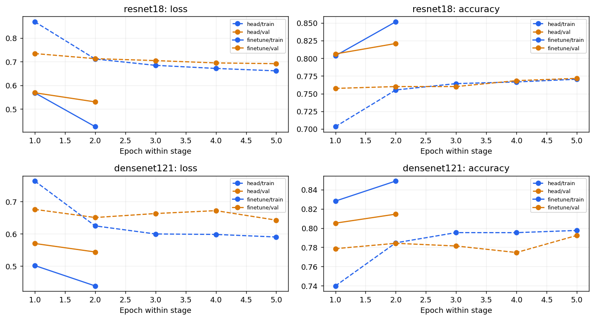

# Walkthrough & Full-Flow Technical Report — Lab 02

> **Lab Title:** Lab 02 — Transfer learning trên CIFAR-10
> **Status:** Kết quả lịch sử đã có; chỉnh trình bày local; tuning mới chưa chạy.
> **Primary Objective:** So sánh chất lượng và chi phí của hai pretrained architectures, với bằng chứng không trộn giữa profile.
> **Workflow Playbook References:** [dl_flow](../../docs/dl_flow.md) | [dl_data](../../docs/dl_data.md) | [dl_training](../../docs/dl_training.md) | [eda](../../docs/eda.md) | [eda-image](../../docs/eda-image.md) | [feature](../../docs/feature.md) | [feature-image](../../docs/feature-image.md)

Dựa trên [walkthrough_template](../../.agents/templates/walkthrough_template.md). Rule 1: [spec-driven-development](../../.agents/skills/spec-driven-development/SKILL.md); Rule 2: [walkthrough-and-experiment-tracking](../../.agents/skills/walkthrough-and-experiment-tracking/SKILL.md); Rule 3: [documentation-and-adrs](../../.agents/skills/documentation-and-adrs/SKILL.md).

Điểm vào: [README](README.md) → [EDA](notebooks/01_lab02_eda.ipynb) → [Modeling](notebooks/02_lab02_modeling.ipynb) → tài liệu này. Các báo cáo trong run là artifact lịch sử; nội dung kỹ thuật hiện hành chỉ sửa tại đây.

## 1. TECHNICAL SPECIFICATION & FLOW DESIGN

### 1.0. Brief Interpretation and Clarifications

Theo [đề đang lưu](description_lab_02.md), cần nhiều pretrained architectures, thay classifier, freeze/fine-tune, train/evaluate, điều chỉnh LR/batch và TensorBoard. CIFAR-10 RGB là dataset đã chốt. File đề hiện tại là bản diễn giải có sẵn; chưa có bản gốc nguyên văn Chapter 3 để đối chiếu.

- Hai notebook tách trách nhiệm: EDA chỉ data raw → preprocess → feature engineering; modeling chứa kiến trúc/train/evaluation. Không in source code hoặc toàn bộ model vào notebook.
- Chất lượng gần nhau cần so thêm thời gian, số tham số được học và điều kiện cache. Không chọn model chỉ từ chênh lệch test 0,04 điểm phần trăm.
- Tuning LR/optimizer/mở thêm block là giả thuyết cần kiểm chứng; chưa có run mới. Không ghi chúng thành kết quả đã đạt.
- Dọn file theo phương án đã chốt: gom logic đóng gói, giữ CLI có chức năng; các snapshot nguồn có hash giữ nguyên.

### 1.1. Master Flow Design

```mermaid
flowchart LR
  A[Raw CIFAR-10 RGB] --> B[Fixed stratified split]
  B --> C[EDA: class counts and RGB features]
  C --> D[Resize / scale / normalize]
  D --> E[Head LR x batch search on validation]
  E --> F[Fine-tune selected head]
  F --> G[Lock checkpoint using validation]
  G --> H[Test metrics and time]
  H --> I[Visual comparison and error analysis]
```

### 1.2. Problem Formulation and Modality

Computer Vision; 10-class single-label classification. Raw `[H,W,C]=[32,32,3]` RGB; đầu vào float32 `[B,3,H,W]`, H=W=64 trong run CPU, 224 trong cấu hình GPU. Đầu ra logits `[B,10]`; CrossEntropy nhận logits, softmax dùng khi đánh giá.

### 1.3. Data Contract and Partitioning Strategy

50.000 train chính thức → 45.000 train + 5.000 validation stratified, seed 42. Test 10.000 chính thức giữ riêng. Mỗi lớp 4.500/500/1.000 ảnh. RGB mean/std mô tả được tính trên train; normalization cố định theo ImageNet. Không augmentation trong run đã có để cache đầu vào nhất quán. Resize 64×64 không phải transform 224×224 chính thức.

Duplicate/corrupt audit, histogram raw và đặc trưng không gian: **not computed trong artifact đã lưu**; không coi là đã kiểm tra sạch. EDA notebook hiển thị giới hạn này, không dựng số thay thế.

### 1.4. Baseline Model and Target Metrics

Baseline so sánh trong lab: head-only trên backbone pretrained. Chưa có baseline train-from-scratch; do đó chưa định lượng riêng lợi ích pretraining. Primary metric: validation accuracy để chọn cấu hình. Báo cáo test loss, accuracy, Macro F1, macro precision/recall, precision/recall(TPR)/F1/FPR theo lớp. Không có acceptance threshold được chốt trước run lịch sử; không đặt lại ngưỡng hậu nghiệm.

Đề xuất cho tuning mới: chạy seed 42/43/44, chọn theo validation accuracy; nếu chênh dưới 0,1 điểm phần trăm thì xét validation loss rồi thời gian pipeline cùng chính sách thực thi. Đây là tiêu chí đề xuất, chưa áp dụng vào run cũ.

### 1.5. Loss Function and Optimization Design

Run lịch sử: CrossEntropy, AdamW weight_decay=1e-4; head LR={1e-3,1e-2} × batch={32,64}, 5 epoch/trial. Fine-tune backbone LR=1e-5, head LR=1e-4, 2 epoch. Chưa có scheduler/optimizer ablation.

Kế hoạch chi tiết: [tuning_plan.json](config/tuning_plan.json) (**chưa phải config được run.py hỗ trợ**).

| Bước | Thay đổi duy nhất | Cấu hình đề xuất | Kiểm soát |
|---|---|---|---|
| T0 | Baseline cùng chế độ | Last block, AdamW, 10 epoch | Cả hai không cache prefix, cùng GPU/224×224 |
| T1 | LR | backbone {3e-6,1e-5,3e-5}, head=10× | Batch 64, seed cố định; chọn trên val |
| T2 | Optimizer | AdamW vs SGD momentum 0.9 | SGD LR riêng {1e-4,3e-4,1e-3}, head=10×; không ép cùng LR tối ưu |
| T3 | Unfreeze depth | ResNet layer3+layer4+fc; DenseNet denseblock3+transition3+denseblock4+norm5+classifier | Giữ LR/optimizer đã chọn, BN running statistics cố định |
| T4 | Scheduler | LR constant vs CosineAnnealingLR T_max=10 | Giữ depth/optimizer; cùng số epoch |

Block thứ ba nằm trước ranh giới prefix cache hiện tại: mở thêm block **phải tắt cache prefix cho cả hai**, hoặc thiết kế lại ranh giới và kiểm chứng logits/gradient. Pipeline hiện chỉ hỗ trợ last block và AdamW; cần triển khai/test trước khi thực thi T2–T4. Mở thêm lớp tăng số tham số học, có thể cải thiện thích nghi nhưng cũng tăng chi phí và overfit. Đánh giá cả val loss/gap, không mặc định mở nhiều hơn là tốt hơn.

### 1.6. Execution Environment Constraints

Run cũ: Windows CPU, CPython 3.13.3, torch 2.14.1+cpu, torchvision 0.29.1+cpu, ảnh 64×64. [requirements.txt](requirements.txt) chứa phiên bản Windows đã ghi; không có dòng `python==...`. Chưa xác thực toàn bộ Requires-Python/khả năng cài trên Linux. Phiên bản của run nằm trong `environment.json`.

Đợt sửa này chỉ chạy lại các view từ artifact, không train full CPU theo [AGENTS 1.5](../../.agents/AGENTS.md). Thí nghiệm mới thực thi trên GPU sau sanity overfit và test gradient/shape. Profile CPU và GPU báo cáo riêng.

## 2. FULL-FLOW EXPERIMENT LINEAGE & CHANGELOG

### 2.1. Flow Comparison Matrix

Run lịch sử `20261024T075133Z_cifar10_cpu_full64_71863a0e`; [registry](outputs/selected_run.json). Tất cả hàng dùng cùng CIFAR-10/split, RGB 64×64, không augmentation, ImageNet normalization.

| model | stage | loss | accuracy | macro_f1 | macro_precision | macro_recall | best_val_accuracy |
|---|---|---|---|---|---|---|---|
| resnet18 | head | 0.706896 | 0.7609 | 0.761075 | 0.763462 | 0.7609 | 0.7716 |
| resnet18 | finetune | 0.547387 | 0.8149 | 0.814634 | 0.815284 | 0.8149 | 0.821 |
| densenet121 | head | 0.660355 | 0.7821 | 0.781146 | 0.786055 | 0.7821 | 0.7924 |
| densenet121 | finetune | 0.547715 | 0.8153 | 0.815109 | 0.815191 | 0.8153 | 0.8146 |

Bộ metric theo lớp (FPR = FP/(FP+TN), one-vs-rest) tính lại từ confusion counts:

| model | stage | class | precision | recall_tpr | f1 | fpr |
|---|---|---|---|---|---|---|
| resnet18 | head | airplane | 0.7113 | 0.818 | 0.7609 | 0.0369 |
| resnet18 | head | automobile | 0.8149 | 0.854 | 0.834 | 0.0216 |
| resnet18 | head | bird | 0.7283 | 0.67 | 0.6979 | 0.0278 |
| resnet18 | head | cat | 0.634 | 0.646 | 0.6399 | 0.0414 |
| resnet18 | head | deer | 0.6712 | 0.741 | 0.7044 | 0.0403 |
| resnet18 | head | dog | 0.7736 | 0.687 | 0.7278 | 0.0223 |
| resnet18 | head | frog | 0.812 | 0.786 | 0.7988 | 0.0202 |
| resnet18 | head | horse | 0.7904 | 0.792 | 0.7912 | 0.0233 |
| resnet18 | head | ship | 0.8562 | 0.822 | 0.8388 | 0.0153 |
| resnet18 | head | truck | 0.8427 | 0.793 | 0.8171 | 0.0164 |
| resnet18 | finetune | airplane | 0.7992 | 0.84 | 0.8191 | 0.0234 |
| resnet18 | finetune | automobile | 0.8833 | 0.863 | 0.873 | 0.0127 |
| resnet18 | finetune | bird | 0.7578 | 0.776 | 0.7668 | 0.0276 |
| resnet18 | finetune | cat | 0.6948 | 0.699 | 0.6969 | 0.0341 |
| resnet18 | finetune | deer | 0.7977 | 0.765 | 0.781 | 0.0216 |
| resnet18 | finetune | dog | 0.7878 | 0.735 | 0.7605 | 0.022 |
| resnet18 | finetune | frog | 0.8319 | 0.871 | 0.851 | 0.0196 |
| resnet18 | finetune | horse | 0.8815 | 0.826 | 0.8529 | 0.0123 |
| resnet18 | finetune | ship | 0.8431 | 0.908 | 0.8743 | 0.0188 |
| resnet18 | finetune | truck | 0.8756 | 0.866 | 0.8708 | 0.0137 |
| densenet121 | head | airplane | 0.7853 | 0.823 | 0.8037 | 0.025 |
| densenet121 | head | automobile | 0.8451 | 0.851 | 0.848 | 0.0173 |
| densenet121 | head | bird | 0.7697 | 0.695 | 0.7304 | 0.0231 |
| densenet121 | head | cat | 0.621 | 0.703 | 0.6595 | 0.0477 |
| densenet121 | head | deer | 0.7733 | 0.672 | 0.7191 | 0.0219 |
| densenet121 | head | dog | 0.8269 | 0.645 | 0.7247 | 0.015 |
| densenet121 | head | frog | 0.7904 | 0.852 | 0.82 | 0.0251 |
| densenet121 | head | horse | 0.7419 | 0.891 | 0.8096 | 0.0344 |
| densenet121 | head | ship | 0.8317 | 0.875 | 0.8528 | 0.0197 |
| densenet121 | head | truck | 0.8753 | 0.814 | 0.8435 | 0.0129 |
| densenet121 | finetune | airplane | 0.8421 | 0.832 | 0.837 | 0.0173 |
| densenet121 | finetune | automobile | 0.8765 | 0.859 | 0.8677 | 0.0134 |
| densenet121 | finetune | bird | 0.7788 | 0.757 | 0.7677 | 0.0239 |
| densenet121 | finetune | cat | 0.6826 | 0.699 | 0.6907 | 0.0361 |
| densenet121 | finetune | deer | 0.7819 | 0.771 | 0.7764 | 0.0239 |
| densenet121 | finetune | dog | 0.7847 | 0.751 | 0.7675 | 0.0229 |
| densenet121 | finetune | frog | 0.8335 | 0.866 | 0.8494 | 0.0192 |
| densenet121 | finetune | horse | 0.8544 | 0.857 | 0.8557 | 0.0162 |
| densenet121 | finetune | ship | 0.8652 | 0.886 | 0.8755 | 0.0153 |
| densenet121 | finetune | truck | 0.852 | 0.875 | 0.8633 | 0.0169 |

### 2.2. Changelog per Run

| Lượt | Data / preprocess | Model / training | Định lượng | Evaluation |
|---|---|---|---|---|
| Cũ: head → fine-tune ResNet | Split giữ nguyên; 64×64, cache pooled head | Mở layer4+fc, thêm 2 epoch | Accuracy +5,40 điểm phần trăm; Macro F1 +0,05356 | Khóa bằng val, sau đó test |
| Cũ: head → fine-tune DenseNet | Split giữ nguyên; 64×64 | Mở denseblock4+norm5+classifier, thêm 2 epoch, cache prefix | Accuracy +3,32 điểm phần trăm; Macro F1 +0,03396 | Test forward toàn mạng |
| 2026-10-26: chỉnh trình bày | Không đổi split, metric hoặc preprocessing đã chạy | Tách EDA/modeling, views từ artifact; gộp delivery; chuẩn hóa tên | Không có kết quả train mới; delta model không áp dụng | Thực thi lại notebook và đối chiếu metric/links |
| T0–T4 đề xuất | 224×224, cùng GPU và chính sách cache | LR → optimizer → depth → scheduler | not run | Chọn bằng validation; test sau khi khóa |

### 2.3. Artifact Harvesting Log

Nguồn số: [comparison.csv](outputs/runs/20261024T075133Z_cifar10_cpu_full64_71863a0e/comparison.csv), [cost_comparison.csv](outputs/runs/20261024T075133Z_cifar10_cpu_full64_71863a0e/cost_comparison.csv), [verification.json](outputs/runs/20261024T075133Z_cifar10_cpu_full64_71863a0e/verification.json). [Report HTML lịch sử](outputs/runs/20261024T075133Z_cifar10_cpu_full64_71863a0e/report_vi.html) giữ nguyên.

Notebook mới dùng [notebook_views.py](src/notebook_views.py), lưu hình mới ở `outputs/review/<run>/` để không làm lệch manifest gốc. Checkpoint/dataset/prediction NPZ và events không đi cùng Git; các view đọc bảng/hình vẫn chạy khi thiếu các file nặng.

## 3. COMPARATIVE RESULTS, ERROR DIAGNOSTICS & FINAL SUBMISSION REPORT

### 3.1. Quantitative Evaluation & Comparison Matrix

| model | stage | execution | pipeline_training_seconds | test_seconds |
|---|---|---|---|---|
| resnet18 | head | pooled_feature_cache | 329.45 | 64.0 |
| resnet18 | finetune | full_image_forward | 1414.15 | 62.76 |
| densenet121 | head | pooled_feature_cache | 521.51 | 100.4 |
| densenet121 | finetune | cached_frozen_prefix | 741.18 | 92.39 |

DenseNet fine-tune hơn accuracy **+0,04 điểm phần trăm** nhưng loss **+0,0003283** (cao hơn); Macro F1 **+0,0004746**. Một seed không đủ kết luận hơn có ý nghĩa thống kê. Validation của ResNet là **82,10%**, DenseNet **81,46%**; registry khuyến nghị ResNet theo validation, không đảo lựa chọn vì test DenseNet nhỉnh hơn.

Pipeline train ghi nhận: ResNet 1414,15 s; DenseNet 741,18 s (ít hơn khoảng 47,59%). Đây là thời gian thực tế gồm extraction+all head trials+fine-tune, **không phải kết luận kiến trúc DenseNet nhanh hơn**: DenseNet dùng cached frozen prefix, ResNet full_image_forward, số tham số học cũng khác. Test chạy toàn mạng: ResNet 62,76 s, DenseNet 92,39 s; test time bao gồm loader/chuyển thiết bị/forward, chưa phải latency per-image chuẩn hóa. Cần T0 cùng policy/hardware trước khi xếp hạng hiệu quả.

### 3.2. Confusion Matrix Diagnostics

Đọc ảnh và đối chiếu counts: ResNet dog → cat **145/1000 = 14,5%**, cat → dog **108/1000 = 10,8%**; lớp cat có 699/1000 đúng. DenseNet dog → cat **144/1000 = 14,4%**. Bảng per-class ở 2.1 là số tính trực tiếp từ counts.

- resnet18: TPR thấp nhất cat = 69.90%; FPR cao nhất cat = 3.41%.
- densenet121: TPR thấp nhất cat = 69.90%; FPR cao nhất cat = 3.61%.

Ảnh RGB 32×32 có chi tiết hạn chế; tương đồng động vật là giả thuyết thị giác, chưa có kiểm định nguyên nhân.

### 3.3. Error Analysis Slices

Lưới DenseNet fine-tune đã mở: dog → deer với p=0,819; horse → dog p=0,757; automobile → truck p=0,642; airplane → truck p=0,734. Confidence cao không bảo đảm đúng. Lưới cố ý chọn tối đa 8 đúng và 8 sai nên không đại diện phân phối lỗi. [Notebook modeling](notebooks/02_lab02_modeling.ipynb) hiển thị lưới và confusion của cả hai cạnh nhau.

### 3.4. Key Technical Findings

Head search đã chọn LR=0,001/batch=64 cho cả hai. LR=0,01 kém hơn trên validation trong grid này; chưa chứng minh LR=0,001 là tối ưu toàn miền. Fine-tune đều cải thiện so với head nhưng có thêm ngân sách epoch; chưa cô lập tác động unfreeze dưới ngân sách ngang nhau. Đọc đường cong: ResNet fine-tune val loss giảm 0,5686 → 0,5301, val accuracy 80,62% → 82,10%; DenseNet val loss giảm 0,5701 → 0,5439, val accuracy 80,52% → 81,46%. Cuối fine-tune, train–val accuracy gap lần lượt khoảng 3,08 và 3,45 điểm phần trăm. DenseNet head có val loss tăng tạm ở epoch 3–4 rồi giảm ở epoch 5; không có bằng chứng tăng loss kéo dài. Chỉ 2 epoch fine-tune nên chưa đủ khẳng định đã hội tụ hoặc không overfit.

### 3.5. Checkpoint Verification (Save/Load)

Bốn `roundtrip.json` trong run ghi passed, max_probability_error=0 trên 8 mẫu; notebook chỉ hiển thị chứng cứ cũ. Chưa chạy inference mới vì checkpoint/dataset không nằm trong folder hiện tại. [infer.py](scripts/infer.py) là điểm vào kiểm chứng lại khi có checkpoint. Không khẳng định tái lập toàn test chỉ dựa trên kiểm tra 8 mẫu.

Kiểm tra checkout local: 39 file source snapshot, 14 khớp SHA256 theo byte, 25 chỉ khác LF/CRLF do Git. Không có thay đổi nội dung khác. Các snapshot/hash gốc không bị sửa; `delivery.audit_snapshot` báo riêng byte-exact và newline-only, không coi chuyển đổi xuống dòng là bằng chứng khớp byte. Đợt này chưa chạy lại full finalize/inference.

### 3.6. Decision Traceability

| Quyết định | Điểm 1.0 | Hướng giải quyết |
|---|---|---|
| Hai notebook tách biệt | EDA không modeling | EDA chỉ nhập notebook_views, không dựng mạng hoặc in architecture |
| Một tài liệu sống | Naming/template | Lab02_CIFAR10.md và RESULTS.md hợp nhất vào walkthrough_lab_02.md |
| Không xóa snapshot | Chống deadfile | Snapshot là chứng cứ hash/manifest; CLI/module hiện hành có bản đồ tham chiếu trong README |
| Gộp logic đóng gói | Dọn src/scripts đã trao đổi | finalize/complete_delivery dùng src/delivery.py; CLI ngắn |
| Chưa chọn thắng theo test | Chất lượng gần nhau | Giữ validation recommendation; so chi phí kèm execution policy |
| Mở thêm block | Đề xuất performance | T3 sau LR/optimizer, tắt cache cũ, chưa khẳng định cải thiện |

### 3.7. Conclusion & Lessons Learned

Kết quả chất lượng hiện tại gần ngang nhau; chi phí đo được khác nhưng bị nhiễu bởi policy cache. Chưa có kết quả tuning mới. Ưu tiên kiểm chứng baseline cùng chính sách rồi thay từng yếu tố. Hai notebook tập trung biểu đồ, bảng ngắn và link source; source snapshot và bằng chứng gốc giữ nguyên.

### Nguồn chính thức

- [Torchvision ResNet18](https://docs.pytorch.org/vision/stable/models/generated/torchvision.models.resnet18.html) và [DenseNet121](https://docs.pytorch.org/vision/stable/models/generated/torchvision.models.densenet121.html): weights và preprocessing.
- [PyTorch optim](https://docs.pytorch.org/docs/stable/optim.html): AdamW, SGD và LR scheduler; cấu hình đề xuất không phải kết quả đo.
- [Transfer learning tutorial](https://docs.pytorch.org/tutorials/beginner/transfer_learning_tutorial.html): freeze/fine-tuning.

### Kiểm tra đợt chỉnh local

[review_validation.json](outputs/review/20261024T075133Z_cifar10_cpu_full64_71863a0e/review_validation.json): hai notebook chạy hết cell không lỗi; 7 bài kiểm tra review đạt. Cú pháp source/CLI và CLI --help đã kiểm tra. Chưa chạy bộ test PyTorch hoặc full finalize vì interpreter hiện tại chưa có torch/pytest và folder không có dataset/checkpoint/events. Không có tuning mới. Các kiểm tra này được thực hiện trước khi commit/push.
