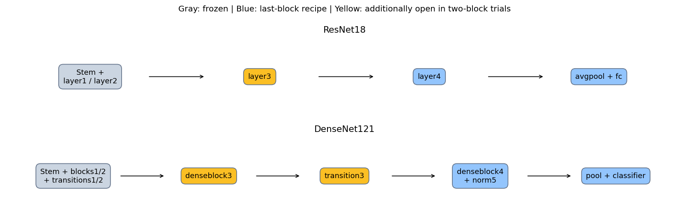
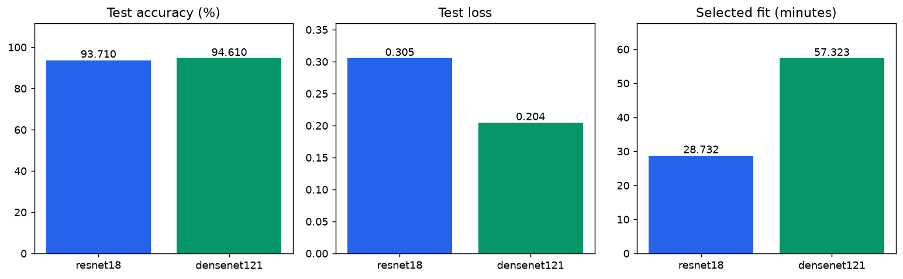
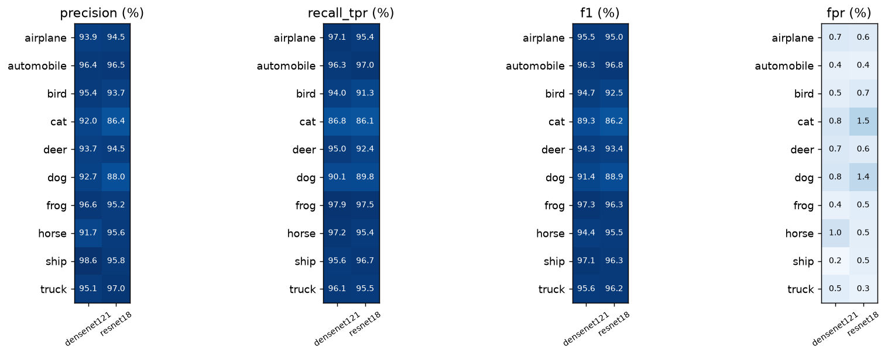
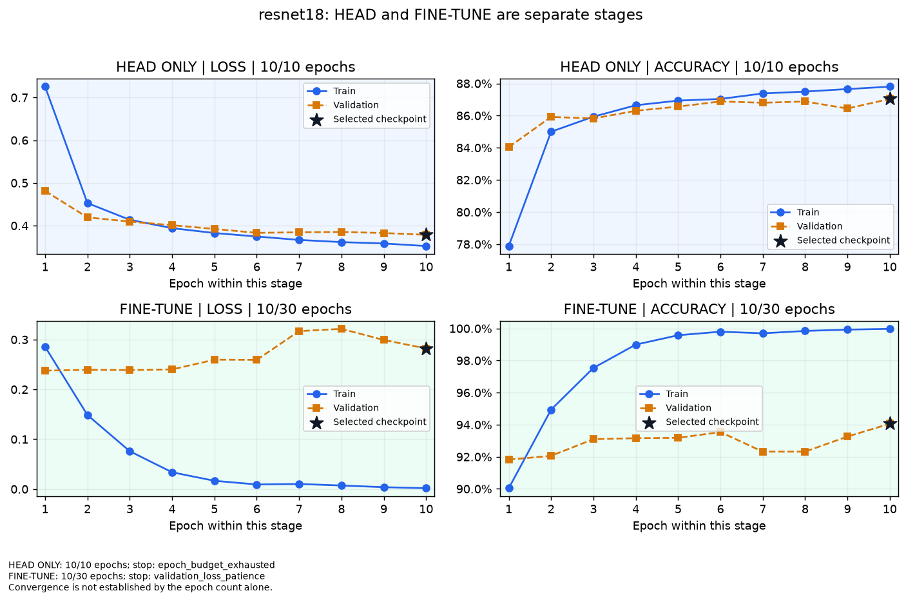
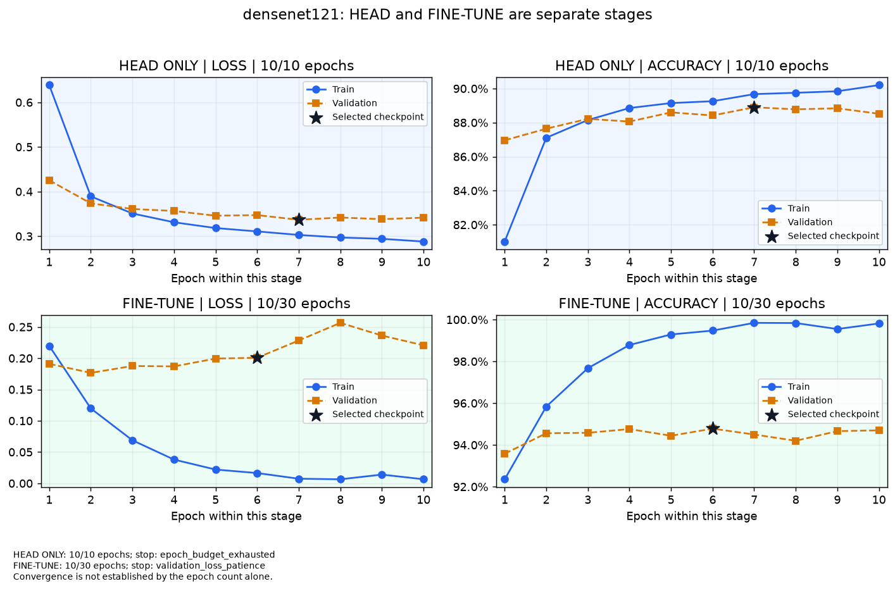

# Walkthrough & Full-Flow Technical Report — Lab 02

> **Lab Title:** Lab 02 — Transfer learning trên CIFAR-10
> **Status:** Đã hoàn tất phạm vi cuối: 18 fine-trial, seed 42, Kaggle Versions 5/6/8. Báo cáo hiện hành dùng GPU 224×224; CPU 64×64 chỉ là lịch sử. Chỉnh sửa local sau commit c1b2d24 chưa push.
> **Primary Objective:** So sánh chất lượng và chi phí của hai pretrained architectures, với bằng chứng không trộn giữa profile.
> **Workflow Playbook References:** [dl_flow](../../docs/dl_flow.md) | [dl_data](../../docs/dl_data.md) | [dl_training](../../docs/dl_training.md) | [eda](../../docs/eda.md) | [eda-image](../../docs/eda-image.md) | [feature](../../docs/feature.md) | [feature-image](../../docs/feature-image.md)

Dựa trên [walkthrough_template](../../.agents/templates/walkthrough_template.md). Rule 1: [spec-driven-development](../../.agents/skills/spec-driven-development/SKILL.md); Rule 2: [walkthrough-and-experiment-tracking](../../.agents/skills/walkthrough-and-experiment-tracking/SKILL.md); Rule 3: [documentation-and-adrs](../../.agents/skills/documentation-and-adrs/SKILL.md).

Điểm vào: [README](README.md) → [EDA](notebooks/01_lab02_eda.ipynb) → [Modeling](notebooks/02_lab02_modeling.ipynb) → tài liệu này. Các báo cáo trong run là artifact lịch sử; nội dung kỹ thuật hiện hành chỉ sửa tại đây.

## 1. TECHNICAL SPECIFICATION & FLOW DESIGN

### 1.0. Brief Interpretation and Clarifications

Theo [đề đang lưu](description_lab_02.md), cần nhiều pretrained architectures, thay classifier, freeze/fine-tune, train/evaluate, điều chỉnh LR/batch và TensorBoard. CIFAR-10 RGB là dataset đã chốt. File đề hiện tại ghi riêng nội dung ảnh và phạm vi triển khai; đã đối chiếu ảnh đề slide trang 23 trong lượt rà soát này; CIFAR-10 là lựa chọn của source, không phải ràng buộc trong ảnh.

- Hai notebook tách trách nhiệm: EDA chỉ data raw → preprocess → feature engineering; modeling chứa kiến trúc/train/evaluation. Không in source code hoặc toàn bộ model vào notebook.
- So sánh chất lượng cùng thời gian, số tham số học và execution policy; không chọn kiến trúc dựa trên test. Chênh lệch CPU lịch sử không thay kết luận GPU hiện hành.
- Tuning LR/optimizer/depth đã đo trong 18 fine-trial; không suy rộng sang optimizer × depth chưa thử. Không áp dụng các đề xuất 16 trial hoặc fine tối đa 10 epoch đã rút lại.
- Dọn file theo phương án đã chốt: gom logic đóng gói, giữ CLI có chức năng; các snapshot nguồn có hash giữ nguyên.

### 1.0.1. Đối chiếu ảnh đề và tên artifact

| Yêu cầu trong ảnh | Bằng chứng trong source hiện hành | Kết luận |
|---|---|---|
| Nhiều pretrained architectures | `models.SPECS`: ResNet18 và DenseNet121, ImageNet weights enum | Đáp ứng về code; không bắt buộc VGG |
| Khảo sát cấu trúc/layer/parameter | `architecture.txt`, `parameters.csv`, biểu đồ số tham số; full structure thu gọn trong modeling | Đáp ứng; không in dài mặc định |
| Thay classifier, freeze/fine-tune | `build_model`, `configure_trainable`, BN statistics cố định | Đáp ứng; test gradient/frozen weights |
| transforms + DataLoader | `data.image_transform`, `IndexedImages`, `image_loader` | Đáp ứng; RGB và normalization có test |
| Loss, optimizer, loop | `experiment.pass_epoch/fit`: CrossEntropy + AdamW/SGD momentum | Đáp ứng về triển khai |
| Điều chỉnh LR/batch | 3 LR × batch 64/128, 10 epoch/head trial; 9 fine candidate/model | Có kết quả GPU; chọn bằng validation |
| TensorBoard | SummaryWriter scalars/LR/histogram/graph; hình dựng từ event scalars đã lưu | Có code và artifact lịch sử; thiếu event files trong checkout để xác minh live mới |
| Evaluate test | 4 condition, confusion counts và metric tính lại khớp | Đáp ứng ở mức bằng chứng đã lưu |
| EDA tách modeling (yêu cầu người dùng) | `src/eda.py`, notebook 01 chỉ dùng outputs/eda; notebook 02 đọc kết quả model | Đã tách cả import và nguồn artifact |
| Naming/template (quy định repo) | `description_lab_02.md`, `walkthrough_lab_02.md`, `README.md`, 01/02 notebook | Đúng tên template; không tạo Lab02_CIFAR10.md/REPORT.md thứ hai |

Kết luận hiện hành: code và artifact bao phủ các yêu cầu trong ảnh. Đã thu notebook, checkpoint, predictions và events của ba nhóm GPU về local; Git chỉ chứa source và artifact nhẹ. Phạm vi cuối 18 trial đã hoàn tất. Không chứng nhận tái lập full training từ CSV/PNG; báo cáo tách kiểm chứng metric từ predictions, roundtrip 8 mẫu và huấn luyện lại. CPU lịch sử được giữ riêng.

### 1.1. Master Flow Design

```mermaid
flowchart LR
  A[Raw CIFAR-10 RGB] --> B[Fixed stratified split]
  B --> C[EDA: class counts and RGB features]
  C --> D[Resize / scale / normalize]
  D --> E[Head LR x batch search on validation]
  E --> F[Fine-tune selected head]
  F --> G[Lock checkpoint using validation]
  G --> H[Test metrics and time]
  H --> I[Visual comparison and error analysis]
```

### 1.2. Problem Formulation and Modality

Computer Vision; 10-class single-label classification. Raw `[H,W,C]=[32,32,3]` RGB; đầu vào float32 `[B,3,H,W]`, H=W=64 trong run CPU, 224 trong cấu hình GPU. Đầu ra logits `[B,10]`; CrossEntropy nhận logits, softmax dùng khi đánh giá.

### 1.3. Data Contract and Partitioning Strategy

50.000 train chính thức → 45.000 train + 5.000 validation stratified, seed 42. Test 10.000 chính thức giữ riêng. Mỗi lớp 4.500/500/1.000 ảnh. RGB mean/std mô tả được tính trên train; normalization cố định theo ImageNet. Không augmentation trong run đã có để cache đầu vào nhất quán. Resize 64×64 không phải transform 224×224 chính thức.

Bổ sung ngày 26/10/2026: đo lại raw CIFAR-10 từ 6 batch đã kiểm MD5 chính thức, lưu riêng tại `outputs/eda/`. Split 45.000/5.000/10.000 tái dựng theo thuật toán seed 42 có SHA256 `dcfe29a6b8c5f308b77679d3ca6f33156aa8e76db22c9b4c74a93251afc686c8`, khớp `data_sha256` trong config head của run cũ. Mean/std RGB khớp trong sai số <1e-12. Không sửa source snapshot, manifest hay metric của run cũ.

Kiểm tra 60.000 ảnh: 0 nhãn ngoài miền, 0 pixel không hữu hạn, 0 ảnh hằng, 0 bản ghi trùng byte trong/chéo train-val-test. Đây là kiểm tra trùng chính xác, không phát hiện near-duplicate. Các batch có dtype uint8, shape 32×32×3, min/max 0/255. Không có mask phân đoạn nên foreground ratio/bounding box ghi **not applicable**, không coi pixel đen là nền.

Histogram RGB, ảnh trung bình theo lớp, mean/variance heatmap, boxplot brightness/contrast/edge density, correlation giữa feature và giữa ảnh trung bình lớp đều chỉ đo trên train. Foreground không được suy diễn. Đọc hình: airplane/ship có median brightness cao hơn frog; truck có median contrast và edge density cao. Heatmap mean sáng hơn ở mép trên, variance thấp hơn quanh trung tâm. Đây là mô tả train, không phải kết luận nguyên nhân phân lớp. Handcrafted features chỉ phục vụ chẩn đoán; tensor vẫn RGB CHW, không nối thêm feature vào đầu vào. Mean/std train là thống kê mô tả; normalization vẫn theo ImageNet của weights.

### 1.4. Baseline Model and Target Metrics

Baseline so sánh trong lab: head-only trên backbone pretrained. Chưa có baseline train-from-scratch; do đó chưa định lượng riêng lợi ích pretraining. Primary metric: validation accuracy để chọn cấu hình. Báo cáo test loss, accuracy, Macro F1, macro precision/recall, precision/recall(TPR)/F1/FPR theo lớp. Không có acceptance threshold được chốt trước run lịch sử; không đặt lại ngưỡng hậu nghiệm.

Đề xuất cho tuning mới: chạy seed 42/43/44, chọn theo validation accuracy; nếu chênh dưới 0,1 điểm phần trăm thì xét validation loss rồi thời gian pipeline cùng chính sách thực thi. Đây là tiêu chí đề xuất, chưa áp dụng vào run cũ.

### 1.5. Loss Function and Optimization Design

Run lịch sử: CrossEntropy, AdamW weight_decay=1e-4; head LR={1e-3,1e-2} × batch={32,64}, 5 epoch/trial. Fine-tune backbone LR=1e-5, head LR=1e-4, 2 epoch. Chưa có scheduler/optimizer ablation.

Kế hoạch gốc ngày 26/10/2026 ở [tuned.json](config/tuned.json): 26 trial. Phạm vi cuối đã chốt và hoàn tất là 18 trial trong [completed.json](config/completed.json); bảng dưới mô tả không gian kế hoạch, không phải mọi tổ hợp đều đã chạy.

| Thành phần | Triển khai | Kiểm soát |
|---|---|---|
| Head search | AdamW LR {1e-4,1e-3,1e-2} × batch {64,128}, 10 epoch/trial | Cùng initial classifier và shuffle seed |
| Fine control | AdamW, backbone 1e-5, head 1e-4, last block, LR cố định | Min 10 / max 30 epoch; patience 7 theo val loss |
| Fine grid | AdamW LR {3e-6,1e-5,3e-5}; SGD momentum 0,9 LR {1e-4,3e-4,1e-3}; head=10× | LR riêng theo optimizer; cùng giới hạn min 10 / max 30 và stopping policy |
| Unfreeze | Last block hoặc last two blocks; tổng 12 tổ hợp optimizer/LR/depth + 1 control | Reset toàn bộ state_dict, kể cả BN buffers, về cùng selected head |
| ResNet hai block | layer3 + layer4 + fc | layer1/layer2 vẫn frozen |
| DenseNet hai block | denseblock3 + transition3 + denseblock4 + norm5 + classifier | Không bỏ sót transition3; block1/block2 frozen |
| Scheduler | CosineAnnealingLR, T_max=30; control LR cố định | Step sau optimizer/epoch, log LR thực dùng trước khi step |
| Cache | Tắt prefix cache ở tuned cho cả hai kiến trúc | Raise lỗi trước load weights nếu mở hai block mà cache vẫn bật |
| Seed | Khởi tạo/shuffle 42, rồi 43/44; split_seed cố định 42 | Thay training seed không đổi train/validation/test |

Checkpoint mỗi trial chọn validation accuracy lớn nhất; hòa chọn validation loss nhỏ hơn rồi epoch sớm hơn. Chọn candidate theo ba bước: giữ accuracy trong 0,001 của mức cao nhất; giữ loss trong 0,005 của mức thấp nhất trong nhóm đó; chọn fit time thấp nhất. Tolerances là đơn vị tuyệt đối; 0,001 accuracy = 0,1 điểm phần trăm. Không dùng test accuracy/loss để chọn. Policy mới không hồi tố thay đổi checkpoint/kết quả lịch sử.

Khuyến nghị giữa hai kiến trúc dùng cùng validation bands và **selected recipe training cost** chỉ khi execution policy giống nhau. Nếu policy khác nhau như run cũ, bỏ time tie-break và chọn theo validation accuracy/loss. Chất lượng gần nhau ở một seed chưa chứng minh tương đương thống kê; cần lặp seed và kiểm tra độ ổn định trước kết luận.

AdamW weight decay tách khỏi gradient còn SGD dùng L2 theo optimizer; cùng hệ số không làm hai regularization hoàn toàn tương đương. Kết quả so sánh phản ánh từng recipe hoàn chỉnh. Mở thêm block có thể tăng khả năng thích nghi nhưng cũng có thể tăng overfit, thời gian và VRAM; chưa khẳng định cải thiện khi chưa đo validation.

### 1.5.0. Cách đọc lựa chọn block, candidate và ngân sách

Mở block cuối là giả thuyết transfer learning cần kiểm chứng: giữ phần đầu ổn định, thích nghi biểu diễn gần đầu ra. ResNet dùng layer4+fc; candidate sâu hơn mở layer3. DenseNet dùng denseblock4+norm5+classifier; mở block3 phải gồm transition3 nối block3→block4. Một block ở hai mạng không tương đương số tham số. Sơ đồ màu trong notebook chỉ rõ vị trí, không dùng độ dài thanh tham số để biểu diễn vị trí layer.

Ví dụ candidate: AdamW, backbone LR=0,00001, head LR=0,0001, last_block, cosine. Đây là một recipe cần chạy, không phải điểm đo chất lượng. Grid có 13 candidate/model: 1 control + 3 LR × 2 depth với AdamW + 3 LR × 2 depth với SGD. Fine-tune giữ batch được head search chọn từ 64/128. Đổi batch có thể giảm số optimizer step mỗi epoch nhưng không bảo đảm thời gian giảm hoặc chất lượng tăng.

Run CPU lịch sử dùng head 5/fine 2 epoch. GPU đã chạy head 10, fine min 10/max 30; winner hai model đều dừng sau 10 epoch. Best checkpoint có thể sớm hơn số epoch thực chạy. Báo cáo tách planned/completed/best epoch và stop_reason; hết ngân sách không đồng nghĩa hội tụ. Không sửa history/metric cũ để khớp cấu hình mới.

### 1.5.1. Đo thời gian và chi phí

- `train_pass_seconds` và `validation_seconds` đo riêng, đồng bộ CUDA trước/sau; train pass gồm loader, truyền dữ liệu và tính toán.
- `train_seconds` là fit wall time, gồm train/validation và phần log/checkpoint trong vòng fit; không phải GPU compute thuần. History có LR từng nhóm, throughput; summary có peak CUDA allocated memory.
- `pipeline_training_seconds` = extraction + toàn bộ head search + toàn bộ fine search. Không cộng lại selected head/fine lần thứ hai.
- `selected_recipe_training_seconds` = extraction + selected head fit + selected fine fit; dùng để cân nhắc recipe khi chất lượng tương đương trong các bands.
- `model_selection_wall_seconds` còn tính startup model/weights, preview, tạo loader và đóng gói search. Không dùng số này như pure training compute. Test pass đo riêng và vẫn forward toàn bộ model.

GPU 224×224 mới được so riêng với CPU 64×64 cũ; không đặt cạnh nhau rồi quy chênh lệch cho optimizer/depth. Grid đầy đủ có 6 head + 13 fine trials/model/seed; `--dry-run` hiển thị ngân sách mà không tải data/weights. Không tự chạy benchmark dài chỉ để kiểm tra source.

### 1.6. Execution Environment Constraints

GPU đã chạy: Linux/Python 3.13.15, Torch 2.11.0+cu128, torchvision 0.26.0+cu128. Profile cài đặt [requirements-gpu.txt](requirements-gpu.txt), full freeze nằm trong run. Lock Windows/CPU chỉ dùng cho profile local; không coi hai môi trường là giống nhau. [environment_snapshot.json](outputs/logs/environment_snapshot.json) lưu metadata. Requires-Python local >=3.12, !=3.14.1; GPU xác nhận interpreter đã chạy, chưa có audit lower-bound đầy đủ.

Run cũ: Windows CPU, CPython 3.13.3, torch 2.14.1+cpu, torchvision 0.29.1+cpu, ảnh 64×64. [requirements.txt](requirements.txt) chứa phiên bản Windows đã ghi; không có dòng `python==...`. Metadata Requires-Python của profile local đã được ghi trong environment_snapshot; điều này không xác thực cài đặt lock CPU trên Linux. Phiên bản thực tế của từng run nằm trong `environment.json`.

Đợt sửa này chỉ chạy lại các view từ artifact, không train full CPU theo [AGENTS 1.5](../../.agents/AGENTS.md). Thí nghiệm mới thực thi trên GPU sau sanity overfit và test gradient/shape. Profile CPU và GPU báo cáo riêng.

### 1.7. Roadmap tiếp tục — rà soát ngày 29/10/2026

Mốc xuất phát: local và remote branch lab02 cùng commit 12171a4e1a5f471f81f1f6dd6b4a64e6da662d07, đã đối chiếu bằng git ls-remote ngày 29/10. Đã đọc lại đề, README, registry, config completed, model/data pipeline và logic gộp báo cáo. Bộ 59 test là bằng chứng lần chạy ngày 28/10, chưa được chạy lại trong lượt nghiên cứu này. Roadmap dưới đây là kế hoạch, không phải yêu cầu tự khởi động huấn luyện.

| Giai đoạn | Đầu vào và việc thực hiện | Đầu ra | Tiêu chí nghiệm thu / trạng thái |
|---|---|---|---|
| 1. Dữ liệu và xác thực | Raw CIFAR-10, split khóa và manifest hiện có; giữ nguyên seed/split | Data contract và bằng chứng membership | Đã có: 45.000/5.000/10.000, các nhóm dùng cùng index; không cần tải hoặc train lại |
| 2. Preprocess và features | Giữ preprocess 224×224 của GPU; nếu mở nghiên cứu overfit thì thiết kế augmentation chỉ cho train, val/test deterministic | Đặc tả transform và kiểm thử data/cache | Hiện tại đã có deterministic pipeline; nhánh augmentation là tùy chọn chưa thực hiện, không dùng cache cố định như thể augmentation được áp dụng mỗi epoch |
| 3. Baseline và môi trường | Bảo toàn head-only cùng 18 fine-trial; audit Requires-Python GPU và kiểm chứng môi trường mới trước training tiếp | Môi trường cài đặt có kiểm chứng và baseline nguyên trạng | Ưu tiên tiếp theo: import/test/sanity đạt, ghi snapshot; không coi cài lock Windows là tái lập GPU |
| 4. Mô hình và thí nghiệm tùy chọn | Chỉ khi tiếp tục nghiên cứu chất lượng: so control với một thay đổi augmentation, giữ LR/depth/seed/budget còn lại; chưa đổi đồng thời dropout/weight decay | Thí nghiệm nhỏ đã đặc tả và dự toán bằng đo runtime thực | Chưa chạy; phải chốt ngân sách trước khi gửi GPU; không mở lại grid 26 trial hoặc restart 18 trial mặc định |
| 5. Đánh giá và phân tích lỗi | Chọn cấu hình bằng validation, kiểm tra train–val gap/loss, cat↔dog, fit time và VRAM; test sau khi khóa lựa chọn | So sánh có đối chứng và nhận xét inline | Không hứa accuracy tăng; một seed chưa đủ chứng minh ưu thế. Nếu nghiên cứu độ ổn định thì lập ngân sách seed riêng |
| 6. Đóng gói và bàn giao | Chạy checklist nộp bài, kiểm chứng clone sạch xem được notebook và inference với checkpoint local | Notebook, walkthrough và hướng dẫn tái lập thống nhất | Đã có notebook inline/registry và 59 test ở mốc trước; cần kiểm chứng môi trường sạch trước khi tuyên bố tái lập hoàn toàn |

Thứ tự: **bảo toàn dữ liệu/kết quả → kiểm chứng môi trường → đặc tả nhánh cải thiện tùy chọn → sanity → GPU nếu được yêu cầu → validation/test → cập nhật notebook/tài liệu**. Không cần tạo module mới trong bước nghiên cứu này; nếu triển khai, tái sử dụng src/data.py, models.py, experiment.py, tuning.py, reporting.py và merged_results.py cùng các test hiện có.

Bản Lab02 hiện tại đáp ứng bài thực hành đã chốt; phần giảm overfit và nhiều seed là mở rộng nghiên cứu, không phải các trial còn thiếu. Không thay metric cũ, không tự train hoặc push từ roadmap này.

## 2. FULL-FLOW EXPERIMENT LINEAGE & CHANGELOG

### 2.1. Flow Comparison Matrix

**GPU hiện hành:** Versions 5/6/8 hoàn tất, tổng 18 fine-trial (9/model); cùng seed/split/head initialization. Bảng trial đầy đủ nằm tại [all_18_fine_trials.csv](outputs/review/merged_gpu/all_18_fine_trials.csv); metric cuối tại Section 3. Các bảng CPU phía dưới giữ riêng để truy vết.

| Nhóm | Candidate mỗi model | Đầu ra | Trạng thái |
|---|---|---|---|
| 0 / Version 5 | Control; AdamW last_block 3e-6/1e-5 | 6 fine-trial, head search riêng | Hoàn tất, tải và xác minh |
| 1 / Version 6 | AdamW last_block 3e-5; last_two_blocks 3e-6/1e-5 | 6 fine-trial | Hoàn tất, tải và xác minh |
| 2 / Version 8 | AdamW last_two_blocks 3e-5; SGD last_block 1e-4/3e-4 | 6 fine-trial; cả hai winner toàn phạm vi nằm ở đây | Hoàn tất, tải và xác minh |
| 3/4 kế hoạch cũ | Các SGD bổ sung | Không có kết quả | Không chạy theo phạm vi cuối |

Các bảng CPU dưới đây là lịch sử `20261024T075133Z_cifar10_cpu_full64_71863a0e`, trường `historical_run` trong [registry](outputs/selected_run.json); không phải kết quả GPU hiện hành. Tất cả hàng dùng cùng CIFAR-10/split, RGB 64×64, không augmentation, ImageNet normalization.

| model | stage | loss | accuracy | macro_f1 | macro_precision | macro_recall | best_val_accuracy |
|---|---|---|---|---|---|---|---|
| resnet18 | head | 0.706896 | 0.7609 | 0.761075 | 0.763462 | 0.7609 | 0.7716 |
| resnet18 | finetune | 0.547387 | 0.8149 | 0.814634 | 0.815284 | 0.8149 | 0.821 |
| densenet121 | head | 0.660355 | 0.7821 | 0.781146 | 0.786055 | 0.7821 | 0.7924 |
| densenet121 | finetune | 0.547715 | 0.8153 | 0.815109 | 0.815191 | 0.8153 | 0.8146 |

Bộ metric theo lớp (FPR = FP/(FP+TN), one-vs-rest) tính lại từ confusion counts:

| model | stage | class | precision | recall_tpr | f1 | fpr |
|---|---|---|---|---|---|---|
| resnet18 | head | airplane | 0.7113 | 0.818 | 0.7609 | 0.0369 |
| resnet18 | head | automobile | 0.8149 | 0.854 | 0.834 | 0.0216 |
| resnet18 | head | bird | 0.7283 | 0.67 | 0.6979 | 0.0278 |
| resnet18 | head | cat | 0.634 | 0.646 | 0.6399 | 0.0414 |
| resnet18 | head | deer | 0.6712 | 0.741 | 0.7044 | 0.0403 |
| resnet18 | head | dog | 0.7736 | 0.687 | 0.7278 | 0.0223 |
| resnet18 | head | frog | 0.812 | 0.786 | 0.7988 | 0.0202 |
| resnet18 | head | horse | 0.7904 | 0.792 | 0.7912 | 0.0233 |
| resnet18 | head | ship | 0.8562 | 0.822 | 0.8388 | 0.0153 |
| resnet18 | head | truck | 0.8427 | 0.793 | 0.8171 | 0.0164 |
| resnet18 | finetune | airplane | 0.7992 | 0.84 | 0.8191 | 0.0234 |
| resnet18 | finetune | automobile | 0.8833 | 0.863 | 0.873 | 0.0127 |
| resnet18 | finetune | bird | 0.7578 | 0.776 | 0.7668 | 0.0276 |
| resnet18 | finetune | cat | 0.6948 | 0.699 | 0.6969 | 0.0341 |
| resnet18 | finetune | deer | 0.7977 | 0.765 | 0.781 | 0.0216 |
| resnet18 | finetune | dog | 0.7878 | 0.735 | 0.7605 | 0.022 |
| resnet18 | finetune | frog | 0.8319 | 0.871 | 0.851 | 0.0196 |
| resnet18 | finetune | horse | 0.8815 | 0.826 | 0.8529 | 0.0123 |
| resnet18 | finetune | ship | 0.8431 | 0.908 | 0.8743 | 0.0188 |
| resnet18 | finetune | truck | 0.8756 | 0.866 | 0.8708 | 0.0137 |
| densenet121 | head | airplane | 0.7853 | 0.823 | 0.8037 | 0.025 |
| densenet121 | head | automobile | 0.8451 | 0.851 | 0.848 | 0.0173 |
| densenet121 | head | bird | 0.7697 | 0.695 | 0.7304 | 0.0231 |
| densenet121 | head | cat | 0.621 | 0.703 | 0.6595 | 0.0477 |
| densenet121 | head | deer | 0.7733 | 0.672 | 0.7191 | 0.0219 |
| densenet121 | head | dog | 0.8269 | 0.645 | 0.7247 | 0.015 |
| densenet121 | head | frog | 0.7904 | 0.852 | 0.82 | 0.0251 |
| densenet121 | head | horse | 0.7419 | 0.891 | 0.8096 | 0.0344 |
| densenet121 | head | ship | 0.8317 | 0.875 | 0.8528 | 0.0197 |
| densenet121 | head | truck | 0.8753 | 0.814 | 0.8435 | 0.0129 |
| densenet121 | finetune | airplane | 0.8421 | 0.832 | 0.837 | 0.0173 |
| densenet121 | finetune | automobile | 0.8765 | 0.859 | 0.8677 | 0.0134 |
| densenet121 | finetune | bird | 0.7788 | 0.757 | 0.7677 | 0.0239 |
| densenet121 | finetune | cat | 0.6826 | 0.699 | 0.6907 | 0.0361 |
| densenet121 | finetune | deer | 0.7819 | 0.771 | 0.7764 | 0.0239 |
| densenet121 | finetune | dog | 0.7847 | 0.751 | 0.7675 | 0.0229 |
| densenet121 | finetune | frog | 0.8335 | 0.866 | 0.8494 | 0.0192 |
| densenet121 | finetune | horse | 0.8544 | 0.857 | 0.8557 | 0.0162 |
| densenet121 | finetune | ship | 0.8652 | 0.886 | 0.8755 | 0.0153 |
| densenet121 | finetune | truck | 0.852 | 0.875 | 0.8633 | 0.0169 |

### 2.2. Changelog per Run

| Lượt | Data / preprocess | Model / training | Định lượng | Evaluation |
|---|---|---|---|---|
| Cũ: head → fine-tune ResNet | Split giữ nguyên; 64×64, cache pooled head | Mở layer4+fc, thêm 2 epoch | Accuracy +5,40 điểm phần trăm; Macro F1 +0,05356 | Khóa bằng val, sau đó test |
| Cũ: head → fine-tune DenseNet | Split giữ nguyên; 64×64 | Mở denseblock4+norm5+classifier, thêm 2 epoch, cache prefix | Accuracy +3,32 điểm phần trăm; Macro F1 +0,03396 | Test forward toàn mạng |
| 2026-10-26: rà soát bổ sung | Raw checksum + integrity + pixel/spatial/features; khớp hash split cũ | EDA riêng module; modeling thêm tham số, heatmap metric và TensorBoard; bỏ nhánh TRAIN bị reset RUN | Không có metric train mới | Kiểm thử lại source, notebook và artifact |
| 2026-10-26: chỉnh trình bày | Không đổi split, metric hoặc preprocessing đã chạy | Tách EDA/modeling, views từ artifact; gộp delivery; chuẩn hóa tên | Không có kết quả train mới; delta model không áp dụng | Thực thi lại notebook và đối chiếu metric/links |
| 26/10/2026: triển khai tuning | Data CIFAR-10 giữ nguyên; split_seed riêng | AdamW/SGD, LR groups, cosine, hai block, reset candidate, guard cache | Chưa có delta benchmark; xem kiểm thử bên dưới | Validation-only selection, time/cost tách phạm vi |
| T0–T4 đề xuất trước lượt này | 224×224, cùng GPU và chính sách cache | LR → optimizer → depth → scheduler | not run | Chọn bằng validation; test sau khi khóa |

### 2.3. Artifact Harvesting Log

Nguồn số: [comparison.csv](outputs/runs/20261024T075133Z_cifar10_cpu_full64_71863a0e/comparison.csv), [cost_comparison.csv](outputs/runs/20261024T075133Z_cifar10_cpu_full64_71863a0e/cost_comparison.csv), [verification.json](outputs/runs/20261024T075133Z_cifar10_cpu_full64_71863a0e/verification.json). [Report HTML lịch sử](outputs/runs/20261024T075133Z_cifar10_cpu_full64_71863a0e/report_vi.html) giữ nguyên.

Notebook modeling dùng [notebook_views.py](src/notebook_views.py); EDA dùng [eda.py](src/eda.py) và `outputs/eda/`. Modeling lưu hình mới ở `outputs/review/<run>/` để không làm lệch manifest gốc. Checkpoint/dataset/prediction NPZ và events không đi cùng Git; các view đọc bảng/hình vẫn chạy khi thiếu các file nặng.

## 3. COMPARATIVE RESULTS, ERROR DIAGNOSTICS & FINAL SUBMISSION REPORT

### 3.1. Quantitative Evaluation & Comparison Matrix — GPU hiện hành

Phạm vi cuối: **18 fine-trial, 9/model**, seed 42, split 45.000/5.000/10.000, RGB 224×224. Cả ba nhóm đã hoàn tất và thu hồi; 26 trial là kế hoạch cũ, nhóm 3/4 không chạy. Nguồn: [registry](outputs/selected_run.json), [bảng 18 trial](outputs/review/merged_gpu/all_18_fine_trials.csv), [trạng thái nhóm](outputs/review/tuning_submissions.json).

| model | stage | accuracy | loss | macro_f1 | macro_precision | macro_recall | best_val_accuracy |
| --- | --- | --- | --- | --- | --- | --- | --- |
| resnet18 | head | 0.858600 | 0.402428 | 0.859006 | 0.861530 | 0.858600 | 0.870400 |
| resnet18 | finetune | 0.937100 | 0.305124 | 0.937085 | 0.937192 | 0.937100 | 0.940600 |
| densenet121 | head | 0.879000 | 0.344264 | 0.879111 | 0.879864 | 0.879000 | 0.889000 |
| densenet121 | finetune | 0.946100 | 0.204466 | 0.945915 | 0.946212 | 0.946100 | 0.947800 |

DenseNet cao hơn ResNet **0,90 điểm phần trăm** test accuracy, loss thấp hơn 0,100658. Fit winner: ResNet 1723,90 giây (28,73 phút), DenseNet 3439,37 giây (57,32 phút); không phải tổng chi phí search. Cả hai full_image_forward trên Tesla T4; timing gồm loader, train/validation, logging và checkpoint I/O, không phải latency inference. Peak allocated GPU memory 1090,68/4648,35 MiB. Một seed chưa chứng minh ưu thế thống kê.

### 3.2. Confusion Matrix Diagnostics

Đọc ảnh và đối chiếu counts GPU: ResNet cat → dog **82/1000 = 8,2%**, dog → cat **70/1000 = 7,0%**; DenseNet giảm còn **54/1000 = 5,4%** và **43/1000 = 4,3%**. Cat có recall thấp nhất: 86,1%/86,8%. DenseNet bird recall 94,0%, ResNet 91,3%. Pixel raw 32×32 thiếu chi tiết, tương đồng hình dáng là giả thuyết thị giác, chưa phải nguyên nhân đã kiểm định. Precision/Recall/TPR/F1/FPR đủ lớp được nhúng trong notebook và lưu [class_metrics.csv](outputs/review/merged_gpu/class_metrics.csv).

### 3.3. Error Analysis Slices

Lưới DenseNet GPU đã mở: automobile → truck p=0,961; ship → airplane p=0,999; airplane → horse p=0,989. Confidence cao không bảo đảm đúng. Lưới tối đa 8 đúng và 8 sai không đại diện accuracy. Hai model/ma trận/lưới nằm trực tiếp trong notebook; không thay kết quả bằng hyperlink.

### 3.4. Key Technical Findings

Cả hai winner là AdamW, backbone LR 3e-5, head 3e-4, cosine, last_two_blocks. ResNet mở layer3+layer4+fc; DenseNet mở denseblock3+transition3+denseblock4+norm5+classifier. Weight decay 1e-4, BatchNorm running statistics cố định, không random augmentation/dropout. Head batch được chọn 128, head LR 0,001; head chạy 10 epoch. Mỗi trial fine bắt đầu từ cùng selected head: hash tensor của mỗi model khớp cả ba nhóm, được ghi ở nhật ký 28/10 phía dưới.

Fine winner đều chạy **10/30 epoch**, dừng validation_loss_patience; ResNet checkpoint epoch 10, DenseNet epoch 6. ResNet train cuối 99,98%/validation 94,06%, val loss 0,2376 → 0,2822. DenseNet train 99,82%/validation 94,70%, val loss 0,1910 → 0,2206. Đây là dấu hiệu overfit; không tuyên bố hội tụ chỉ vì dừng sớm, không tăng epoch để giảm train loss. Có thể thử augmentation/regularization tiếp, nhưng chưa có bằng chứng hiệu quả từ thí nghiệm này.

### 3.5. Checkpoint Verification (Save/Load)

Bốn roundtrip của winner head/fine ghi passed, max_probability_error=0 trên 8 mẫu. Đã tính lại accuracy/loss/Macro F1/Precision/Recall và confusion counts từ predictions của cả ba nhóm, khớp report trên 10.000 mẫu test/condition. Đây là hai kiểm chứng khác nhau; không giả định roundtrip 8 mẫu đã chạy lại inference toàn test. Checkpoint và raw có local, không nằm trong Git; [README](README.md) có lệnh inference với đường dẫn checkpoint GPU rõ ràng.

### 3.6. Decision Traceability

| Quyết định | Điểm 1.0 | Thực hiện hiện hành |
|---|---|---|
| EDA tách modeling | Ranh giới dữ liệu | EDA chỉ src.eda; modeling đọc registry/artifact GPU |
| Chọn bằng validation | So sánh công bằng | Accuracy band 0,001 → loss band 0,005 → fit time, không dùng test |
| Mở hai block | Giả thuyết performance | Đã đo AdamW last_two_blocks; chưa thử toàn bộ SGD × depth |
| Phạm vi cuối | Giới hạn thời gian đã chốt | 18 trial, không chạy nhóm 3/4; config completed.json |
| Đúng run khi kiểm chứng | Tái lập | LAB02_RUN ưu tiên hơn registry; markdown/metric lấy từ run đó |
| Gộp kết quả | Không hard-code winner | Dùng đường dẫn registry và select_trial; từ chối dữ liệu thiếu/trùng/policy khác |
| Môi trường | CPU/GPU khác nhau | requirements Windows/CPU và requirements-gpu từ freeze Kaggle, metadata lưu riêng |

### 3.7. Conclusion & Lessons Learned

DenseNet phù hợp khi ưu tiên validation/test quality; ResNet giảm fit time và bộ nhớ trong các điều kiện đã đo. Kết quả test cuối 94,61%/93,71%; không chọn model theo test. Báo cáo GPU hiện hành thay kết luận CPU gần ngang nhau; CPU giữ như lịch sử ở Section 2. Việc sửa registry, view và tài liệu không huấn luyện lại hoặc thay metric/checkpoint gốc. Mọi đề xuất 16 trial/10 epoch mới đã rút lại được đánh dấu trong README.

### Nguồn chính thức

- [Torchvision ResNet18](https://docs.pytorch.org/vision/stable/models/generated/torchvision.models.resnet18.html) và [DenseNet121](https://docs.pytorch.org/vision/stable/models/generated/torchvision.models.densenet121.html): weights và preprocessing.
- [PyTorch optim](https://docs.pytorch.org/docs/stable/optim.html): AdamW, SGD và LR scheduler; cấu hình đề xuất không phải kết quả đo.
- [Transfer learning tutorial](https://docs.pytorch.org/tutorials/beginner/transfer_learning_tutorial.html): freeze/fine-tuning.

### Nhật ký các đợt chỉnh trước khi GPU hoàn tất

Các mục ngày 26–27/10 dưới đây là bản ghi tại thời điểm đó; không thay trạng thái và kết luận hiện hành ở đầu tài liệu/Section 3.

### Kiểm tra đợt chỉnh local

Hai notebook có 9 ảnh inline mỗi notebook, tối đa 7 dòng/code cell; thực thi đủ, không có output lỗi. Bộ kiểm thử đạt **20/20**, gồm cả test split/nhãn trên raw CIFAR-10, freeze/gradient/cache và hash snapshot. Kiểm tra cú pháp đạt cho 21 file Python hiện hành. Chi tiết kiểm chứng mới ghi tại [revision_validation.json](outputs/review/revision_validation.json). Thực thi hai notebook bằng kernel Jupyter, kiểm tra ảnh/bảng inline, giới hạn 8 dòng/cell, link nội bộ, hash snapshot và metric tính từ confusion counts. Kiểm thử PyTorch dùng model khởi tạo không tải weights để kiểm tra shape/freeze/gradient/cache. Không huấn luyện benchmark mới; không xác nhận lại inference toàn test hay mở TensorBoard live khi checkout thiếu checkpoint/event files gốc.

### Kiểm chứng mở rộng tuning

Bộ kiểm thử đạt **34/34**, không skip; cú pháp 24 file Python hợp lệ. Notebook modeling thực thi đủ 11 code cell, 11 hình inline, tối đa 7 dòng/cell. CUDA smoke trên GTX 1660 Ti/PyTorch 2.9.1+cu128 chạy train/validation một batch tổng hợp 2×3×224×224 cho cả hai model, scheduler và timing/memory đều qua; không coi là benchmark. Kết quả được ghi tại [tuning_validation.json](outputs/review/tuning_validation.json) và [JUnit](outputs/review/tuning_tests.xml). Có test optimizer/LR groups và cosine, gradient ở block vừa mở, one-batch overfit trên hai mạng thật, reset trial về cùng head/BN buffers, chặn test trong search, chọn validation không bị ảnh hưởng bởi test metrics, cost accounting và smoke test thực thi fit/search/predict/report trên dữ liệu tổng hợp.

Sanity với model khởi tạo ngẫu nhiên, freeze hai block cuối: AdamW LR 0,01 không qua ngưỡng loss 0,05 trong 50 bước; LR 0,001 qua cho cả hai model. Đây là chẩn đoán local trên hai ảnh tổng hợp, không phải ablation CIFAR-10 và không dùng để khẳng định LR tối ưu. Không tải weights để vượt test. Benchmark GPU 224×224 toàn bộ dữ liệu chưa chạy; accuracy lịch sử giữ nguyên.

API tham chiếu: [SGD](https://docs.pytorch.org/docs/2.14/generated/torch.optim.SGD.html), [CosineAnnealingLR](https://docs.pytorch.org/docs/2.14/generated/torch.optim.lr_scheduler.CosineAnnealingLR.html). Chữ ký và hành vi được kiểm thử thêm với PyTorch 2.9.1 của môi trường local.

### 26/10/2026 — Dọn file và khóa tham chiếu

Chấp thuận dọn theo báo cáo rà soát: CLI giảm 9 xuống 7; gộp workflow hoàn tất vào `finalize.py --all`, tải chia phần vào `download_assets.py --chunked`. Giữ resume tại ranh giới kiến trúc. Bỏ hàm view kế hoạch không có caller; nội dung thiết kế tuning chỉ còn tại mục 1.5, cấu hình chạy thực tế tại `config/tuned.json`. Không thay source snapshot/manifest/metric lịch sử.

10 module source giữ nhiệm vụ rõ: `delivery` sở hữu IO/hash/path nhẹ; EDA không kéo training dependencies. `data.prepare_indices` dùng lại split đã khóa trong EDA, `eda.rgb_statistics/class_counts` dùng chung cho build EDA và summary mỗi run. `reporting.write_final_report` là nơi ghép Markdown/HTML; finalizer cung cấp diagnostics đã kiểm chứng. Nội dung profile/epoch lấy từ config; inference sau đóng gói lấy model trong validation recommendation.

Sửa lỗi CSV mới có sẵn cột execution: view chỉ lấy execution từ bảng cost khi merge. `LAB02_DATA` được dùng thống nhất ở training/infer/finalize/resume/downloader. Workflow --all truyền rõ LAB02_RUN cho subprocess notebook, không phụ thuộc run đang được registry chọn.

README là bản đồ file/caller/đầu ra. Bộ test cleanup kiểm tra graph từ CLI/notebook production, CLI import/--help an toàn, không có hàm public không tham chiếu tĩnh, split dùng chung, công thức RGB độc lập, merge schema mới, checksum tải chia phần, và đúng run/checkpoint trong workflow --all. Đây là kiểm tra cấu trúc và hồi quy, không phải benchmark training mới. Kết quả đợt dọn ghi tại [cleanup_validation.json](outputs/review/cleanup_validation.json).

Kiểm chứng đợt cleanup: **50/50 test đạt**, không skip; 23 file Python qua kiểm tra cú pháp; EDA 8 code cell/9 hình và modeling 11 code cell/11 hình đều thực thi đủ, không có output lỗi. Không có benchmark mới.

### Làm rõ block, batch và ngân sách epoch

**Lý do mở các block cuối:** phần đầu pretrained thường biểu diễn cạnh/màu/họa tiết tổng quát; phần gần classifier được điều chỉnh để thích nghi nhãn CIFAR-10. Last block là baseline tiết kiệm chi phí, không được coi là tối ưu nếu chưa so validation. Với ResNet18, layer4+fc mở khoảng 8,40 triệu tham số; DenseNet121 denseblock4+norm5+classifier khoảng 2,17 triệu. Cùng tên “một block” không có nghĩa cùng năng lực hoặc chi phí. Last two blocks mở thêm layer3 hoặc denseblock3+transition3; cần theo dõi overfit và dùng LR backbone nhỏ hơn head.

**Hình grid cũ:** các dấu × chỉ là các điểm cấu hình dự kiến, không có metric. Đã thay phần chưa chạy bằng bảng nhóm optimizer/LR/depth/scheduler có cột NOT RUN. Khi có kết quả thật, biểu đồ mới hiển thị validation accuracy/loss và thời gian.

**Run cũ và ngân sách mới:** artifact gốc ghi head 5 epoch, fine-tune 2 epoch, trạng thái completed. Không sửa history/metric cũ thành 10 hay 30. Ngân sách trước đây 10 là kế hoạch chưa chạy; hiện full/tuned cấu hình head 10, fine-tune tối đa 30, không dừng trước 10; patience 7 trên val loss, min_delta=1e-4. Summary mới ghi epochs_planned, epochs_completed, stop_reason và chưa khẳng định hội tụ. Giới hạn ngân sách giống nhau không bảo đảm số epoch thực chạy bằng nhau khi dùng early stopping; báo cáo cả actual epochs và thời gian.

**Batch mới 64/128:** áp dụng cho các config active, bỏ 16/32 khỏi grid mới. Biểu đồ run lịch sử vẫn hiển thị 32/64 đúng bằng chứng. Batch 128 chưa chắc nhanh hơn 64 và có thể vượt VRAM, đặc biệt khi mở hai block DenseNet ở 224×224; nếu cần dùng 64 phải ghi rõ điều kiện, không âm thầm giảm về 32.

**Giải pháp chất lượng:** trước tiên chạy control đủ ngân sách trên cùng GPU/resolution/cache policy. Run cũ fine-tune tăng accuracy từ 76,09% lên 81,49% (ResNet) và 78,21% lên 81,53% (DenseNet), nhưng chỉ 2 epoch nên chưa đánh giá hội tụ. Theo dõi val loss, best epoch và train–val gap; sau đó đánh giá LR, optimizer và depth. Nếu vẫn underfit, augmentation/224×224 là thí nghiệm tiếp theo; nếu val loss tăng khi train loss giảm, tăng regularization/giảm depth hoặc dừng theo validation. Chưa có benchmark mới nên không khẳng định đã cải thiện accuracy.

Kiểm tra bản sửa batch/epoch/visualization: [training_revision_validation.json](outputs/review/training_revision_validation.json), [JUnit](outputs/review/training_revision_tests.xml): **55 test đạt**, lint đạt; notebook modeling chạy lại đủ cell, không output trống hoặc lỗi. Không huấn luyện benchmark mới; artifact gốc trong outputs/runs giữ nguyên.

Bổ sung giải thích theo ảnh: sơ đồ block, ví dụ đọc candidate bằng LR thập phân, stop evidence và xu hướng val loss đã được hiển thị trong notebook. [Kiểm tra local mới nhất](outputs/review/screenshot_revision_validation.json) và [JUnit](outputs/review/screenshot_revision_tests.xml): 28 test liên quan đạt; lint/diff sạch. Chỉ sửa folder, không commit/push, không có benchmark mới.

### 26/10/2026 — Khởi chạy control trên Kaggle

[Version 2 riêng tư trên Kaggle](https://www.kaggle.com/code/minhthnt/lab02cifar10?scriptVersionId=362563464) đã xác nhận Tesla T4 (2 GPU được cấp), PyTorch 2.11.0+cu128; pipeline hiện dùng một thiết bị CUDA, chưa có distributed training. Source local được đóng gói với SHA256 `3e95748f789764f0793211c4d4b4f7493a3506c14cada22dc9f9043e25022fca`. Cổng kiểm tra từ xa đạt 25 test trong 51,56 giây; dữ liệu và pretrained weights đã tải thành công.

Run `20261026T165328Z_cifar10_gpu_full224_77790096` dùng `config/full.json`: batch 64/128, head 10 epoch/trial; fine-tune AdamW last block, min 10/max 30 epoch, patience 7 theo validation loss. Đã bắt đầu trích xuất feature ResNet18 trên 45.000 ảnh train; chưa có kết quả hoàn tất. Đây là control ngân sách mới, không phải grid 13 candidate của `config/tuned.json`. Cần thu hồi artifact, kiểm tra actual epochs/stop reason, rồi cập nhật notebook và so sánh quality/time; không suy diễn metric mới từ trạng thái Running. Theo yêu cầu người dùng, không commit/push Git.

Rà soát local sau khi khởi chạy: [JUnit mới nhất](outputs/review/final_review_tests.xml) ghi **55/55 test đạt**, 2 cảnh báo deprecation TorchScript, không lỗi. Notebook modeling thực thi lại thành công; view kết quả fine-search thêm candidate ID trên từng điểm và bảng optimizer/backbone LR/head LR/depth/scheduler/actual epochs/validation/time/stop reason khi có dữ liệu thực. Thay đổi view này là bước trình bày local sau snapshot Kaggle, không thay source huấn luyện đang chạy.

### 27/10/2026 — Chạy grid đầy đủ theo nhóm

Theo yêu cầu chạy hết, 13 candidate trong `config/tuned.json` được chia cố định thành các nhóm chỉ số [0–2], [3–5], [6–8], [9–11], [12], mỗi nhóm chạy cả ResNet18 và DenseNet121. Tổng cộng 26 fine trials, không bỏ LR, optimizer hay depth nào. Cấu hình head, seed, split và early stopping giữ nguyên giữa các nhóm; mỗi nhóm có run/source/config riêng. Notebook đã được kiểm tra cú pháp và phủ đủ 13 ID không trùng, lưu trong `outputs/cache/lab02_kaggle_tuning_group_00.ipynb` đến `_04.ipynb`.

[Kế hoạch và trạng thái gửi job](outputs/review/tuning_submissions.json) là nguồn theo dõi nhóm còn thiếu. Version 5 (group 0) và Version 6 (group 1) đã được Kaggle nhận, đang Running. Kaggle từ chối gửi group 2–4 vì giới hạn tối đa 2 batch GPU sessions đồng thời; các nhóm này chưa nằm trong hàng đợi và chưa chạy. Không được ghi chúng là đã hoàn tất. Phiên Interactive riêng giữ nguyên.

Kết quả từng nhóm chỉ là tạm thời. Sau khi đủ năm nhóm, phải gộp các bảng fine-search theo candidate ID và chọn toàn grid bằng validation accuracy/loss/time theo policy đã định; không chọn nhóm hoặc model dựa trên test. Test của winner trong từng nhóm chỉ là artifact trung gian, không phải bằng chứng chọn winner toàn grid. Thời gian cần ghi riêng số epoch thực chạy và điều kiện các job chạy đồng thời, không quy chênh lệch toàn bộ thời gian thành ưu thế kiến trúc. Không commit/push Git.

### 27/10/2026 — Hoàn thiện trình bày local, tuning bổ sung sau

Theo yêu cầu mới nhất, hai notebook không còn link Markdown dẫn người đọc ra ngoài để hiểu kết quả. Bảng, hình PNG và nhận xét nằm ngay trong file ipynb; code cell chỉ gọi module. EDA chỉ xử lý raw/integrity/preprocessing/features, nêu đủ phát hiện không có nhãn ngoài phạm vi, pixel không hữu hạn, ảnh hằng hoặc ảnh trùng byte; phân biệt preview 64×64 đã đo với profile GPU 224×224.

Notebook modeling thêm bảng control GPU đã đối chiếu trực tiếp từ comparison.csv và training_summary của Kaggle Version 3: test accuracy head/fine của ResNet18 85,86%/91,37%, DenseNet121 87,90%/91,11%; fine test loss 0,360075/0,293843. ResNet18 chạy 13/30 epoch, best accuracy checkpoint epoch 13, fit wall 2010,99 giây; DenseNet121 chạy 18/30, best epoch 16, fit wall 4601,71 giây. Cả hai dừng theo validation-loss patience 7; head 10 epoch/trial. Bảng có đủ Macro F1/Precision/Recall đã đọc, không dựng metric theo lớp GPU khi chưa thu hồi predictions/confusion counts. Thông tin này là bảng đối chiếu remote, không giả làm artifact đã tải local.

Các hình CPU được giữ nguyên và ghi rõ lịch sử, không đổi nhãn thành GPU. View metric theo lớp hiển thị đủ các lớp cho cả head/fine thay vì chỉ các lớp F1 thấp. Nhãn kế hoạch chỉ nói chưa có kết quả trong run đang xem; không còn khẳng định grid toàn cục chưa khởi chạy. Control ResNet có dấu hiệu overfit (train gần 100%, validation khoảng 91–92%, val loss tăng cuối), nên không suy diễn thêm epoch sẽ cải thiện. Phần kết luận ghi rõ chỉ chênh 0,26 điểm phần trăm accuracy giữa hai model, DenseNet loss thấp hơn và một seed chưa đủ ưu thế thống kê.

Phần đang chạy sẽ bổ sung sau: đủ 26 trial, kiểm tra cùng head khởi tạo giữa nhóm, gộp validation và chọn toàn grid, thu hồi notebook/artifact một đợt rồi nhúng biểu đồ GPU và phân tích lỗi theo lớp vào notebook. Không dừng/đổi job, không huấn luyện CPU, không commit/push Git trong đợt hoàn thiện trình bày này.

Kiểm chứng đợt hoàn thiện local: hai notebook thực thi thành công, EDA 9 ảnh/modeling 12 ảnh PNG nhúng, tối đa 7 dòng/code cell, không output lỗi, không link Markdown. 25 test notebook/cleanup đạt trong 34,83 giây; diff không lỗi khoảng trắng. Kết quả kiểm chứng lưu tại `outputs/review/local_completion_validation.json` và `outputs/review/local_completion_tests.xml`. Các chỉ số này kiểm chứng trình bày/code local, không thay cho kết quả tuning đang chạy.

### 28/10/2026 — Kết quả GPU hoàn tất và nhúng vào notebook

Phạm vi cuối cùng theo quyết định giữ phiên hiện tại: **18 fine-tune trial, 9/model**, thuộc Versions 5, 6, 8. Không chạy nhóm 3/4; kế hoạch 26 trial và các cấu hình 16 trial phía trên đã được thay thế. Cả ba nhóm đã tải notebook thực thi, ZIP và giải nén đầy đủ; checksum/CRC được lưu trong manifest từng nhóm.

| model | stage | accuracy | loss | macro_f1 | macro_precision | macro_recall |
| --- | --- | --- | --- | --- | --- | --- |
| resnet18 | head | 0.858600 | 0.402428 | 0.859006 | 0.861530 | 0.858600 |
| resnet18 | finetune | 0.937100 | 0.305124 | 0.937085 | 0.937192 | 0.937100 |
| densenet121 | head | 0.879000 | 0.344264 | 0.879111 | 0.879864 | 0.879000 |
| densenet121 | finetune | 0.946100 | 0.204466 | 0.945915 | 0.946212 | 0.946100 |

Chọn trên toàn bộ 9 cấu hình/model bằng validation accuracy tolerance 0,001, validation loss tolerance 0,005 rồi thời gian; không chọn bằng test. Cả hai winner là group 2 trial 0: AdamW, backbone LR 3e-5, head LR 3e-4, cosine, hai block cuối. Tensor hash head_selected khớp giữa ba nhóm: ResNet18 edc94d5400bef43c721ef2ad2c8ee82ac2b9ac22097f6ed72aac0b1b882d9e72; DenseNet121 5cfbffef1907d6eda5369b30670439bd4524db22d365ad25d001fd33b1a02b64.

Head chạy 10/10 epoch; hai fine winner chạy 10/30 epoch, dừng validation_loss_patience. Checkpoint được chọn: ResNet epoch 10, DenseNet epoch 6. Fit winner 28,73 và 57,32 phút; đây không phải tổng chi phí search. DenseNet test accuracy cao hơn 0,90 điểm phần trăm nhưng fit gần gấp đôi. CPU run bị dừng được giữ riêng và không tính vào bảng GPU.

Đọc trực tiếp đường cong cho thấy overfit: ResNet train cuối 99,98%/validation 94,06%, validation loss từ 0,2376 lên 0,2822; DenseNet train 99,82%/validation 94,70%, validation loss từ 0,1910 lên 0,2206. Không diễn giải dừng sớm là đã hội tụ hoàn toàn. Chưa có random augmentation hoặc dropout trong các run này.

Confusion matrix cho thấy cat → dog / dog → cat là 82/70 ảnh ở ResNet và 54/43 ở DenseNet; recall cat 86,1%/86,8%. DenseNet vẫn sai rất tự tin: automobile → truck 0,961, ship → airplane 0,999, airplane → horse 0,989. Các metric Precision/Recall/TPR/F1/FPR đủ lớp nằm trực tiếp trong notebook. Một seed chưa đủ xác nhận ưu thế thống kê; không coi confidence cao là bảo đảm đúng.

Notebook modeling đã nhúng 12 PNG, bảng 18 trial, metric và nhận xét; EDA giữ 9 PNG, chỉ raw/preprocess/features. Kiểm chứng nbformat hợp lệ, toàn bộ 10/8 code cell có execution count, không error output, tối đa 7 dòng/code cell, không hyperlink thay kết quả. Bằng chứng: outputs/review/merged_gpu/notebook_validation.json; bảng gộp: all_18_fine_trials.csv trong cùng thư mục. Không commit/push.

### 28/10/2026 — Sửa tính nhất quán và chọn run

Registry mặc định chuyển sang GPU, giữ historical_run CPU riêng; trạng thái đã chốt 18 trial/3 nhóm hoàn tất. Notebook dùng LAB02_RUN khi được yêu cầu, không cố định group 2; đường dẫn gộp lấy tường minh từ registry, winner chọn theo validation, có kiểm tra trùng candidate/policy và test export. Khi winner hai model nằm ở hai nhóm khác nhau, chỉ tạo report view nhẹ có provenance, không thay checkpoint gốc. Nhận xét lấy trực tiếp từ metric/history của run đang xem.

README, Section 3 và cấu hình completed.json phản ánh kết quả hiện hành; các config 16-trial/local đã dừng được ghi nhãn lịch sử. Lock Windows/CPU tách rõ khỏi direct pins GPU lấy từ full freeze Kaggle. Tests lịch sử dùng historical_run; kiểm tra chi phí GPU cộng toàn bộ fine-search, không chỉ fit winner. Membership train/val/test giữa EDA và ba nhóm GPU khớp từng index; NPZ khác byte archive không được diễn giải là split khác.

Đã chạy notebook mặc định và kiểm chứng notebook với LAB02_RUN group 0 trong bộ nhớ: output đúng metric group 0, không ghi đè notebook mặc định. Không huấn luyện lại, không sửa metrics/history/checkpoints gốc; chưa commit/push các chỉnh sửa này. Kết quả kiểm thử cuối lưu ở outputs/review/fix_validation.json.

Kiểm chứng sau sửa: **59/59 test đạt** trong 70,62 giây; hai cảnh báo deprecation TorchScript cũ. Notebook mặc định có 12 PNG/10 code cell, EDA 9 PNG/8 code cell, không output lỗi, tối đa 7 dòng/code cell. Notebook với LAB02_RUN group 0 cũng thực thi thành công trong bộ nhớ và hiển thị đúng test accuracy ResNet 91,37%. Báo cáo máy đọc: [fix_validation.json](outputs/review/fix_validation.json). Chưa cài lại môi trường GPU mới và chưa push.
