# Lab03 — Artifacts cho report

Nguồn run được chọn tường minh trong source_runs.json (report.json hoặc latest_report.json). Không huấn luyện hoặc chọn lại threshold khi xuất.

| Policy | Accuracy | Precision | Recall | Binary F1 | Macro F1 | Test loss |
|---|---:|---:|---:|---:|---:|---:|
| TF-IDF | 78.9869% | 79.2060% | 78.6116% | 78.9077% | 78.9866% | Not logged |
| Frozen DistilBERT threshold 0.5 | 82.9268% | 83.0508% | 82.7392% | 82.8947% | 82.9268% | 0.409902 |
| Frozen DistilBERT validation threshold | 83.1144% | 82.3853% | 84.2402% | 83.3024% | 83.1123% | 0.409902 |

Bảng chính thuộc frozen trial: hoàn thành 5 epoch, checkpoint epoch 5 theo validation loss; threshold 0.45 theo validation Macro-F1. Checkpoint và threshold được khóa trước khi đo test.

## Nguồn thí nghiệm

| Vai trò | Run |
|---|---|
| frozen_trial | `20261103T110437Z_frozen_trial_b021d6eb` |
| exercise1 | `20261103T110425Z_exercise1_f9b5a257` |
| exercise1_analysis | `20261103T110429Z_exercise1_analysis_f2706089` |

## Hiệu năng và phạm vi đo

Test evaluation: **0.426360 ms/mẫu**; Trainer.predict full test, includes batching/transfer/evaluation overhead; not single-request latency.
RAM/VRAM training: **measured**.
[Bảng từng epoch](frozen_trial/performance_history.json) · [Phạm vi/đơn vị](frozen_trial/performance_summary.json)

Peak/batch slots là bộ nhớ dùng chung được phân bổ theo batch, không phải bộ nhớ độc lập cho mỗi câu. Không thay số thiếu bằng 0.

## Log nguồn đã publish

Các log dưới đây được copy nguyên byte từ run nguồn và có SHA256 trong catalog/manifest. Log thiếu trong nguồn giữ khai báo artifact_availability; không sinh log thay thế.

- [frozen_trial: console.log](logs/frozen_trial/console.log)
- [exercise1: console.log](logs/exercise1/console.log)
- [exercise1_analysis: console.log](logs/exercise1_analysis/console.log)

## Hình và bảng

Các PNG dưới đây là bản sao của hình đã lưu trong run nguồn. JSON giữ số liệu để tính lại.

### frozen_trial/attention_mask.png

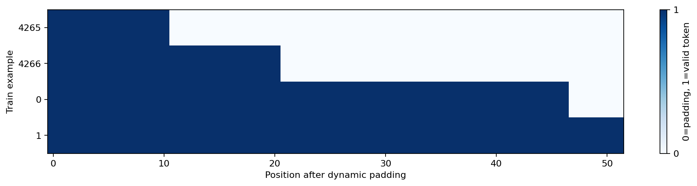

### frozen_trial/augmentation_counts.png

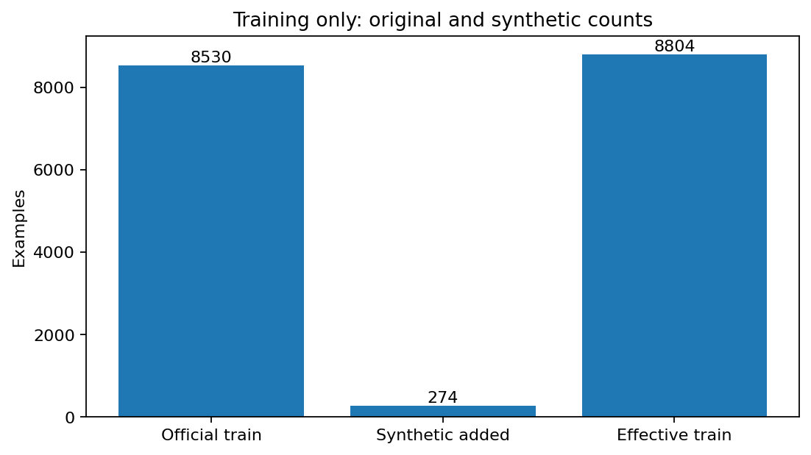

### frozen_trial/augmentation_diagnostics.png

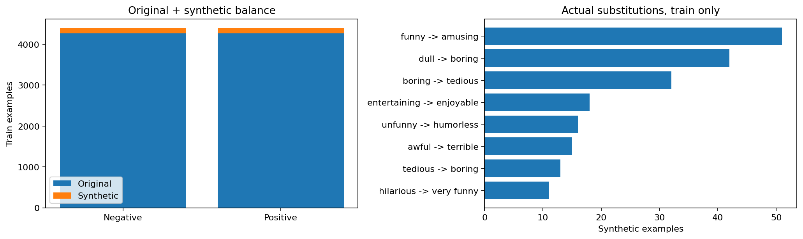

### frozen_trial/augmentation_examples.png

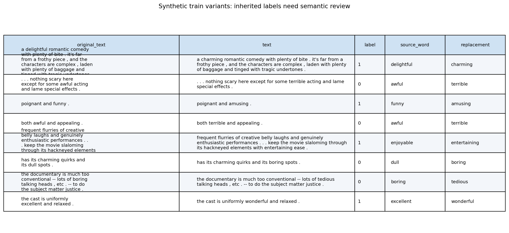

### frozen_trial/calibration_confidence.png

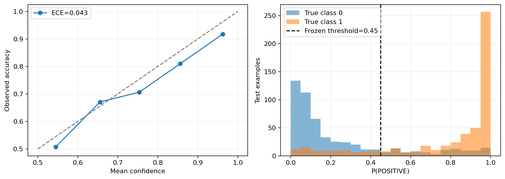

### frozen_trial/class_distribution.png

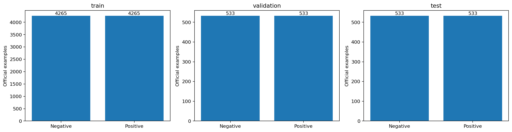

### frozen_trial/confusion_matrix.png

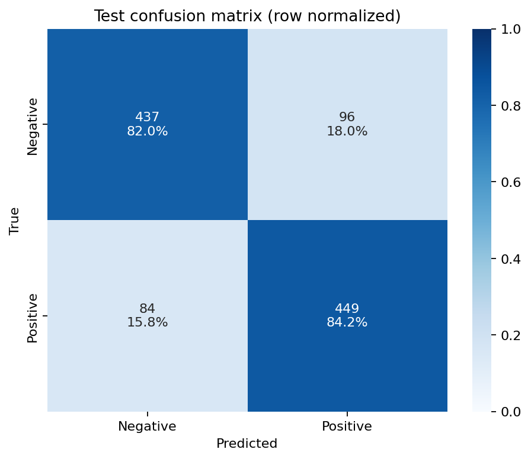

### frozen_trial/data_quality.png

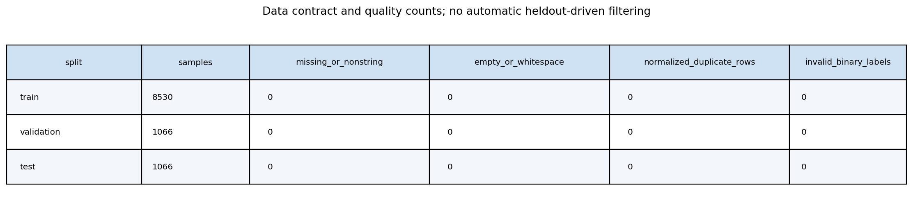

### frozen_trial/learning_curves.png

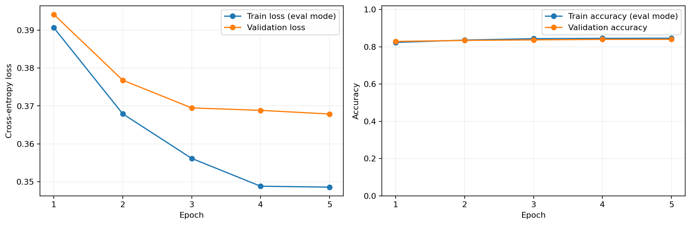

### frozen_trial/lengths_by_class.png

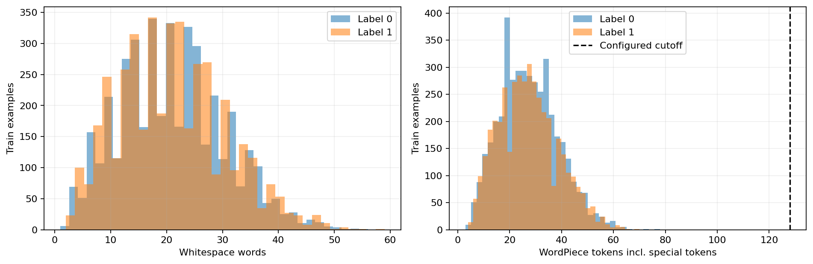

### frozen_trial/metrics_bar.png

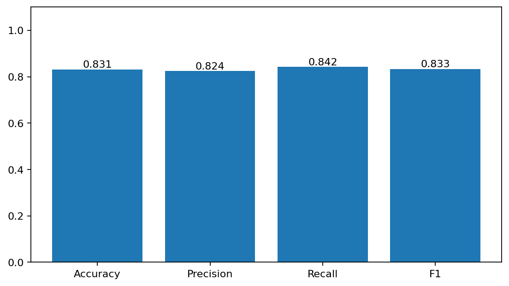

### frozen_trial/model_architecture.png

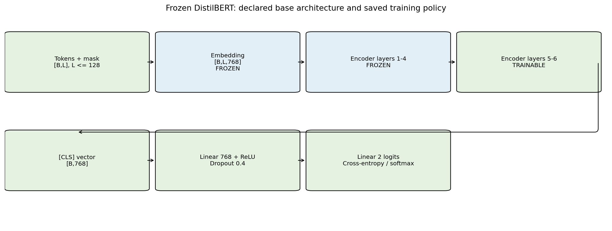

### frozen_trial/performance.png

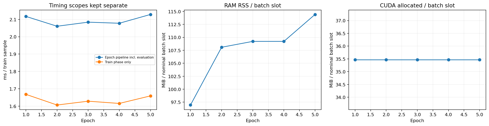

### frozen_trial/preprocessing_diagnostics.png

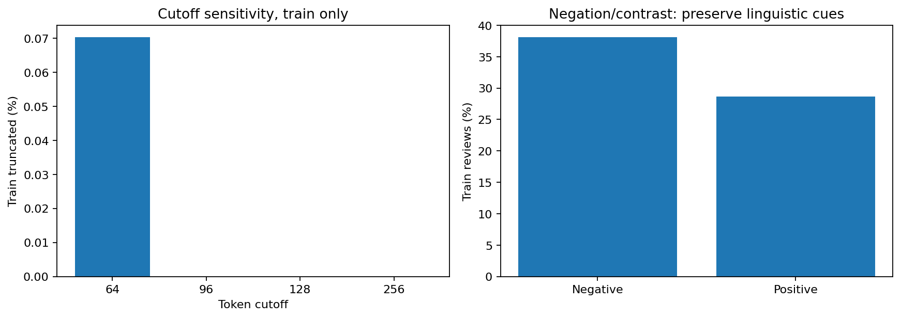

### frozen_trial/preprocessing_examples.png

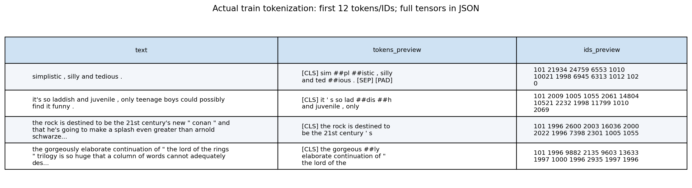

### frozen_trial/roc_pr_curves.png

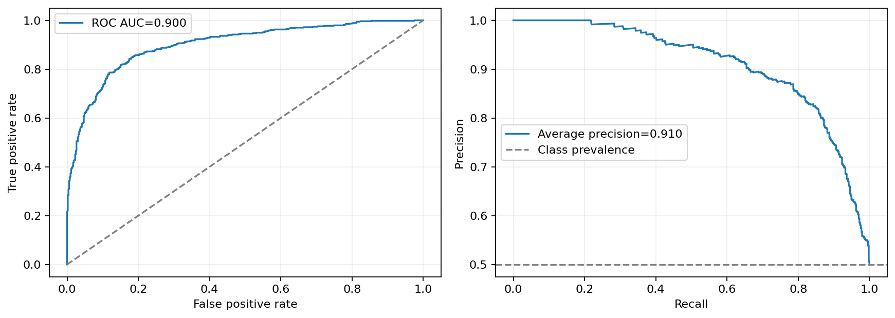

### frozen_trial/sample_predictions.png

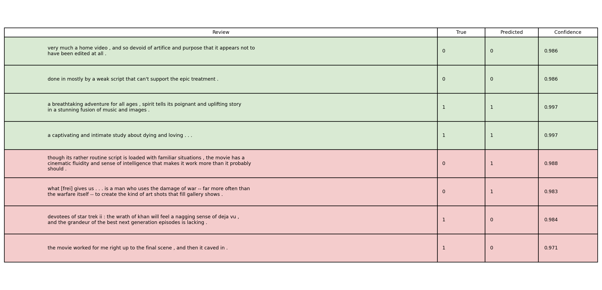

### frozen_trial/tfidf_features.png

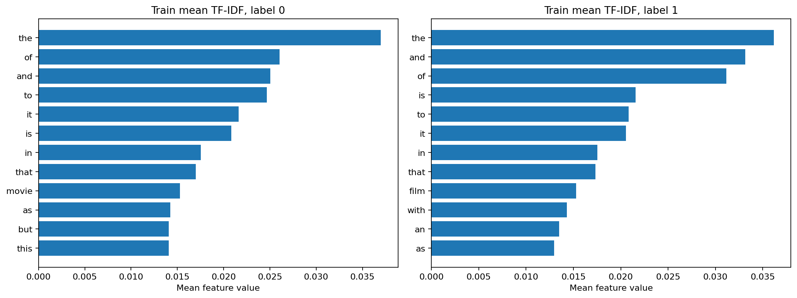

### frozen_trial/token_length_distribution.png

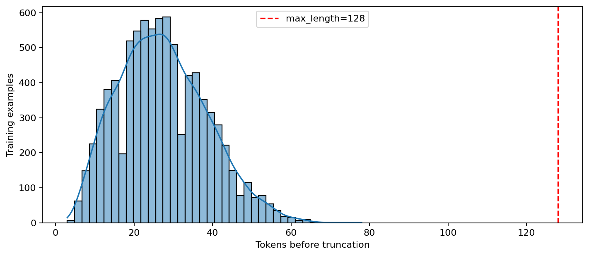

### frozen_trial/train_examples.png

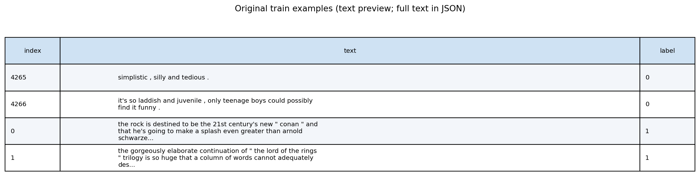

### frozen_trial/validation_threshold_curves.png

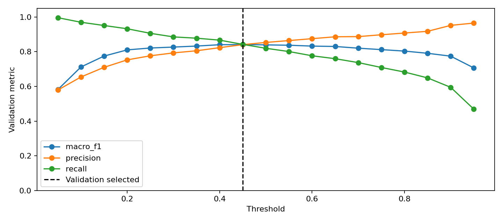

### exercise1_analysis/pipeline_manual_comparison.png

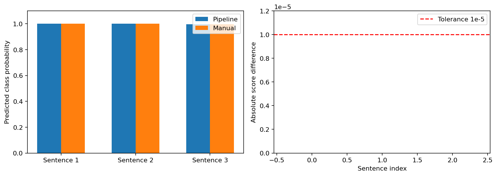

### exercise1_analysis/sentiment_predictions.png

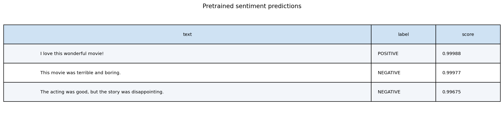

### exercise1_analysis/tokenizer_table.png

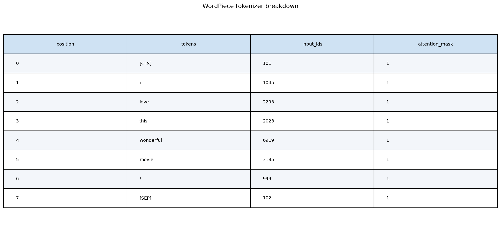
