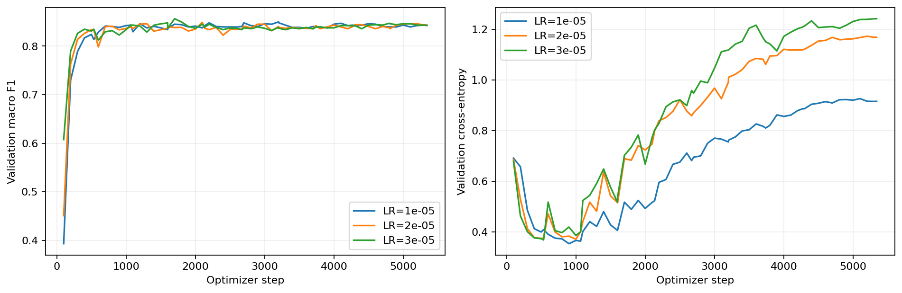
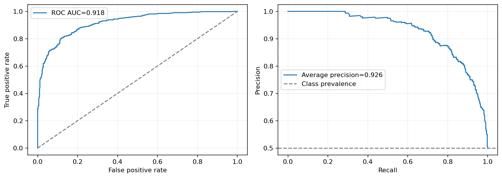
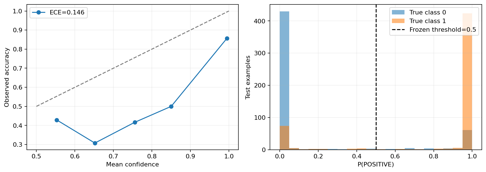
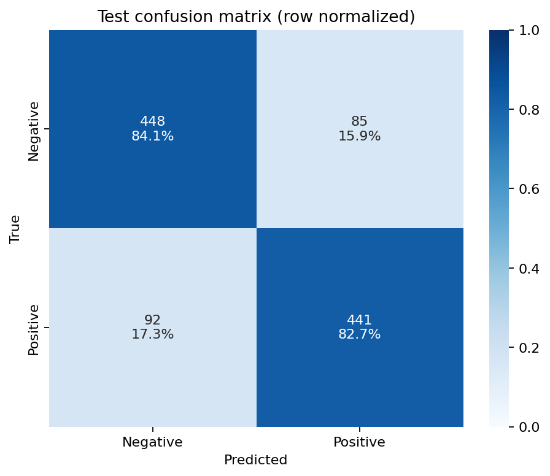
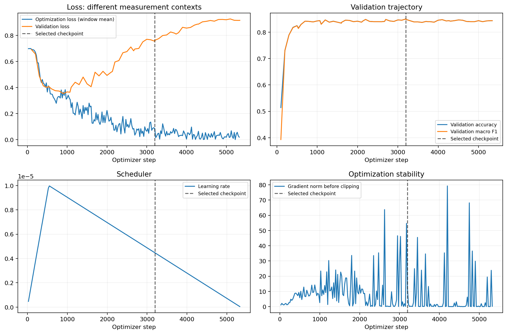
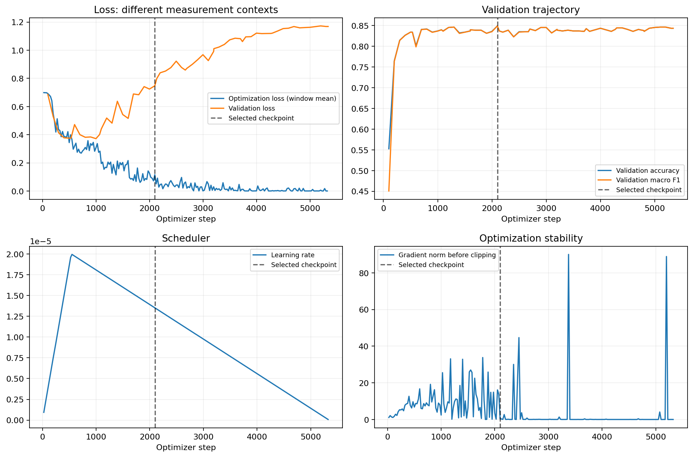
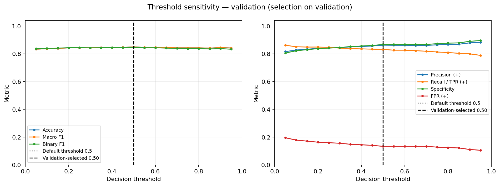
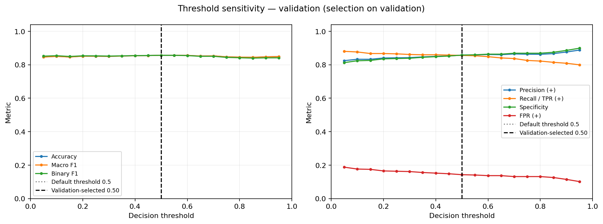

# Lab03 — Báo cáo thí nghiệm 10 epoch

Run: `20261026T184219Z_study_94f2ba7b`

## Thiết kế và lựa chọn

Full official splits: 8.530 train / 1.066 validation / 1.066 test. Seed 42.
Mỗi DistilBERT candidate chạy đủ 10 epoch, không early stopping. Checkpoint chọn bằng validation Macro-F1.
TF-IDF và Logistic Regression fit chỉ trên train; C chọn bằng validation.
Learning rate chọn bằng validation Macro-F1; hòa ưu tiên loss thấp hơn rồi LR nhỏ hơn.
Threshold chốt từ 19 điểm validation trước test; không tối ưu threshold trên test.

| Candidate | LR | Epoch hoàn tất | Best step | Val Macro-F1 | Val loss |
|---|---:|---:|---:|---:|---:|
| 20261026T184223Z_candidate_4b1da858 | 1e-05 | 10 | 3200 | 0.84991 | 0.75563 |
| 20261026T185017Z_candidate_202c0434 | 2e-05 | 10 | 2100 | 0.84892 | 0.74738 |
| 20261026T185804Z_candidate_8308037d | 3e-05 | 10 | 1700 | 0.85647 | 0.70275 |

Winner: `20261026T185804Z_candidate_8308037d`.

## Test với các policy đã chốt

| Model / policy | Accuracy | Precision (+) | Recall (+) | Macro-F1 | Binary-F1 | FP | FN |
|---|---:|---:|---:|---:|---:|---:|---:|
| TF-IDF + logistic regression (0.5) | 0.7824 | 0.7867 | 0.7749 | 0.7824 | 0.7807 | 112 | 120 |
| TF-IDF + validation threshold | 0.7871 | 0.7542 | 0.8518 | 0.7862 | 0.8000 | 148 | 79 |
| DistilBERT (0.5) | 0.8340 | 0.8384 | 0.8274 | 0.8340 | 0.8329 | 85 | 92 |
| DistilBERT + validation threshold | 0.8340 | 0.8384 | 0.8274 | 0.8340 | 0.8329 | 85 | 92 |

## Xếp hạng, confidence và bất định

ROC-AUC: 0.91842; AP: 0.92599; Brier: 0.15067; argmax-confidence ECE: 0.14607.
95% percentile bootstrap CI: `{'accuracy': [0.8095684803001876, 0.8564727954971857], 'macro_f1': [0.809568212168358, 0.8564696378079979]}`.
CI phân tầng trên test cho model/policy cố định; không bao gồm bất định do seed train.

## Ma trận nhầm lẫn và mẫu lỗi

Xem report.md cho mẫu lỗi argmax và threshold_errors.json cho toàn bộ lỗi của policy chốt.
Giả thuyết ngôn ngữ không phải causal attribution. Không sửa policy dựa trên ví dụ test.

## Giới hạn

Test lịch sử 3 epoch từng được xem. Đây là mở rộng thí nghiệm, không phải benchmark hoàn toàn chưa đụng tới.
Một seed không chứng minh cấu hình ổn định qua các lần khởi tạo. Ba learning rate không chứng minh tối ưu toàn cục.
Chạy lâu hơn không đảm bảo test accuracy/F1 cao hơn. Báo cáo cả cải thiện và suy giảm.
Nếu overlap audit có giao nhau giữa split, phải nêu rõ trong kết luận; không tự đổi official splits.

## Artifact theo từng candidate

### 20261026T184223Z_candidate_4b1da858: learning_curves.png

### 20261026T184223Z_candidate_4b1da858: step_learning_curves.png

### 20261026T184223Z_candidate_4b1da858: validation_threshold/threshold_curves.png

### 20261026T185017Z_candidate_202c0434: learning_curves.png

### 20261026T185017Z_candidate_202c0434: step_learning_curves.png

### 20261026T185017Z_candidate_202c0434: validation_threshold/threshold_curves.png

### 20261026T185804Z_candidate_8308037d: learning_curves.png

### 20261026T185804Z_candidate_8308037d: step_learning_curves.png

### 20261026T185804Z_candidate_8308037d: validation_threshold/threshold_curves.png

