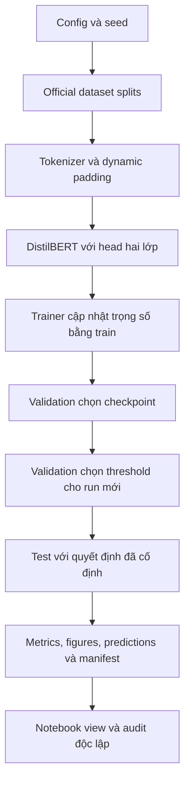
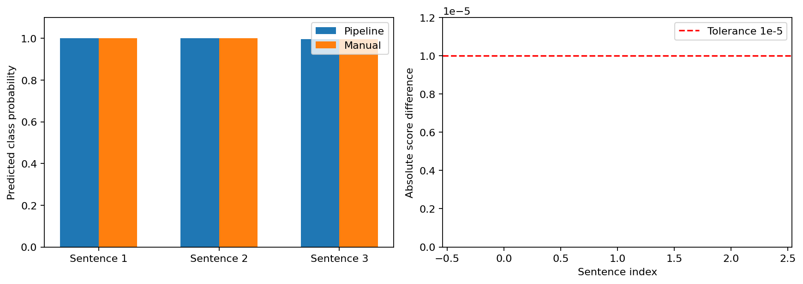
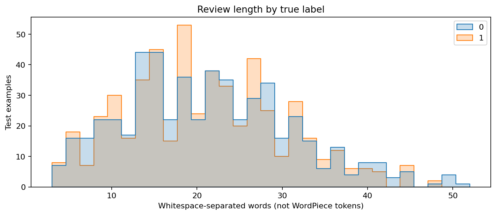
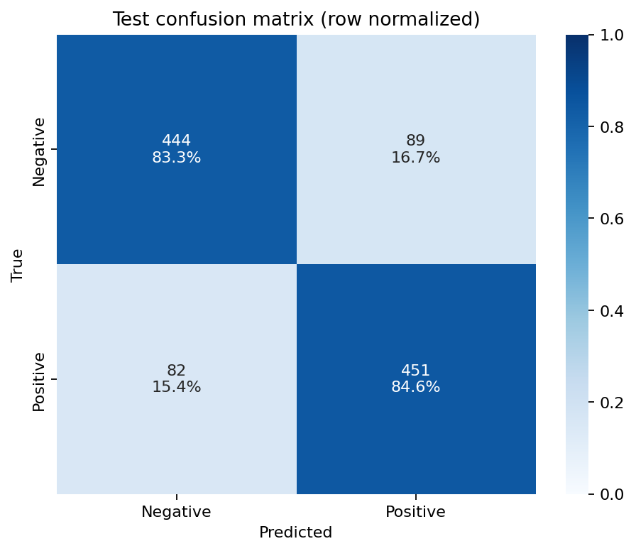
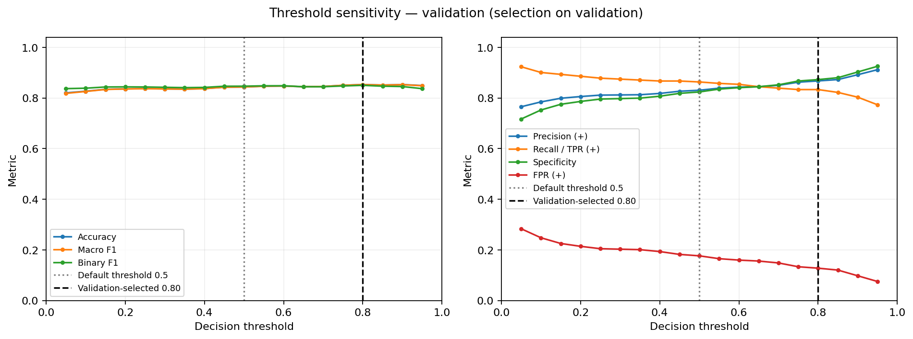
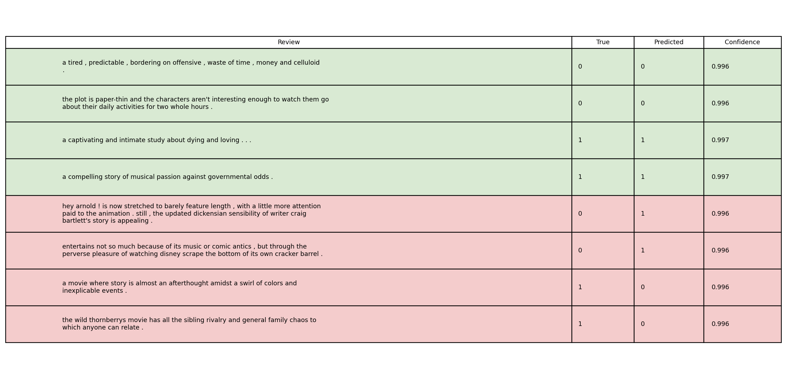
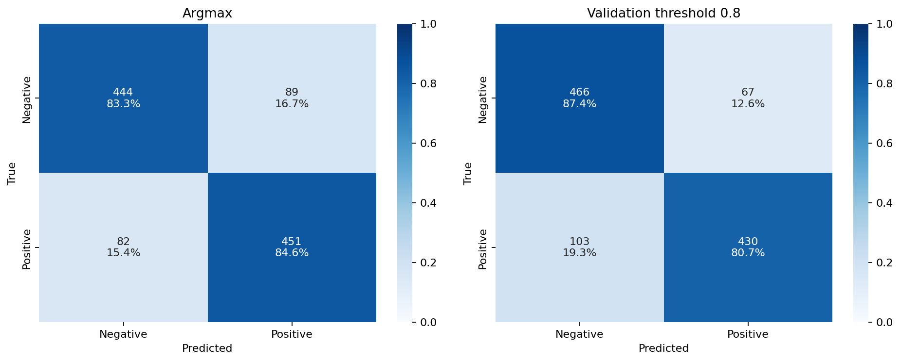

# BÁO CÁO LAB 03 — PHÂN TÍCH CẢM XÚC VÀ FINE-TUNING VỚI HUGGING FACE

**Môn học:** Deep Learning — UTH.

**Chủ đề:** biểu diễn văn bản, pretrained Transformer, sentiment inference, binary classification và lựa chọn operating threshold.

**Phạm vi:** Exercise 1 dùng DistilBERT sentiment pretrained; Exercise 2 fine-tune DistilBERT trên toàn bộ Rotten Tomatoes.

**Quy ước bằng chứng:** số liệu huấn luyện hiện hành được đọc từ run Kaggle `20261025T181550Z_finetuning_e02bced7`; các kết quả suy luận Exercise 1 thuộc run `20261025T181532Z_exercise1_71da6f40`.

**Quy ước kết quả bổ sung:** run `20261026T083558Z_threshold_selection_b64cf564` chọn threshold từ validation; run `20261026T083612Z_evaluation_a724c16c` đánh giá lại toàn test sau khi tải checkpoint; run `20261026T083627Z_inference_0ed240e2` minh họa inference cùng policy. Hình/bảng tính lại từ predictions được ghi rõ là diagnostics dẫn xuất; ba run bổ sung không huấn luyện lại weights.

**Cấu trúc báo cáo:** một tài liệu sống gồm đặc tả, phương pháp/thí nghiệm và kết quả/chẩn đoán; nhật ký sửa phần mềm nằm trong `internal_changes.md`.

### Tóm tắt

Lab triển khai hai mức sử dụng hệ sinh thái Hugging Face: dùng ngay một mô hình đã fine-tune và tự fine-tune backbone cho bài toán đích. Exercise 1 mở quy trình `pipeline` thành tokenizer, tensor đầu vào, forward, logits, softmax và nhãn dự đoán. Exercise 2 giữ nguyên official train/validation/test của Rotten Tomatoes, dùng `Trainer` để tối ưu ba epochs và chọn checkpoint bằng validation accuracy.
Run Kaggle đạt test Accuracy **83,9587%**, Binary F1 **84,0634%** và Macro F1 **83,9580%**, tương ứng 895 dự đoán đúng trên 1.066 mẫu. Confusion matrix có 444 Negative đúng, 451 Positive đúng, 89 Negative bị đoán Positive và 82 Positive bị đoán Negative. Đường học cho thấy train tiếp tục cải thiện nhưng validation loss tăng ở epoch cuối, nên kết quả phải đi kèm phân tích overfitting thay vì chỉ báo một con số accuracy.
Phần mở rộng đã khôi phục đúng checkpoint trong Kaggle, dự đoán toàn bộ validation và chọn threshold **0,8** theo Macro F1 trên lưới định trước. Validation Macro F1 tăng từ **84,3279%** tại 0,5 lên **85,2663%** tại 0,8. Sau khi cố định policy, đánh giá lại toàn test đạt Accuracy **84,0525%**, Macro F1 **84,0343%** và Binary F1 **83,4951%**: thêm một mẫu đúng, giảm 22 FP nhưng tăng 21 FN. Đây là đánh đổi operating point có bằng chứng thật, không phải cải thiện mọi metric. Checkpoint lớn vẫn nằm ngoài Git; việc tải lại toàn test được chứng minh bằng artifacts Kaggle của run evaluation mới.

### Roadmap phương pháp và module tham chiếu

| Phase | Câu hỏi cần trả lời | Module/file chính | Artifact hoặc bằng chứng |
|---|---|---|---|
| P01 — Setup | Môi trường có phù hợp và tái lập được không? | `requirements.txt`, `src/workflow.py`, `src/utils/runs.py` | Config, seed, environment snapshot |
| P02 — Pretrained inference | Mô hình có phân tích cảm xúc được không? | `src/models/classifier.py`, `scripts/run_exercise1.py` | Predictions của ba câu mẫu |
| P03 — Tokenizer | Chuỗi ký tự được biến thành tensor như thế nào? | `src/models/classifier.py`, notebook Exercise 1 | Tokens, IDs, attention mask |
| P04 — Data contract | Train/validation/test dùng để làm gì? | `src/datasets/loader.py`, `config/config.json` | Split sizes, labels, fingerprints |
| P05 — Preprocessing | Padding/truncation ảnh hưởng dữ liệu ra sao? | `src/datasets/loader.py`, `src/training/trainer.py` | Token-length statistics, distribution |
| P06 — Model/loss | Logits hai lớp và cross-entropy được tạo ở đâu? | `src/models/classifier.py`, `src/training/metrics.py` | Model configuration, tensor contract |
| P07 — Training | Có học được và checkpoint được chọn thế nào? | `src/training/trainer.py`, `src/workflow.py` | Train/validation history, best checkpoint |
| P08 — Binary threshold | Ngưỡng được chọn từ split nào? | `src/training/thresholds.py`, `src/decision.py`, `scripts/select_threshold.py` | 1.066 validation scores, sweep 19 điểm, policy threshold 0,8 |
| P09 — Evaluation | Kết quả test có nhất quán không? | `src/evidence.py`, `src/analysis.py`, `scripts/audit_outputs.py` | Metrics recomputed, confusion matrix, ROC/PR và calibration |
| P10 — Error analysis | Mô hình sai ở những dạng câu nào? | `src/workflow.py`, notebook, walkthrough | Sample predictions và hình đúng/sai |
| P11 — Reuse | Có thể xem lại và tải mô hình ra sao? | `scripts/eval.py`, `scripts/infer.py`, registry | View outputs, save/load evidence |

### Mục lục nội dung

1. Đặc tả, lựa chọn thiết kế và cơ sở lý thuyết.
2. Phương pháp thực hiện, luồng thí nghiệm và hợp đồng artifacts.
3. Kết quả, threshold, chẩn đoán lỗi, giới hạn và kết luận.

**Workflow tham chiếu:** [DL flow](../../docs/dl_flow.md), [DL data](../../docs/dl_data.md), [DL training](../../docs/dl_training.md), [EDA](../../docs/eda.md), [Feature engineering](../../docs/feature.md).
Cấu trúc ba phần kế thừa `.agents/templates/walkthrough_template.md` và cách trình bày có hình/bảng của walkthrough Lab01 trên nhánh `main`. Các quy trình EDA ảnh không áp dụng trực tiếp cho dữ liệu văn bản; chúng được thay bằng kiểm tra văn bản, nhãn và độ dài token.

## 1. TECHNICAL SPECIFICATION & FLOW DESIGN (Rule: spec-driven-development)

### 1.0. Diễn giải đề bài, thảo luận và tiêu chí nghiệm thu

Đề gốc của Exercise 1 yêu cầu cài Transformers, dùng một sentiment model từ Hub, tokenize câu mẫu và thực hiện dự đoán. Đề gốc của Exercise 2 yêu cầu tải dataset nhị phân, pretrained model/tokenizer, tiền xử lý, thiết lập training arguments, tạo Trainer, fine-tune và đánh giá. Đề không chỉ định dataset, backbone, số epochs, GPU hoặc ngưỡng Accuracy tối thiểu.
Vì vậy, các lựa chọn Rotten Tomatoes, DistilBERT và ba epochs là quyết định triển khai, không được gán ngược thành yêu cầu của giảng viên. Phần thảo luận và các quyết định chốt được ghi trong `description_lab_03.md`, tách với đoạn đề gốc giữ nguyên văn.

Các điểm làm rõ quan trọng gồm quy mô dữ liệu, mức độ modular hóa, cách lưu run, nội dung notebook và protocol threshold. Quy mô được chốt là full official Rotten Tomatoes để tránh báo cáo trên subset rồi diễn giải như toàn dataset. Notebook cần giải thích phase, tham chiếu module và hiển thị trực quan; JSON là dữ liệu máy đọc chứ không thay thế hình/bảng trình bày.
Mọi output phục vụ báo cáo phải được lưu vào `outputs/` để có thể thu hồi và kiểm tra độc lập với trạng thái notebook. Quét threshold là phần mở rộng phù hợp với binary classification, nhưng phải chốt protocol trước khi sử dụng test labels.

| Tiêu chí | Cách xác nhận | Điều không được suy diễn |
|---|---|---|
| Exercise 1 hoạt động | Có output pretrained và tokenizer | Ba câu mẫu không chứng minh accuracy tổng quát |
| Exercise 2 đúng workflow | Đủ split, Trainer, history, evaluation | Tests fixture không thay benchmark thật |
| Kết quả có truy vết | Run ID, config, snapshot, manifest | Hash đúng không chứng minh mô hình đúng khoa học |
| Có threshold protocol | Chọn bằng validation rồi cố định | Không tối ưu threshold trên test |
| Có trực quan hóa | Hình/bảng có nguồn và được lưu | Không chỉ liệt kê tên file mà thiếu diễn giải |
| Có tính trung thực | Ghi rõ phần chưa log/chưa thực thi | Không lấp chỗ thiếu bằng số liệu từ run khác |

Không sử dụng ngưỡng 85% làm điều kiện để đổi kết quả hoặc loại run hiện hành. Acceptance của lab tập trung vào hợp đồng dữ liệu đúng, quy trình chạy đúng, output có bằng chứng và khả năng giải thích. Những kiểm tra cần checkpoint hoặc validation scores thật phải được ghi trạng thái riêng khi tài nguyên đó không có trong Git.
Đây là ranh giới giữa một chức năng đã được triển khai và một kết quả thực nghiệm đã được xác nhận.

### 1.1. Modality, biến mục tiêu và ý nghĩa hai lớp

Đầu vào là một đoạn nhận xét phim tiếng Anh dưới dạng chuỗi Unicode. Đầu ra của bài phân loại là một nhãn duy nhất trong hai giá trị Negative và Positive. Dataset quy định `0 = NEGATIVE`, `1 = POSITIVE`; mapping này phải được giữ xuyên suốt tokenizer, model, metrics và ảnh minh họa.
Một mẫu không đồng thời thuộc cả hai lớp, nên đây là single-label binary classification, không phải multi-label classification.

Từ vựng cảm xúc không quyết định nhãn một cách độc lập với ngữ cảnh. Câu có từ tiêu cực có thể đang mô tả nội dung phim nhưng khen cách thể hiện. Câu chứa lời khen bề mặt có thể mang mỉa mai hoặc kết luận chung tiêu cực.
Điều này giải thích vì sao bài cần contextual encoder và phân tích lỗi định tính, thay vì chỉ đếm từ tích cực/tiêu cực.

| Thành phần | Hợp đồng |
|---|---|
| Raw text | `str`, không dùng nhãn làm đầu vào |
| Label | Số nguyên 0 hoặc 1 |
| Model output | Hai logits theo thứ tự mapping model |
| Probability | Hai giá trị không âm, tổng gần 1 |
| Decision | Argmax baseline hoặc quy tắc threshold đã xác định |

Giữ mapping rõ ràng đặc biệt quan trọng khi dùng threshold trên cột xác suất Positive. Nếu đảo cột 0/1, ROC/PR hoặc confidence có thể vẫn vẽ được nhưng diễn giải sẽ sai. Vì vậy, các bước audit kiểm tra label domain, vector xác suất và predicted label cùng nhau.

### 1.2. Data contract và phân chia chính thức

Dataset được tải từ `cornell-movie-review-data/rotten_tomatoes` qua thư viện `datasets`. Luồng hiện hành không lấy mẫu nhỏ để train chính và không tự tạo lại validation split. Official splits được giữ như nguồn dữ liệu cung cấp.

| Split | Số mẫu | Vai trò trong protocol |
|---|---:|---|
| Train | 8.530 | Ước lượng gradient và cập nhật trọng số |
| Validation | 1.066 | Chọn checkpoint; run bổ sung chọn threshold 0,8 |
| Test | 1.066 | Đánh giá cuối sau khi các lựa chọn đã cố định |

Loader kiểm tra đúng kích thước đã chốt và bảo đảm mỗi split có hai nhãn 0/1. Kiểm tra kích thước phát hiện tải nhầm dataset hoặc vô tình dùng subset, nhưng không thay thế kiểm toán nội dung từng mẫu. Việc giữ official splits hạn chế sai sót do chia lại sau khi đã quan sát test.
Tuy nhiên, artifacts hiện hành chưa có kết quả duplicate/leakage audit toàn bộ ba split nên không khẳng định đã chứng minh không có mọi dạng trùng lặp.

Test có 533 mẫu Negative và 533 mẫu Positive, xác nhận từ `all_predictions.json`. Cân bằng này làm Accuracy bằng Macro Recall trong kết quả hiện hành, vì hai lớp có trọng số bằng nhau. Không được suy rộng nhận xét đó cho một dataset mất cân bằng.
Trong môi trường triển khai có base rate khác, Precision và tác động vận hành của cùng threshold có thể thay đổi.

### 1.3. Baseline và điều kiện so sánh công bằng

Baseline được dùng để đặt một mốc dễ hiểu trước khi diễn giải mô hình phức tạp. Với test cân bằng, quy tắc luôn dự đoán Negative đạt Accuracy 50%. Macro F1 của baseline hằng là 33,3333%, không phải 50%, vì F1 Positive bằng 0 và F1 Negative bằng 2/3.
Đây là baseline quyết định hằng được tính từ nhãn thật, không phải một checkpoint pretrained chưa fine-tune.

| Baseline | Có train không? | Có dùng text không? | Accuracy test | Macro F1 |
|---|---|---|---:|---:|
| Luôn Negative | Không | Không | 50,0000% | 33,3333% |
| DistilBERT fine-tuned | Có | Có | 83,9587% | 83,9580% |

Không gán Accuracy 50% cho đầu phân loại ngẫu nhiên của DistilBERT nếu chưa thực sự đo. Một model với head mới có thể nghiêng về một lớp và thay đổi theo seed; đó là một thí nghiệm khác với baseline hằng. Không so sánh trực tiếp số liệu IMDB subset của bản cũ với Rotten Tomatoes như thể chỉ đổi kiến trúc.
Dataset, số mẫu và phân bố độ dài khác nhau là các biến gây nhiễu cho kết luận đó.

So sánh threshold cũng phải dùng cùng model scores và cùng split để diễn giải tác động của operating point. Đổi đồng thời checkpoint, tokenizer, dữ liệu và threshold sẽ làm mất khả năng tách nguyên nhân. Run registry và config snapshot giúp bảo toàn các điều kiện so sánh này.

### 1.4. Kiến trúc phần mềm và luồng dữ liệu

Project tách phần cấu hình, thuật toán, điểm chạy, trình bày và kết quả. `src/` chứa tính toán tái sử dụng; CLI và notebook gọi cùng workflow để tránh có hai cách chia dữ liệu hoặc hai model initialization khác nhau. Namespace `labs.lab03.src` được dùng để không xung đột với `src` của Lab01 trong cùng repository.



| Khu vực | Trách nhiệm | Không nên làm |
|---|---|---|
| `config/` | Tham số và danh mục run | Chứa secret hoặc thay dữ liệu kết quả |
| `src/datasets/` | Tải và tokenize dữ liệu | Chọn model bằng test labels |
| `src/models/` | Tạo model, inference, save/load | Giả định backbone đã biết sentiment đích |
| `src/training/` | Trainer, metric và threshold policy | Tối ưu threshold bằng test |
| `src/utils/` | Lưu run, log, hình và manifest | Ghi đè run cũ để làm đẹp kết quả |
| `scripts/` | CLI và kiểm tra tham số | Sao chép lại thuật toán từ notebook |
| `notebooks/` | Roadmap, lý thuyết, bảng và hình | Chỉ in JSON dài mà thiếu diễn giải |
| `outputs/` | Artifact gốc và artifact phân tích | Lưu cache/venv hoặc secret |
| `validation/` | Báo cáo kiểm chứng phần mềm | Trình bày như kết quả GPU mới |

### 1.5. Transformer encoder và self-attention

Văn bản được biểu diễn thành các vector token theo vị trí trong chuỗi. Self-attention cho phép biểu diễn một token phụ thuộc các token khác, thay vì xử lý từng từ như một quan sát độc lập. Ví dụ, nghĩa của “good” trong “not good” cần được điều chỉnh bởi từ phủ định.
Cơ chế attention cung cấp một cách học quan hệ ngữ cảnh, nhưng không tự bảo đảm mọi phủ định hoặc mỉa mai đều được hiểu đúng.

$$\operatorname{Attention}(Q,K,V)=\operatorname{softmax}\left(\frac{QK^T}{\sqrt{d_k}}\right)V.$$

$Q$, $K$, $V$ được tạo bằng các phép chiếu tuyến tính từ biểu diễn token. Tích $QK^T$ đo mức tương thích giữa vị trí truy vấn và các vị trí khóa. Chia cho $\sqrt{d_k}$ kiểm soát độ lớn logits trước softmax; attention mask loại ảnh hưởng của padding ở phép tính phù hợp.
Multi-head attention cho phép nhiều phép chiếu cùng khảo sát các quan hệ khác nhau.

Transformer encoder dùng positional information để nhận biết thứ tự, vì attention thuần không tự mã hóa vị trí trong câu. Các tầng feed-forward, residual connection và normalization tiếp tục biến đổi biểu diễn sau attention. Lab vận dụng pretrained encoder chứ không huấn luyện Transformer từ đầu.
Điều này phù hợp lượng dữ liệu và ngân sách thực hành.

### 1.6. Vì sao DistilBERT được chọn

DistilBERT là mô hình rút gọn từ BERT bằng knowledge distillation. Backbone được chọn có sáu transformer layers, hidden size 768 và 12 attention heads trong cấu hình chuẩn của model này. Mô hình có quy mô khoảng 66 triệu tham số, đủ khả năng biểu diễn ngữ cảnh nhưng nhẹ hơn BERT-base.
Các số kiến trúc này mô tả cấu hình model, không phải kết quả benchmark đo trong lab.

Lựa chọn DistilBERT ưu tiên cân bằng thời gian train, bộ nhớ và khả năng giải thích một quy trình pretrained fine-tuning. Không có thí nghiệm so sánh BERT/DistilBERT nhiều seed trong artifacts hiện hành để kết luận model nào tốt hơn trên Rotten Tomatoes. Không dùng mô tả tốc độ từ tài liệu model như số đo thực nghiệm trên Tesla T4 của bài.
Runtime được báo cáo riêng từ `train_metrics.json`.

Model Exercise 1 và model Exercise 2 có cùng họ kiến trúc nhưng khác trạng thái trọng số. Exercise 1 dùng checkpoint đã fine-tune SST-2 cho sentiment inference. Exercise 2 dùng backbone nền cùng classification head mới cho hai nhãn.
Cảnh báo head mới khởi tạo ở Exercise 2 là trạng thái mong đợi, không phải lỗi tải model.

### 1.7. Tokenization, special tokens và hợp đồng tensor

WordPiece phân tách câu thành token/subword rồi ánh xạ sang ID trong vocabulary. Một từ hiếm có thể thành nhiều subword; một token không nhất thiết tương ứng một từ ngữ pháp. Mô hình nhận số nguyên ID chứ không nhận trực tiếp chuỗi ký tự.
Tokenizer phải tương thích với vocabulary và quy tắc preprocessing của model được tải.

| Trường | Dtype/shape | Vai trò |
|---|---|---|
| `input_ids` | Integer tensor `(B,S)` | ID token trong vocabulary |
| `attention_mask` | Integer tensor `(B,S)` | 1 cho token hợp lệ, 0 cho padding |
| `labels` | Integer tensor `(B,)` | Nhãn 0/1 dùng tính loss |
| `logits` | Floating tensor `(B,2)` | Score chưa chuẩn hóa của hai lớp |
| `probabilities` | Floating array `(B,2)` | Softmax dùng cho inference/threshold |

`[CLS]` mở đầu chuỗi và cung cấp vị trí biểu diễn dùng trong head phân loại. `[SEP]` đánh dấu kết thúc câu/đơn vị chuỗi theo tokenizer. `[PAD]` chỉ phục vụ căn chỉnh batch và không được diễn giải như nội dung nhận xét.
DistilBERT không yêu cầu `token_type_ids` theo cách BERT gốc thường dùng cho sentence pairs.

Ví dụ trong Exercise 1 có tám tokens kể cả special tokens. Mask toàn 1 là hợp lệ vì câu đơn đó không chứa padding. Bảng tokens/IDs/mask trong notebook cho phép kiểm tra mapping từng vị trí thay vì chỉ in shape tổng.

### 1.8. Truncation, dynamic padding và lựa chọn max length

Truncation giới hạn chiều dài input để kiểm soát bộ nhớ và chi phí attention. Padding bổ sung token đệm để các mẫu trong cùng batch có shape tương thích. Hai thao tác giải quyết hai vấn đề khác nhau, không được dùng thay nhau trong giải thích.

Với padding cố định `max_length`, mọi mẫu đều có chiều dài 128 dù câu ngắn. Với dynamic padding, collator chỉ đệm đến chiều dài lớn nhất của batch hiện tại. Các câu Rotten Tomatoes ngắn khiến dynamic padding có thể giảm đáng kể số vị trí đệm so với đệm toàn bộ lên 128.
Lab không có benchmark đối chứng hai chế độ để lượng hóa phần trăm tăng tốc do riêng lựa chọn padding.

Train token lengths ghi nhận trung bình **27,3683**, tối đa **78**, và truncated fraction **0,0** ở cutoff 128. Vì tối đa train nhỏ hơn 128, cutoff không làm mất token train trong run này. Không tự suy ra validation/test cũng có đúng phân bố đó khi chưa đo chúng.
Nếu đổi dataset sang các review dài như IMDB, cần đo lại độ dài trước khi dùng nguyên cutoff.

### 1.9. Classification head, logits và xác suất

Biểu diễn đầu chuỗi từ encoder được đưa qua head phân loại của `DistilBertForSequenceClassification`. Head có pre-classifier, activation, dropout và lớp tuyến tính trả hai logits. Đây là phần có thể mới khởi tạo khi chuyển backbone ngôn ngữ sang tác vụ phân loại.
Fine-tuning cập nhật tham số của mô hình theo gradient, không chỉ thay một bảng mapping nhãn.

Với hai logits $z_0,z_1$:

$$p(y=c\mid x)=\frac{e^{z_c}}{e^{z_0}+e^{z_1}},\quad c\in\{0,1\}.$$

Hai xác suất phải không âm và có tổng gần 1 trong sai số floating point. Confidence của prediction thường là xác suất của lớp được chọn, không phải chứng nhận mức đúng ngoài dữ liệu huấn luyện. Trong run hiện hành có các lỗi confidence gần 99,6%, cho thấy cần phân biệt score model với độ tin cậy được hiệu chuẩn.
Phân tích bổ sung đã tạo probability distribution và top-label reliability diagram từ toàn bộ test scores; số đo này được diễn giải ở Section 3 với giới hạn hậu nghiệm rõ ràng.

### 1.10. Cross-entropy và gradient

Với nhãn thật $y$, loss một mẫu là $-\log p_y$. Cross-entropy tăng mạnh khi model gán xác suất rất thấp cho lớp đúng, ngay cả khi số mẫu dự đoán sai không thay đổi nhiều. Điều đó giải thích vì sao validation accuracy gần như đứng yên nhưng validation loss có thể tăng đáng kể.

$$\mathcal L=-\frac{1}{B}\sum_{i=1}^{B}\log p(y_i\mid x_i).$$

Trong PyTorch, `CrossEntropyLoss` nhận logits và nhãn nguyên; không cần tự softmax trước khi đưa vào loss. Autograd tính gradient qua classifier và encoder; optimizer dùng gradient để cập nhật tham số. Trong inference, model ở eval mode và dùng `torch.inference_mode()` để không xây dựng computation graph không cần thiết.
Eval mode cũng điều chỉnh hoạt động dropout, nên khác training mode về hành vi stochastic.

### 1.11. AdamW, learning rate, warmup và regularization

AdamW kết hợp cập nhật thích nghi với weight decay tách khỏi gradient loss. Learning rate 2e-5 được chọn cho fine-tuning pretrained Transformer, nơi cập nhật quá lớn có thể làm mất biểu diễn hữu ích. Đây là cấu hình thực hành cố định, không phải kết quả của một search learning rate trong bài.

Warmup ratio 0,1 dành giai đoạn đầu để learning rate tăng dần trước phần lịch còn lại. Weight decay 0,01 cung cấp regularization; dropout có sẵn trong model là một nguồn regularization khác. Sự hiện diện của hai cơ chế này không cho phép khẳng định đã loại bỏ overfitting.
Các đường học của run cho thấy cần đánh giá điều đó từ dữ liệu thực tế.

| Yếu tố | Quyết định | Lý do | Bằng chứng được đo |
|---|---|---|---|
| Optimizer | AdamW | Phù hợp fine-tuning Transformer | Config và TrainingArguments |
| LR | 2e-5 | Cập nhật có kiểm soát | Config/history |
| Warmup | 0,1 | Làm mượt giai đoạn đầu | Config |
| Weight decay | 0,01 | Hạn chế độ lớn tham số | Config |
| Epochs | 3 | Ngân sách thực hành vừa phải | 1.602 optimizer steps |

### 1.12. Mixed precision, batch size và tài nguyên

FP16 trong Trainer là mixed precision: một số phép tính sử dụng độ chính xác thấp hơn để tiết kiệm bộ nhớ/tăng throughput. Nó không đồng nghĩa mọi trọng số cuối cùng đều được lưu bằng FP16. Cơ chế gradient scaling hỗ trợ tránh underflow khi train với precision thấp.
Trên CPU, cấu hình mã tự tắt FP16; full training mặc định yêu cầu CUDA để tránh vô tình chạy công việc dài.

Train batch size là 16 trên một GPU; eval batch size là 32. Một epoch có $\lceil8530/16\rceil=534$ optimizer steps khi gradient accumulation mặc định bằng 1. Ba epochs tương ứng 1.602 steps như history đã ghi.
Nếu tăng số GPU, batch hiệu dụng và số steps có thể thay đổi; không được hard-code số steps đó cho mọi cấu hình phần cứng.

Tesla T4 là thiết bị ghi trong environment snapshot của run đã hoàn thành. Không suy ra số GPU thực dùng chỉ từ lựa chọn T4 x2 trong giao diện Kaggle; luồng chạy đã giới hạn GPU nhìn thấy qua `CUDA_VISIBLE_DEVICES=0`. Throughput train và throughput evaluate là hai đại lượng khác nhau cần ghi tách biệt.
Không dùng tốc độ inference trên train để mô tả tốc độ cập nhật gradient.

### 1.13. Chọn checkpoint và tách lựa chọn khỏi test

Sau mỗi epoch, Trainer đánh giá trên validation và lưu checkpoint. `load_best_model_at_end=True` yêu cầu khôi phục checkpoint tốt nhất theo metric đã chốt. Trong run gốc, metric đó là validation accuracy với hướng lớn hơn tốt hơn.
Việc lựa chọn không dựa trên test accuracy.

Checkpoint epoch 3 có validation accuracy cao nhất trong ba điểm đo. Checkpoint epoch 2 có validation loss thấp nhất. Hai tiêu chí phản ánh hai góc nhìn khác nhau: quyết định đúng/sai và chất lượng phân bố xác suất.
Không đổi sang epoch 2 sau khi nhìn thấy test chỉ vì một tiêu chí khác có vẻ hấp dẫn hơn.

Nếu muốn khảo sát chọn theo validation loss hoặc early stopping, cần ghi một cấu hình/thí nghiệm riêng trước khi diễn giải test mới. Registry phải nêu rõ run/checkpoint được chọn để notebook không vô tình dùng một run khác có kết quả đẹp hơn. Tách checkpoint selection và threshold selection giúp nhận biết hai mức lựa chọn khác nhau.

### 1.14. Binary threshold: định nghĩa và protocol

Với xác suất Positive $p_1$, một operating rule có thể định nghĩa:

$$\hat y_t=\begin{cases}1& p_1\ge t,\\0& p_1<t.\end{cases}$$

$t$ là threshold quyết định, không phải learning rate hoặc một tham số trainable được backpropagation cập nhật. Thay $t$ không thay trọng số model; nó thay cách chuyển score thành nhãn. Tăng threshold thường làm ít dự đoán Positive hơn, thay đổi cân bằng Precision/Recall và FP/FN.
Với scores cố định, Recall không tăng và FPR không tăng khi threshold tăng; Accuracy, Precision và F1 không được bảo đảm biến thiên đơn điệu.

Argmax hai lớp gần tương đương threshold 0,5 khi xác suất không tie. Khi $p_0=p_1$, `argmax` thường chọn chỉ số đầu, còn quy tắc `p_1 >= 0.5` chọn Positive. Vì vậy, boundary convention phải được ghi rõ và kiểm tra, không khẳng định hai cách luôn bit-identical ở mọi trường hợp.
Metrics Kaggle trong báo cáo này là baseline argmax đã lưu từ run gốc.

Protocol chốt cho phần mở rộng là chọn threshold bằng **validation scores và validation labels**. Implementation chốt Macro F1 làm metric chọn; grid mặc định gồm 19 thresholds từ 0,05 đến 0,95 với bước 0,05. Nếu nhiều điểm có score bằng nhau trong sai số 1e-12, ưu tiên ngưỡng gần 0,5 rồi ngưỡng nhỏ hơn; metadata lưu đầy đủ lựa chọn này.
Sau khi chọn, threshold được cố định trước khi đọc kết quả test cho nhánh đó. Không chọn `best threshold` từ test labels rồi báo score test tương ứng như đánh giá độc lập.

### 1.15. ROC, Precision–Recall và calibration

ROC khảo sát TPR theo FPR trên các mức threshold; ROC-AUC đánh giá khả năng xếp hạng score giữa hai lớp. PR curve khảo sát Precision theo Recall; Average Precision tổng hợp chất lượng xếp hạng theo cách tích phân/tổng trọng số của thư viện. AP không đồng nghĩa F1 và không được gọi là Accuracy.
Các đường này bổ sung cho confusion matrix tại một threshold, không thay thế mọi đánh giá vận hành.

Reliability diagram có nhiều định nghĩa; bản triển khai này dùng **top-label confidence**: nhóm theo $\max(p_0,p_1)$ rồi so sánh mean confidence với tỷ lệ prediction đúng trong bin. Nếu mean confidence cao hơn accuracy của bin, model thể hiện overconfidence trong bin đó; không nhầm trục tung này với tần suất Positive của một binary reliability diagram khác. Tuy nhiên, số mẫu mỗi bin và cách chọn bins ảnh hưởng hình dạng đường.
Không hiệu chỉnh model bằng test labels chỉ vì hình test calibration cho thấy vấn đề.

Quét threshold trên test có thể dùng như **phân tích mô tả độ nhạy**, khi toàn bộ grid được công bố và không chọn một threshold để triển khai. Kết quả đó phải được đặt tên và diễn giải khác validation selection. Sự phân biệt này quan trọng vì yêu cầu “có threshold scan” không tự cho phép thay đổi protocol đánh giá.

### 1.16. Artifact contract và khả năng tái lập

Mỗi output có ý nghĩa trong notebook phải đi kèm artifact trong `outputs/`. JSON/CSV phục vụ tính lại; PNG phục vụ đọc trực quan; Markdown/report phục vụ diễn giải. Lưu output giúp kết quả không phụ thuộc một biến còn tồn tại trong kernel notebook.
Chỉ hiển thị bảng mà không lưu bản nguồn sẽ gây khó khăn khi so sánh hoặc xuất báo cáo sau này.

| Loại output | Dạng lưu phù hợp | Vai trò trong notebook |
|---|---|---|
| Cấu hình/snapshot | JSON | Bảng cấu hình gọn, không dump JSON dài |
| Dữ liệu metrics | JSON và bảng máy đọc | Bảng so sánh và bar plot |
| History | JSON/CSV | Curves train/validation |
| Toàn bộ predictions | JSON | Nguồn cho audit, ROC/PR và error analysis |
| Threshold grid/selection | JSON/CSV cùng metadata split | Bảng sweep, curves và selected point |
| Figure | PNG | Hiển thị ảnh và nhúng walkthrough |
| Nội dung phân tích | Markdown hoặc record trong report | Gắn quan sát với bằng chứng |

Run gốc được giữ nguyên bytes để manifest SHA256 vẫn có giá trị. Artifact phân tích bổ sung phải lưu ở vị trí riêng hoặc run phân tích riêng, không sửa metrics gốc để thêm một kết quả chưa được đo. Notebook view có thể tạo artifacts phân tích từ predictions cũ, nhưng phải ghi rõ source run và mode.
Không coi một lần view là một lần huấn luyện mới.

## 2. FULL-FLOW EXPERIMENT LINEAGE & CHANGELOG (Rule: walkthrough-and-experiment-tracking)

### 2.0. Roadmap thực thi và phân công trách nhiệm

Quy trình được tổ chức theo các phase trong bảng đầu báo cáo để người đọc biết mỗi cell đang kiểm tra điều gì. Notebook cần tham chiếu file/hàm tương ứng trước các khối tính toán quan trọng. Mục tiêu là giải thích luồng dữ liệu và quyết định, không che thuật toán sau một lệnh gọi mà không có ngữ cảnh.
Các module vẫn giữ vai trò nguồn tính toán chung để tránh hai phiên bản thuật toán.

Một phiên train đầy đủ bắt đầu từ config và kết thúc ở status/manifest sau khi evaluation cùng các kiểm tra cần thiết hoàn tất. Nếu lỗi hậu xử lý xuất hiện, không được xem một dòng progress 100% là bằng chứng toàn bộ workflow thành công. `status.json`, registry và file kết quả cần được đối chiếu với nhau.
Đối với run hiện hành, status ghi completed và artifacts đã qua kiểm tra đọc-only.

### 2.1. Môi trường cài đặt và phiên bản đã kiểm chứng

Run Kaggle sử dụng Python 3.12.15 trên Linux với Tesla T4. Môi trường rà soát CPU sử dụng Python 3.12.14 và wheel PyTorch CPU tương ứng. Sự khác biệt môi trường được ghi rõ để không nhầm kết quả kiểm thử phần mềm với đo throughput GPU.
Dependencies trực tiếp được pin; toàn bộ dependency bắc cầu chưa được khóa thành lockfile hoàn chỉnh.

| Thư viện | Phiên bản Kaggle được ghi |
|---|---|
| PyTorch | 2.6.0 |
| Transformers | 4.48.3 |
| Datasets | 3.2.0 |
| Evaluate | 0.4.3 |
| Accelerate | 1.3.0 |
| NumPy | 2.2.2 |
| Scikit-learn | 1.6.1 |

`evaluate` được cài theo đề và ghi phiên bản, nhưng các metric báo cáo tính bằng scikit-learn tại máy. Cách này tránh yêu cầu tải executable metric scripts từ Hub trong môi trường bị giới hạn mạng. Không được mô tả rằng các metric thực tế đã được tính bằng `evaluate.load()` khi code không làm vậy.
Các phiên bản chính cần khớp environment snapshot của run được chọn, không lấy phiên bản từ máy phát triển khác để điền vào báo cáo GPU.

`Requires-Python` của các pin trực tiếp có giao dưới từ Python 3.10, nhưng quy trình hiện hành được kiểm chứng bằng Python 3.12. Tính sẵn có của wheel và tương thích dependency bắc cầu còn phụ thuộc nền tảng. Môi trường `.venv-lab03` tách riêng tránh hạ cấp hoặc thay các dependency của Lab01.
Khi Kaggle restart session, biến Python và kết nối kernel phải được khởi tạo lại dù file vẫn còn trong filesystem.

### 2.2. Seed, provenance và giới hạn phục dựng từ Hub

`set_seed(42)` khởi tạo các nguồn ngẫu nhiên thường dùng của Python/NumPy/PyTorch. Cấu hình cuDNN tắt benchmark và bật deterministic ở mức được hỗ trợ. Data seed của Trainer được đặt để kiểm soát thứ tự sampling phù hợp.
Các thiết lập này làm điều kiện thí nghiệm rõ hơn, không thay thế việc ghi version và source revision.

Backbone commit thực được ghi là `12040accade4e8a0f71eabdb258fecc2e7e948be`. Dataset fingerprints lần lượt là train `0346a9d2308d9056`, validation `4d310508c191379e`, test `23aa2ff3ad95b6f5`. Fingerprints giúp nhận diện đối tượng dataset đã xử lý trong môi trường thư viện, nhưng không thay thế một dataset commit SHA để phục dựng lâu dài.
Config run gốc dùng revision `main`, nên việc Hub thay đổi trong tương lai là một giới hạn tái lập cần công khai.

Một lần chạy cùng seed trên thiết bị hoặc kernels khác có thể có sai số floating point khác. Vì vậy, so sánh output cần tolerance hợp lý và cùng ngữ cảnh precision khi kiểm tra save/load. Không thay expected hashes hoặc nới tolerance để che việc thực sự tải sai trọng số.
Manifest và checkpoint state cung cấp hai lớp kiểm tra khác với việc chỉ so nhãn của một câu.

### 2.3. Exercise 1: tải model và tạo pipeline

Run Exercise 1 hiện hành là `20261025T181532Z_exercise1_71da6f40`. Model dùng là `distilbert/distilbert-base-uncased-finetuned-sst-2-english`. `AutoTokenizer` và `AutoModelForSequenceClassification` tải các thành phần tương ứng; pipeline bọc chúng thành API sentiment analysis.
Khi có CUDA, model được đưa lên GPU; việc đó không biến inference thành training.

Ba câu mẫu được chốt trong config nhằm minh họa một câu tích cực rõ, một câu tiêu cực rõ và một câu có cảm xúc pha trộn. Chúng không được chọn thành một tập benchmark có đại diện thống kê. Output được lưu thành `predictions.json` và `tokenizer_breakdown.json` trong run riêng.
Notebook chuyển các records này thành bảng dễ đọc và hình minh họa thay vì yêu cầu người đọc giải mã JSON thô.

| Câu mẫu | Nhãn model | Confidence xấp xỉ |
|---|---|---:|
| I love this wonderful movie! | POSITIVE | 99,99% |
| This movie was terrible and boring. | NEGATIVE | 99,98% |
| The acting was good, but the story was disappointing. | NEGATIVE | 99,67% |

Confidence được định dạng làm tròn cho trình bày; file JSON giữ giá trị floating point gốc. Không thay giá trị trong artifact chỉ để bảng có số đẹp. Nhãn của câu thứ ba cho thấy model nhận một kết luận chung tiêu cực, nhưng không đủ chứng minh đã hiểu mọi cấu trúc “but”.

Ba trực quan hóa bổ sung của Exercise 1 được tạo từ artifacts thật trong analysis run riêng `20261026T080357Z_exercise1_analysis_a8b6bff3`. Ảnh table và JSON summary được lưu cùng nhau dưới `outputs/runs/`, nên bảng nhìn trong notebook có thể thu hồi độc lập.




Ở hình đối chiếu, panel trái cho hai cột score gần chồng khít ở từng câu, còn panel phải đối chiếu sai lệch với tolerance 1e-5. Điều cần đọc là mức sai lệch thực so với tolerance, không phải coi biểu đồ score gần 1 là accuracy gần 100%.

### 2.4. Tokenizer breakdown và đọc từng vị trí

Câu `I love this wonderful movie!` có bảng ánh xạ sau trong artifact:

| Vị trí | Token | ID | Attention mask |
|---:|---|---:|---:|
| 0 | `[CLS]` | 101 | 1 |
| 1 | `i` | 1045 | 1 |
| 2 | `love` | 2293 | 1 |
| 3 | `this` | 2023 | 1 |
| 4 | `wonderful` | 6919 | 1 |
| 5 | `movie` | 3185 | 1 |
| 6 | `!` | 999 | 1 |
| 7 | `[SEP]` | 102 | 1 |

Chữ hoa đầu câu được xử lý theo tokenizer uncased đã chọn. Dấu chấm than trở thành token riêng, nên số token không bằng số từ khi tách bằng khoảng trắng. Special tokens góp mặt trong chiều dài mà model nhận.
Nếu chỉ đếm số từ mà chọn cutoff, có thể đánh giá thiếu số token của những từ bị chia thành nhiều subwords.

Quan sát mask toàn 1 cần được liên hệ với mẫu không padding, thay vì kết luận code thiếu xử lý padding. Batch có nhiều câu độ dài khác nhau mới thể hiện rõ vị trí mask 0 do collator thêm. Notebook trình bày bảng này để kết nối khái niệm với dữ liệu thật của một câu cụ thể.

### 2.5. Đối chiếu high-level và manual forward

Luồng manual chuyển text sang tensor, đưa tensor đến đúng device và gọi model trong inference mode. Kết quả `outputs.logits` được chuẩn hóa bằng softmax ở chiều lớp. Nhãn chọn bằng argmax được ánh xạ qua `model.config.id2label`.
Đọc mapping từ model tránh giả định nhãn của checkpoint bên ngoài luôn có cùng thứ tự.

Pipeline và manual phải dùng cùng model, tokenizer, câu đầu vào và chính sách truncation. Nếu một cách xử lý câu dài khác cách còn lại, so sánh confidence sẽ không còn cùng điều kiện. Code đối chiếu cả label và chênh lệch score, với tolerance 1e-5 cho bộ ví dụ này.
Không chỉ kiểm tra cả hai đều trả được một dictionary.

Cả ba câu trong run hiện hành vượt qua kiểm tra nhất quán đó. Kết quả xác nhận cách sử dụng API của lab, không xác nhận sentiment predictions đều đúng trên mọi dữ liệu mới. Trong Exercise 1 không có nhãn chuẩn do dataset gán cho ba câu để tính metric tổng thể chính thức.
Do đó, bảng này được gọi là minh họa inference và đối chiếu implementation.

### 2.6. Dataset loading và kiểm tra phạm vi trước train

`src/datasets/loader.py` gọi `load_dataset` với tên/revision trong config. Kiểm tra sizes và label domain diễn ra trước khi huấn luyện tốn tài nguyên. Nếu có sai lệch hợp đồng, workflow dừng thay vì âm thầm tiếp tục với một tập nhỏ hơn.
Đây là kiểm tra readiness hữu ích hơn việc chỉ xác nhận lệnh import không lỗi.

Không có bước dùng test để fit scaler hay vocabulary riêng trong implementation hiện hành. Tokenizer pretrained là một thành phần của pretrained model, không được fit lại bằng toàn bộ train/validation/test của lab. Các token IDs được tạo theo vocabulary đã tải, còn classifier được fine-tune bằng train labels.
Phân biệt pretrained corpus của model với split của dataset đích giúp tránh lập luận sai về leakage.

Các kiểm tra thiếu/blank text, nhãn không hợp lệ và duplicate cần được lưu khi mở rộng EDA ở một lượt dữ liệu mới. Với run lịch sử, không nên giả vờ đã có full raw-dataset audit nếu chỉ còn predictions test và thống kê train. Các statistics được đo và các statistics chưa có phải xuất hiện tách biệt trong bảng trạng thái.

### 2.7. EDA độ dài và ảnh hưởng đến chi phí tính toán

Train token length trung bình 27,3683, cực đại 78 trong run đã ghi. Histogram cho thấy khối lượng lớn câu tập trung ở vùng khoảng vài chục tokens, đuôi phải mỏng dần trước 80. Vạch cutoff 128 nằm ngoài vùng dữ liệu train quan sát được.
Suy ra trực tiếp là 0% train bị truncation trong cấu hình này, không phải dữ liệu đã bị cắt ngắn để có biểu đồ đẹp.


KDE giúp đọc hình dạng phân bố trơn hơn histogram nhưng không tạo thêm dữ liệu đo. Chiều dài token là đại lượng sau tokenizer, không phải số ký tự hoặc số từ. Dynamic padding tận dụng độ dài ngắn này trong từng batch.
Không có số đo bộ nhớ peak VRAM trong artifact hiện hành, nên báo cáo không gán một con số tiết kiệm VRAM cụ thể.

Khi báo cáo EDA, cần đặt rõ mẫu số: histogram này là 8.530 mẫu train. Nếu tạo thêm phân bố validation/test ở phiên mới, các hình phải có split labels và artifact riêng. Trộn ba split rồi chỉ ghi “distribution” có thể làm người đọc hiểu sai phạm vi thống kê.

Phân tích bổ sung tách hai góc nhìn EDA từ test records đã có:


Hai cột có chiều cao 533 xác nhận mẫu số lớp của confusion matrix; hình không phải thống kê nhãn train được suy đoán từ test.



Hình độ dài bổ sung đếm từ bằng khoảng trắng trên text test, có mean **21,2205**, median **20**, max **52**. Đây không phải WordPiece token lengths: không so trực tiếp số 52 với max train tokens 78 để kết luận split nào dài hơn. Tách tên trục và tên split giúp tránh lẫn các đại lượng chỉ vì cả hai cùng được gọi chung là “length”.

### 2.8. Preprocessing và collator trong Trainer

Tokenization chạy theo batch để tận dụng API vectorized và cache của Datasets. Text được đổi thành các trường tensor-compatible trước khi đưa vào Trainer. Dynamic padding không diễn ra bằng cách sửa labels hoặc thay đổi thứ tự mẫu.
Collator giữ nhãn đi cùng đúng chuỗi token của từng record.

| Trước tokenize | Sau tokenize | Sau collate |
|---|---|---|
| Text string | List IDs và mask, độ dài riêng từng câu | Tensor `(B,S_batch)` |
| Label 0/1 | Label vẫn đi cùng record | Tensor labels `(B,)` |
| Câu dài | Truncation theo cutoff | Không vượt cutoff đã đặt |

Trainer nhận `processing_class=tokenizer` và `DataCollatorWithPadding` trong cấu hình hiện hành. Các interface này tương ứng phiên bản Transformers đã pin, không giả định API mọi phiên bản luôn giống nhau. Tests kiểm tra trường đầu ra, chiều dài, mask và labels sau collate.
Các test đó có thể thất bại khi preprocessing bị sai, thay vì chỉ lặp lại một phép gán trong source.

### 2.9. Khởi tạo model và sanity overfit

Model train chính được tải từ backbone `distilbert/distilbert-base-uncased` với `num_labels=2` và mapping nhãn rõ ràng. Classifier head mới cần học quan hệ giữa biểu diễn ngôn ngữ và nhãn sentiment của dataset đích. Không dùng predictions từ head ngẫu nhiên như một sản phẩm sentiment có ý nghĩa trước fine-tuning.
CLI infer mặc định của Exercise 1 vì vậy dùng checkpoint sentiment pretrained phù hợp.

Sanity overfit trong tests dùng một model nhỏ disposable và một mini-batch cố định. Mục tiêu là chứng minh forward, loss, backward và optimizer có thể làm loss giảm mạnh trên dữ liệu dễ học. Model sanity test không được tái sử dụng làm model train chính.
Cách tách này tránh thay đổi trọng số baseline bởi một tập câu nhân tạo ngoài dataset.

Sanity test không kiểm tra khả năng tổng quát hóa của DistilBERT trên Rotten Tomatoes. Loss rất thấp trên tám ví dụ lặp lại là điều mong đợi của overfit check, không phải chỉ số benchmark. Các lỗi kích thước tensor, label mapping hoặc gradient có thể được phát hiện rẻ trước full GPU job.
Đây là vai trò của gate kỹ thuật theo quy tắc repo.

### 2.10. TrainingArguments và lịch cập nhật

`src/training/trainer.py` cấu hình optimizer-related arguments, số epochs và evaluation/save strategy. TrainingArguments ghi output directory dưới run, giúp checkpoints không lẫn giữa các lần chạy. Bước train gọi `trainer.train()`; model được tối ưu theo batches của tập train.
Sau mỗi epoch, các metrics validation được log cùng epoch/global step.

| Tham số thực nghiệm | Giá trị |
|---|---:|
| Per-device train batch | 16 |
| Per-device eval batch | 32 |
| Epochs | 3 |
| Learning rate | 0,00002 |
| Warmup ratio | 0,1 |
| Weight decay | 0,01 |
| Seed/data seed | 42 |
| Best metric | Validation accuracy |

Lịch warmup/scheduler được giao cho Trainer theo cấu hình, không tự viết thêm một vòng scheduler không đồng bộ trong notebook. Checkpoint được giới hạn số lượng lưu để kiểm soát dung lượng runtime. Giới hạn lưu checkpoint không có nghĩa mất mọi bằng chứng của epoch đã qua: history và metrics vẫn lưu riêng.
Trọng số tốt nhất cần được xác định từ state/selection, không chỉ lấy folder có tên đẹp nhất.

### 2.11. History thực nghiệm theo epoch

Run hiện hành có các giá trị sau:

| Epoch | Global step | Optimization loss | Train accuracy eval-mode | Validation loss | Validation accuracy |
|---:|---:|---:|---:|---:|---:|
| 1 | 534 | 0,4609 | 88,0774% | 0,4036 | 82,2702% |
| 2 | 1.068 | 0,2597 | 95,9789% | 0,3787 | 84,1463% |
| 3 | 1.602 | 0,1515 | 97,2098% | 0,4896 | 84,3340% |

Optimization loss là trung bình được log trong quá trình train của epoch. Evaluate-mode train loss ở cuối mỗi epoch lần lượt 0,2939; 0,1261; 0,0935. Chúng không bắt buộc bằng nhau vì trạng thái dropout và thời điểm đo khác nhau.
Khi vẽ đường học cần ghi rõ loại loss đang biểu diễn.

Tổng `train_runtime` được Trainer ghi là **95,9321 giây**. Train throughput là **266,751 samples/s**, optimizer steps/s khoảng **16,699**. Các số runtime evaluate train ở từng epoch chỉ đo forward/evaluation và không được dùng thay runtime training.
Không kết luận mọi máy T4 sẽ có thời gian giống hệt từ một lượt thực nghiệm.

### 2.12. Đọc learning curves và checkpoint selection


Loss tối ưu train giảm qua cả ba epochs, cho thấy objective trên train được cải thiện. Train accuracy tăng rõ từ khoảng 88% lên 97%. Validation accuracy tăng nhưng chậm dần; từ epoch 2 đến 3 chỉ tăng khoảng 0,1876 điểm phần trăm.
Trên 1.066 mẫu validation, chênh lệch đó tương ứng hai mẫu.

Validation loss giảm ở epoch 2 rồi tăng từ 0,3787 lên 0,4896 ở epoch 3. Đường loss và accuracy không mâu thuẫn: cross-entropy còn nhạy với độ tự tin của những dự đoán sai. Một số ít lỗi tự tin hơn có thể làm loss tăng trong khi số prediction đúng tăng nhẹ.
Không suy ra chính xác mẫu nào gây loss tăng nếu không có logits/loss từng mẫu validation.

Epoch 3 được chọn bởi tiêu chí validation accuracy đã chốt. Báo cáo nêu dấu hiệu overfitting nhưng không thay lại tiêu chí sau khi biết test. Nếu lựa chọn theo loss là câu hỏi nghiên cứu mới, cần lập một nhánh thí nghiệm có policy riêng và ghi kết quả tương ứng.
Không coi kết quả cuối như bằng chứng ba epochs là tối ưu phổ quát.

### 2.13. Protocol threshold sweep cho run có validation scores

Threshold sweep được thực hiện sau khi model/checkpoint đã được xác định theo protocol. Scores validation và labels validation được dùng để đánh giá một grid thresholds định trước. Mỗi điểm grid cần xuất metrics và confusion counts tương ứng để người đọc hiểu trade-off.
Selection artifact cần nêu rõ split chọn, objective, threshold được chọn và tie-break rule.

```text
Validation probabilities + validation labels
    -> threshold grid đã định nghĩa
    -> metrics/FP/FN của từng điểm
    -> chọn theo objective validation
    -> lưu selected threshold và policy
    -> giữ threshold cố định khi đánh giá test
```

Objective đã chốt trong implementation là Macro F1 để cân bằng chất lượng hai lớp. Nếu một ứng dụng ưu tiên phát hiện Positive, có thể đặt Recall constraint rồi tối ưu Precision; đó là một policy khác cần công bố trước. Không được gọi cả hai policy là cùng một thí nghiệm nếu lựa chọn sau khi xem kết quả.
Grid quá chi tiết trên validation nhỏ cũng tạo nguy cơ overfit vào validation.

Nếu nhiều thresholds có cùng objective, tie-break ưu tiên gần 0,5 rồi threshold nhỏ hơn để lựa chọn tái lập được. Ưu tiên gần 0,5 giảm mức dịch chuyển khi cùng score; không được diễn giải như một định luật tìm ngưỡng tối ưu. Threshold đã chọn phải đi cùng model/checkpoint và label mapping khi lưu hoặc dùng infer.
Một số đo threshold không có split metadata không đủ bằng chứng cho tuyên bố “được chọn bằng validation”.

Các file/hàm thực thi protocol gồm:

| File/hàm | Trách nhiệm | Artifact |
|---|---|---|
| `src/training/thresholds.py::scan_thresholds` | Tính metric mọi điểm, không tự chọn | Curve records |
| `select_validation_threshold` | Từ chối split khác validation, chọn Macro F1 | Selection metadata |
| `export_threshold_analysis` | Lưu hình/JSON của sweep | `threshold_scan.json`, `threshold_curves.png`, `selected_threshold.json` khi chọn hợp lệ |
| `src/workflow.py::select_threshold_for_validation` | Predict validation và đóng băng policy | `validation_predictions.json`, `validation_threshold/`, `decision_threshold.json` |
| `src/decision.py` | Đọc và áp dụng policy đã chọn, không fit lại | Threshold/label trong infer output |
| `scripts/select_threshold.py` | Chọn ngưỡng cho checkpoint đã khôi phục | Run `threshold_selection` riêng |

Run train mới lưu policy ở cả run root và `best_model/`, rồi truyền ngưỡng đã cố định vào test evaluation. Metrics argmax vẫn nằm trong `test_metrics.json`; metrics theo policy validation nằm riêng ở `test_threshold_metrics.json`. Cách lưu này giữ khả năng so sánh baseline và operating point mà không ghi đè hoặc đổi ý nghĩa trường metrics cũ.
`eval.py` và `infer.py` nhận `--threshold-file` để dùng một policy validation cụ thể; checkpoint lịch sử thiếu policy vẫn giữ argmax. Một file policy tự khai báo split validation chưa phải chứng minh dữ liệu thật đúng split: phải truy vết cả validation predictions và source checkpoint.

### 2.14. Hoàn tất validation sweep từ đúng checkpoint lịch sử

Run train gốc giữ `all_predictions.json` cho test nhưng không lưu từng probability validation; history chỉ có metric tổng hợp theo epoch. Không thể phục dựng distribution scores từ một accuracy tổng hợp. Bước bổ sung vì thế tải lại đúng `best_model/` trên Kaggle và chạy inference validation thật, thay vì đổi tên test records hoặc tạo xác suất giả.
Run selection riêng là **`20261026T083558Z_threshold_selection_b64cf564`**, loại `threshold_selection`; không có optimizer step hay gradient update trong bước này.

Nguồn model của selection trỏ về checkpoint đã fine-tune ngày 25/10. SHA256 `model.safetensors` là `5a63c9c2a6391132c86b0e6c08277cc23ccc692dd080b78ba2db074225bb5105`, trùng identity của run train gốc. Fingerprint validation `4d310508c191379e` và số mẫu 1.066 được lưu cùng selection.
Nhờ vậy, policy gắn với đúng weights và đúng split chứ không chỉ một tên thư mục có thể bị thay nội dung.

| Thành phần selection đã chạy | Giá trị hoặc bằng chứng |
|---|---|
| Dữ liệu dùng chọn | Validation chính thức, 1.066 mẫu; 533 Negative, 533 Positive |
| Score | Softmax probability cột Positive sau checkpoint reload |
| Grid định trước | 19 thresholds từ 0,05 đến 0,95, bước 0,05 |
| Objective | Tối đa validation Macro F1 |
| Tie-break | Gần 0,5 hơn; nếu vẫn hòa chọn threshold nhỏ hơn |
| Kết quả | Threshold 0,8; validation Macro F1 0,8526632715 |
| Policy | `decision_threshold.json`, `selection_split=validation` |
| Dữ liệu kiểm tra lại | `validation_predictions.json`, `validation_threshold/threshold_scan.json` |

Threshold 0,8 dự đoán Positive khi `p_positive >= 0.8`. Policy không thay loss, kiến trúc, trọng số hay thứ tự scores; nó chỉ chuyển probability thành nhãn. Việc gắn SHA256 giúp eval/infer từ chối dùng policy này với một checkpoint khác.
Đây là hoàn tất khoảng trống bằng chứng của run lịch sử, không phải sửa lại raw metrics hoặc manifest của run train.

Test đã được quan sát trước phiên mở rộng, nên phần bổ sung được mô tả là exploratory development trên benchmark hiện có. Trong phạm vi bước chọn threshold, labels test không được đưa vào hàm lựa chọn: threshold được lưu trước khi chạy evaluation riêng. Không chọn lại 0,8 hoặc một giá trị khác sau khi xem đường sensitivity test.
Một kết luận confirmatory mạnh hơn vẫn cần thiết kế held-out chưa quan sát từ đầu hoặc nhiều seeds phù hợp câu hỏi nghiên cứu.

### 2.15. Đánh giá test và lưu dự đoán đầy đủ

Sau checkpoint selection, workflow dự đoán toàn bộ 1.066 mẫu test. Labels và predicted probabilities được lưu theo index để tránh chỉ giữ vài ví dụ đẹp. `all_predictions.json` ghi text, nhãn thật, nhãn dự đoán và vector xác suất của mỗi mẫu.
Các records này là nguồn độc lập để tính lại classification metrics mà không tải model.

`sample_predictions.json` chọn các ví dụ đúng/sai của cả hai lớp, ưu tiên confidence cao. Cách chọn đó làm lỗi tự tin cao dễ quan sát, nhưng không phải random sampling đại diện test. Phải đọc bảng sample cùng với confusion matrix và toàn bộ metric thay vì dùng tám ví dụ để ước lượng tỷ lệ lỗi.
Mỗi sample được audit đối chiếu text/nhãn/index/confidence với record đầy đủ.

Metrics gốc gồm Accuracy và binary/macro Precision, Recall, F1. Test loss không được evaluator gốc ghi vào file metrics; nó được báo cáo **not logged**. Không thay test loss bằng validation loss epoch 3 hoặc train loss trung bình.
Phân tích offline tái tính NLL từ probability records sau chuẩn hóa tổng từng hàng, được **0,5442964394**; đại lượng này mang tên riêng và không ghi ngược thành scalar Trainer loss gốc. Run evaluation bổ sung sau checkpoint reload đã đo `test_loss=0,5442677736` trong `test_runtime_metrics.json`, runtime **1,6827 giây** cho 1.066 mẫu. Hai giá trị gần nhau nhưng đến từ hai đường tính số khác nhau; artifacts lịch sử vẫn giữ trạng thái not logged, còn số đo mới được gắn đúng run evaluation.

### 2.16. Run tracking, logs và manifest

Run ID kết hợp UTC timestamp, loại run và mã ngẫu nhiên để hạn chế xung đột tên. `config.json` snapshot bảo toàn tham số của lần chạy, thay vì phụ thuộc file cấu hình có thể đổi sau đó. `environment_snapshot.json` ghi runtime thực tế; `console.log` giữ tiến trình và thông báo của run.
`status.json` ghi completed/failed, còn registry chọn active run hoàn thành gần nhất.

SHA256 manifest được tạo từ bytes của từng file artifact đã lưu. Đổi xuống dòng, mất ký tự CR trong progress log hoặc chỉnh một số trong JSON đều có thể đổi hash. Vì vậy, artifacts gốc không được sửa để làm sạch trình bày; bản trình bày và derived analysis lưu riêng.
Hash là kiểm tra tính toàn vẹn, không phải chữ ký xác thực nguồn và không chứng minh pipeline không leakage.

Trong hai run Kaggle gốc, 24 tệp hiện có đã được đối chiếu đúng manifest; số đó không bao gồm artifacts mới của analysis/render runs. Các manifest còn tham chiếu 29 tệp `best_model/` và checkpoint trung gian không có trong Git. Các tệp thiếu có chủ đích được liệt kê riêng; không được tính là đã kiểm tra hash ở máy không chứa chúng.
Trọng số và optimizer checkpoints không thuộc nhóm artifact nhẹ nên được giữ trong ZIP Kaggle riêng.

### 2.17. Save/load và ngữ cảnh precision

`reload_check.json` của Kaggle ghi `weights_exact_match=true`. Quy trình kiểm tra so sánh tensor weights và suy luận trong cùng ngữ cảnh CPU FP32 với forward method sạch. Điều này tránh so một live model đang có wrapper CUDA autocast với một model mới tải trên CPU rồi coi mọi chênh lệch floating point là lỗi serialization.
Không nới tolerance tùy ý hoặc sửa expected hash để làm kiểm tra vượt qua.

Bằng chứng save/load gốc có một câu: review về `Stuart Little 2` được dự đoán Positive với probability khoảng 0,971858. Bằng chứng đó tự nó chỉ xác nhận một ví dụ. Phiên bổ sung hiện đã có run **`20261026T083612Z_evaluation_a724c16c`** tải checkpoint từ `best_model/` và dự đoán lại toàn bộ 1.066 mẫu test trên Tesla T4.
Kết quả argmax sau reload khớp đầy đủ metrics gốc; evaluation đồng thời xuất metrics theo policy validation 0,8 và test loss đo thật. Không có weights trong checkout Git, nên máy rà soát xác nhận nguồn, identity và predictions đã lưu; không tuyên bố đã tự thực thi full-model inference tại máy này.

Để chạy lại, khôi phục đúng `best_model/` của run và dùng CLI eval/infer với config snapshot tương ứng. Không đưa một checkpoint khác có cùng tên folder vào rồi chỉ so nhãn vài câu. Hash trọng số kỳ vọng nằm trong manifest để xác nhận đúng file đã được chọn.
Giữ model và tokenizer cùng nhau là cần thiết vì vocabulary/preprocessing phải phù hợp weights.

### 2.18. Notebook train/view và việc thu hồi artifacts

Ba notebook có vai trò riêng: một cho Exercise 1, một cho Exercise 2 và một tích hợp để theo dõi toàn bài. Mặc định view cho phép xem lại số liệu và hình từ artifacts đã kiểm chứng mà không tiêu tốn GPU. Train mode tạo thí nghiệm mới và không được mô tả như đang chỉ mở một báo cáo cũ.
Roadmap đầu notebook nêu phase, file/hàm tham chiếu và artifact tương ứng.

Output trực quan cần hiển thị trực tiếp ở cell và đồng thời có file ảnh/bảng nguồn trong `outputs/`. Ví dụ confusion matrix vừa giúp đọc tại lớp vừa cần tồn tại để nhúng walkthrough hoặc xuất báo cáo độc lập. JSON vẫn được giữ để máy tính lại số liệu; nó không thay thế nhãn trục, tên lớp và chú thích phạm vi đo trên hình.
Mỗi ảnh cần có đoạn diễn giải nội dung, không chỉ lệnh `display(Image(...))`.

Notebook view có thể thực thi offline khi những artifact cần thiết đã có trong checkout. View không khẳng định vừa tải lại model hay vừa huấn luyện GPU. Nếu thiếu artifacts bắt buộc, workflow cần báo rõ thay vì tự tạo số liệu giả để giữ notebook xanh.
Các file output từ một phiên phân tích mới phải mang source run ID để tránh lẫn với kết quả train gốc.

Module `src/analysis.py` phụ trách luồng trực quan hóa từ artifacts, tách với GPU training. `ensure_exercise1_analysis` tạo hoặc đọc cache đúng code/manifest của Exercise 1; `ensure_analysis` làm tương tự cho fine-tuning diagnostics. Cache key chứa hash manifest nguồn và code phân tích, không chỉ tên run, để sửa logic không âm thầm tái dùng hình cũ.
Các artifact mới nằm trong run riêng với `analysis_source.json`, config, snapshot, log, status và manifest của chính run phân tích.

Analysis run hiện hành là `20261026T080403Z_analysis_7b9e92eb`, lấy nguồn từ `20261025T181550Z_finetuning_e02bced7`. `analysis_summary.json` giữ AUC/AP/Brier/ECE và NLL tái tính; `roc_pr_coordinates.json` giữ các tọa độ để vẽ lại; `reliability_bins.json` giữ dữ liệu từng bin. `tables.json` giữ các bảng phase/config/environment/history/per-class; PNG tương ứng được notebook hiển thị trực tiếp.
Thư mục `threshold_test_diagnostic/` có curve JSON/PNG và metadata `selection_performed=false`, `selected_threshold=null`. Các records này giúp phân biệt output nhìn thấy với metadata chứng minh output được tính ở đâu và dùng cho mục đích nào.

Việc thực thi notebook cũng có artifact riêng: run `20261026T124505Z_notebook_render_29bd8d4e` lưu bản executed của cả ba notebook và `execution_summary.json`. `scripts/render_notebooks.py --kernel lab03` thực hiện render view và lưu output dưới `outputs/`; không chỉ để hình tồn tại trong kernel tương tác. `scripts/analyze_outputs.py` cung cấp CLI tạo các run phân tích trực quan từ artifacts nguồn.
Bản source notebook trong `notebooks/` giữ output để đọc trực tiếp trên GitHub, còn bản render trong outputs giữ gói bằng chứng của lần thực thi.

### 2.19. Kiểm thử phần mềm và audit kết quả

Test suite bao phủ tokenization, collator, pipeline/manual, checkpoint, Trainer, run tracking, plots, CLI và audit. Các tests mô hình nhỏ/fixture nhằm xác nhận chức năng có thể chạy, không đo chất lượng của DistilBERT thật trên Rotten Tomatoes. Kiểm tra artifacts thật bổ sung xác nhận metrics được tính lại từ 1.066 prediction records.
Hai lớp bằng chứng này trả lời hai câu hỏi khác nhau và cần báo cáo tách biệt.

Bộ kiểm thử sau mở rộng đạt **53 passed trên CPU**, gồm kiểm tra threshold grid/validation-only, boundary/tie, policy và các luồng CLI trên fixture. Ba notebook render thành công ở view offline: Exercise 1 có 5 code cells, Exercise 2 có 15 code cells, bản tích hợp có 19 code cells. Số cell là quy mô thực thi được ghi nhận, không phải thước đo độc lập chất lượng học thuật của notebook.
Source run Kaggle không bị đổi metrics trong quá trình tạo các phân tích và bản render này.

| Lớp kiểm tra | Có thể phát hiện | Không chứng minh |
|---|---|---|
| Unit/functional fixture | Sai shape, mapping, loss, IO, control flow | Accuracy của full pretrained model |
| Manifest audit | File thiếu hoặc bị đổi bytes | Dữ liệu không leakage về ngữ nghĩa |
| Prediction audit | Metrics không khớp records, index lỗi | Checkpoint đã được chạy lại tại máy audit |
| Notebook execution | Cell lỗi, path sai, thiếu artifacts | Một lần GPU training mới |
| Save/load evidence | Weights identity, kết quả một câu gốc và toàn test trong run evaluation mới | Máy audit đã tự chạy weights khi weights không có trong checkout |

Các test threshold cần kiểm tra split selection, boundary/tie và sự tách biệt validation/test. Một test chỉ chứng minh hàm trả về một dictionary là chưa đủ cho nguy cơ test-set tuning. Các kiểm tra hiển thị phải bảo đảm ảnh/bảng thật sự được ghi vào nơi lấy artifacts, không chỉ có object trong memory.
Giữ nguyên assertions thay vì bỏ qua test lỗi để đạt một con số passed đẹp.

## 3. COMPARATIVE RESULTS, ERROR DIAGNOSTICS & FINAL REPORT (Rule: documentation-and-adrs)

### 3.1. Flow Comparison Matrix và trạng thái bằng chứng

| Mốc/run | Data | Preprocessing | Model/training | Evaluation policy | Kết quả dùng trong báo cáo |
|---|---|---|---|---|---|
| Baseline hằng Negative | Test Rotten Tomatoes | Không dùng text | Không train | Luôn dự đoán Negative | Accuracy 50%, Macro F1 33,33% |
| Exercise 1 `20261025T181532Z_exercise1_71da6f40` | Ba câu cấu hình | WordPiece | Sentiment pretrained, inference | Pipeline/manual comparison | Ba trường hợp khớp, không tính benchmark accuracy |
| Fine-tuning `20261025T181550Z_finetuning_e02bced7` | Full official Rotten Tomatoes | WordPiece, 128, dynamic padding | DistilBERT, AdamW, ba epochs | Best validation accuracy; test argmax | Accuracy 83,9587%, Macro F1 83,9580% |
| Threshold selection `20261026T083558Z_threshold_selection_b64cf564` | 1.066 validation scores thật | Giữ tokenizer/128/dynamic padding | Tải đúng weights, không train lại | 19 điểm, tối đa validation Macro F1 | Chọn 0,8; validation Macro F1 85,2663% |
| Evaluation `20261026T083612Z_evaluation_a724c16c` | 1.066 test sau checkpoint reload | Cùng preprocessing | SHA256 trùng run train | Argmax gốc và policy 0,8 cố định | Threshold Accuracy 84,0525%, Macro F1 84,0343%; test loss 0,5442678 |
| Inference `20261026T083627Z_inference_0ed240e2` | Một câu review cấu hình | Cùng tokenizer | Checkpoint cùng identity | Policy validation 0,8 | Negative, confidence 0,9933324 |
| Diagnostic từ test scores đã lưu | 1.066 test probabilities | Không tokenize lại | Không train | Mô tả, không chọn threshold | Có thể tái tính ROC/PR/calibration và sensitivity |

Bản IMDB subset trước đây không được coi là một baseline cùng điều kiện của bảng Rotten Tomatoes. Thay đổi chính của bản hiện hành là dùng full official splits, thống nhất luồng notebook/CLI và lưu bằng chứng theo run. Tác động accuracy có thể lượng hóa so với baseline hằng trên cùng test là **+33,9587 điểm phần trăm**.
Không diễn giải delta giữa hai dataset khác nhau là mức cải thiện do một thay đổi mô hình đơn lẻ.

### 3.2. Metrics test tổng thể và định nghĩa

| Metric | Giá trị hiện hành | Phạm vi |
|---|---:|---|
| Accuracy | **83,9587%** | Tổng số prediction đúng / toàn test |
| Binary Precision | 83,5185% | Positive là lớp dương |
| Binary Recall | 84,6154% | Positive là lớp dương |
| Binary F1 | **84,0634%** | Trung bình điều hòa Precision/Recall Positive |
| Macro Precision | 83,9646% | Trung bình đều Precision hai lớp |
| Macro Recall | 83,9587% | Trung bình đều Recall hai lớp |
| Macro F1 | **83,9580%** | Trung bình đều F1 hai lớp |
| Test loss của run train gốc | **Not logged** | Evaluator gốc chưa lưu; giữ nguyên raw artifacts |
| Test loss sau checkpoint reload | **0,5442678** | Đo trong run evaluation `20261026T083612Z_evaluation_a724c16c` |

Với Positive là lớp dương:

$$\operatorname{Precision}=\frac{TP}{TP+FP},\qquad \operatorname{Recall}=\frac{TP}{TP+FN}.$$

$$F_1=\frac{2PR}{P+R},\qquad \operatorname{Accuracy}=\frac{TP+TN}{TP+TN+FP+FN}.$$

Binary F1 không phải trung bình của hai F1 lớp; Macro F1 mới làm việc đó. Accuracy và Macro F1 gần nhau trong run này vì hỗ trợ hai lớp bằng nhau và chất lượng hai lớp tương đối gần. Sự gần nhau về số không cho phép dùng hai thuật ngữ thay thế nhau trong giải thích.
Khi class distribution hoặc operating threshold đổi, chúng có thể phân kỳ đáng kể.

### 3.3. Confusion matrix và đọc lỗi theo hướng



| Nhãn thật / dự đoán | Negative | Positive | Tổng hàng |
|---|---:|---:|---:|
| Negative | 444 | 89 | 533 |
| Positive | 82 | 451 | 533 |
| Tổng cột | 526 | 540 | 1.066 |

Theo quy ước Positive là lớp dương, $TN=444$, $FP=89$, $FN=82$, $TP=451$. Số đúng là $444+451=895$; số sai là $89+82=171$. Ảnh chuẩn hóa theo hàng nên 16,7% ở ô Negative→Positive có mẫu số là 533 Negative thật.
Đó không phải tỷ lệ sai trong tất cả 540 dự đoán Positive.

Ô nhầm ngoài đường chéo lớn nhất là Negative bị đoán Positive, nhưng chênh với hướng ngược lại chỉ bảy mẫu. Không diễn giải điều đó như bias nghiêm trọng khi chưa xem thêm độ bất định và thay đổi operating point. Tổng predicted Positive là 540, gần với 533 Positive thật nhưng sự gần nhau không chứng minh mọi quyết định được cân bằng đúng.
Confusion matrix phải được đọc theo cả hàng và cột tùy câu hỏi Recall hay Precision.

### 3.4. Metric theo từng lớp và TPR/FPR

| Lớp theo one-vs-rest | Precision | Recall / TPR | F1 | FPR | Support |
|---|---:|---:|---:|---:|---:|
| NEGATIVE | 84,4106% | 83,3021% | 83,8527% | 15,3846% | 533 |
| POSITIVE | 83,5185% | 84,6154% | 84,0634% | 16,6979% | 533 |

Đối với mỗi lớp được coi là lớp dương, $TPR=TP/(TP+FN)$ và $FPR=FP/(FP+TN)$. Khi chuyển lớp dương từ Positive sang Negative, các vai trò TP/TN/FP/FN thay đổi; không dùng nguyên bộ đếm của bảng Positive. Negative có TPR thấp hơn, nghĩa là tỷ lệ bỏ sót Negative cao hơn khoảng 1,31 điểm phần trăm.
Positive có FPR cao hơn, nghĩa là nhiều Negative bị nhận thành Positive hơn ở operating point hiện hành.

Precision Negative dùng mẫu số 526 predicted Negative, còn Recall Negative dùng mẫu số 533 Negative thật. Precision Positive dùng mẫu số 540 predicted Positive, còn Recall Positive dùng mẫu số 533 Positive thật. Ghi rõ mẫu số giúp tránh đọc nhầm phần trăm màu trên ảnh thành Precision.
Các số được tái tính từ records và confusion counts, không lấy từ một báo cáo của run khác.

### 3.5. Metrics bar và giới hạn của một operating point


Biểu đồ hiện hành hiển thị Accuracy, Binary Precision, Binary Recall và Binary F1. Recall Positive cao hơn Precision Positive khoảng 1,10 điểm phần trăm. Nhận xét này phù hợp với 89 FP so với 82 FN ở test cân bằng.
Bar plot tóm tắt dễ đọc nhưng không thay thế bảng số chính xác và confusion matrix.

Một bar plot không cho biết model xếp hạng scores tốt đến đâu trên toàn bộ threshold domain. ROC/PR bổ sung góc nhìn đó; threshold-sensitivity bổ sung tác động thay đổi quyết định. Các hình mới phải ghi split để không nhầm test diagnostics với validation selection.
Không lấy mức cao nhất của đường test sensitivity làm một cột “improved model” trong bảng benchmark độc lập.

### 3.6. Overfitting, calibration và quan hệ loss–accuracy

Ở epoch 3, train accuracy **97,2098%** và validation accuracy **84,3340%**, chênh khoảng **12,8759 điểm phần trăm**. Khoảng cách này là dấu hiệu model khớp dữ liệu train tốt hơn dữ liệu dùng chọn checkpoint. Validation loss tăng lên **0,4896** trong khi optimization train loss tiếp tục giảm còn **0,1515**.
Đó là bằng chứng cần thảo luận overfitting, không thể kết luận “không overfit” chỉ vì test accuracy trên 80%.

Accuracy chỉ quan tâm argmax đúng hay sai; cross-entropy còn xét mức xác suất gán cho lớp đúng. Một prediction sai có probability sai rất cao có thể tăng loss mạnh hơn nhiều prediction sai nhưng do dự. Các ví dụ test sai confidence cao phù hợp với nhu cầu khảo sát calibration, nhưng không trực tiếp giải thích từng đóng góp loss validation.
Selection mới đã bổ sung validation probabilities của checkpoint được chọn ở epoch 3. Tuy nhiên, không có probability/loss từng mẫu của cả epoch 2 và epoch 3 trong cùng điều kiện để phân rã chính xác mẫu nào làm validation loss tăng giữa hai epoch; không suy ra kết luận đó từ một snapshot cuối.

Một phương án nghiên cứu tiếp là thay số epochs, weight decay hoặc checkpoint criterion theo một protocol validation định trước. Không chạy nhiều cấu hình rồi dùng test để chọn cấu hình tốt nhất mà vẫn gọi test là độc lập. Một seed chưa đủ đo độ ổn định của điểm accuracy hoặc kết luận lợi ích nhỏ có ý nghĩa thống kê.
Các kết luận hiện hành chỉ áp dụng trực tiếp cho run và điều kiện được mô tả.

### 3.7. ROC/PR và quét threshold: kết luận được phép

Predictions test đã lưu chứa scores liên tục nên đủ để tạo ROC curve và PR curve mô tả run hiện hành. AUC/AP được tính thật trong `analysis_summary.json`; ROC-AUC = **0,9199494**, Average Precision = **0,9268529**. Đây là kết quả descriptive từ test scores đã lưu, không có model fitting hoặc threshold selection mới trên các nhãn đó.
Accuracy không xác định duy nhất ROC-AUC: nhiều phân bố scores khác nhau có thể cho cùng số prediction đúng tại 0,5. Tương tự, biết confusion matrix một điểm không cho phép phục dựng cả PR curve.

Threshold scan trên validation là bước lựa chọn operating point của một quy trình mới. Threshold-sensitivity trên test là một phân tích hậu nghiệm của benchmark đã có. Hai việc đều có thể vẽ đường metric theo threshold nhưng khác vai trò khoa học.
Tên hình, metadata split và văn bản xung quanh phải làm sự khác biệt đó rõ ràng.

| Câu hỏi | Nguồn dữ liệu hợp lệ | Trạng thái với run lịch sử |
|---|---|---|
| Threshold nào được chọn để vận hành? | Validation scores/labels | 0,8 theo validation Macro F1; có scores/policy và weights SHA256 |
| Model trade-off FP/FN ra sao trên test? | Test scores, descriptive only | Có thể khảo sát từ records đã lưu |
| Threshold validation thay test thế nào? | Ngưỡng cố định từ validation rồi test | Accuracy +1 mẫu; Macro F1 +0,0763 điểm %, Binary F1 giảm |
| Vì sao lỗi test confidence cao? | Score diagnostics và đọc câu | Có ví dụ; nguyên nhân nội tại chưa được chứng minh |

Mục tiêu bổ sung sweep là làm rõ decision rule, không bảo đảm luôn tăng F1 hoặc accuracy. Một threshold validation khác 0,5 có thể kém hơn trên test do biến thiên hữu hạn mẫu. Khi đó vẫn giữ kết quả và protocol thay vì quay lại chọn threshold tốt hơn trên test.
Đây là một kết quả thực nghiệm hợp lệ, không phải lý do sửa labels hoặc loại run.

### 3.7.1. Đọc trực tiếp ROC/PR được tạo từ test scores


ROC nằm cao hơn rõ rệt đường chéo tham chiếu, phù hợp ROC-AUC khoảng 0,9199. AUC không phải tỷ lệ phân loại đúng tại threshold 0,5; nó mô tả thứ tự scores giữa hai lớp trên nhiều operating points. PR curve giữ precision cao ở vùng recall thấp và giảm khi tiến gần recall 1; đường prevalence là 0,5 vì test cân bằng.
AP khoảng 0,9269 cho thấy xếp hạng Positive hữu ích so với mốc prevalence, nhưng không loại bỏ nhu cầu chọn ngưỡng theo mục tiêu validation.

| Diagnostic | Giá trị | Cách diễn giải hợp lệ |
|---|---:|---|
| ROC-AUC | 0,9199494 | Chất lượng xếp hạng trên test scores |
| Average Precision | 0,9268529 | Tóm tắt PR theo định nghĩa AP của scikit-learn |
| Brier score | 0,1361409 | Sai số bình phương probability Positive so với label |
| Top-label ECE, 10 bins | 0,1167378 | Calibration gap có trọng số theo confidence bins đã định nghĩa |
| NLL tái tính từ scores | 0,5442964 | NLL sau normalize probability rows, không phải Trainer test loss gốc |

Brier của dự đoán probability hằng 0,5 là 0,25; model có Brier thấp hơn mốc đó trên test quan sát được. Không dùng riêng Brier/ECE để kết luận model sẽ được hiệu chuẩn giống vậy ở mọi phân bố triển khai. NLL tái tính dùng xác suất float32 đã export, có chuẩn hóa tổng từng hàng để loại sai số làm tròn; tên và preprocessing được ghi trong JSON.
Cột “Test loss” của run GPU gốc vẫn là not logged. Scalar loss **0,5442678** của lần checkpoint reevaluation được lưu ở run evaluation mới; không ghép nó vào log nguyên thủy. Loss mới và NLL tái tính **0,5442964** dùng hai đường tính số gần tương đương về ý nghĩa, nhưng không được đồng nhất nguồn hoặc precision.

### 3.7.2. Đọc probability distribution và reliability diagram


Phần lớn Negative có $P(Positive)$ gần 0 và Positive có score gần 1, phù hợp khả năng xếp hạng khá tốt. Vẫn có Negative nằm ở vùng score gần 1 và Positive nằm ở vùng gần 0; đó là các lỗi tự tin cao không thể sửa bằng việc coi confidence là chứng nhận đúng. Vạch 0,5 trong hình là reference chưa fit, không phải một threshold được chọn từ histogram test.
Các phần chồng lấn nhắc rằng tăng hoặc giảm ngưỡng luôn đánh đổi hai hướng lỗi.


Panel trái so accuracy thực của bin với mean predicted-class confidence; các điểm quan sát đều nằm dưới đường lý tưởng trong lần phân tích này. Panel phải cho thấy phần lớn mẫu nằm ở bin confidence 0,9–1,0, không phân bố đều giữa các bins. Cụ thể, bin cao nhất có **934 mẫu**, confidence trung bình **0,987576** nhưng accuracy chỉ **0,875803**, chênh khoảng **11,18 điểm phần trăm**.
Đó là bằng chứng overconfidence trên nhóm quan sát, không chỉ một nhận xét từ bốn câu lỗi được chọn.

Các bins confidence dưới 0,5 rỗng là bình thường với top-label confidence của softmax hai lớp. Không diễn giải vùng rỗng như việc dữ liệu Positive scores không có giá trị nhỏ hơn 0,5: đó là một đại lượng khác. ECE được tính với 10 bins cố định và phụ thuộc định nghĩa này, nên không so trực tiếp với ECE của nghiên cứu dùng bins/adaptive scheme khác mà thiếu điều kiện.
Phương án calibration trong tương lai cần một tập fitting khác test, cùng kiểm tra deployment distribution shift.

### 3.7.3. Đọc threshold sensitivity mà không chọn từ test


Panel trái mô tả Accuracy, Macro F1 và Binary F1 trên grid; panel phải thể hiện Precision, Recall, Specificity và FPR. Recall giảm khi threshold tăng vì Positive decision trở nên khắt khe hơn; Specificity tăng, FPR giảm. Các đường Accuracy/F1 gần nhau ở vùng giữa nhưng có biến thiên theo từng điểm dữ liệu, không xác định một threshold tối ưu phổ quát.
Không có vạch selected threshold vì `selection_performed=false`; chỉ có đường reference 0,5.

Hình cung cấp trực quan hóa độ nhạy ngưỡng, đồng thời công khai nguồn là test descriptive. Không lấy điểm tốt nhất trên hình này để ghi vào `decision_threshold.json`. Threshold thực tế 0,8 đến từ run selection validation riêng trình bày tiếp theo; eval/infer nhận đúng policy qua `--threshold-file`.
Do benchmark test đã được quan sát, một nhánh mới trên cùng dữ liệu vẫn phải được mô tả là exploratory development; confirmatory evaluation cần thiết kế held-out phù hợp từ trước.

### 3.7.4. Kết quả validation sweep đã thực thi và policy đóng băng



Khác với hình test descriptive ở trên, hình này dùng scores của **validation** sau khi tải lại checkpoint. Vạch 0,8 là ngưỡng thực sự được chọn theo objective đã chốt. Hai panel cho thấy vì sao phải đọc đồng thời F1 và Recall: dịch ngưỡng sang phải khiến việc gọi một review là Positive khắt khe hơn.
Các điểm cùng nằm trên một đường là những quyết định khác nhau của cùng model; chúng không đại diện 19 mô hình được train riêng.

| Metric validation | Reference threshold 0,5 | Selected threshold 0,8 |
|---|---:|---:|
| Accuracy | 84,3340% | 85,2720% |
| Macro F1 — objective chọn | 84,3279% | **85,2663%** |
| Binary Precision | 83,0325% | 86,7188% |
| Binary Recall | 86,3039% | 83,3021% |
| Binary F1 | 84,6366% | 84,9761% |
| Specificity | 82,3640% | 87,2420% |
| FPR | 17,6360% | 12,7580% |
| TN / FP | 439 / 94 | 465 / 68 |
| FN / TP | 73 / 460 | 89 / 444 |
| Số mẫu đúng / tổng | 899 / 1.066 | 909 / 1.066 |

Validation có thêm **10 dự đoán đúng**, Accuracy tăng khoảng **0,9381 điểm phần trăm** và Macro F1 tăng **0,9385 điểm phần trăm**. Giảm 26 FP đi kèm tăng 16 FN; objective Macro F1 của hai lớp tăng trong mẫu validation này. Điều đó giải thích quyết định chọn 0,8 mà không cần đọc test để chọn lại.
Không gọi 0,8 là một hằng số phù hợp mọi sentiment model hoặc mọi dataset; nó thuộc checkpoint và validation cụ thể.

`decision_threshold.json` lưu selection metric, split, grid, tie-break, validation sample count và identity của checkpoint. Khi eval/infer đọc policy, chúng áp quy tắc `p_positive >= threshold` và bảo toàn metadata lựa chọn. Chỉ chép một con số 0,8 vào notebook sẽ làm mất bằng chứng vì sao và từ đâu con số đó được chọn.
Các bảng trong phần này có thể tính lại từ `validation_predictions.json`; không suy ngược từ metrics tổng hợp cũ.

### 3.7.5. Đánh giá test sau khi tải checkpoint và cố định threshold


Run evaluation diễn ra sau selection và nhận policy 0,8 đã đóng băng. Nó tải `best_model/`, tokenize full official data và predict 1.066 mẫu test, lưu cả baseline argmax lẫn nhãn theo policy. Argmax tái đánh giá khớp metrics training run gốc, giúp kiểm tra checkpoint phục hồi không bị đổi thành model khác.
Không có bước huấn luyện bổ sung trong run này.

| Test metric | Argmax baseline | Validation-selected 0,8 | Chênh lệch theo điểm phần trăm |
|---|---:|---:|---:|
| Accuracy | 83,9587% | **84,0525%** | +0,0938 |
| Macro F1 | 83,9580% | **84,0343%** | +0,0763 |
| Binary Precision | 83,5185% | **86,5191%** | +3,0006 |
| Binary Recall | **84,6154%** | 80,6754% | -3,9400 |
| Binary F1 | **84,0634%** | 83,4951% | -0,5682 |
| Specificity | 83,3021% | **87,4296%** | +4,1276 |
| FPR | 16,6979% | **12,5704%** | -4,1276 |
| Đúng / sai | 895 / 171 | 896 / 170 | Thêm 1 mẫu đúng |

| Nhãn thật / dự đoán tại 0,8 | Negative | Positive | Tổng hàng |
|---|---:|---:|---:|
| Negative | 466 | 67 | 533 |
| Positive | 103 | 430 | 533 |
| Tổng cột | 569 | 497 | 1.066 |

Ở threshold 0,8, **22 Negative** từng bị gọi Positive đã chuyển thành đúng, trong khi **21 Positive** từng đúng bị chuyển thành Negative sai. Tổng 43 quyết định thay đổi nhưng chỉ tăng một mẫu đúng. Vì threshold tăng, các thay đổi đều theo hướng Positive→Negative; kết quả là đánh đổi giữa hai loại lỗi chứ không có thêm thông tin từ weights.
Không mô tả chênh lệch một mẫu là cải thiện lớn hoặc có ý nghĩa thống kê đã được chứng minh.

Precision Positive tăng vì tập được dự đoán Positive còn 497 mẫu và ít FP hơn. Recall Positive giảm vì 103 trong 533 Positive bị bỏ sót. Binary F1 giảm dù Macro F1 tăng nhẹ, bởi Macro F1 còn tính F1 của lớp Negative; hai objective trả lời hai câu hỏi khác nhau.
Nếu ứng dụng cần tìm đủ review tích cực, mất gần 3,94 điểm Recall có thể không phù hợp; đó là lý do phải thống nhất objective và chi phí lỗi trước khi triển khai.

### 3.7.6. Loss, runtime và suy luận cùng policy

| Đo lường sau checkpoint reload | Giá trị | Nguồn |
|---|---:|---|
| Test loss đo bằng Trainer | **0,5442677736** | Evaluation `test_runtime_metrics.json` |
| Test runtime | **1,6827 giây** | Cùng run, Tesla T4 |
| Test samples/s | 633,519 | 1.066 mẫu trong lượt predict này |
| Test steps/s | 20,206 | 34 batches ở cấu hình evaluation |
| NLL từ saved test probabilities | 0,5442964394 | Analysis offline, normalized saved probabilities |
| Test loss của run train 25/10 | Not logged | Không sửa raw file để thêm loss mới |

Cross-entropy/NLL sử dụng probability của lớp thật, không sử dụng threshold biến score thành nhãn. Vì vậy test loss trong evaluation không phải một loss mới được tối ưu riêng cho ngưỡng 0,8. Runtime là thời gian predict trong lượt này; không cộng nhầm nó thành train runtime 95,9321 giây hoặc cam kết tốc độ mọi GPU đều giống nhau.
Chênh lệch nhỏ giữa measured loss và reconstructed NLL được giữ nguyên theo nguồn; không làm tròn rồi tuyên bố hai phép thực thi có cùng bytes hoặc cùng precision.


Run inference dùng câu “The acting was excellent, but the story was disappointing.” và policy 0,8. Model gán `P(Positive)=0,0066675888`, nên cả argmax lẫn policy đều trả Negative, confidence predicted class khoảng **0,9933324**. Output ghi `argmax_label`, `decision_threshold` và `threshold_selection_split=validation` để phân biệt model score với rule quyết định.
Một câu inference minh họa việc sử dụng policy; chất lượng tổng thể vẫn dựa vào toàn bộ test evaluation phía trên.

### 3.8. Phân tích định tính: mẫu đúng và mẫu sai



Bảng gồm các ví dụ đúng/sai có confidence cao cho cả hai nhãn. Màu xanh thể hiện dự đoán khớp label dataset, màu đỏ thể hiện không khớp. Đọc màu cần đi cùng text, true label, predicted label và confidence chứ không chỉ đếm số dòng đỏ.
Các sample được chọn theo confidence nên không được dùng để ước lượng tỷ lệ lỗi trên toàn bộ dataset.

Câu “a tired, predictable, bordering on offensive, waste of time, money and celluloid” có từ chê trực tiếp và được dự đoán Negative đúng. Câu “a captivating and intimate study about dying and loving” chứa chủ đề chết nhưng thái độ khen rõ; model dự đoán Positive đúng. Hai ví dụ cho thấy một từ tiêu cực về chủ đề không bắt buộc làm model sai ở mọi trường hợp.
Phân tích lỗi cần tránh giả thuyết đơn giản kiểu “cứ gặp từ tiêu cực là đoán Negative”.

**Hey Arnold — Negative bị dự đoán Positive, confidence khoảng 99,6%.**
Câu mở đầu phê bình phim bị kéo thành chiều dài barely feature length rồi chuyển sang điểm hấp dẫn trong câu chuyện/hình ảnh. Các tín hiệu khen ở cuối và lời chê về độ dài tạo polarity pha trộn. Giả thuyết hợp lý là model gán trọng số cao cho “appealing”, nhưng chưa có attribution analysis để chứng minh causal contribution của token đó.

**Disney — Negative bị dự đoán Positive, confidence khoảng 99,6%.**
“Entertains not so much … but through the perverse pleasure … scrape the bottom of its own cracker barrel” dùng cấu trúc mỉa mai. Nhận diện “entertains” như lời khen mà không hiểu thành ngữ chê cạn ý tưởng có thể dẫn đến nhãn sai. Đây là giả thuyết đọc ngôn ngữ; không khẳng định model dùng đúng một shortcut khi chưa kiểm tra counterfactual hoặc attribution.

**“Story is almost an afterthought” — Positive bị dự đoán Negative, confidence khoảng 99,6%.**
“Afterthought” và “inexplicable events” có thể mang sắc thái chê khi tách khỏi cách thưởng thức phim thiên về thị giác. Dataset lại gán Positive cho câu này, cho thấy nhãn sentiment của một trích đoạn ngắn có thể không hiển nhiên nếu thiếu ngữ cảnh rộng. Báo cáo giữ label dataset và không tự sửa nhãn chỉ vì dự đoán của model hoặc cách đọc của người phân tích khác đi.

**The Wild Thornberrys — Positive bị dự đoán Negative, confidence khoảng 99,6%.**
“Sibling rivalry” và “general family chaos” mô tả nội dung xung đột gia đình. Cụm “to which anyone can relate” thể hiện tính gần gũi/đồng cảm, là lý do câu được hiểu tích cực theo label. Có thể model nhầm từ mô tả cốt truyện với thái độ người review; cần thí nghiệm thêm để xác nhận cơ chế này.

### 3.9. Khả năng giải thích và điều chưa được đo

Mô tả một pattern lỗi không tự biến thành lời giải thích nội tại của neural network. Một nghiên cứu giải thích sâu hơn có thể thay từ có kiểm soát, dùng attribution hoặc kiểm tra nhóm câu cùng cấu trúc. Lab hiện hành chưa có các thí nghiệm đó, nên chỉ gọi các nhận xét là giả thuyết ngôn ngữ.
Giữ mức chắc chắn phù hợp giúp báo cáo có thể bảo vệ khi được hỏi “bằng chứng nào chứng minh nguyên nhân”.

Bốn lỗi confidence cao riêng lẻ không đủ kết luận toàn model không được hiệu chuẩn. Phân tích bổ sung trên toàn bộ test đã tính top-label ECE 10 bins và Brier score, cung cấp bằng chứng tổng hợp về overconfidence ở chính tập quan sát này. Ngay cả khi có diagnostic trên test, việc học calibration transformation vẫn phải dùng tập khác để tránh leakage.
Không dùng nhãn test để fit một mapping calibration rồi báo lại cùng test như kết quả khách quan.

Test loss của lần training gốc vẫn chưa được log; khoảng trống full-test reload đã được giải quyết bằng run evaluation mới, có measured test loss 0,5442678 và policy validation 0,8. Weights không nằm trong Git nên việc rà soát checkout không đồng nghĩa đã tự chạy checkpoint tại máy rà soát. Không có peak VRAM hay energy consumption, nhiều seeds hoặc confidence interval để lượng hóa độ ổn định và ý nghĩa thống kê của mức tăng một mẫu đúng.
Những giới hạn còn lại được nêu đúng phạm vi; không giữ một trạng thái pending đã được artifacts mới giải quyết, cũng không biến audit predictions thành thực thi model mới.

### 3.10. Decision Traceability về Mục 1.0

| Quyết định (ID trong description) | Câu hỏi thảo luận | Hướng xử lý | Bằng chứng / giới hạn |
|---|---|---|---|
| Full Rotten Tomatoes (D01–D02) | Dùng subset hay toàn dataset? | Giữ 8.530/1.066/1.066 official | Sizes contract và statistics |
| DistilBERT (D03) | Cân bằng khả năng và tài nguyên thế nào? | Encoder pretrained nhẹ hơn BERT-base | Config/provenance; không có model comparison mới |
| Trainer API (D05) | Tự viết loop hay dùng hệ sinh thái đề bài? | Trainer/TrainingArguments chung CLI/notebook | Source và history |
| Dynamic padding (D04) | Giảm padding thừa mà giữ labels ra sao? | DataCollatorWithPadding | Tests và token distribution |
| Best checkpoint (D05) | Chọn ở đâu, theo metric nào? | Validation accuracy mỗi epoch | Epoch 3 là best accuracy |
| Threshold sweep (D08–D10) | Binary decision được lựa chọn thế nào? | 19 điểm validation, freeze 0,8 trước evaluation | Selection run có 1.066 scores, policy và weights identity |
| Notebook trực quan (D07) | Làm sao đọc được toàn flow? | Roadmap, module refs, bảng/hình hiển thị | Notebook output và artifacts |
| Artifact persistence (D11–D12) | Kết quả có sống ngoài kernel không? | Lưu bảng/hình/metadata dưới outputs | Manifest và source run ID |
| Weights ngoài Git (D13) | Giữ repo nhẹ thế nào? | ZIP riêng, Git giữ bằng chứng nhẹ | Hash weights; full-test reload có artifacts Kaggle, máy audit không có weights |

Các quyết định này thống nhất cách hiểu đề và các yêu cầu bổ sung. Không phát sinh một bảng benchmark mới từ dữ liệu không có trong artifacts. Khi thay một quyết định trong tương lai, config và report cần ghi rõ thay đổi qua data/preprocess/model/training/evaluation.
Điều đó giúp lịch sử thí nghiệm giữ được khả năng diễn giải thay vì chỉ thêm các folder output.

### 3.11. Hướng tái hiện và kiểm tra sản phẩm

Đọc [README](README.md) để tạo môi trường Python 3.12 riêng với requirements Lab03. Chạy tests đúng scope `labs/lab03/tests`, tránh vô tình thu thập tests của Lab01 trong môi trường NLP riêng. Mở notebook tích hợp ở view để kiểm tra roadmap, bảng token, history, metric, hình và phân tích binary mà không train lại.
Chạy audit để tính lại metrics từ predictions và kiểm tra toàn vẹn artifacts hiện có.

```bash
.venv-lab03/bin/python -m pytest labs/lab03/tests -q -c labs/lab03/pytest.ini
.venv-lab03/bin/python labs/lab03/scripts/audit_outputs.py
.venv-lab03/bin/python labs/lab03/scripts/run_exercise1.py
CUDA_VISIBLE_DEVICES=0 TOKENIZERS_PARALLELISM=false .venv-lab03/bin/python labs/lab03/scripts/train.py
```

Hai lệnh đầu có thể chạy trên CPU với artifacts/dependencies phù hợp. Hai lệnh sau thực hiện model/data workflow thật; full fine-tuning mặc định cần CUDA và Internet nếu cache chưa có. Không coi một stdout có PID hay progress bar là đủ; cần kiểm tra status, metrics và output artifacts.
Các bước thu hồi ZIP từ Kaggle là thao tác lưu trữ, không phải thuật toán cần trình bày thành một phase học máy.

Đối với checkpoint đã khôi phục nhưng chưa có policy validation, lệnh sau thực hiện bước chọn ngưỡng mà không train lại:

```bash
.venv-lab03/bin/python labs/lab03/scripts/select_threshold.py \
  --model-path labs/lab03/outputs/runs/20261025T181550Z_finetuning_e02bced7/best_model
```

Run `threshold_selection` giữ validation predictions, sweep và `decision_threshold.json` riêng. Policy đã thực thi trong bài là file của selection `20261026T083558Z_threshold_selection_b64cf564`. Truyền đúng policy này khi đánh giá hoặc suy luận checkpoint đã khôi phục:

```bash
.venv-lab03/bin/python labs/lab03/scripts/eval.py \
  --model-path labs/lab03/outputs/runs/20261025T181550Z_finetuning_e02bced7/best_model \
  --threshold-file labs/lab03/outputs/runs/20261026T083558Z_threshold_selection_b64cf564/decision_threshold.json

.venv-lab03/bin/python labs/lab03/scripts/infer.py \
  --model-path labs/lab03/outputs/runs/20261025T181550Z_finetuning_e02bced7/best_model \
  --threshold-file labs/lab03/outputs/runs/20261026T083558Z_threshold_selection_b64cf564/decision_threshold.json \
  --text "The acting was excellent, but the story was disappointing."
```

Không chép test diagnostic JSON vào vị trí policy. Nếu weights thiếu, SHA256 khác hoặc policy không hợp lệ, chương trình báo lỗi; không tự thay bằng backbone chưa fine-tune. Chạy lại các lệnh này tạo run mới và có thể có sai khác floating point nhỏ theo thiết bị/runtime, dù giữ nguyên weights và protocol.

Muốn inference/eval lại checkpoint lịch sử, khôi phục `best_model/` đúng run từ ZIP Kaggle đã giữ riêng. SHA256 `model.safetensors` kỳ vọng là `5a63c9c2a6391132c86b0e6c08277cc23ccc692dd080b78ba2db074225bb5105`. Git hiện không có URL checkpoint công khai đã được xác minh; không thể cam kết clone repo là đủ để chạy inference từ model đã fine-tune.
Model sentiment SST-2 của Exercise 1 vẫn có thể tải từ Hub theo cấu hình công khai khi cần minh họa inference mới.

### 3.11.1. Bản trình bày bổ sung từ bằng chứng đã kiểm toán

Run phân tích `20261026T124315Z_threshold_analysis_8bc30b27` không thực thi lại model. Nó đọc ba run Kaggle bổ sung, kiểm tra 32 SHA256 và tính lại grid validation, test metrics, confusion matrices và loss từ probabilities. Các hình so sánh được xuất từ chính những bản ghi đã kiểm chứng; không tạo dự đoán tổng hợp.


Validation được dùng để chọn; hình này giải thích vì sao policy ưu tiên 0,8 theo Macro F1. Nó không phải đồ thị test và không cần nhìn test để xác định điểm chọn.


Trên test, Precision tăng nhưng Recall và Binary F1 giảm. Chênh lệch rất nhỏ về Accuracy/Macro F1 cần được đọc cùng số lỗi thay đổi; không dùng trục biểu đồ cắt sát metric để thổi phồng lợi ích.



Hai confusion matrices có cùng thang màu 0–1 và cùng support 533 mỗi lớp. Độ đậm của ô TN tăng và ô TP giảm biểu hiện chính xác hướng đánh đổi do nâng threshold.


Từ 895 lên 896 mẫu đúng là kết quả ròng của 22 lỗi FP được sửa và 21 FN mới phát sinh. Không được chỉ chọn các mẫu được sửa để trình bày như threshold luôn có lợi.


Bảng lưu đủ Precision, Recall/TPR, F1, FPR và support cho từng lớp ở cả hai quyết định. TPR Negative tăng đồng thời TPR Positive giảm; chọn policy thực tế phải dựa trên chi phí lỗi của ứng dụng.


Ví dụ “a handsome but unfulfilling suspense drama…” có nhãn Negative nhưng argmax Positive với P(Positive) khoảng 0,59158; threshold 0,8 sửa thành Negative. Trái lại, “red dragon never cuts corners” có nhãn Positive và P(Positive) khoảng 0,75294, bị policy mới chuyển thành Negative sai. Hai trường hợp minh họa cùng vùng quyết định có cả lợi và hại.


ROC và PR dùng probabilities của evaluation sau reload. Hai điểm chỉ là hai policy cố định trên cùng scores; không fit thêm weights, không chọn lại ngưỡng trên test. Ranking của model không thay đổi khi chỉ thay threshold.


Inference dùng policy có checkpoint identity trùng nguồn selection. Câu tương phản có P(Positive) thấp hơn nhiều cả hai ngưỡng nên kết quả không đổi. Cần phân biệt khả năng tái lập quyết định của một câu với khả năng tổng quát hóa trên một tập mới.

Mọi bảng hiển thị có nguồn `tables.json`; toàn bộ kết luận và nguồn run ở `summary.json`, chi tiết kiểm toán ở `threshold_audit.json`. Các notebook đã thực thi có bản sao trong run `notebook_render`, vì output cell cũng là artifact cần thu hồi. Chạy lại phân tích tạo/cache run theo manifest và code hash, giữ nguyên bytes evidence Kaggle ban đầu.

### 3.12. Kết luận

Lab03 thực hiện đủ hai bài trong đề gốc bằng một pipeline có thể kiểm tra từ text đến quyết định và artifacts. Exercise 1 làm rõ tokenizer, tensor, pipeline và manual forward trên pretrained sentiment model. Exercise 2 fine-tune DistilBERT với full official Rotten Tomatoes, chọn checkpoint bằng validation và đánh giá 1.066 mẫu test độc lập với lựa chọn đó.
Kết quả hiện hành Accuracy 83,9587%, Binary F1 84,0634%, Macro F1 83,9580% được truy vết đến đúng run và toàn bộ prediction records.

Đóng góp của phần trình bày mở rộng là kết nối mỗi phase với source/module, tăng bảng/hình có giải thích và bảo toàn output dưới dạng artifacts. Phần binary threshold đã có kết quả thật: phục hồi đúng checkpoint, chọn 0,8 bằng Macro F1 của validation, rồi đánh giá full test với policy đã cố định. Test tại policy này đạt Accuracy 84,0525%, Macro F1 84,0343%, Binary F1 83,4951% và measured loss 0,5442678; tăng một mẫu đúng nhưng đánh đổi 22 FP giảm với 21 FN tăng.
Các diagnostics test vẫn giữ vai trò mô tả; không dùng chúng để chọn lại ngưỡng nhằm nâng kết quả đã công bố.

Kết quả cho thấy pretrained Transformer có thể học sentiment với ngân sách thực hành vừa phải, đồng thời vẫn sai ở các câu pha trộn sắc thái hoặc mỉa mai. Validation-score recovery và full-test reload hiện đã hoàn tất trên Kaggle mà không train lại; ba run mới bổ sung lựa chọn, đánh giá và sử dụng policy. Dấu hiệu overfitting, overconfidence và lợi ích test rất nhỏ của threshold cho thấy cần đọc nhiều loại bằng chứng cùng nhau.
Nhiều seeds, kiểm toán leakage nội dung, calibration fitting trên tập riêng và xác nhận trên held-out chưa quan sát là các hướng tiếp theo; chúng chưa được suy ra là hoàn thành từ unit tests hoặc từ một run GPU.

Policy threshold của phiên mở rộng gắn `checkpoint_identity` bằng SHA256 weights. Eval/infer từ chối policy của checkpoint khác; inference cũng lưu bản policy đầy đủ để giữ criterion, tie-break và nguồn validation khi tách artifacts khỏi máy train.
