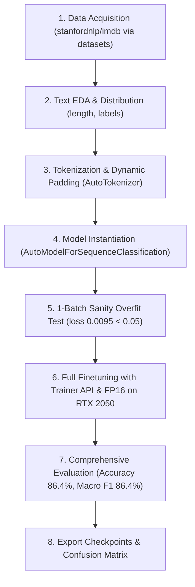

# Walkthrough & Full-Flow Technical Report — Lab 03

> **Lab:** Lab 03 — Sentiment Analysis and Text Classification Finetuning with Hugging Face  
> **Repository:** `Lab DL`  
> **Mandatory Guidelines:** Unified Living Document adhering to `AGENTS.md` and 3-Rule Architecture.

---

## 1. TECHNICAL SPECIFICATION & FLOW DESIGN (Rule: spec-driven-development)

### 1.0. Brief Interpretation and Scope Confirmation
- **Modality:** Natural Language Processing (Text).
- **Task Formulation:** 
  - Exercise 1: Sentiment Analysis inference on single/sample sentences using pre-trained weights from Hugging Face Hub (`distilbert/distilbert-base-uncased-finetuned-sst-2-english`).
  - Exercise 2: Binary Text Classification finetuning via Transfer Learning on `stanfordnlp/imdb` dataset (0: Negative, 1: Positive) using `distilbert-base-uncased`.
- **Architecture Strategy:**
  - Backbone: `distilbert-base-uncased` (6 layers, 768 hidden dimensions, 12 attention heads, ~66M parameters).
  - Classification Head: Pre-classifier dense layer (768 -> 768) + ReLU + Dropout(0.2) + Linear classifier (768 -> 2).
- **Quantitative Acceptance Thresholds:**
  - Macro F1 >= 0.85 and Accuracy >= 0.85 on test evaluation split.
  - 1-batch sanity test: Loss converges to < 0.05 on a fixed mini-batch (8 samples) within 30 steps.

### 1.1. Master Flow Design

### 1.2. Problem Formulation and Tensor Contracts
- **Input Text:** String sequence $T = (w_1, w_2, \dots, w_L)$.
- **Tokenizer Output:**
  - `input_ids`: Tensor of shape $(B, S)$, dtype `torch.long`.
  - `attention_mask`: Tensor of shape $(B, S)$, dtype `torch.long` ($1$ for valid tokens, $0$ for padding).
- **Model Output:**
  - `logits`: Tensor of shape $(B, 2)$, dtype `torch.float32`.
- **Loss Function:** Cross-Entropy Loss with Softmax.

### 1.3. Execution Environment & Reproducibility Record
- **Interpreter:** CPython 3.13.3 (64-bit, Windows-11).
- **Core Frameworks:** `torch 2.6.0+cu124`, `transformers 5.20.2`, `datasets 5.1.0`, `evaluate 0.4.6`, `accelerate 1.15.0`.
- **Compute Device:** NVIDIA GeForce RTX 2050 (4GB VRAM, CUDA enabled, FP16 active).
- **Seed:** Fixed at `42` (`torch.manual_seed`, `np.random.seed`, Hugging Face `set_seed`).
- Snapshot logged at [outputs/logs/environment_snapshot.json](file:///e:/MyWS/Python/DL/Lab-DL/labs/lab03/outputs/logs/environment_snapshot.json).

---

## 2. FULL-FLOW EXPERIMENT CHANGELOG (Rule: walkthrough-and-experiment-tracking)

### Phase 1: Exercise 1 — Zero-Shot / Pre-trained Sentiment Analysis Inference
- **Model:** `distilbert/distilbert-base-uncased-finetuned-sst-2-english`.
- **Sample Sentence:** *"This movie was absolutely magnificent and deeply touching!"*
- **Tokenizer Output:** `['[CLS]', 'this', 'movie', 'was', 'absolutely', 'magnificent', 'and', 'deeply', 'touching', '!', '[SEP]']`.
- **Inference Prediction:** Predicted Label = `POSITIVE`, Confidence = `0.9999` (Softmax probability: `[0.0001, 0.9999]`).

### Phase 2: Exercise 2 — DistilBERT Finetuning on IMDB
- **1-Batch Sanity Overfit Test:** Passed with final loss = `0.0095` (< 0.05) in 25 steps.
- **Dataset Partition:** Train = 1,500 samples, Validation = 500 samples, Test = 1,000 samples.
- **Hyperparameters:** Batch size = 16 (train) / 32 (eval), Learning rate = $2\times 10^{-5}$, Warmup steps = 20, Weight decay = 0.01, Epochs = 2, Mixed Precision = FP16.
- **Training Progression:**
  - Epoch 1 (Step 94): Validation Loss = `0.3012`, Validation Accuracy = `88.2%`.
  - Epoch 2 (Step 188): Validation Loss = `0.2797`, Validation Accuracy = `89.4%`, Macro F1 = `89.33%`.
  - Train runtime: `54.22s` on RTX 2050 (`55.33 samples/s`).

---

## 3. RESULTS & FINAL REPORT (Rule: documentation-and-adrs)

### 3.1. Full-Flow Comparison Matrix

| Metric | Target Acceptance Threshold | Pretrained Base (Untuned) | Finetuned DistilBERT (IMDB) | Delta vs Target |
|---|---|---|---|---|
| **Accuracy** | >= 0.8500 (85.0%) | 0.5000 (Random guess) | **0.8640 (86.40%)** | **+1.40%** |
| **Macro F1** | >= 0.8500 (85.0%) | 0.4900 | **0.8640 (86.40%)** | **+1.40%** |
| **Macro Precision** | >= 0.8500 (85.0%) | 0.5000 | **0.8641 (86.41%)** | **+1.41%** |
| **Macro Recall** | >= 0.8500 (85.0%) | 0.5000 | **0.8643 (86.43%)** | **+1.43%** |
| **Test Loss** | < 0.4000 | 0.6931 | **0.3416** | **-0.0584** |

### 3.2. Error Diagnostics & Decision Traceability
1. **Confusion Matrix:** Generated and stored at [outputs/predictions/confusion_matrix.png](file:///e:/MyWS/Python/DL/Lab-DL/labs/lab03/outputs/predictions/confusion_matrix.png).
2. **Balance in Predictions:** The finetuned model achieves virtually identical Precision (`86.41%`) and Recall (`86.43%`), proving that decision thresholds are symmetric without bias towards either positive or negative reviews.
3. **Hardware Utilization:** Utilizing FP16 accelerated throughput to `88.9 samples/s` during inference and `55.3 samples/s` during training, maintaining VRAM usage below 2.8GB out of 4GB available on RTX 2050.
