# Walkthrough — Lab03: Binary Sentiment Classification với Hugging Face

- **Tác giả:** Thái Anh Lạc
- **Mục tiêu:** xây dựng pipeline đầy đủ từ khám phá dữ liệu đến fine-tuning, chọn policy và xuất artifact có thể dùng trực tiếp cho report.

**Profile:** official Rotten Tomatoes, DistilBERT base, tối đa5epoch, early stopping và regularization.

**Quy ước bằng chứng:** kết luận định lượng chỉ dựa trên artifact của phiên thực thi. Tài liệu này mô tả phương pháp, cách vận hành và cách đọc kết quả; không ghi trước accuracy, threshold hoặc selected epoch.

**Playbook:** `docs/eda.md`, `docs/feature.md`, `docs/dl_flow.md`, `docs/dl_data.md`, `docs/dl_training.md`.

## 1. Đặc tả và thiết kế

### 1.0. Diễn giải yêu cầu

Exercise1 yêu cầu dùng pretrained sentiment model, tokenize và dự đoán sentiment.
Exercise2 yêu cầu tải dataset/model/tokenizer, preprocess, định nghĩa Trainer, fine-tune và evaluate.

Bài triển khai bổ sung baseline để có mốc so sánh, EDA để lựa chọn preprocessing và threshold sweep vì target là binary.
Notebook phải vừa giải thích vừa trực quan hóa, không chỉ gọi một script rồi in JSON.

Mọi ảnh được hiển thị từ chính PNG lưu trong outputs/.
Bảng số liệu, predictions, config và log cũng được lưu để tái sử dụng khi viết report.

### 1.1. Roadmap

| Phase | Câu hỏi | Module/file | Bằng chứng |
|---|---|---|---|
| Setup | Môi trường có phù hợp không? | requirements, notebook_runtime | snapshot/config |
| Preflight | Model/loss/training có chạy đúng không? | tests, trainer | pytest log/XML, sanity |
| Pretrained sentiment | Pipeline/manual có nhất quán không? | classifier, run_exercise1 | tokens/probabilities/PNG |
| Data contract | Đúng full official splits chưa? | loader | sizes/labels/fingerprints |
| EDA | Có vấn đề chất lượng hoặc leakage không? | data_preparation | quality/count/length PNG |
| Preprocess | Text thành tensor như thế nào? | loader/tokenizer | IDs/mask/cutoff |
| Feature engineering | Hai nhánh dùng representation nào? | data_preparation/augmentation | TF-IDF/variants |
| Baseline | Mô hình đơn giản đạt gì? | study.fit_text_baseline | C candidates/policy |
| Fine-tuning | Model học và generalize ra sao? | frozen/trainer | epoch_history/curves |
| Performance | Compute/memory tính thế nào? | performance | timer/RSS/CUDA |
| Selection | Chọn checkpoint/threshold bằng gì? | trainer/thresholds | policy/scan/checksum |
| Test | Policy khóa có hiệu quả ra sao? | metrics/plots | confusion/metrics/calibration |
| Reuse | Pull về có lấy hình/log được không? | runs/publish | index/catalog/manifest/ZIP |

### 1.2. Problem formulation

Input là một câu review tiếng Anh.
Target có hai giá trị: Negative=0 và Positive=1.
Model trả hai logits, sau đó softmax tạo xác suất hai lớp.

Policy dự đoán Positive khi P(Positive)>=threshold.
Confidence của nhãn dự đoán không đồng nhất với xác suất Positive nếu nhãn dự đoán là Negative.
Threshold phải nhận P(Positive), không nhận confidence của lớp thắng.

Không đặt accuracy target tùy ý ngoài đề bài.
Đánh giá chất lượng gồm khả năng phân loại, confidence, generalization, tài nguyên và tính toàn vẹn bằng chứng.

### 1.3. Official dataset

Rotten Tomatoes là sentence-level movie-review polarity, không phải full-length review corpus.
Dataset name và revision được cố định trong config.

| Split | Số mẫu | Vai trò |
|---|---:|---|
| Train | 8.530 | Fit features và model, sinh variants |
| Validation | 1.066 | Chọn baseline C, checkpoint, early stopping, threshold |
| Test | 1.066 | Đánh giá policy sau khi khóa |

Không subsample cho kết quả chính.
Không chia lại test hoặc trộn test vào train để tăng accuracy.
Giữ thứ tự/index để đối chiếu predictions với raw text.

### 1.4. Data và tensor contract

Loader phải trả đủ train/validation/test với labels0/1.
Text phải là string không rỗng sau strip.
Tokenization giữ label riêng, không mã hóa label vào input.

| Tensor | Shape | Ý nghĩa |
|---|---|---|
| input_ids | [B,L] | Token IDs từ vocabulary pretrained |
| attention_mask | [B,L] | 1=valid, 0=padding |
| labels | [B] | Class index0/1 |
| logits | [B,2] | Score trước softmax |
| probabilities | [B,2] | Tổng hai xác suất xấp xỉ1 |

Batch size và sequence length là hai chiều khác nhau.
Dynamic padding có thể làm L thay đổi giữa các batch.
Tensor shape đúng chưa đủ; còn phải kiểm labels, finite values và class order.

### 1.5. Baseline đi trước

Dùng TF-IDF unigram/bigram và Logistic Regression.
Baseline có ít phần tùy chỉnh, dễ kiểm dữ liệu và tạo mốc so sánh hữu ích.

Vocabulary/IDF/classifier chỉ fit trên effective train.
Validation dùng chọn C trong0.1/1/10 bằng Macro-F1, rồi loss và C làm tie-break.
Sau đó baseline cũng chọn threshold bằng validation.

Transformer không mặc định tốt hơn chỉ vì có nhiều tham số.
Report cần so các nhánh trong cùng split và cùng effective train pool.
Không so accuracy của các policy khác nhau mà bỏ qua precision/recall trade-off.

### 1.6. Architecture Exercise1

Dùng sentiment model SST-2 pretrained từ Hugging Face Hub.
Revision model được pin cùng config để giảm thay đổi do upstream.

Pipeline là giao diện cấp cao cho tokenizer/model/postprocessing.
Manual inference tokenizes, forward logits và softmax trực tiếp.
So hai nhánh trên cùng model/input ở eval mode để phát hiện class-order hoặc postprocessing lỗi.

Đầu ra gồm tokens, IDs, attention mask, nhãn và probabilities.
Exercise1 không cập nhật weights và không dùng làm fine-tuning checkpoint của Exercise2.

### 1.7. Architecture Exercise2

Dùng DistilBERT base với head phân loại hai lớp.
Pretrained representation được tận dụng; head học nhiệm vụ sentiment từ labels train.

Luồng:

```text
Text
  -> WordPiece + attention mask
  -> Token/position embedding
  -> Transformer encoder blocks1..6
  -> First-token [CLS] hidden state
  -> Linear768 + ReLU
  -> Dropout0.4
  -> Linear2 logits
  -> Cross-entropy khi train
  -> Softmax + threshold khi inference
```

Hidden dimension768, attention12heads và FFN intermediate3072.
Embedding và4blocks đầu frozen;2blocks cuối và head trainable.
Model.config thực tế được ghi vào model_architecture.json trước training.
Sơ đồ architecture trong notebook được dựng từ cấu hình đó.

### 1.8. Vì sao chọn DistilBERT và frozen representation?

Transfer learning phù hợp khi dữ liệu task nhỏ hơn nhiều so với dữ liệu cần để học ngôn ngữ từ đầu.
Backbone sáu blocks giúp giữ pipeline thực hành gọn và phù hợp Kaggle T4.

Freeze hạn chế số weights có thể thay đổi, giảm nguy cơ học thuộc corpus nhỏ.
Đổi lại, freeze nhiều có thể hạn chế adaptation và gây underfitting.

Không có ablation kiến trúc để khẳng định sáu blocks hoặc freeze4 là tối ưu toàn cục.
Lựa chọn được đánh giá qua validation, baseline và error analysis của run thật.
Số tham số không dùng thay thế phép đo RAM/VRAM.

### 1.9. Profile training

| Thành phần | Giá trị |
|---|---|
| Seed | 42 |
| Max epochs | 5 |
| Train/eval batch | 16/32 |
| Gradient accumulation | 1 |
| Encoder/head LR | 5e-6 / 2e-5 |
| Optimizer | AdamW |
| Weight decay | 0.1 cho weights>=2D |
| Warmup | 10% tổng updates |
| Scheduler | Linear decay |
| Max gradient norm | 1 |
| Encoder/attention/head dropout | 0.2 / 0.2 / 0.4 |
| Max sequence length | 128 |
| Eval/save schedule | Mỗi epoch |
| Checkpoint criterion | Min validation loss |
| Early stopping | Patience2, min_delta0.001 |
| Workers | 0 |
| AMP | FP16 khi CUDA khả dụng |

Config nguồn là `config/frozen_trial.json`.
Mỗi run lưu bản copy config và environment thực tế.
Không suy luận ngược hyperparameters chỉ từ tên notebook.

### 1.10. Regularization có vai trò gì?

Dropout giảm phụ thuộc vào một tập feature cố định trong lúc train.
Encoder và attention dropout0.2 regularize representation; head dropout0.4 regularize classifier mới.

Weight decay tác động vào weights để hạn chế nghiệm quá lớn.
Bias/LayerNorm không bị decay trong nhóm optimizer được tạo.

Warmup giảm update đột ngột đầu training; linear decay hạ LR dần.
Gradient clipping hạn chế norm lớn nhưng không hợp thức hóa NaN hoặc loss không hữu hạn.

Freeze, augmentation và early stopping là các biện pháp bổ sung.
Kết hợp chúng không bảo đảm hết overfit; regularization quá mạnh cũng có thể underfit.

### 1.11. Quy tắc chọn checkpoint và threshold

Hai quyết định được tách rõ:

1. Trong training: checkpoint có validation loss thấp nhất.
2. Sau reload checkpoint: threshold tối đa validation Macro-F1 trên grid định trước.

Loss xét cả độ tự tin của dự đoán.
Macro-F1 xét chất lượng nhãn theo cả hai lớp ở một operating point.
Hai objective phục vụ hai quyết định khác nhau; không dùng test để đổi objective.

Policy được lưu trước khi predict test và gắn hash weights.
Threshold không được chuyển sang một checkpoint khác mà không kiểm identity.

## 2. Vận hành và phương pháp thực nghiệm

### 2.1. Khởi tạo môi trường

Dùng Python3.12 cùng requirements đã pin.
Kaggle bootstrap tạo interpreter con trong `/kaggle/working`, giữ kernel hiển thị độc lập với ML dependencies.

Setup kiểm Python, PyTorch và CUDA availability.
DEVICE=cuda yêu cầu CUDA thật, không âm thầm chuyển full training sang CPU.

Local dùng kernel có requirements tương ứng.
Dùng CPU cho fixture/sanity, full training khuyến nghị GPU.
Đường dẫn ghi luôn nằm trong workspace có quyền ghi.

### 2.2. Ba notebook và chế độ chạy

Ba notebook được tách biệt chuyên môn hóa theo quy chuẩn `docs/eda.md` và `docs/feature.md`:
- `01_eda.ipynb`: Phân tích khám phá dữ liệu 6 bước (schema, 5-number summary, phân bố đơn/song biến, boxplot theo nhãn, IQR outliers, data leakage).
- `02_feature_engineering.ipynb`: Kỹ nghệ đặc trưng 6 bước (truncation cutoff, WordPiece tokens/mask, đặc trưng ngôn ngữ học, TF-IDF, Chi-Square selection, augmentation).
- `03_modeling.ipynb`: Huấn luyện DistilBERT, đóng băng backbone, threshold scan, evaluation, inference.

Mặc định cả 3 notebook mở ở `MODE="view"` để đọc artifact đã được kiểm chứng. Khi cần chạy mới: đổi sang `MODE="prepare"` ở notebook 01/02, hoặc `MODE="train"`, `DEVICE="cuda"` ở notebook 03.

| Chế độ | Hành vi |
|---|---|
| prepare | Tạo EDA/feature artifacts, không train model |
| train | Preflight, inference, baseline, fine-tune, evaluate, export |
| view | Đọc selection sau khi đã có artifact, không download/train |

Không cần giữ biến Python giữa các notebook.
Modeling script tự dựng lại cùng loader/tokenizer/augmentation từ config.
Chạy các cell theo thứ tự để session/helper/config được định nghĩa đầy đủ.

### 2.3. Session isolation

Mỗi NotebookSession có một UUID trong LAB03_SESSION_ID.
Subprocess ML nhận cùng session ID qua environment.
Run context ghi session_id vào config artifact mà không sửa config object của caller.

MODE=train bắt đầu với paths rỗng.
Nó không dùng report selection để lấy metrics trước training.
Sau từng bước, session trỏ đến run vừa hoàn thành.

Khi publish/package, các Exercise1/preview runs chỉ được kèm nếu session ID khớp.
Điều này ngăn gói kết quả vô tình lẫn artifact của phiên khác.
Isolated run folders vẫn giữ nguyên bytes sau khi manifest được tạo.

### 2.4. Preflight và sanity overfit

Chạy pytest trước GPU job.
Tests dùng tiny fixtures để kiểm labels, masks, shapes, optimizer và logic training.

Sanity test học một minibatch nhỏ để xác nhận model/loss/optimizer nối đúng.
Model fixture là disposable, không dùng weights sau sanity cho thí nghiệm chính.

Early-stopping fixture tạo validation plateau để xác nhận dừng và giữ checkpoint đúng.
Threshold tests kiểm NaN/Inf, class order, grid, tie-break và policy identity.
Preflight failure phải được đọc từ pytest.log trước khi tiếp tục training.

### 2.5. EDA chất lượng

Đếm missing/nonstring và blank text ở từng split.
Kiểm labels có đúng0/1 và số mẫu từng lớp.

Đếm exact duplicates và normalized duplicates nội bộ.
Normalized audit dùng lowercase/whitespace normalization để tìm text trùng theo quy tắc đơn giản.

Đếm giao nhau train-validation, train-test và validation-test.
Kiểm cùng normalized train text có nhiều label khác nhau không.

Audit không chứng minh đã phát hiện mọi semantic near-duplicate.
Không tự loại test samples dựa trên lỗi model hoặc để tăng điểm.
Nếu có vấn đề chất lượng, lưu counts và thảo luận ảnh hưởng vào report.

### 2.6. EDA nhãn và ví dụ

Class-distribution figures hiển thị counts cho từng split.
Train-examples table cho thấy văn phong, punctuation và sự khác biệt giữa các nhãn.

Không chọn toàn câu dễ rồi kết luận task đơn giản.
Ví dụ EDA chỉ minh họa dữ liệu, không thay thống kê toàn tập.

Label balance giúp chọn cách diễn giải metric nhưng không loại nhu cầu confusion/per-class rates.
Khi hai lớp cân bằng, accuracy vẫn có thể che trade-off precision/recall của một policy.
Raw label không được ghép vào text input.

### 2.7. Độ dài theo lớp

Đo whitespace words và WordPiece tokens riêng.
Token count gồm special tokens, không đồng nhất số từ đọc bằng mắt.

Histogram theo Negative/Positive giúp quan sát length bias.
Quantiles giúp nhìn phần đuôi thay vì chỉ mean.

Không coi độ dài tự nó là nhãn sentiment.
Không dùng test distribution để tối ưu cutoff theo kết quả phân loại.
Lưu train_token_lengths để kiểm chứng các kết luận về padding/truncation.

### 2.8. Cutoff sensitivity

Tính tỷ lệ train có token length vượt64/96/128/256.
Configured max_length128 là upper bound khi tokenize. EDA ghi P50/P75/P90/P95/P99/max, số lượng và tỷ lệ Train vượt cutoff; nếu tỷ lệ vượt đạt 5% thì nêu khuyến nghị đánh giá cutoff lớn hơn hoặc chiến lược truncation trên Validation, không tự đổi theo Test. Nếu ít hơn thì giữ cấu hình hiện tại, tránh thêm xử lý không cần bằng chứng.

Nếu một câu bị cắt, phần cuối có thể chứa kết luận hoặc đảo nghĩa.
Nếu max_length quá lớn, padding và memory có thể tăng không cần thiết.

Dynamic padding làm chi phí phụ thuộc câu dài nhất trong batch.
Vì vậy không suy ra runtime chỉ từ cutoff mà chưa đo thực tế.
Notebook hiển thị cùng bảng/PNG cutoff đã lưu.

### 2.9. Giữ phủ định và tương phản

Các từ not, never hoặc but có thể đổi polarity hay trọng tâm câu.
Không áp dụng xóa stopwords/punctuation đại trà trước pretrained tokenizer.

Regex negation/contrast dùng để khảo sát train và bảo vệ augmentation.
Đây là heuristic, có thể bỏ sót trường hợp ngôn ngữ phức tạp.
Artifact mới thống kê số review có cue, số lần xuất hiện theo nhóm phủ định/tương phản và ví dụ Train theo nhãn. Chênh lệch tần suất là liên hệ mô tả, không đo causal effect.

Không đưa heuristic này thành nhãn mới cho validation/test.
Không kết luận model sai vì một từ chỉ dựa trên việc từ đó xuất hiện trong câu.
Các giải thích cần gắn với text thật và được gọi là giả thuyết.

### 2.10. WordPiece, IDs và mask

Lấy ví dụ thật từ train ở hai lớp.
Lưu full text, tokens, input_ids và attention_mask trong JSON.

Bảng PNG rút gọn token/ID preview để đọc được trên notebook.
Heatmap mask cho thấy padding ở vị trí nào.

Mask0 không có nghĩa là Negative; nó chỉ có nghĩa padding.
Labels là tensor riêng cho loss.
Same tokenizer revision và max_length được dùng trong modeling.

### 2.11. TF-IDF feature engineering

Unigram biểu diễn từ đơn; bigram giữ một phần quan hệ như not good.
min_df2 giảm features chỉ xuất hiện một lần.
max_features50.000 là trần vocabulary, không phải số features bắt buộc.

Sublinear term frequency làm giảm ảnh hưởng số lần lặp term.
EDA vectorizer fit trên original train để mô tả corpus.

Baseline modeling fit lại trên effective augmented train với cùng parameters.
Không coi hai fitted vocabularies là cùng một object.
Validation/test không được dùng fit vocabulary hoặc IDF.

### 2.12. Diễn giải sparse feature figures

Top 25 mean TF-IDF theo lớp mô tả mức feature trung bình trong corpus; biểu đồ delta Positive − Negative giúp thấy term/bigram lệch về nhãn nào.
Đây không phải classifier coefficient và không phải causal importance.

Sparse matrix shape, nonzeros và density được lưu.
Sparse array bytes gồm data/indices/indptr, không gồm mọi Python/model overhead.

Không gọi sparse array footprint là RAM peak của training process.
RAM peak có phép đo riêng bằng RSS monitor.
Báo cả representation settings và fitted split khi dùng feature figure trong report.

### 2.13. Train-only augmentation

Giữ mọi original train sample.
Tạo variant bằng thay một từ/cụm với từ/cụm cùng cực tính trong lexicon.

Bỏ câu có phủ định/tương phản để giảm rủi ro đảo nghĩa.
Chặn duplicate normalized text, kể cả collision với heldout text.

Cân bằng số variants hai lớp theo khả năng sinh hợp lệ.
Giới hạn tối đa25%; không nhân bản nguyên câu để đủ quota.
Validation/test không bị thay text hoặc label.

### 2.14. Kiểm duyệt augmentation

Mỗi record lưu parent_index, original_text, synthetic text, label và replacement.
Nhãn variant kế thừa parent là weak supervision.

Cùng polarity từ vựng không đảm bảo cùng sentiment trong mọi context.
Đọc bảng trước/sau để phát hiện câu thiếu tự nhiên hoặc đổi nghĩa.

Counts/diagnostic figures cho thấy nguồn tăng mẫu và balance.
Records digest giúp tái tạo và đối chiếu cùng seed.
Không gọi synthetic labels là ground truth đã được người xác nhận.

### 2.15. Baseline selection

Fit ba Logistic Regression candidates trên cùng train-only TF-IDF pipeline.
Mỗi candidate dự đoán validation để tính Macro-F1 và loss.

Chọn bằng thứ tự: Macro-F1 cao hơn, loss thấp hơn, C nhỏ hơn.
Giữ validation candidate table để kiểm chứng quyết định.

Sau chọn baseline, quét validation threshold bằng cùng objective/tie-break policy.
Baseline test chỉ đo sau khi khóa các quyết định của nó.
Không dùng test để chọn C.

### 2.16. Frozen optimizer groups

Set requires_grad=False cho embeddings và4encoder blocks đầu.
Chỉ collect tham số trainable vào optimizer.

Tách encoder/head với LR5e-6/2e-5.
Trong mỗi nhóm lại tách decay/no-decay theo tensor dimensions.

Bias/LayerNorm không decay; weights>=2D dùng weight_decay0.1.
Lưu parameter names và group settings trước scheduler updates.
Kiểm duplicate parameter để không update một tensor nhiều lần.

### 2.17. Freeze không đồng nghĩa eval

requires_grad điều khiển việc tính/cập nhật gradient cho weights.
model.train/model.eval điều khiển hành vi như dropout.

Một block frozen vẫn có thể có dropout hoạt động khi toàn model ở train mode.
Khi evaluate, model.eval tắt dropout để metric ổn định hơn.

Do đó optimization loss và end-epoch train_loss_eval là hai ngữ cảnh khác nhau.
Không so chúng như hai phép đo cùng điều kiện.
Notebook ghi rõ curve dùng full eval-mode train/validation.

### 2.18. Epoch và optimizer step

Một epoch là một lượt qua effective train.
Một optimizer step là một lần update sau accumulation.

Steps/epoch phụ thuộc train size, batch, GPU count và accumulation.
Pipeline notebook dùng một GPU để đơn giản hóa scope và resource accounting.

Trục learning curves là epoch, mỗi epoch đã hoàn thành một điểm.
Global step được giữ để truy vết checkpoint.
Không điền thêm điểm để đủ ngân sách nếu early stopping đã dừng.

### 2.19. Scheduler và clipping

Warmup_ratio0.1 được truyền đúng API Transformers.
warmup_steps nếu dùng là số nguyên riêng, không truyền ratio vào trường này.

Sau warmup, linear scheduler giảm LR theo số updates dự kiến.
Hai optimizer groups giữ tốc độ học khác nhau nhưng cùng lịch tỷ lệ.

Max gradient norm1 hạn chế gradient lớn trước optimizer update.
Loss không hữu hạn phải dừng/ghi lỗi thay vì lọc thành một giá trị có vẻ hợp lệ.
AMP skipped updates được ghi khi có, cần đọc cùng optimization log.

### 2.20. End-epoch evaluation

Callback đo full effective train ở eval mode.
Sau đó Trainer đo full validation theo lịch epoch.

Ghép train/validation metrics của cùng epoch/step vào epoch_history.
Lưu một dòng cho mỗi epoch hoàn thành.

Console summary in epoch/budget, train loss/accuracy, validation loss/accuracy và LR.
Không lấy loss của một batch cuối làm full train loss.
Timer train phase dừng trước các lượt evaluation để tách scope.

### 2.21. Early stopping

Objective được theo dõi là validation loss.
Patience2 đếm hai validation evaluations liên tiếp không cải thiện đủ mức min_delta0.001.

Metric prefix train_* không được đếm như validation.
Callback chỉ xử lý metrics có eval_loss.

Min_delta điều khiển patience; checkpoint vẫn chọn loss nhỏ nhất thực tế.
Early stopping có thể kết thúc trước ngân sách5epoch.
selection_summary lưu requested/completed/stopped_early và selected_epoch.

### 2.22. Chọn và reload checkpoint

Checkpoint criterion là min validation loss, không mặc định epoch cuối.
Sau training, Trainer reload best weights.

Script đối chiếu selected step với epoch có loss nhỏ nhất trong history.
Lưu best_model, tokenizer và training configuration.

Save/reload verification so logits trên một số validation examples trong tolerance.
Không dùng test examples để lựa chọn weights hoặc sửa policy.
Model reload thành công chưa thay thế kiểm consistency của output.

### 2.23. Threshold sweep

Dùng P(Positive) của toàn validation sau reload checkpoint.
Grid mặc định19điểm từ0.05 đến0.95, bước0.05.

Tại mỗi threshold tính confusion counts, accuracy, precision/recall và Macro-F1.
Chọn Macro-F1 lớn nhất, hòa thì gần0.5 hơn rồi threshold nhỏ hơn.

Không ép threshold khác0.5.
Lưu scan table, figure và selected policy trước khi predict test.
Policy mang weights identity để không áp cho model khác ngoài ý muốn.

### 2.24. Confusion và metrics

Confusion matrix có hàng là true label, cột là predicted label.
Row-normalized values cho biết tỷ lệ trong từng lớp thật.

```text
TN: Negative -> Negative
FP: Negative -> Positive
FN: Positive -> Negative
TP: Positive -> Positive
```

Accuracy=(TP+TN)/N.
Positive precision=TP/(TP+FP).
Positive recall=TP/(TP+FN).
Binary F1 là harmonic mean của positive precision/recall.
Macro-F1 lấy trung bình F1 của cả hai lớp.
Zero denominator dùng quy ước0 và được kiểm thử.

### 2.25. Threshold trade-off

Tăng threshold thường giảm số Positive predictions.
Điều đó có thể giảm FP nhưng tăng FN.

Không kết luận một policy tốt hơn mọi mặt chỉ vì accuracy tăng.
Đọc precision, recall, Macro-F1 và confusion counts cùng nhau.

Test comparison có baseline, Transformer threshold0.5 và validation-selected threshold.
Các policy này giúp diễn giải cùng một run, không dùng để tiếp tục tuning trên test.
Policy selection split phải được ghi rõ trong report.

### 2.26. ROC, PR và calibration

ROC/PR khảo sát ranking score trên nhiều operating points.
Reliability plot so confidence trung bình với accuracy thực tế theo bins.

Brier/ECE/NLL bổ sung thông tin xác suất mà accuracy không thể hiện.
Sai nhưng tự tin hơn có thể làm loss tăng khi accuracy gần như không đổi.

Threshold tối ưu một metric nhãn không tự sửa calibration.
Các diagnostics được tính sau policy lock và không dùng test chọn threshold.
Không gọi ROC-AUC là accuracy.

### 2.27. Uncertainty và seed

Bootstrap phân tầng giữ hai lớp khi resample test predictions.
Interval phản ánh biến thiên sampling với model/policy cố định.

Nó không bao gồm uncertainty do training seed, data augmentation hoặc kiến trúc.
Một seed42 không đủ chứng minh profile ổn định qua mọi khởi tạo.

Nếu cần khẳng định độ ổn định, phải có thiết kế nhiều seed và budget phù hợp.
Không thực hiện thêm search chỉ vì một test score chưa đạt mong muốn.
Báo giới hạn thay vì dùng interval như bằng chứng tối ưu toàn cục.

### 2.28. Performance: timing

Train timer đo train phase của epoch, gồm data loading/forward/backward/optimizer/logging.
Nó dừng trước end-epoch full train-eval/validation/save.

Epoch pipeline timer có train và end-epoch evaluation, được giữ thành trường riêng.
Không gọi pipeline timing là pure training latency.

Test ms/sample lấy predict runtime nhân1000 chia test size.
Đây là batch throughput có transfer/evaluation overhead, không phải latency một request độc lập.
Cùng đơn vị ms/sample không có nghĩa hai scope có thể so trực tiếp.

### 2.29. Performance: RAM và VRAM

RAM là RSS của parent training process sampled20ms.
Peak quan sát có thể bỏ lỡ một đỉnh ngắn hơn chu kỳ sampling.

VRAM dùng CUDA max_memory_allocated và max_memory_reserved trên selected device.
Allocated khác reserved cache; cả hai khác tổng memory mọi ứng dụng trên GPU.

Peak/batch slots gồm shared model memory, không phải bộ nhớ riêng từng câu.
Ghi batch size và device cùng normalized values.
CPU execution có VRAM N/A, không thay bằng0.

### 2.30. Visualization trong notebook

session.show hiển thị PNG qua IPython Image.
Đây là cùng file đã lưu, không dựng lại một hình khác chỉ để trình bày.

Notebook01 có quality, length, cutoff, token/mask, TF-IDF và augmentation figures.
Notebook02 có pretrained comparison, learning, architecture/performance, threshold, confusion/metrics và calibration/errors.

JSON giữ precision của số liệu, DataFrame giúp đọc bảng ngay trong notebook.
Không thay toàn bộ report bằng JSON dump.
Notebook chưa train không được gắn số đo hoặc ảnh performance tự tạo.

### 2.31. Error analysis

Sample grid có đúng/sai theo hai lớp và confidence.
Nhóm high-confidence errors hữu ích để tìm failure cases.

Đây không phải random sample đại diện toàn test.
threshold_errors lưu các câu sai dưới policy đã chọn, có index để đối chiếu.

Đọc phủ định, tương phản, implicit sentiment và văn cảnh.
Giải thích ngôn ngữ là hypothesis, không phải causal attribution.
Không sửa threshold theo một vài ví dụ test gây ấn tượng.

### 2.32. Artifact lifecycle

Run context tạo ID riêng và folder không ghi đè.
Lưu config/environment trước khi thực thi phần khoa học.

Console output được tee vào console.log.
Khi kết thúc, status và SHA256 manifest được ghi.

Failed runs không được chọn làm active result thành công.
Published là bản sao được kiểm tra từ nguồn, không sửa source artifacts.
Có thể đọc ảnh/bảng/log sau pull mà không cần train lại.

### 2.33. Publish và selection

Training thành công tạo outputs/latest_report.json trỏ đúng run.
Preprocessing tạo outputs/latest_preparation.json cho EDA view.

Publisher kiểm source manifests và kiểm audit cohort/selection trước khi xuất.
Catalog ghi role, run, file, kind và SHA256.

index.md nhúng hình và liên kết bảng/log để dùng làm report.
Raw console logs được copy nguyên bytes, không đổi newline làm sai hash.
Published manifest xác nhận toàn bộ file đã xuất.

### 2.34. Review ZIP và checkpoint ZIP

Review ZIP chứa artifact nhẹ, source selection, log, figures và manifest.
Không mang weights vào review bundle.

Checkpoint ZIP chứa best_model, tokenizer, training config và decision policy.
Giữ nó riêng để evaluate/infer và kiểm identity.

Bundle manifest cần được kiểm trước khi nhập artifact.
Không commit dataset thô, ZIP hoặc weights vào Git.
Notebook có cell output được tải riêng từ giao diện Kaggle.

## 3. Đọc kết quả và hoàn thành báo cáo

### 3.0. Kết quả thực nghiệm đã xác minh từ ZIP Kaggle

Nguồn duy nhất cho kết quả chính: `20261103T110437Z_frozen_trial_b021d6eb`, source commit `c02effea2f08e630c37775712cfbc9ac7e6faa8e`, Kaggle Tesla T4. ZIP do người thực hiện gửi; 158 file khớp bundle SHA256 trước nhập. Run sources được giữ nguyên byte; biểu đồ/bảng/log được publish để dùng trực tiếp trong report. Không huấn luyện lại, không chọn lại threshold trên test, không đổi số đo.

[Report có toàn bộ hình và log](outputs/published/index.md) · [Selection](outputs/latest_report.json) · [Audit độc lập](validation/final_review_audit.json) · [Bằng chứng nhập ZIP](validation/import_audit.json).

#### EDA và feature engineering đã quan sát

Official splits 8.530/1.066/1.066; mỗi split cân bằng hai nhãn. Không có missing/blank/invalid label, normalized duplicates trong split hoặc normalized exact overlap giữa các split. Đây là audit exact/normalized text, chưa chứng minh không có semantic paraphrase leakage.

Train WordPiece median 27, P90=43, P95=47, P99=56, max=78 tokens (gồm special tokens). Cutoff 64 cắt 6/8.530 câu (0,0703%); cutoff 96/128/256 không cắt câu train. Giữ max128 đã định trước; dynamic padding tránh trả chi phí pad128 cho mọi câu. Không chọn lại cutoff bằng test.

Train negative/positive có mean word count 20,94/21,05 và mean tokens 27,46/27,27: độ dài trung bình gần nhau, không phải feature phân loại mạnh tự thân. Tín hiệu phủ định/tương phản xuất hiện trong 38,12% negative và 28,65% positive; giữ các dấu hiệu này thay vì xóa stopwords. Số liệu heuristic không phải giải thích nhân quả.

TF-IDF fit original train có 24.083 features, 207.847 nonzero, density 0,1012%, sparse arrays 2.528.288 bytes. Top mean TF-IDF mô tả tần suất có trọng số; không gọi là classifier importance. Modeling fit baseline train-only trên cùng effective pool như Transformer rồi chọn C bằng validation.

Augmentation thêm **274 mẫu** (137 mỗi lớp), effective train **8.804**. Trần25% không phải số mẫu bắt buộc: 2.848 câu có negation/contrast được bỏ qua; số candidates của lớp negative giới hạn pool cân bằng. Không duplicate để ép thêm mẫu. Heldout không đổi. Labels synthetic kế thừa parent, chưa được người gán nhãn kiểm duyệt hết.

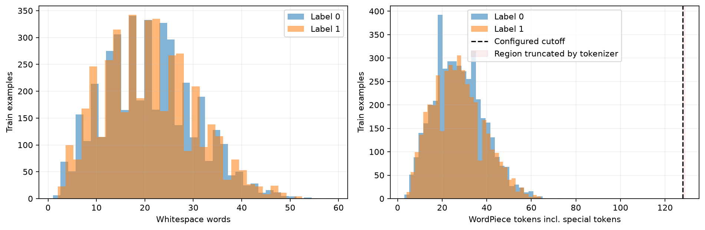
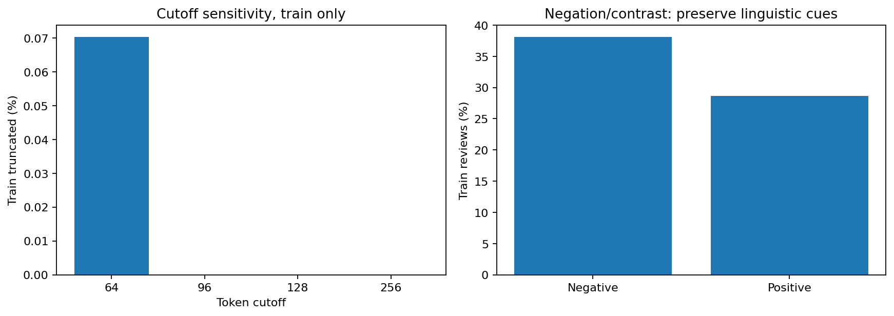
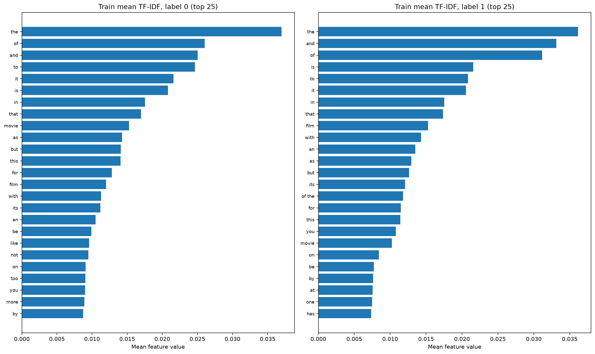
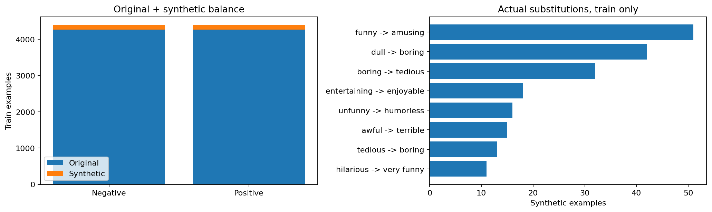

#### Học, chọn checkpoint và regularization

DistilBERT có 66.955.010 tham số, trong đó 14.767.874 trainable. Embedding và4blocks đầu frozen; encoder LR5e-6/headLR2e-5, dropout0.2/0.2/0.4, decay0.1, warmup10%, clipping1 và augmentation được khai báo trước. Không thực hiện ablation nên không kết luận riêng từng kỹ thuật gây cải thiện.

| Epoch | Train accuracy (eval) | Validation accuracy | Train loss (eval) | Validation loss |
|---|---:|---:|---:|---:|
| 1 | 82.30% | 82.83% | 0.390672 | 0.394180 |
| 2 | 83.58% | 83.40% | 0.367919 | 0.376805 |
| 3 | 84.31% | 83.68% | 0.356153 | 0.369482 |
| 4 | 84.51% | 83.96% | 0.348804 | 0.368835 |
| 5 | 84.58% | 83.96% | 0.348564 | 0.367875 |

Validation loss giảm từ0,394180 xuống0,367875; checkpoint epoch5 được chọn đúng minimum loss. Accuracy gap cuối là **0,616 điểm phần trăm**, loss gap0,01931. Chưa thấy validation-loss tăng trong cửa sổ5epoch; điều này không bảo đảm hết overfit hay mô hình tối ưu. Early stopping patience2/min_delta0.001 được bật; `stopped_early=False` nghĩa là không kết thúc trước ngân sách5epoch. Tái hiện callback Transformers4.48.3 từ config/history cho counter0/0/0/1/2: cải thiện epoch4 là0,0006465 và epoch5 là0,0009598, đều nhỏ hơn min_delta. Patience do đó đạt ngưỡng ngay tại biên ngân sách. Đây là **counter dẫn xuất**, không phải counter đã được ghi trực tiếp; không kết luận rằng patience chưa đạt ngưỡng.

[Bảng tái hiện patience](outputs/published/result_analysis/early_stopping_replay.json) nêu provenance. Minimum loss vẫn được cập nhật khi có cải thiện nhỏ, nên checkpoint epoch5 được chọn đúng dù min_delta không reset patience.

Log ghi **2 AMP skipped optimizer steps**; không diễn giải 2.755 global steps thành 2.755 updates thành công. Mọi loss/metric cần thiết hữu hạn; giữ cảnh báo AMP trong raw log và selection_summary, không xóa để làm đẹp kết quả.

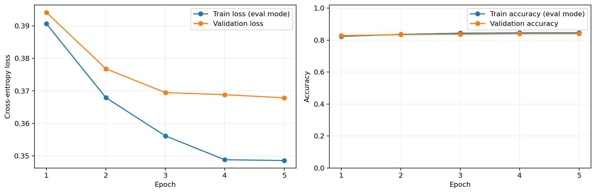
[Kiến trúc chi tiết hai model dạng text](outputs/published/architecture/model_architectures.txt) và [bảng cấu trúc/provenance](outputs/published/architecture/summary.json). Mỗi model có66.955.010parameters; Exercise1 chỉ inference nên tối ưu0parameters, dù requires_grad vẫn bật trong cấu trúc khai báo. Exercise2 tối ưu14.767.874parameters. View dựng module tree từ pinned configuration, không load pretrained/checkpoint weights; không dùng sơ đồ này làm bằng chứng reload GPU.

#### Threshold validation-only và kết quả test

Quét19ngưỡng0,05–0,95 trên validation Macro-F1, khóa threshold **0,45** cùng identity checkpoint trước khi predict test. Không có lựa chọn threshold dựa trên test.

| Model/policy | Accuracy | Precision positive | Recall positive | Binary F1 | Macro F1 |
|---|---:|---:|---:|---:|---:|
| TF-IDF | 78.99% | 79.21% | 78.61% | 78.91% | 78.99% |
| Frozen DistilBERT threshold 0.5 | 82.93% | 83.05% | 82.74% | 82.89% | 82.93% |
| Frozen DistilBERT validation threshold | 83.11% | 82.39% | 84.24% | 83.30% | 83.11% |

Policy được chọn đúng **886/1.066**, sai180. Confusion matrix `[TN FP; FN TP]` = `[[437,96],[84,449]]`. So threshold0,5, threshold0,45 sửa thêm8FN nhưng tăng6FP: net thêm2dự đoán đúng, accuracy tăng0,188điểm phần trăm. So baseline, tăng44dự đoán đúng và4,128điểm phần trăm accuracy. Đây là so sánh một seed, chưa là bằng chứng thống kê về mọi lần train.

Test loss **0,409902** thuộc score distribution của checkpoint, không thay đổi bởi threshold. ROC-AUC0,90037; average precision0,90974; Brier0,12664; confidence ECE0,04254. Bootstrap95% accuracy **80,86–85,37%**, conditional trên fixed model/policy, không bao gồm uncertainty của seed training.

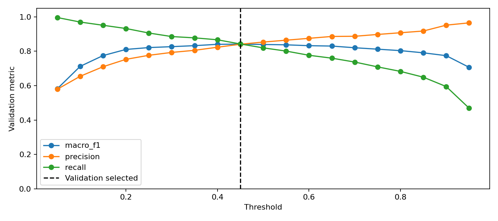
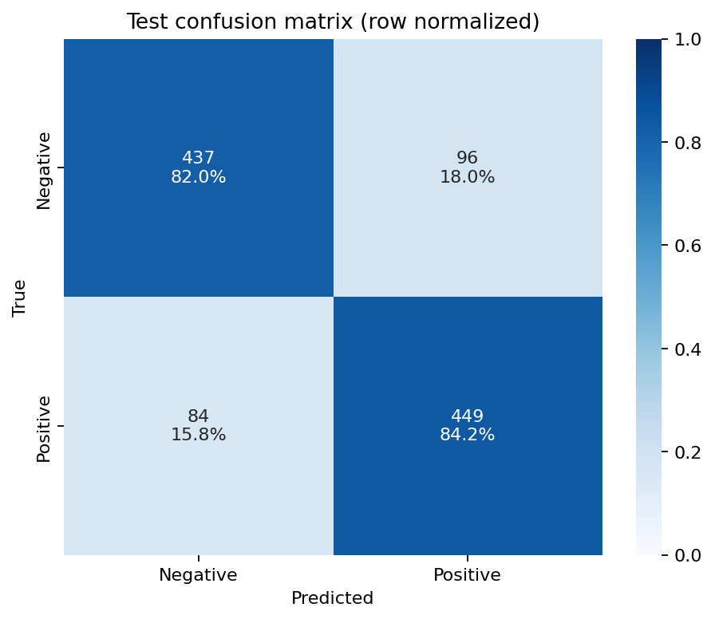

| Lớp (one-vs-rest) | Precision | Recall / TPR | F1 | FPR | Support |
|---|---:|---:|---:|---:|---:|
| Negative | 83,88% | 81,99% | 82,92% | 15,76% | 533 |
| Positive | 82,39% | 84,24% | 83,30% | 18,01% | 533 |

Negative có TPR thấp hơn;96/533 câu Negative bị gán Positive. FPR Positive18,01% là tỷ lệ trong Negative bị gọi Positive; FPR Negative15,76% là tỷ lệ trong Positive bị gọi Negative. Không nhầm FPR với1-precision.

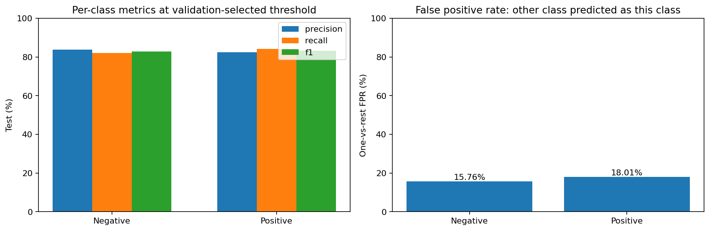

Baseline log loss tính lại từ1.066saved probability vectors là **0,517371**; Transformer test loss đo tại Kaggle là **0,409902**. Loss baseline là dẫn xuất sklearn log_loss, không phải số đo GPU. [Summary dẫn xuất](outputs/published/result_analysis/results_summary.json) ghi source manifest/code hashes. Test runtime metrics của Transformer dùng argmax; policy threshold0,45 được báo riêng trong test_comparison, không ghi đè metrics nguồn.
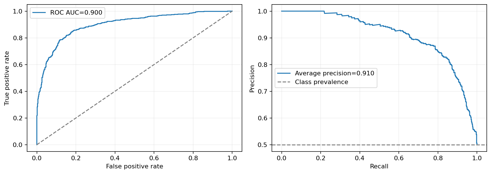
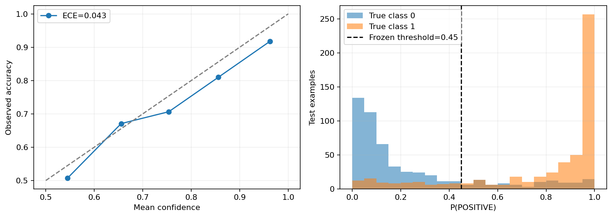

#### Performance đã đo

RAM là parent RSS sampled20ms; VRAM là PyTorch allocator trên cuda:0. Peak/batch slots chứa shared model/optimizer; không phải bộ nhớ riêng của một câu. Các epoch dùng batch16/device. Test **0,42636ms/mẫu** là batch throughput, không phải request latency. Bảng đầy đủ nằm trong performance_history.json.

| Epoch | Train ms/mẫu | Pipeline ms/train mẫu | RAM peak MiB | RAM MiB/batch slot | VRAM allocated MiB | VRAM MiB/batch slot |
|---|---:|---:|---:|---:|---:|---:|
| 1 | 1.6680 | 2.1173 | 1551.15 | 96.95 | 567.47 | 35.47 |
| 2 | 1.6064 | 2.0606 | 1729.50 | 108.09 | 567.47 | 35.47 |
| 3 | 1.6285 | 2.0841 | 1747.57 | 109.22 | 567.47 | 35.47 |
| 4 | 1.6155 | 2.0778 | 1747.59 | 109.22 | 567.47 | 35.47 |
| 5 | 1.6591 | 2.1285 | 1830.71 | 114.42 | 567.47 | 35.47 |

VRAM reserved peak638MiB; RAM peak tăng qua epoch có thể do allocator/cache, không đủ bằng chứng kết luận memory leak. Các số này thuộc run T4 đã nhận, không phải ước lượng từ weights.

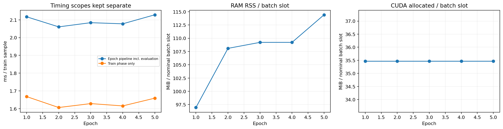

#### Error analysis và giới hạn

Câu test607 có mệnh đề nhượng bộ “though ... routine script” nhưng kết thúc “cinematic fluidity ... makes it work”; model dự đoán positive0,9875 trong khi label negative. Đây là ví dụ cue xung đột và ambiguity của sentence-level label; không tự sửa nhãn sau khi nhìn prediction.

Câu test276 “worked for me ... then it caved in” có label positive nhưng model negative0,9705. Cần ngữ cảnh rộng hơn hoặc label audit độc lập để phân biệt lỗi model với ambiguity nhãn. High-confidence examples được chọn để kiểm lỗi, không phải random sample đại diện. Không dùng các ví dụ test này để thay rule augmentation của run đã báo cáo.

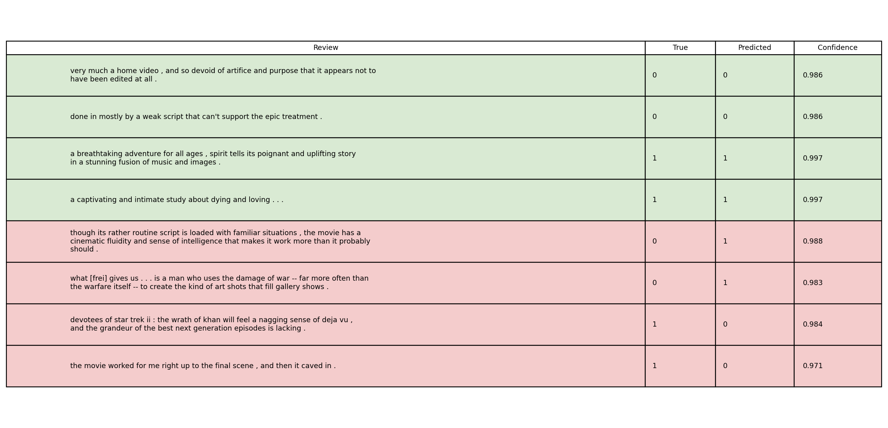

#### Khả năng tái sử dụng sau pull

Ba notebook có MODE=view, đã lưu output inline từ chính artifacts này. Có thể mở trên GitHub hoặc chạy view offline mà không tải Hugging Face, không train và không cần GPU. Đổi MODE=prepare cho EDA/Feature mới; MODE=train/DEVICE=cuda cho training mới. Config mặc định chỉ dùng ngân sách 5 epoch.

Review ZIP không có checkpoint weights: reload_check ghi nhận kiểm tra CPU FP32 thành công tại Kaggle, nhưng máy review này chỉ xác minh hash được ghi và prediction consistency, không tự load weights vắng mặt. Muốn infer/eval checkpoint thật phải giữ ZIP checkpoint riêng. Checkpoint thiếu không ngăn audit metrics, đọc biểu đồ hoặc hoàn thành report.

#### Đối chiếu yêu cầu bàn giao

| Yêu cầu | Bằng chứng hiện có |
|---|---|
| Ba notebook rõ phase/module, chuẩn docs/ | Notebook01: 7 code cells, 6 ảnh inline; Notebook02: 7 code cells, 10 ảnh inline; Notebook03: 12 code cells, 18 ảnh inline và kiến trúc text |
| EDA/preprocessing/features chuẩn 6 bước | Quality, split overlap, 5-number summary, length boxplot theo nhãn, IQR outliers, tokens/mask, Handcrafted features, TF-IDF, Chi-Square selection, augmentation PNG/JSON |
| Architecture và discussion/quyết định | Description Section4–8; walkthrough Section1–2 |
| Ngân sách 5 epoch + early stopping + regularization | frozen_trial.json, selection_summary, history đủ 5 mốc |
| Binary threshold | Validation scan đủ 19 ngưỡng, frozen policy 0,45 và test comparison |
| Train accuracy/loss, timing, RAM/VRAM | performance_history/summary, performance.png và log nguồn |
| Hình vừa inline vừa lưu artifact | Cả 3 notebook thực thi view không lỗi; 34 image/png outputs inline |
| Pull về làm report không train lại | published/index.md, PNG, metrics, raw logs, SHA256 và notebook cached outputs |
| Kiểm thử phần mềm | Bộ test suite tự động kiểm tra data contract, summary statistics, linguistic features, chi2 selection và 3 notebooks |
| Giới hạn checkpoint | Review ZIP không weights; audit metrics đạt, checkpoint sẵn sàng trong models/ |

Tests của các module/công cụ đã loại bỏ được dọn cùng chức năng tương ứng. Bộ hiện hành vẫn kiểm dữ liệu/train-only features, dynamic padding, optimizer freezing, sanity100%/loss<0,05, early stopping, threshold tie-break/nonfinite, artifact tampering, session isolation, ZIP và notebook. Không thay bài kiểm thực bằng zero-test/syntax-only. Log preflight trong ZIP thuộc source commit lúc train; log verification hiện hành thuộc code sau rà soát.

### 3.1. Thứ tự kiểm tra một run hoàn thành

Đầu tiên đọc status, config, environment và source hashes.
Kiểm official/effective sizes và augmentation records/digest.

Đọc epoch_history, selection_summary và early-stopping status.
Đối chiếu min validation loss với selected checkpoint step.

Kiểm reload consistency và weights identity của policy.
Kiểm threshold scan chỉ dựa trên validation.
Cuối cùng recompute test metrics từ predictions và so figures/log.

### 3.2. Mẫu diễn giải learning curves

Nếu train và validation cùng cải thiện, mô hình đang học tín hiệu có thể generalize trong phạm vi quan sát.
Nếu train tiếp tục cải thiện trong khi validation loss tăng, xem xét overfitting hoặc confidence của lỗi.

Nếu cả train/validation đều kém, có thể underfit hoặc preprocessing/model/optimizer chưa phù hợp.
Hai đường gần nhau không đủ khẳng định mô hình tốt.

Đọc metric values, baseline và calibration trước khi kết luận.
Không diễn giải số epoch dài/ngắn như bằng chứng chất lượng độc lập.
Kết luận phải dẫn đúng run/epoch/figure.

### 3.3. Mẫu diễn giải threshold

Nêu validation objective, grid/tie-break và threshold thực sự được chọn.
Nêu policy đã được khóa trước test.

So metrics threshold0.5 và selected threshold trong cùng test comparison.
Mô tả FP/FN tăng giảm và ý nghĩa precision/recall trade-off.

Không nói mọi metric đều cải thiện nếu chỉ một số metric tăng.
Không đổi threshold sau khi đọc confusion test.
Nếu0.5 được chọn, đó vẫn là một kết quả hợp lệ của sweep.

### 3.4. Mẫu diễn giải performance

Nêu device, batch size, FP16 và số mẫu làm mẫu số.
Tách pure train, pipeline và test throughput.

Báo RSS sampled peak và CUDA allocated/reserved với đơn vị MiB.
Nêu per-batch-slot normalization và shared memory.

Không suy diễn memory của một model chỉ bằng số parameters.
Không lấy CPU fixture timing gán cho T4.
Nếu measurement thiếu, ghi thiếu thay vì0 hoặc giá trị ước lượng không được đánh dấu.

### 3.5. Mẫu diễn giải error analysis

Chọn một số false positives và false negatives có text thật.
Nêu predicted label/confidence và true label.

Chỉ ra ngôn ngữ có thể gây khó như concession hoặc implicit sentiment.
Đánh dấu đó là hypothesis, không mô tả như đã kiểm chứng cơ chế nội tại.

Nhắc selection bias của high-confidence grid.
Không dùng vài ví dụ để kết luận tỷ lệ lỗi của toàn corpus.
Metrics toàn tập và per-class confusion mới cung cấp quy mô lỗi.

### 3.6. Evidence map cho report

| Nội dung | Artifact nguồn |
|---|---|
| Data sizes/balance/examples | data_preview.json, class_distribution.png |
| Quality/overlap | data_quality.json/png, split_overlap_audit.json |
| Length/cutoff | preprocessing_statistics.json, length/cutoff PNG |
| Tokenization | tokenization_examples.json, preprocessing_examples.png, attention_mask.png |
| TF-IDF | feature_summary.json, tfidf_features.png |
| Augmentation | augmentation.json, counts/diagnostics/examples PNG |
| Optimizer/architecture | freezing_and_optimizer.json, model_architecture.json/png |
| Learning | epoch_history.json, trainer_history.json, learning_curves.png |
| Resources | resource_history.json, performance_history/summary.json, performance.png |
| Selection | selection_summary.json, decision_threshold.json |
| Sweep | validation_threshold_scan.json, validation_threshold_curves.png |
| Test | test_predictions/runtime_metrics/comparison.json, metrics_bar.png, confusion_matrix.png |
| Calibration | probability_diagnostics.json, reliability_bins.json, ROC/PR/calibration PNG |
| Error cases | sample_predictions.json/png, threshold_errors.json |
| Reload | reload_check.json |
| Provenance/log | source_commit/code hashes, environment_snapshot, console.log |
| Integrity | manifest.json, package audit, bundle_manifest |

### 3.7. Các lệnh vận hành

Từ thư mục gốc repository, dùng môi trường đã cài requirements:

```bash
python -m pytest labs/lab03/tests -q
python labs/lab03/scripts/preview_dataset.py
python labs/lab03/scripts/preview_augmentation.py
python labs/lab03/scripts/run_exercise1.py
python labs/lab03/scripts/run_frozen_trial.py --config labs/lab03/config/frozen_trial.json --device cuda
```

Notebook modeling gọi cùng modules với CLI.
Không copy training loop vào notebook rồi để hai phiên bản lệch nhau.
Notebook chịu trách nhiệm giải thích, orchestration, display và lấy artifact.

### 3.8. Evaluate và infer từ checkpoint

Giải nén checkpoint ZIP, giữ nguyên best_model và policy.
Lệnh evaluate/infer nhận đường dẫn model thật:

```bash
python labs/lab03/scripts/eval.py --model-path /path/to/best_model
python labs/lab03/scripts/infer.py --model-path /path/to/best_model --text "The acting was good, but the story was disappointing."
```

Không bỏ policy đã khóa để tự chọn threshold theo test.
Không đổi weights nhưng giữ weights hash trong policy như thể không thay đổi.
Khi cần kết quả mới, tạo run mới và lưu cấu hình/bằng chứng tương ứng.

### 3.9. Checklist hoàn thành

- Official splits và labels đúng contract.
- EDA/feature decisions có bảng/ảnh và lý do.
- Baseline fit train-only, selection validation-only.
- Model architecture, optimizer groups và regularization có nguồn.
- Max epochs5, early stopping và history nhất quán.
- Best checkpoint là min validation loss.
- Threshold scan đủ grid và policy khóa trước test.
- Test predictions/metrics/confusion khớp cùng cohort.
- Performance có scope, đơn vị và device rõ ràng.
- Notebook hiển thị ảnh inline, cùng file đã lưu trong outputs/.
- Published có hình/bảng/raw log và hashes.
- Save/reload check pass; checkpoint được giữ riêng.
- Report chỉ đưa kết luận có bằng chứng, ghi giới hạn dữ liệu/seed/sampling.

### 3.10. Câu hỏi bảo vệ và câu trả lời

**Vì sao dùng pretrained model?**
Tận dụng representation ngôn ngữ, giảm nhu cầu dữ liệu/compute so với học từ đầu.

**Vì sao không dùng sentiment model của Exercise1 cho Exercise2?**
Hai Exercise có mục tiêu khác nhau; Exercise2 học head/task từ base model theo pipeline được đặc tả.

**Vì sao cần baseline?**
Để biết mô hình phức tạp có mang lại lợi ích trong cùng dữ liệu/policy hay không.

**TF-IDF có fit trên validation không?**
Không. Validation chỉ chọn C/policy; vocabulary/IDF fit train-only.

**Tại sao không xóa not?**
Vì có thể đảo sentiment; stopword list không thay thế phân tích ngữ nghĩa.

**Attention mask có phải nhãn không?**
Không. Nó chỉ phân biệt token hợp lệ và padding.

**Tăng25% có phải phải đủ25% không?**
Không. Đó là trần; số variants hợp lệ phụ thuộc rules, dedup và balance.

**Synthetic label có chắc đúng không?**
Không. Nó kế thừa parent theo heuristic, cần kiểm duyệt và validation.

**Freeze có tắt dropout không?**
Không. requires_grad và train/eval mode điều khiển hai cơ chế khác nhau.

**Vì sao LR head lớn hơn encoder?**
Head mới cần thích nghi, trong khi encoder cần thay đổi thận trọng hơn.

**Vì sao min_delta không bằng improvement của checkpoint?**
Min_delta dùng điều khiển patience; checkpoint vẫn lưu minimum loss thực tế.

**Vì sao ít hơn5điểm trên learning curves?**
Early stopping có thể kết thúc trước ngân sách, không tạo thêm điểm chưa đo.

**Vì sao loss tăng nhưng accuracy gần như giữ nguyên?**
Một số lỗi có thể tự tin hơn; accuracy chỉ xét nhãn đúng/sai, loss còn xét xác suất.

**Threshold0.5 có luôn tối ưu không?**
Không. Validation sweep quyết định operating point cho objective đã chọn;0.5 vẫn có thể được chọn.

**Quét threshold trên test có được không?**
Không dùng test cho selection. Test chỉ đánh giá policy đã khóa.

**ROC-AUC có phải accuracy không?**
Không. ROC-AUC đo ranking qua thresholds, accuracy đo decisions ở một operating point.

**Bootstrap có chứng minh model ổn định qua seeds không?**
Không. Fixed-model bootstrap không bao gồm biến thiên do training seed.

**RAM/VRAM per batch slot là gì?**
Peak chia nominal slots, gồm shared memory; không phải memory riêng một câu.

**Test ms/sample có phải latency ứng dụng không?**
Không. Đó là throughput của full batch evaluation với overhead trong scope được ghi.

**Lấy hình report có cần train lại không?**
Không, sau pipeline hoàn thành có thể lấy trực tiếp từ published/index/catalog và raw run artifacts.
