# EDA và feature engineering

Ảnh và log từ các run nguồn đã kiểm tra SHA256.

## data: attention_mask

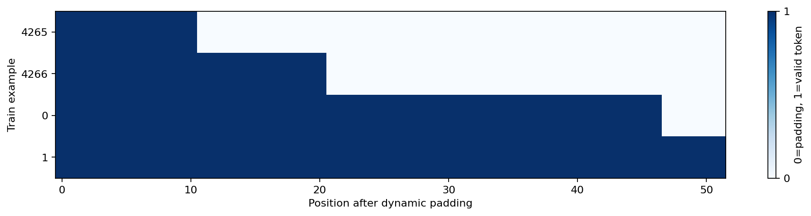

## data: class_distribution

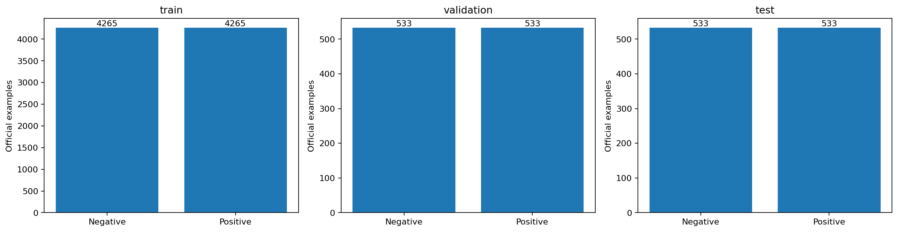

[Log data](data/console.log)

## data: data_quality

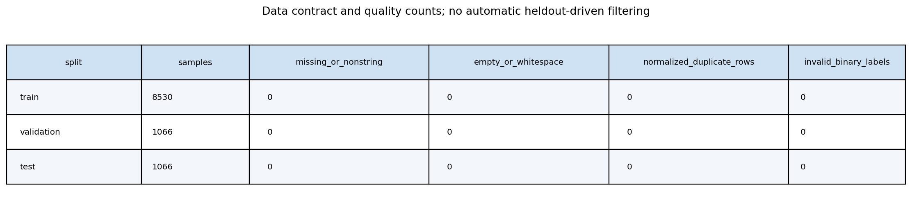

## data: lengths_by_class

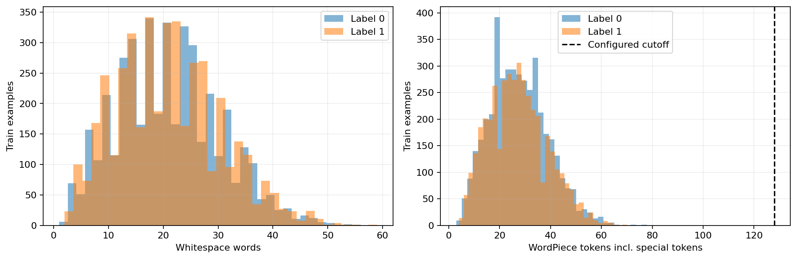

## data: preprocessing_diagnostics

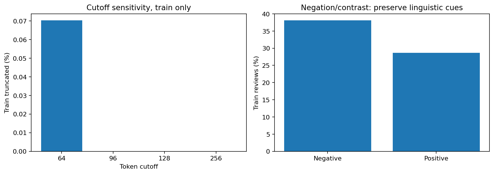

## data: preprocessing_examples

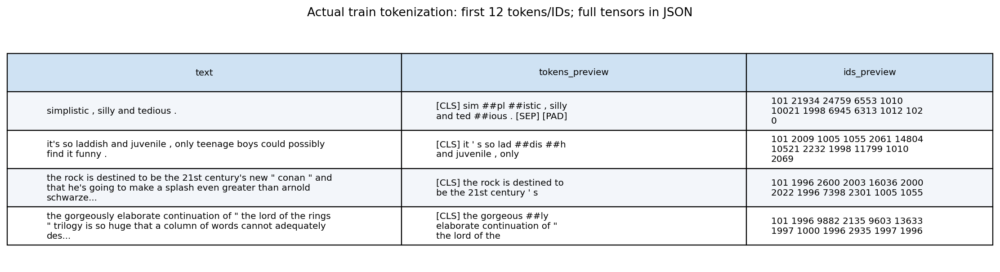

## data: tfidf_features

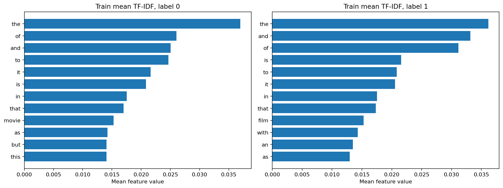

## data: token_length_distribution

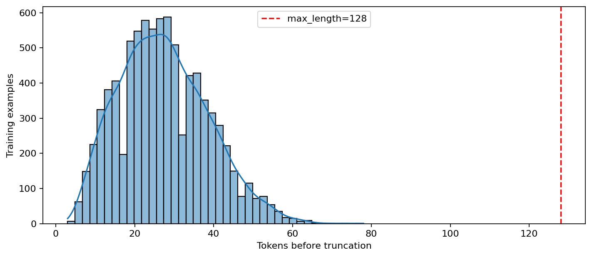

## data: train_examples

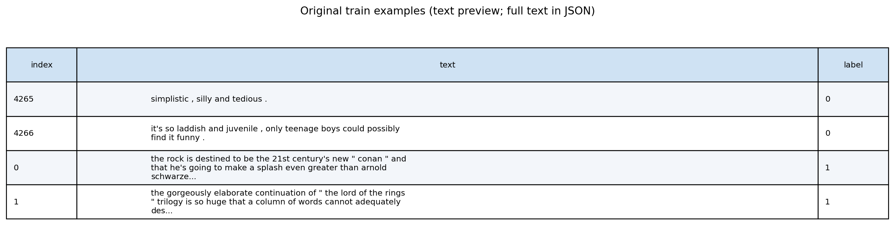

## augmentation: augmentation_counts

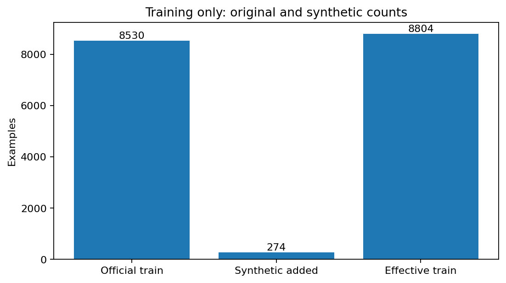

## augmentation: augmentation_diagnostics

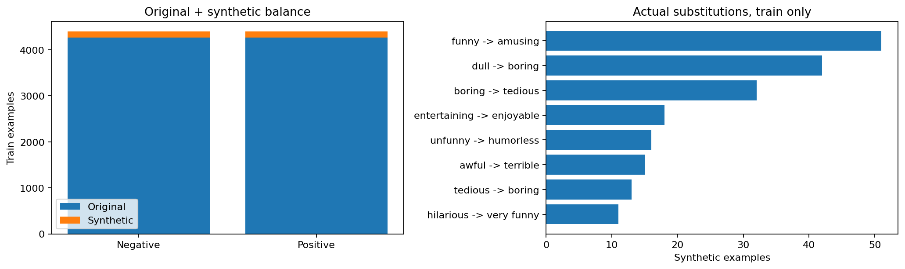

## augmentation: augmentation_examples

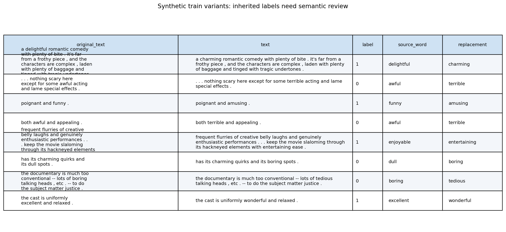

[Log augmentation](augmentation/console.log)
